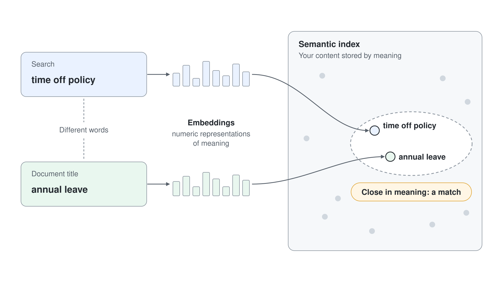

# How Agents Work

Every agent you build in this course, in Cowork, Agent Builder or Copilot Studio, works the same way: it pursues a goal in a loop, you assemble it from instructions, knowledge and tools, and a harness runs it on a model. This topic gives you that model in one pass, with the retrieval (RAG) and tool (MCP) standards underneath it and the handful of patterns teams build with. Get it right and you can diagnose any agent you meet later.

---

## From Answering to Pursuing a Goal

A plain chatbot answers one turn at a time and forgets. An agent takes a goal, breaks it into steps, and loops (plan, act, observe, adjust) until the outcome is reached, calling tools along the way. You stay in control through human-in-the-loop approvals: the agent proposes an action such as sending an email, and a person approves before it runs.

Approval works best as a rule per action, decided before the first run. Each action an agent can take falls on one of three levels:

| Level | Use it for | Example |
|---|---|---|
| Proceed | Low-risk steps you can undo, such as reading approved information | Look up the travel policy |
| Confirm | Sending a message, creating a request or updating a record | Send the summary email after the user agrees |
| Escalate | Work that needs human judgement, a formal approval or privileged access | Approve an expense above the limit |

Instructions express that line, but they don't enforce it. Sign-in, permissions, data policies and connector controls decide what the agent can actually reach.

---

## Agent, Model and Harness

Three parts shape how an agent behaves, and you write only one of them. The agent is your design: its purpose, instructions, knowledge, tools and the limits it must respect. The model generates language and makes the decision for one call, and models differ in speed, cost and how deeply they reason. The harness is the runtime around the model: it decides when to call the model, what to send with the call, how to read the reply and what happens next.

Because the harness owns that sequence, two agents with the same model and the same instructions can behave differently on different harnesses. Copilot Studio offers four harnesses, and [Agent Harnesses: Choose the Runtime](../03-agent-harnesses/readme.md) shows how to pick one before you build.

---

## What You Design: Instructions, Knowledge, Tools

| Part | What it does | Example |
|---|---|---|
| Instructions | The system prompt that sets the agent's role, tone, and rules | "You are a sales assistant. Answer only from the approved playbook." |
| Knowledge | Grounding content the agent retrieves from to answer accurately | SharePoint sites, uploaded files, Dataverse tables, Bing custom search |
| Tools | Functions the agent calls to fetch live data or take action | A REST connector, an MCP server, a Power Automate flow |

Instructions decide how the agent behaves, knowledge decides what it knows, and tools decide what it can do. Good instructions name the role, the scope, and what to do when the answer is missing ("say I don't know"), which cuts down confident wrong answers.

A weak agent is almost always thin in one of these three, and naming which one is the fastest route to a fix. When the design looks complete, check the model and the harness next.

| Symptom | Likely missing part |
|---|---|
| Confident but wrong answers | Knowledge (no grounding) or instructions (no "say I don't know") |
| Off-topic or wrong tone | Instructions (weak role and scope) |
| Cannot see current data or take action | Tools (no connector or MCP server) |
| Ignores your documents | Knowledge not indexed, or not referenced in instructions |
| Slow answers, high cost or shallow reasoning | Model (pick one that fits the work) |
| The same instructions behave differently in another agent | Harness (each runtime routes the same design its own way) |

---

## Knowledge: Semantic Index and RAG

A language model on its own only knows its training data, which is generic and frozen in time. Retrieval Augmented Generation (RAG) fetches relevant snippets from your content at question time and hands them to the model, so the answer is grounded in your documents and can cite them. The semantic index finds those snippets by meaning: a search for "time off policy" also matches a document titled "annual leave". In Microsoft 365, Copilot builds this index over your Graph content automatically.

---

## Tools: The Model Context Protocol

Knowledge lets an agent read; tools let it act on live systems, such as checking an order status or creating a ticket. The Model Context Protocol (MCP) is the open standard for exposing those tools: an MCP server describes its tools once, and any MCP-aware agent host discovers and calls them. You connect MCP servers in the Copilot Studio module; here the point is where they sit, as the tool layer every agent shares.

---

## Design Patterns

Most agent solutions are assembled from a small set of recurring patterns. You choose a pattern for the shape of the problem, and you can combine several in one solution.

| Pattern | When to use it |
|---|---|
| Single agent | One job, one set of instructions, knowledge, and tools |
| Multi-agent orchestration | A master agent routes work to focused specialists |
| Deterministic flow | The steps are fixed and must run the same way every time, so the agent gathers the inputs and calls the flow |
| Autonomous agent | A trigger fires the agent to act without a person starting it |
| Human-in-the-loop | A person approves before the agent takes a consequential action |

Single-agent design starts in Copilot Studio Basics; multi-agent orchestration, deterministic flows, and autonomous agents follow in the advanced module.

---

## Where to Go Next

1. [Agent Harnesses: Choose the Runtime](../03-agent-harnesses/readme.md): the four harnesses and how to pick one
2. [Where to Build and What It Costs](../04-where-to-build/readme.md): the surface for each pattern and how it bills
3. [Agents & Copilots for Microsoft 365](../01-agents-copilots/readme.md): revisit the vocabulary this topic builds on

---

## Links & Resources

- [What are agents in Microsoft 365 Copilot](https://learn.microsoft.com/microsoft-365/copilot/extensibility/agents-overview)
- [Write agent instructions in Copilot Studio](https://learn.microsoft.com/microsoft-copilot-studio/authoring-instructions)
- [Semantic Index for Microsoft 365 Copilot](https://learn.microsoft.com/microsoftsearch/semantic-index-for-copilot)
- [Model Context Protocol](https://modelcontextprotocol.io/)
- [Add other agents in Copilot Studio](https://learn.microsoft.com/microsoft-copilot-studio/authoring-add-other-agents)
