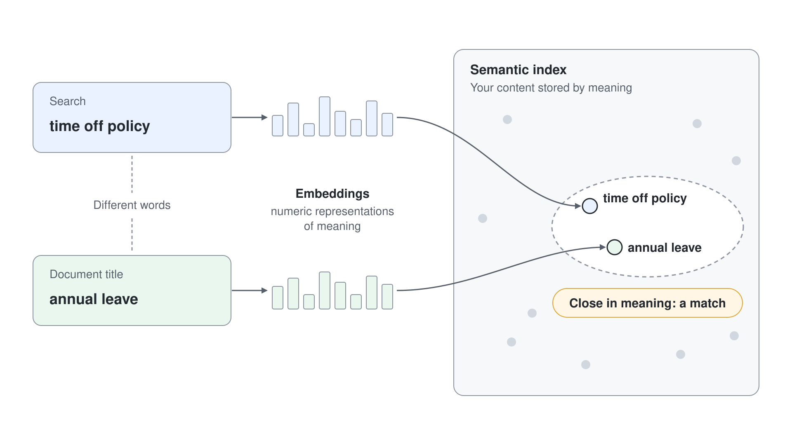
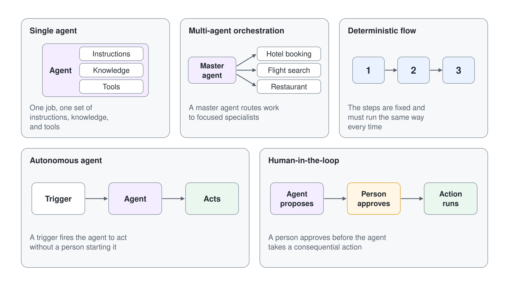

# How Agents Work

Every agent you build in this course, in Cowork, Agent Builder or Copilot Studio, works the same way: it pursues a goal in a loop, you assemble it from instructions, knowledge and tools, and a harness runs it on a model. This topic gives you that model in one pass, with the retrieval (RAG) and tool (MCP) standards underneath it and the handful of patterns teams build with. Get it right and you can diagnose any agent you meet later.

---

## From Answering to Pursuing a Goal

A plain chatbot answers one turn at a time and forgets. An agent takes a goal, breaks it into steps, and loops (plan, act, observe, adjust) until the outcome is reached, calling tools along the way. You stay in control through human-in-the-loop approvals: the agent proposes an action such as sending an email, and a person approves before it runs.

Approval works best as a rule per action, decided before the first run. Each action an agent can take falls on one of three levels:

| Level | Use it for | Example |
|---|---|---|
| Proceed | Low-risk steps you can undo, such as reading approved information | Look up the travel policy |
| Confirm | Sending a message, creating a request or updating a record | Send the summary email after the user agrees |
| Escalate | Work that needs human judgement, a formal approval or privileged access | Approve an expense above the limit |

Instructions express that line, but they don't enforce it. Sign-in, permissions, data policies and connector controls decide what the agent can actually reach.

---

## What a Harness Is

A model on its own only reasons and writes: text goes in, text comes out. It can't read your SharePoint site, call a connector, remember yesterday's conversation or save a file. A harness is the operating layer around the model that turns that reasoning into work: it decides how the model receives context, uses instructions and tools, reads the results and moves through a task to completion. Put simply, the model reasons, and the harness equips and directs it.

Everything an agent can do beyond writing text comes from its harness:

| What the harness equips the model with | What it does | Example in the HR onboarding agent |
|---|---|---|
| Context | Packs the instructions, the conversation so far and the retrieved knowledge into every call | The agent's rules and three snippets from the HR Documents site |
| Tools | Describes connectors, REST APIs and MCP servers to the model and runs the calls the model asks for | The HR MCP server's `add_employee` tool creates the employee record |
| Skills | Loads a skill, a name, a description and Markdown instructions for one task, when a request matches its purpose | A first-week checklist skill that knows the order of the onboarding steps |
| Memory | Keeps what the agent learned across turns and runs | The agent remembers that a recruiter wants the summary as a table |
| Sandbox and files | Runs code and creates or edits Word, Excel, PowerPoint and PDF files in an isolated container | The onboarding plan comes back as an Excel workbook |
| Orchestration loop | Plans the steps, checks each result and decides to continue, retry, hand over to another agent or stop | The record already exists, so the agent updates the existing record |
| Guardrails | Applies sign-in, permissions and approvals before an action runs | The record is written only after the HR manager confirms |

The model is the same in every product; the harness is what you choose. Coding agents such as GitHub Copilot and Claude Code are harnesses around a model, and Copilot Studio's Microsoft Copilot harness shares technology with GitHub Copilot. Each Copilot Studio harness equips the model with a different set of these capabilities, which is why [Agent Harnesses: Choose the Runtime](../03-agent-harnesses/readme.md) treats the harness as the first decision you make.

---

## Agent, Model and Harness

Three parts shape how an agent behaves, and you write only one of them. The agent is your design: its purpose, instructions, knowledge, tools and the limits it must respect. The model generates language and makes the decision for one call, and models differ in speed, cost and how deeply they reason. The harness is the runtime around the model: it decides when to call the model, what to send with the call, how to read the reply and what happens next.

Because the harness owns that sequence, two agents with the same model and the same instructions can behave differently on different harnesses. Copilot Studio offers four harnesses, and [Agent Harnesses: Choose the Runtime](../03-agent-harnesses/readme.md) shows how to pick one before you build.

---

## What You Design: Instructions, Knowledge, Tools

| Part | What it does | Example |
|---|---|---|
| Instructions | The system prompt that sets the agent's role, tone, and rules | "You are a sales assistant. Answer only from the approved playbook." |
| Knowledge | Grounding content the agent retrieves from to answer accurately | SharePoint sites, uploaded files, Dataverse tables, Bing custom search |
| Tools | Functions the agent calls to fetch live data or take action | A REST connector, an MCP server, a Power Automate flow |

Instructions decide how the agent behaves, knowledge decides what it knows, and tools decide what it can do. Good instructions name the role, the scope, and what to do when the answer is missing ("say I don't know"), which cuts down confident wrong answers.

A weak agent is almost always thin in one of these three, and naming which one is the fastest route to a fix. When the design looks complete, check the model and the harness next.

| Symptom | Likely missing part |
|---|---|
| Confident but wrong answers | Knowledge (no grounding) or instructions (no "say I don't know") |
| Off-topic or wrong tone | Instructions (weak role and scope) |
| Cannot see current data or take action | Tools (no connector or MCP server) |
| Ignores your documents | Knowledge not indexed, or not referenced in instructions |
| Slow answers, high cost or shallow reasoning | Model (pick one that fits the work) |
| The same instructions behave differently in another agent | Harness (each runtime routes the same design its own way) |

---

## Knowledge: Semantic Index and RAG

A language model on its own only knows its training data, which is generic and frozen in time. Retrieval Augmented Generation (RAG) fetches relevant snippets from your content at question time and hands them to the model, so the answer is grounded in your documents and can cite them. The semantic index finds those snippets by meaning: a search for "time off policy" also matches a document titled "annual leave". In Microsoft 365, Copilot builds this index over your Graph content automatically.

---

## Tools: The Model Context Protocol

Knowledge lets an agent read; tools let it act on live systems, such as checking an order status or creating a ticket. The Model Context Protocol (MCP) is the open standard for exposing those tools: an MCP server describes its tools once, and any MCP-aware agent host discovers and calls them. You connect MCP servers in the Copilot Studio module; here the point is where they sit, as the tool layer every agent shares.

---

## Work IQ: The Work Context Behind Copilot

Knowledge and tools are parts you add to an agent, but in Microsoft 365 a large share of both already exists. Work IQ is the intelligence layer that grounds Microsoft 365 Copilot and your agents in how your organization works: mail, meetings, Teams chats, OneDrive and SharePoint files, Planner plans, the people you work with, and business data from Dynamics 365 and Power Platform. Think of it as the semantic index, RAG and an MCP server built once for the whole tenant, so an agent needs no vector store or sync job of its own. It is why Copilot Chat can answer "what did we agree with the canteen supplier last week" without you attaching a file.

Microsoft groups what Work IQ offers agents into four parts:

| Part | What it gives an agent | Example |
|---|---|---|
| Context | Grounded input assembled from work data, with no retrieval pipeline to build | The latest emails and meeting notes about a delayed supplier delivery |
| Tools | The Work IQ MCP server: 10 generic verbs such as fetch, create and update, applied to mail, calendar, files, people, chats and sites | Fetch the onboarding checklist from SharePoint, then create the welcome meeting |
| Chat | A question delegated to Work IQ as a peer agent, answered with Copilot-quality reasoning | "Summarize what changed in the travel policy this quarter" |
| Workspaces | Storage inside the tenant for the intermediate results of long-running work | A draft report the agent picks up again in its next run |

Every request runs as the signed-in user, so an agent sees only what that person may see, and every tool call is logged. You meet Work IQ throughout this course: Copilot Chat and the Office apps use it built in, Cowork reaches your Microsoft 365 data through it, and Copilot Studio adds it by default to every new agent on the [Microsoft Copilot harness](../../06-cs-copilot-harness/readme.md). Inside Microsoft 365 Copilot experiences it comes with the Copilot license, while custom and third-party agents and users without that license pay per use in Copilot Credits, as [Prepare the Tenant: Licenses & Credits](../06-cost-license/readme.md) shows.

---

## Design Patterns

Most agent solutions are assembled from a small set of recurring patterns. You choose a pattern for the shape of the problem, and you can combine several in one solution.

| Pattern | When to use it |
|---|---|
| Single agent | One job, one set of instructions, knowledge, and tools |
| Multi-agent orchestration | A master agent routes work to focused specialists |
| Deterministic flow | The steps are fixed and must run the same way every time, so the agent gathers the inputs and calls the flow |
| Autonomous agent | A trigger fires the agent to act without a person starting it |
| Human-in-the-loop | A person approves before the agent takes a consequential action |

Single-agent design starts in Copilot Studio Basics; multi-agent orchestration, deterministic flows, and autonomous agents follow in the advanced module.

---

## Where to Go Next

1. [Agent Harnesses: Choose the Runtime](../03-agent-harnesses/readme.md): the four harnesses and how to pick one
2. [Where to Build and What It Costs](../04-where-to-build/readme.md): the surface for each pattern and how it bills
3. [Agents & Copilots for Microsoft 365](../01-agents-copilots/readme.md): revisit the vocabulary this topic builds on

---

## Links & Resources

- [What are agents in Microsoft 365 Copilot](https://learn.microsoft.com/microsoft-365/copilot/extensibility/agents-overview)
- [Write agent instructions in Copilot Studio](https://learn.microsoft.com/microsoft-copilot-studio/authoring-instructions)
- [Semantic Index for Microsoft 365 Copilot](https://learn.microsoft.com/microsoftsearch/semantic-index-for-copilot)
- [Model Context Protocol](https://modelcontextprotocol.io/)
- [Work IQ overview](https://learn.microsoft.com/microsoft-365/copilot/extensibility/work-iq)
- [Harnesses in Copilot Studio](https://learn.microsoft.com/microsoft-copilot-studio/harnesses-overview)
- [Compare Copilot Studio agent harnesses](https://learn.microsoft.com/microsoft-copilot-studio/guidance/choose-harness)
- [Add other agents in Copilot Studio](https://learn.microsoft.com/microsoft-copilot-studio/authoring-add-other-agents)
