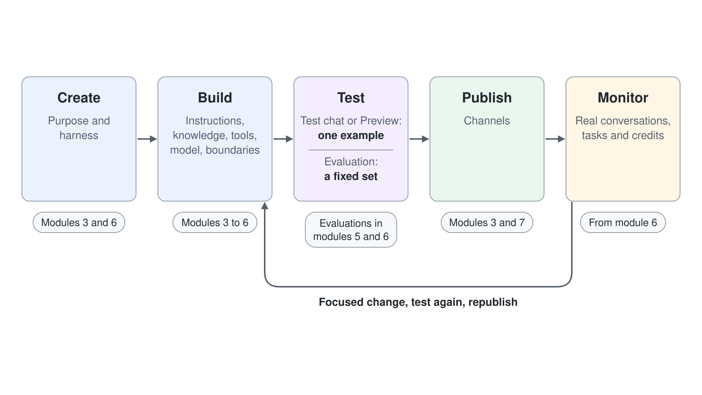

# Agent Harnesses: Choose the Runtime

Two agents can share the same model, the same instructions and the same knowledge and still behave differently, because the runtime around the model differs. Copilot Studio calls that runtime a harness, and you pick it once, when you create the agent. This topic shows what a harness decides, the four harnesses Copilot Studio offers today, how to match one to a business requirement, and the lifecycle every agent goes through on any of them. Treat it as the first architecture decision of every agent you build in this course.

---

## What a Harness Decides

[How Agents Work](../02-how-agents-work/readme.md#agent-model-and-harness) separates the agent you design from the model that reasons and the harness that coordinates them. On every turn the harness decides whether to call the model, which instructions, knowledge and history to send with the call, how to read the reply, and whether the next step is a topic, a tool, another agent or an answer. The model only produces the text or the decision for that one call.

Because the harness owns that sequence, it also fixes what an agent can do at all: follow the paths you drew or plan its own, create files, use skills, remember earlier conversations, publish to customers, and how its usage bills. That makes the choice an architecture decision, made once before you build.

### Three Ways to Pick the Next Step

| Orchestration | Harness | How the next step is chosen | Deepened in |
|---|---|---|---|
| Classic | Standard | A trigger phrase you wrote matches a topic, and the topic runs its fixed path | [Standard Agents: Create & Configure](../../03-cs-basics/01-standard-agents/readme.md#the-orchestration-setting) |
| Generative | Standard | The orchestrator reads the descriptions of your topics, tools, knowledge and agents and picks the ones that fit the request | [Generative Orchestration & Multi-Agent Routing](../../05-cs-advanced/03-multi-agent/readme.md) |
| Enhanced | GitHub Copilot | The agent breaks the goal into steps, runs one, checks the result, then continues, changes course, asks the user or stops | [The Unified Build Surface and the New Orchestrator](../../06-cs-gh-copilot/02-unified-build-and-orchestrator/readme.md) |

A Standard agent lets you choose classic or generative orchestration; a GitHub Copilot agent always plans with enhanced orchestration. A planning agent still hands fixed steps to a workflow: when a transaction must pass the same validation and approval every time, the agent gathers the inputs and calls the workflow once they are complete.

---

## Four Harnesses in Copilot Studio

Microsoft's harness overview lists four harnesses. The Learn training module on harnesses still describes three; the fourth, Customer Conversation, is in preview and appears in Copilot Studio as the **Customer Assist Agent**.

| Harness | Pick it when | What it adds | Publishes to | Billing | In this course |
|---|---|---|---|---|---|
| GitHub Copilot | The work is a multistep process whose path depends on what each step returns | Planning and recovery from failed steps, Word, Excel, PowerPoint and PDF files, skills, memory | Internal teams or external customers | Copilot Credits from the first build step | [Module 6](../../06-cs-gh-copilot/readme.md) |
| Standard | Every request must follow the paths and rules a maker defined | Topics, trigger phrases, branches, agent flows, classic or generative orchestration | Internal teams or external customers | Standard Copilot Studio licensing, no extra credits for Microsoft 365 Copilot users in Microsoft 365 | Modules [3](../../03-cs-basics/readme.md) to [5](../../05-cs-advanced/readme.md) |
| Copilot chat | Employees should get grounded answers inside the Copilot Chat they already use | Your organization's knowledge in Microsoft 365 Copilot Chat, retrieved with each user's own permissions | Internal teams | Consumption-based or included in a Microsoft 365 Copilot license | The same kind of declarative agent that [Agent Builder](../05-chat-productivity/readme.md#agent-builder) builds |
| Customer Conversation (preview) | Customers reach the agent through website chat or a phone number and need a person when it can't help | Sub-agents for focused intents, each with an escalation path to a human representative, plus skills and memory | Website chat or a phone number | Copilot Credits | Not built here; [Voice Agents](../../05-cs-advanced/06-voice/readme.md) builds voice on Standard agents |

The name GitHub Copilot harness points to technology the harness shares with GitHub Copilot. The agents run in Copilot Studio under its privacy, security and data residency commitments, and customer data isn't sent to the GitHub Copilot service.

---

## Choose Before You Build

The harness is fixed at creation. A Standard agent can't be converted into a GitHub Copilot agent or back, so changing your mind means building the agent again. Answer five questions before you open a builder:

1. Should the agent live inside Microsoft 365 Copilot Chat for employees, or be an agent of its own?
2. Who reaches it, and where: employees in Teams and Copilot, or customers on a website or a phone line?
3. Must each conversation follow paths a maker draws, or should the agent work toward a goal?
4. Does the work span several tools, files or earlier conversations, and must it recover when a step fails?
5. Which billing fits: Copilot Credits per use, or the licenses your users already hold?

When a requirement mixes answers, decide by the dominant job and the control it needs. A solution can combine several agents and workflows, but each agent runs on exactly one harness.

| Requirement | Harness | Deciding answer |
|---|---|---|
| An IT help desk that asks for the asset tag, checks the warranty date and offers exactly three return options | Standard | Fixed questions and branches a maker controls |
| A buyer's assistant that compares a quarter of supplier quotes in Excel, drafts a PowerPoint summary and asks the buyer about outliers | GitHub Copilot | Files and several steps whose order depends on the data |
| HR policy answers for employees inside Copilot Chat, from the HR SharePoint site | Copilot chat | Extends Copilot Chat; each employee sees only what they may open |
| A parcel line customers call, handing over to a dispatcher when a delivery is lost | Customer Conversation | Customers by phone, with a person behind the agent |

The more the harness decides on its own, the more the boundaries matter. Set which actions an agent may run alone, which it confirms first and which it hands to a person, as [How Agents Work](../02-how-agents-work/readme.md#from-answering-to-pursuing-a-goal) describes, before its first run.

---

## One Lifecycle on Every Harness

Every agent goes through the same five stages, whichever harness runs it: create it with a purpose, build its parts, test it, publish it, and monitor real use. What monitoring reveals (an unclear instruction, two tools that overlap, an answer without a source, a missing boundary) leads to one focused change, a new test and a new publish.

| Stage | What you do | Where this course teaches it |
|---|---|---|
| Create | Name the purpose and pick the harness | [Module 3](../../03-cs-basics/readme.md) for Standard agents, [module 6](../../06-cs-gh-copilot/readme.md) for GitHub Copilot agents |
| Build | Write instructions, add knowledge and tools, pick the model, set boundaries | Modules 3 to 6 |
| Test | Try requests in the test chat or Preview, then run an evaluation set | [Test and Evaluate Standard Agents](../../05-cs-advanced/07-evaluations/readme.md), [Test and Evaluate Copilot Studio Agents](../../06-cs-gh-copilot/07-evaluations/readme.md) |
| Publish | Release the agent to its channels | [Publishing to Teams & Copilot](../../03-cs-basics/06-publishing/readme.md), [module 7](../../07-cs-maintaining/readme.md) |
| Monitor | Review real conversations, tasks and credits | The **Monitor** tab, used from [module 6](../../06-cs-gh-copilot/readme.md) on |

A test chat shows one answer to one question. An evaluation runs a fixed set of cases, so two versions of an agent can be compared on the same evidence, and Monitor shows what real users did after the publish. The screens differ by harness: a Standard agent spreads the stages across tabs such as **Overview**, **Topics**, **Activity**, **Evaluation** and **Monitor**, while a GitHub Copilot agent groups them into **Build**, **Preview**, **Evaluate** and **Monitor**.

---

## Hands-On Demo

- [Choose the Harness in Copilot Studio](./demo-choose-the-harness.md): the presenter shows where each harness starts in Copilot Studio, reads the harness of existing agents without spending credits, and decides the harness and the control line for four Grey Logistics help desk requests.

---

## Where to Go Next

1. [Where to Build and What It Costs](../04-where-to-build/readme.md): how each harness bills, and how to cap the spend
2. [How Agents Work](../02-how-agents-work/readme.md): the agent, model and harness this topic builds on

---

## Links & Resources

- [Harnesses in Copilot Studio](https://learn.microsoft.com/microsoft-copilot-studio/harnesses-overview)
- [Compare Copilot Studio agent harnesses](https://learn.microsoft.com/microsoft-copilot-studio/guidance/choose-harness)
- [Explore Microsoft Copilot Studio and agent harnesses](https://learn.microsoft.com/training/modules/explore-copilot-studio-agent-harnesses/) (Learn training module)
- [Agents powered by the GitHub Copilot harness overview](https://learn.microsoft.com/microsoft-copilot-studio/agents-experience/overview)
- [Agents powered by the Customer Conversation harness overview](https://learn.microsoft.com/microsoft-copilot-studio/agents-experience/overview-customer-conversation)
- [Extend Microsoft Copilot with the Copilot chat harness](https://learn.microsoft.com/microsoft-copilot-studio/microsoft-365-copilot-extend-with-agents)
- [Orchestrate agent behavior with generative AI](https://learn.microsoft.com/microsoft-copilot-studio/advanced-generative-actions)
