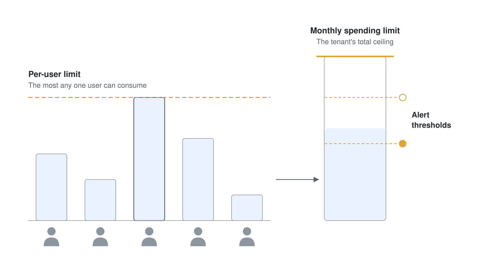

# Where to Build and What It Costs

This course builds agents on several Microsoft surfaces, and each one bills in its own way. This topic places the build paths on one effort scale so you pick the lowest-effort path that meets the need, then shows how Copilot Credits pay for what those agents do and how to cap the spend. Treat it as the map you check before you open a builder.

---

## The Build Paths

The paths trade ease of building against control. Start with the lowest-effort path that meets the need, and move up only when a real requirement (a tool call, a channel, a multi-step process) forces it.

| Path | Build effort | Best when | In this course |
|---|---|---|---|
| Agent Builder and SharePoint agents | No code | A grounded Q&A assistant over your sites and files | [Copilot Chat & Productivity Agents](../04-chat-productivity/readme.md) |
| Cowork skills and plugins | No code | A knowledge worker hands off recurring work in Microsoft 365 | [Microsoft 365 Copilot Cowork](../../02-cowork/readme.md) |
| Copilot Studio | Low code | A process agent with tools, triggers, channels, and governance | Most of the course, from [Copilot Studio Basics](../../03-cs-basics/readme.md) on |
| Pro-code (Microsoft 365 Agents Toolkit, Agents SDK, Microsoft Foundry) | Code | Your own orchestrator, models, or hosting | Out of scope |

Inside Copilot Studio, the harness you build on decides how an agent runs and how it bills. The GitHub Copilot harness reasons through multi-step business processes, the standard harness follows the topics and flows you define, and the Copilot chat harness extends Copilot Chat with your organization's knowledge.

Three building blocks serve every path. Copilot connectors bring external content into Microsoft 365, MCP servers bring tools, and a Microsoft 365 Copilot plugin packages agents, skills, connectors, and MCP server references into one installable unit that admins govern in the Microsoft 365 admin center.

---

## What It Costs: Copilot Credits

Since September 2025, Copilot Credits are the common currency for agent usage across Microsoft 365 Copilot and Copilot Studio. A Microsoft 365 Copilot license covers a lot on its own: licensed users run Copilot Studio agents in Copilot Chat, Teams, and SharePoint at zero-rated usage for classic answers, generative answers, and Graph grounding. Everything else draws Copilot Credits, from prepaid capacity packs or the Copilot Credit Pre-Purchase Plan (P3) first, then from pay-as-you-go billed to an Azure subscription.

Each billing route is set up in its own place:

| What is billed | Where you set it up | Control |
|---|---|---|
| Agents in Copilot Chat and SharePoint agents, for users without a Copilot license | Microsoft 365 admin center, **Copilot** > **Billing & usage** | A billing policy, connected to the service on the **Pay-as-you-go services** tab |
| Copilot Studio agents | Power Platform admin center, **Licensing** > **Pay-as-you-go plans** | A billing plan linked to your environments |
| Cowork, Work IQ API, and other usage-based services | Microsoft 365 admin center, **Copilot** > **Cost Management** | A spending policy that selects the service |

All three bill pay-as-you-go to an Azure subscription and resource group on which the admin holds Owner or Contributor rights.

### Spending Limits

Set the guardrails at activation, before the first bill arrives. A spending policy caps the tenant's monthly total and each user's share, and alerts fire at thresholds below the ceiling. Microsoft sets the minimum per-user limit at 2,000 credits a month, and a user who reaches the limit loses access until credits reset on the first of the month. Model realistic numbers first with the [Copilot Credit Estimator](https://aka.ms/CopilotCreditPlanningModel).

The Cowork tenant setup, step by step, is in [Setting Up Cowork in Your Tenant](../../02-cowork/01-intro/readme.md#setting-up-cowork-in-your-tenant).

---

## Where to Go Next

1. [Copilot Chat & Productivity Agents](../04-chat-productivity/readme.md): the no-code end of the scale, ready to use
2. [How Agents Work](../02-how-agents-work/readme.md): the parts you assemble on any path

---

## Links & Resources

- [Microsoft 365 Copilot extensibility](https://learn.microsoft.com/microsoft-365/copilot/extensibility/)
- [What is a Microsoft 365 Copilot plugin?](https://learn.microsoft.com/microsoft-365/copilot/extensibility/plugins-overview)
- [Harnesses in Copilot Studio](https://learn.microsoft.com/microsoft-copilot-studio/harnesses-overview)
- [Copilot connectors overview](https://learn.microsoft.com/microsoft-365/copilot/connectors/overview)
- [Usage-based billing and Copilot Credits](https://learn.microsoft.com/microsoft-365/copilot/usage-based-billing-overview-copilot-credits)
- [Copilot Studio licensing](https://learn.microsoft.com/microsoft-copilot-studio/billing-licensing)
- [Managing spending policies](https://learn.microsoft.com/microsoft-365/copilot/usage-based-billing-manage-copilot-credits)
