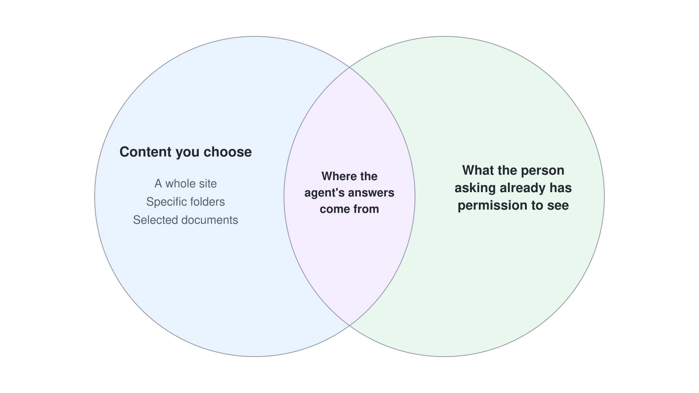

# Copilot Chat & Productivity Agents

Microsoft 365 Copilot Chat is the always-on AI you talk to in plain language to draft, summarize, and answer questions. Around it sit ready-to-use agents that need no building: Researcher, Analyst, and agents scoped to a SharePoint site. This topic gives you that baseline so you know what Copilot already does before you build anything yourself.

---

## Copilot Chat vs. Microsoft 365 Copilot

Everyone in a commercial tenant gets Copilot Chat for free, grounded in the web. Adding a Microsoft 365 Copilot license grounds the same chat in your organization's data and unlocks the deeper features.

| | Copilot Chat (free) | Microsoft 365 Copilot (licensed) |
|---|---|---|
| Grounding | Public web content | Your emails, chats, files, and meetings via Microsoft Graph |
| In-app help | Standalone chat | Embedded in Word, Excel, PowerPoint, Outlook, and Teams |
| Prebuilt agents | Limited | Researcher, Analyst, and custom agents |
| Controls | Basic | Copilot Control System and Copilot Analytics |

You reach it in the browser at [m365.cloud.microsoft](https://m365.cloud.microsoft), in the Microsoft 365 Copilot apps, and inside Teams, Outlook, and the Office apps. In the redesigned Copilot, Home brings Chat and Cowork together in one starting point; delegating whole tasks is covered in [Module 2: Cowork](../../02-cowork/readme.md).

---

## Productivity & SharePoint Agents

A Microsoft 365 Copilot license gives licensed users first-party agents with nothing to build. Researcher runs multi-step research across your work content and the web and returns a structured, source-cited report. Analyst reasons over your data to produce analysis, tables, and charts you can act on.

A SharePoint agent is an assistant scoped to the content you choose: a whole site, specific folders, or selected documents. It grounds its answers in that content and only surfaces what the person asking already has permission to see. You create one from a site or from selected files with no code, then publish it so people can chat with it in SharePoint and in Microsoft 365 Copilot.

| Scenario | Reach for |
|---|---|
| Catch up on a 40-message thread before a meeting | Copilot Chat summary |
| Cited market scan combining your files and the web | Researcher |
| Answer policy questions from a document library | SharePoint agent |

Building apps from a description is covered with [Apps in Copilot Studio](../../03-copilot-studio/04-new-experience/07-apps/readme.md), and building your own agents in [Module 3: Copilot Studio](../../03-copilot-studio/readme.md).

---

## Links & Resources

- [Microsoft 365 Copilot overview](https://learn.microsoft.com/microsoft-365/copilot/microsoft-365-copilot-overview)
- [How Copilot Chat works with and without a Microsoft 365 Copilot license](https://support.microsoft.com/en-us/microsoft-365-copilot/how-copilot-chat-works-with-and-without-a-microsoft-365-copilot-license)
- [Get started with Researcher agent](https://learn.microsoft.com/microsoft-365/copilot/researcher-agent)
- [Insights report on agents in SharePoint](https://learn.microsoft.com/sharepoint/insights-on-sharepoint-agents)
