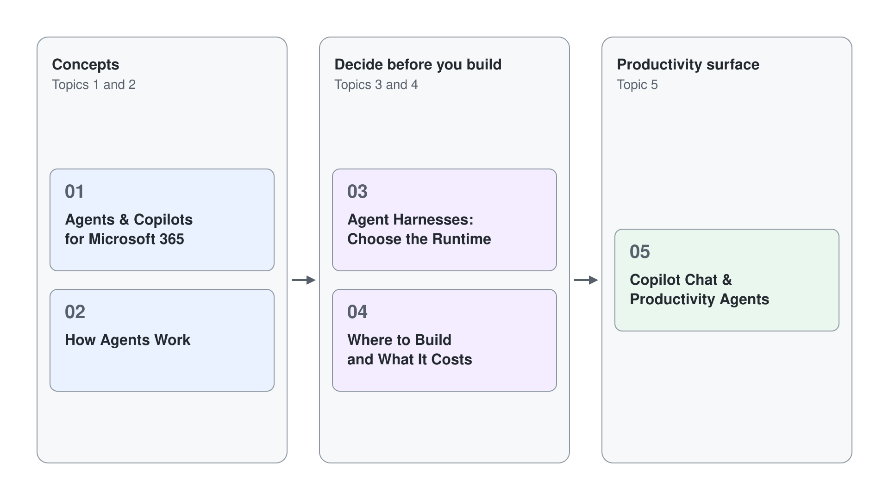

# Introduction to Copilot Cowork & Copilot Studio

This module builds the foundation for the whole course. Before you touch Copilot Studio or Cowork, you need a clear model of what agents and copilots are, how every agent works, and where to build one and what it costs. Get these three things right and everything in the later modules has somewhere to land.

It is split into four focused topics: the first two establish the concepts, the third maps the build paths and their billing, and the fourth tours the Copilot Chat productivity surface you will build on. An optional fifth topic prepares the class tenant: the licenses each module needs, where Copilot Credits come from, and the errors that mean they are missing.

## Topics

| # | Topic | What you learn |
|---|-------|----------------|
| 1 | [Agents & Copilots for Microsoft 365](./01-agents-copilots/readme.md) | The vocabulary (copilot, agent, assistant), the Copilot ecosystem map, and where agents live in Microsoft 365 |
| 2 | [How Agents Work](./02-how-agents-work/readme.md) | The agentic loop, the three parts of every agent, semantic index and RAG, tools via the Model Context Protocol, and the design patterns |
| 3 | [Where to Build and What It Costs](./03-where-to-build/readme.md) | The build paths from Agent Builder to Copilot Studio, Copilot Credits and their three billing routes, and spending limits |
| 4 | [Copilot Chat & Productivity Agents](./04-chat-productivity/readme.md) | Researcher and Analyst, SharePoint agents, and building your own agent with Agent Builder |
| 5 | [Prepare the Tenant: Licenses & Credits](./05-setup/readme.md) (optional) | The licenses per module, what a Copilot license covers, the three places credits come from, the errors that mean one is missing, and where a run's cost shows |

## Duration & Audience

This module opens a four-day, hands-on course on low-code Agentic AI with Copilot Studio and Cowork. It is written for Power Platform makers, software engineers, and solution architects building agents for Microsoft 365.

## Prerequisites

- A GitHub account
- Basic knowledge of the Microsoft 365 platform
- A Microsoft 365 tenant with Copilot, plus an Azure subscription for pay-as-you-go billing (see [Where to Build and What It Costs](./03-where-to-build/readme.md))
- Pre-class homework: [Manage email efficiently with Microsoft Outlook and Copilot Chat](https://aiskillsnavigator.microsoft.com/explore/search/module-b9259bdd701906b1bc10fd3eddc8505e6302469b923b591afaf7a03432c6fe97) on AI Skills Navigator (16 minutes)

## Links & Resources

- [Microsoft 365 Copilot](https://learn.microsoft.com/en-us/copilot/microsoft-365/)
- [Microsoft 365 Copilot Extensibility](https://learn.microsoft.com/en-us/microsoft-365-copilot/extensibility/)
- [Microsoft 365 Copilot extensibility samples](https://learn.microsoft.com/en-us/microsoft-365-copilot/extensibility/samples)
- [Microsoft 365 Copilot Sample Solution Gallery](https://adoption.microsoft.com/en-us/sample-solution-gallery/?product=Microsoft+Graph+connectors&product=Microsoft+365+Copilot)
- [Copilot Chat](https://m365.cloud.microsoft/)
- [Copilot Control System](https://admin.cloud.microsoft/?#/copilot/overview)
- [Copilot Success Kit](https://adoption.microsoft.com/en-us/copilot/success-kit/)
- [Microsoft Scenario Library](https://adoption.microsoft.com/en-us/scenario-library/)

## Additional Labs & Walkthroughs

- [Learning Path: Prepare your organization for Copilot for Microsoft 365](https://learn.microsoft.com/en-us/training/paths/prepare-your-organization-microsoft-365-copilot/)
