# Compile a Q3 Business Review Deck

Hand Cowork three files holding a quarter of raw numbers, manager notes, and last quarter's deck, then steer one brief from a visible plan to a boardroom-ready PowerPoint and a gated send to your VP.

> **Reasoning effort:** Use **Medium** (default; the picker next to the send arrow reads **Auto Medium**). Reading the workbook, the notes and last quarter's deck and building a new deck is standard document work that Medium plans and builds well. Switch to **Light** (the leftmost stop on the picker's Faster to Smarter slider) for the deck edits in Step 3 and the send in Step 4. High or Max adds wait time and Copilot Credits without a better deck here.

## Run Cost

| Token type | Tokens | Opus 5.5 (run) | Sonnet 5.5 (estimate) | Haiku 5.5 (estimate) |
| --- | --- | --- | --- | --- |
| Input | 190 | €0.00 | €0.00 | €0.00 |
| Cache write | 320K | €1.42 | €0.71 | €0.11 |
| Cache read | 15.9M | €2.83 | €2.83 | €0.65 |
| Output | 55K | €0.98 | €0.49 | €0.11 |
| **Total** | **16.3M** | **€5.23** | **€4.03** | **€0.88** |

## Related Topics

This demo puts the [Getting Started with Cowork](./readme.md) interaction model to work in its native shape: one outcome brief, a plan you review and steer while the task runs, and artefacts that land as files. The building blocks are the document and communication capabilities from the built-in [Skills](../02-built-in-skills/readme.md) catalogue, and the send in the final step runs through the approval flow covered in [Human-in-the-Loop](../06-staying-in-control/readme.md).

---

Each step follows the same pattern:

- Overview: what this step achieves
- Research / Planning / Discussion: an open prompt to reason through the problem before acting
- Finding: what to read and evaluate in the response before moving on
- Recipe: a complete implementation prompt you can use as-is or adapt from your own findings
- Expected Outcome: observable artefacts that confirm success

You play the Regional Manager for Northern Europe at Aurora Outdoor, a premium Nordic outdoor-gear retailer. Q3 has closed and your VP, Elena Varga, wants the regional review on Thursday. In Copilot chat you would drive this one question at a time; here you give Cowork the outcome and judge how it plans, works, and asks permission. That difference is what this demo teaches.

---

## Demo Files

Upload the three files from the `demo-01-quarterly-review` folder. They hold the raw quarter plus the deck you shipped three months ago.

| File                      | What it represents                                                                               |
| ------------------------- | ------------------------------------------------------------------------------------------------ |
| `q3-sales-by-region.xlsx` | Q3 revenue by country and category, with QoQ and YoY columns, plus a Targets sheet and headcount |
| `q3-regional-notes.docx`  | Your qualitative notes on what drove the numbers and what needs a decision                       |
| `q2-review.pptx`          | Last quarter's review deck: the structure, tone, and slide count the new deck should match       |



## Load the demo files

In Microsoft Copilot (copilot.cloud.microsoft), select **Cowork** in the Chat, Cowork, Code toggle at the top of the left pane, then **New task**. In the **Start a task...** box, select **+** (Add attachments) > **Upload images and files** and add all three files from the `demo-01-quarterly-review` folder; each one appears as a chip above the prompt. The task starts when you send the Step 1 prompt, and the files then show under **References** in the **Workspace** panel on the right, so every later step reads them without re-attaching. Part of the point is that you never tell Cowork which file to use for what; it has to work that out.

---

## Step 1: Brief the outcome and read the plan

**Overview:** In chat, you do the planning and the AI answers one question at a time. In Cowork, you name the outcome and it proposes the plan; your job shifts from asking good questions to judging a plan before work starts. This step delivers the brief and stops at the plan.

**Research / Planning / Discussion:**

With the three files attached, send this prompt; sending it creates the task:

```
You have last quarter's review deck, this quarter's sales workbook, and my regional notes. Before you build anything, tell me how you would approach producing the Q3 review for Northern Europe: what role each file plays, what story you see in the quarter, and what you would put on the slides.
```

**Finding:** The answer should assign each file its correct role: the Q2 deck as a structural and tonal template, the workbook as the source of figures, the notes as the narrative. It should also surface the two threads that matter, the fleece returns climbing across all four countries and the six open roles capping growth. If it treats the Q2 deck as content to update rather than a shape to follow, or plans slides straight from the spreadsheet with no story, push back now; it is cheaper to correct a plan than a deck. Expect a short list of points to settle as well, such as wording in the notes that the workbook does not support and the missing cost figure for the ask.

**Recipe:**

In the same task, send:

```
Build the Q3 FY26 business review deck for Aurora Outdoor Northern Europe. Match the structure, slide count, and tone of q2-review.pptx, take every figure from q3-sales-by-region.xlsx, and take the story and the leadership ask from q3-regional-notes.docx. Decide the slide content yourself. Show me your plan as a numbered list of steps before you create any file, and wait for my go-ahead.
```

**Expected Outcome:** A numbered plan in the task, naming which file feeds which slide and the order of work, with no `.pptx` created yet. Cowork is paused on your go-ahead, not because the action is risky but because you asked to see the plan first. The **Workspace** panel still shows only **References**, with no **Output** section yet.

---

## Step 2: Steer the plan, then let it build

**Overview:** A chat answer is final until you re-prompt; a Cowork plan is a living thing you can redirect while the task runs. Review it the way you would a colleague's outline: not "is this correct" but "will this survive the room".

**Research / Planning / Discussion:**

In the same task, send:

```
Before you start: which slide in your plan is leadership most likely to challenge, and what context from my notes would defuse it? Is there anything in the notes that your plan currently ignores?
```

**Finding:** A strong answer predicts the two hard moments: the Denmark miss reads as underperformance unless the delayed Copenhagen shipment is named, and the headcount ask invites a "why now" unless it is tied to the growth it is costing. It should also notice what its own plan dropped, such as the idea of repeating the Helsinki refit in Oslo, the healthy apparel margin, or the July heatwave behind the Trail & Hike record. If the answer is generic, name one slide yourself and ask what question Elena will interrupt it with.

**Recipe:**

In the same task, send:

```
Adjust the plan: open with the cross-region returns theme on the mid-layer fleece, keep one line for Accessories as the growth story, and close with the ask for the six open roles. Then go ahead and build the deck. Name the file "Aurora Northern Europe - Q3 Review".
```

**Expected Outcome:** Cowork works through its steps visibly: the **Workspace** panel adds a **Steps** entry, and after several minutes `Aurora Northern Europe - Q3 Review.pptx` appears under **Output** and opens in a PowerPoint preview beside the task. The deck keeps the Q2 deck's six slides, the revenue-versus-target slide matches the Targets sheet, and the closing slide carries the six-open-roles ask with a marked placeholder for the hiring cost, because none of the files gives one.

---

## Step 3: Iterate the deck in place

**Overview:** In chat, asking for changes gets you a fresh wall of text to merge yourself. In Cowork the deck is a file under **Output**, and revisions land in that same file. This step adds a talk track without ever leaving the task.

**Research / Planning / Discussion:**

```
Add speaker notes to every slide in "Aurora Northern Europe - Q3 Review": the opening line I should say, plus a one-line answer to the most likely challenge. On the ask slide, use the Helsinki flagship refit from last quarter's deck as evidence that this region delivers on what it asks for. Save the updated file in place; do not create a copy.
```

**Expected Outcome:** The same `.pptx` under **Output** now carries speaker notes on every slide, with the refit precedent on the ask slide, and Cowork confirms it saved over the file without making a copy. **Output** still lists exactly one deck, not an original plus a revision. The preview beside the task shows the slides without their notes; select **Open in PowerPoint** in the preview to read them.

---

## Step 4: Send it through the approval gate

**Overview:** Everything so far stayed inside your workspace, so Cowork never had to ask. Sending an email leaves it, and that is where the approval model from the interaction pattern stops being a diagram and shows up as a button. For the demo you stand in for Elena, so the mail goes to your own address and your tenant stays clean.

**Research / Planning / Discussion:**

In the same task, send:

```
If I ask you to email this deck, walk me through exactly what you will do and where you will stop for my approval. What risk level does sending an email carry, and why?
```

**Finding:** Cowork should describe pausing before the send with the draft, the attachment, and a risk level shown, because outbound mail leaves your workspace. If it suggests it would send directly, you have found the exact behaviour this step exists to disprove; proceed and watch it stop anyway. It may also warn that the hiring-cost placeholder and your speaker notes travel with the attached file.

**Recipe:**

In the same task, send:

```
Draft an email with "Aurora Northern Europe - Q3 Review" attached, addressed to my own email address, standing in for Elena Varga. Two short paragraphs: the first says the deck is ready for Thursday, the second gives the single most important takeaway and my headcount ask so she is not surprised in the room. Professional but not stiff. Then send it.
```

**Expected Outcome:** The send is held at a **Send draft?** card with a **Medium risk** badge, your name on the **To** line, the subject and the full body, plus **Cancel** and **Send** buttons, even though the prompt said to send it. The card does not list the attachment; the **Add attachments** step above it confirms one was added, and after you select **Send** the reply names the attached deck. The task shows **Approved 1 action** and the email lands in your own inbox with the deck attached: the full loop from brief to delivered artefact, with you in it exactly once per irreversible action.

> Approvals, risk levels, and how to steer a task mid-run are covered in [Human-in-the-Loop](../06-staying-in-control/readme.md).
