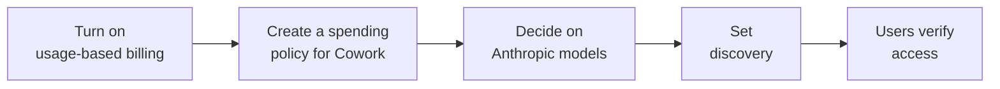

# Getting Started with Cowork

> **Availability**: Cowork is now generally available. Access is governed by usage-based billing (Copilot Credits), not by Frontier enrollment; see [Setting Up Cowork in Your Tenant](#setting-up-cowork-in-your-tenant).

Cowork is Microsoft 365's agentic AI that does work on your behalf. You describe what you need in plain language, Cowork takes the steps, and you approve before anything is sent or saved.

---

## Cowork vs. Copilot Chat

| | Copilot Chat | Cowork |
|---|---|---|
| **What it is** | Always-on AI for drafting, summarizing, and answering questions | Agentic AI that completes multi-step work across Microsoft 365 |
| **Best for** | Fast, single-task support | End-to-end work across multiple apps |
| **Speed** | Seconds to minutes | Minutes to hours (autonomous execution) |
| **Task complexity** | Single-step, single-session | Multi-step workflows across apps and data |
| **Use when…** | You need a quick draft, answer, or insight | You need Copilot to take action, not just suggest |

Think of Copilot Chat as your AI thought partner. Think of Cowork as your AI colleague who actually does the work.

Microsoft announced a new Copilot Home on September 25, 2026, where Chat and Cowork come together in one starting point. Copilot routes each request to Chat, Cowork, or Code, so you don't have to pick a mode. Home and Code roll out through the Frontier program first. Autopilot (previously Scout) is a separate cloud-hosted digital teammate with its own identity, in private preview, and it is not part of Cowork.

---

## Setting Up Cowork in Your Tenant

Before anyone can open Cowork, a tenant admin has to enable a few things. Cowork is gated by usage-based billing: a user gets Cowork when a spending policy that selects Cowork covers them. This is admin work, not maker work; if Cowork is already live in your tenant, skip to [Where to Access Cowork](#where-to-access-cowork).

### Prerequisites

| Requirement | Detail |
|---|---|
| **Copilot license** | An active Microsoft 365 Copilot license assigned to every pilot user (and to the admin account doing the setup). |
| **Admin roles** | **Global administrator** or **Billing administrator** create spending policies and set billing; **AI administrator** or **License administrator** can edit policies but not create them. |
| **Anthropic models (optional)** | An optional model family, on by default for most commercial tenants. Defaults to **No users** in the EU, EFTA, and the UK, and is currently excluded from the EU Data Boundary. Turning it off does not block access. |
| **Spending policy** | The access grant. A policy whose scope includes the user and that selects **Cowork** under **Select agents and services** gives access; a limit of one credit is enough. |
| **Modern browser** | Microsoft Edge or Google Chrome for the pilot users. Browser tasks need Microsoft Edge 152 or later. |
| **Frontier (optional)** | Needed only for the App skill and the GPT 5.5 model. |

Route the Anthropic models decision through your compliance and legal review before a broad rollout, because the family is optional and excluded from the EU Data Boundary. Start with a small pilot group and strict spending limits, then expand once you have seen real consumption.

### Enablement Steps

1. **Turn on usage-based billing.** As a Global or Billing administrator, go to **Copilot** > **Cost Management** in the [Microsoft 365 admin center](https://admin.microsoft.com) and select **Get Started**.
2. **Create a spending policy.** On the **Configuration** page, select **+ Add spending policy**. Under **Scope user and group**, choose **Specific groups** and select your pilot group. Under **Select agents and services**, select **Cowork**. Set the limits, keeping a per-user limit so one person cannot drain the whole budget, choose the billing method, and optionally assign a model profile.
3. **Decide on Anthropic models.** Under **Copilot** > **Settings** > **View All** > **AI providers operating as Microsoft subprocessors**, choose whether the Anthropic family stays on. Turning it off does not block Cowork access, because **Auto** picks from the remaining models. See [Optimize Copilot configuration settings](https://learn.microsoft.com/microsoft-365/copilot/optimize-microsoft-365-configuration-settings#recommended-copilot-tenant-settings).
4. **Set discovery.** Turn on the **AI experiences enabled by usage-based billing** setting so licensed users can find Cowork. The setting controls visibility only. If Cowork is discoverable but billing is not enabled, users can request access, and admins approve the request.
5. **Users verify access.** A pilot user opens [copilot.cloud.microsoft](https://copilot.cloud.microsoft), selects **Cowork** in the top toggle next to Chat, starts a task, approves an action when Cowork asks, and finds the task under **My tasks**.

If Cowork still does not appear, first check whether the user is in scope of a spending policy that selects Cowork. Then recheck licensing, the billing policy, and tenant enablement; rollout changes can take time to propagate.

> **Frontier vs. general availability**: Cowork first shipped through the Frontier preview with agent-based access control. That control is deprecated: settings under **Agents** > **All agents** no longer affect who can use Cowork. Access is governed by usage-based billing.

---

## Where to Access Cowork

- **Browser**: [copilot.cloud.microsoft](https://copilot.cloud.microsoft) (Microsoft Copilot; select **Cowork** in the top toggle next to Chat)
- **Outlook and Teams**: Cowork also works inside both apps.
- **Desktop**: Microsoft Copilot app for Windows and macOS
- **Mobile**: Microsoft Copilot app for iPhone and Android. Custom skills are not available on mobile.

---

## How a Typical Interaction Works

1. **Describe your task**: Use natural language. Example: *"Send a meeting recap to my team and attach the notes from today."*
2. **Watch Cowork work**: It breaks your request into steps and works through them visibly, one by one.
3. **Steer at any time**: Interrupt, add context, or redirect during execution.
4. **Approve before sensitive actions**: Before sending an email or posting in Teams, Cowork pauses and asks for your go-ahead. Risk level (medium or high) is shown on each action.
5. **Review the results**: Download documents, confirm sent messages, or ask for changes.

The approval model, risk indicators, and pause controls are covered in depth in [Human-in-the-Loop](../06-staying-in-control/readme.md).

---

## What Cowork Remembers

Cowork's memory lasts for one conversation. Microsoft's application card for Cowork describes its memory as conversation-scoped: context carries across the steps and messages of one conversation, and approval choices last for that session, but nothing carries into the next conversation. Preferences that should apply every time belong in the custom instructions on the **Customize** page or in a [custom skill](../03-custom-skills/readme.md).

Copilot Chat works differently. Copilot Memory keeps saved memories (anything you ask Copilot to remember), details inferred from your chat history, and your custom instructions. Rolling out through October 2026 (MC1492154), it also uses **work insights**: details learned from your emails, Teams chats, and meeting transcripts, so you type less context into each prompt. Learn documents Copilot Memory for Copilot Chat and still labels it preview.

| You want to | Do this |
|---|---|
| See what Copilot knows about you | Ask Copilot *"What do you know about me?"* |
| Drop one work insight | Ask Copilot to forget it |
| Delete a saved memory | **Settings** > **Personalization** > **Saved memories** > **Manage saved memories** |
| Stop using chat history and work insights | Turn off **Chat history & work insights** under **Settings** > **Personalization** |

For admins, the switch is the **Enhanced personalization** control. It is on by default, and you turn it off for the tenant or for one group through the Microsoft Graph `enhancedPersonalizationSetting` resource. Memories sit in a hidden folder of the user's mailbox and are discoverable in eDiscovery, but Purview retention policies don't apply to them, memory actions write no audit log entries, and admins can't restrict what goes into memory. Route the work insights rollout through the same privacy review as any other processing of personal data, because it infers context from mail and meeting transcripts.

---

## Choosing a Model and Reasoning Effort

| Model | Use it for |
|---|---|
| **Auto** | For most day-to-day work. |
| **GPT 5.5 (Frontier)** | Capable model for medium effort work. |
| **GPT 5.6 Sol** | Intelligent and efficient for hard work. |
| **GPT 5.6 Terra** | Balanced effort for common tasks. |
| **GPT 6 Astra** | Latest model for tough problems. |
| **Opus 5** | For complex, high stakes work. |
| **Claude Sonnet 5** | For everyday tasks and fast responses such as drafting, quick lookups, and day-to-day work. |
| **Claude Fable 5.1** | Most advanced model for ambitious work. |

**Auto** is the default, and it suits most work. Cowork picks the model for each task from the models your organization makes available, so you rarely need to change the **Model** dropdown. A model badge in the conversation shows which model produced each response.

Reasoning effort sets how hard Cowork works on a task. The five levels are **Light**, **Medium** (default), **High**, **Extra High**, and **Max**, and you select them from the dropdown next to the model picker on the web, Windows, and macOS. Higher effort is more thorough but slower, and it uses more credits.

Admins can turn off the Anthropic model family or build model profiles and assign them to spending policies; see [Human-in-the-Loop](../06-staying-in-control/readme.md).

---

## Core Capabilities

Cowork's capabilities span five areas: communication, documents, calendar, research, and automation. This is the overview; the deeper topics build on it.

### Communication
- Draft and send emails, replies, and forwards through Outlook
- Post messages in Teams channels or group chats
- Create and send HTML newsletters
- Prepare polished stakeholder communications (status updates, announcements)

### Documents & Files
- Create Word documents, Excel spreadsheets, PowerPoint presentations, and PDFs from scratch
- Edit existing documents shared in the conversation
- Edit an existing Word, Excel, or PowerPoint file in place in OneDrive or SharePoint; its version history stays available
- Find output files in the side panel **Output folder** and your OneDrive **Cowork** folder; **Download All** zips up to 50 files and 500 MB
- Create and reorganize SharePoint and OneDrive folders

### Calendar & Meetings
- Schedule meetings using natural language (*"Set up a 30-minute check-in with Alex tomorrow at 2 PM"*)
- Manage your calendar: add events, resolve conflicts, decline meetings with a reason
- Get meeting intelligence and briefings to prepare for upcoming conversations
- Start your day with a **Daily Briefing** of what's ahead

### Research
- Search across your organization for documents, messages, and people
- Perform **Deep Research** that synthesizes information from multiple sources into a report
- Browse SharePoint and OneDrive to pull in the files you need
- Run browser tasks in Microsoft Edge with your existing sign-ins (an admin must turn on browser access first)

### Automation
- Run prompts on a recurring schedule (weekly reports, daily briefings)
- Manage schedules on the **Automations** page: **Runs** shows each run, and **Manage schedules** lets you edit, pause, resume, or delete them
- Start a task when an email or a Teams message arrives

Automation is covered in detail in [Scheduled Prompts & Event-Driven Tasks](../04-automation/readme.md), and connecting external systems in [Extending Cowork with Plugins](../05-plugins/readme.md).

---

## How Cowork Gets Things Done: Skills

Behind every capability is a **skill**. As Cowork works on your task, it automatically loads the right skills and shows them in the side panel; you never pick one manually. Built-in skills cover common office tasks, and you can add your own. See [Understanding Skills](../02-built-in-skills/readme.md) for the built-in catalog and the side panel, and [Creating Custom Skills](../03-custom-skills/readme.md) for authoring your own.

---

## Practical Scenarios

| Scenario | How Cowork Handles It |
|---|---|
| **Prepare for a client meeting** | Pull the latest emails with that client, find the relevant files, create a one-page brief |
| **Summarize the week** | Gather sent emails and calendar events, generate a Word summary, send to your manager |
| **Launch a project** | Draft the kickoff email, schedule the first meeting, create a shared folder structure |
| **Clean up your inbox** | Sort emails into folders, unsubscribe from newsletters, flag items needing replies |
| **Create a status presentation** | Pull data from Excel, generate a PowerPoint, send it to stakeholders |

---

## Hands-On Demos

Put this interaction model to work end to end on the Aurora Outdoor scenario:

- [Compile a Q3 Business Review Deck](./demo-01-quarterly-review.md): turn a quarter of sales data and manager notes into a boardroom deck and a cover email to your VP.
- [Schedule a Meeting Where Your Week Has Room](./demo-02-workiq-scheduling.md): let Work IQ read your live week, have Cowork defend the best slot for a one-hour Agentic AI session, and book it through the approval gate.

---

## Where to Go Next

1. **[Understanding Skills](../02-built-in-skills/readme.md)**: the built-in catalog and the side panel that shows Cowork's work
2. **[Creating Custom Skills](../03-custom-skills/readme.md)**: teach Cowork your own recurring workflows with a `SKILL.md`
3. **[Scheduled Prompts & Event-Driven Tasks](../04-automation/readme.md)**: put recurring work on a schedule
4. **[Extending Cowork with Plugins](../05-plugins/readme.md)**: connect external systems with plugins from Discover or your own upload
5. **[Human-in-the-Loop](../06-staying-in-control/readme.md)**: approvals, risk, and governance

---

## Links & Resources

- [Cowork Overview](https://learn.microsoft.com/en-us/microsoft-365/copilot/cowork/)
- [Get Started with Cowork](https://learn.microsoft.com/en-us/microsoft-365/copilot/cowork/get-started)
- [Use Cowork](https://learn.microsoft.com/en-us/microsoft-365/copilot/cowork/use-cowork)
- [Cowork FAQ](https://learn.microsoft.com/en-us/microsoft-365/copilot/cowork/cowork-faq)
- [Choose a Model for Cowork](https://learn.microsoft.com/en-us/microsoft-365/copilot/cowork/cowork-models)
- [Cowork Application Card](https://learn.microsoft.com/en-us/microsoft-365/copilot/responsible-ai/copilot-cowork-application-card)
- [Manage Copilot Personalization and Memory](https://learn.microsoft.com/en-us/microsoft-365/copilot/copilot-personalization-memory)
- [Manage Copilot Memory in Microsoft Copilot](https://support.microsoft.com/topic/b3231eae-9e60-4b3c-ac58-81fddbe56279)
- [How Access to Cowork Is Determined](https://learn.microsoft.com/en-us/microsoft-365/copilot/cowork/cowork-access)
- [Manage Cowork for Your Organization](https://learn.microsoft.com/en-us/microsoft-365/copilot/cowork/cowork-admin-governance)
- [Managing Usage-Based Billing (Copilot Credits)](https://learn.microsoft.com/en-us/microsoft-365/copilot/usage-based-billing-manage-copilot-credits)
- [Anthropic as a Subprocessor](https://learn.microsoft.com/en-us/microsoft-365/copilot/connect-to-ai-subprocessor)
- [Copilot Camp: Cowork Setup Lab](https://microsoft.github.io/copilot-camp/pages/copilot-cowork/00-cowork-setup/)
- [Frontier Program](https://adoption.microsoft.com/en-us/copilot/frontier-program/)
