# Produce a Competitive Market Brief

Send Cowork out to research the outdoor market, hold its findings up against your own positioning document, and come back with a decision-ready brief, shipped as a PDF for leadership.

> **Reasoning effort:** Use **Medium** (default). Deep Research already does the long search and reading, so Medium is enough to compare the findings with the positioning document and write the brief. This is the most credit-intensive demo in the set, so do not raise it to High or Max. Go to **High** only if Step 2 or Step 4 comes back generic after one retry.

## Run Cost

| Token type | Tokens | Opus 5.5 (run) | Sonnet 5.5 (estimate) | Haiku 5.5 (estimate) |
| --- | --- | --- | --- | --- |
| Input | 150 | €0.00 | €0.00 | €0.00 |
| Cache write | 221K | €0.98 | €0.49 | €0.07 |
| Cache read | 9.9M | €1.76 | €1.76 | €0.39 |
| Output | 38K | €0.67 | €0.33 | €0.07 |
| **Total** | **10.2M** | **€3.41** | **€2.59** | **€0.53** |



## Related Topics

This demo runs on the Deep Research capability described in [Understanding Skills](./readme.md); watch the **Plugins** list in the **Workspace** panel to see Deep Research, Web Search, and Word activate as the task runs. The same recurring-report idea returns in [Scheduled Prompts & Event-Driven Tasks](../04-automation/readme.md) when you put a brief like this on a schedule.

---

Each step follows the same pattern:

- Overview: what this step achieves
- Research / Planning / Discussion: an open prompt to reason through the problem before acting
- Finding: what to read and evaluate in the response before moving on
- Recipe: a complete implementation prompt you can use as-is or adapt from your own findings
- Expected Outcome: observable artefacts that confirm success

You are preparing for Aurora Outdoor's AW26 brand planning. Leadership wants to know where the outdoor market is heading and where Aurora is exposed before they lock the season's strategy.

---

## Demo Files

Upload the file from the `demo-01-research-brief` folder.

| File | What it represents |
|------|--------------------|
| `internal-positioning.docx` | Aurora's confidential brand and product positioning: target segments, differentiators, and known gaps |

## Load the demo files

In Microsoft Copilot (copilot.cloud.microsoft), select **Cowork** in the toggle at the top of the left navigation (Chat, Cowork, Code) and select **New task**. In the composer, select **+** (Add attachments) > **Upload images and files** and attach `internal-positioning.docx` from the `demo-01-research-brief` folder; it shows as a Word document chip above the prompt. Attach it once with the Step 1 prompt: it stays listed under **References** in the task's **Workspace** panel, so later steps read it without attaching it again.

---

## Step 1: Research the market

**Overview:** Start on the outside: deep research on the real outdoor market, so the brief rests on current trends rather than assumptions.

**Research / Planning / Discussion:**

Send this prompt:

```
Do deep research on the European outdoor apparel and gear market for the coming season. I want the three or four trends shaping premium outdoor brands right now: sustainability claims and lifecycle transparency, the growth of trail running, direct-to-consumer versus wholesale, and repairability and circular programmes. Cite where each finding comes from and note anything a mid-premium Nordic brand should be worried about.
```

**Finding:** Deep Research runs longer than a normal answer, around four minutes, while the chat reads **Working on 1 background task**. The **Workspace** panel on the right shows one step, **Researching the European premium outdoor market**, and lists **Deep Research** and **Web Search** under **Plugins**. Cowork reads the attached positioning document first, so the closing risk list already names Aurora's own claims, such as the recycled-content shells and the two-year free repairs. A strong result names concrete trends with citations and reads as synthesis, not a link dump; if it stays vague, ask it to back each trend with a source and say why it matters commercially.

**Expected Outcome:** Four numbered market trends with the source and date in brackets after each finding, a **Sources** button under the answer, and a closing list of what a mid-premium Nordic brand should worry about, already tied to the positioning document.

---

## Step 2: Hold the research against your own positioning

**Overview:** Research only matters where it touches you. Bring the confidential positioning into the same task and let Cowork find the gaps.

**Research / Planning / Discussion:**

`internal-positioning.docx` is already under **References** from Step 1, so in the same task send:

```
Now read internal-positioning.docx. Compare Aurora's stated positioning, differentiators, and known gaps against the market trends you just researched. Where is Aurora already aligned, and where is it exposed? Be specific about the gaps we admit to in our own document.
```

**Finding:** Check that Cowork connects the two sides instead of summarising each in turn: the repairability programme aligning with the circular trend, the missing sustainability metrics as the exposure, the thin trail-running presence colliding with that segment's growth. If it produces two separate lists, ask for the single biggest exposure.

**Expected Outcome:** Within a minute, a gap analysis with a **Where Aurora is already aligned** table (positioning element, market trend it fits, why it is a strength) and a numbered **Where Aurora is exposed** list that quotes the three known gaps from the document: the missing sustainability metrics, the thin trail-running presence, and the fleece sizing returns. It closes with exposures the document does not mention and a short **What this means** that names the most urgent fix.

---

## Step 3: Write the brief

**Overview:** Turn the research and the gap analysis into a short document a leadership team can read in five minutes and act on.

**Recipe:**

In the same task, send:

```
Create a Word document titled "AW26 Market Brief - Aurora Outdoor" with these sections:
1. Executive summary: five bullets a leader can read in one minute.
2. Market trends: the trends you researched, one short paragraph each, with sources.
3. Where Aurora stands: our alignment and our exposure, drawn from the positioning document.
4. Risks to watch: the two or three gaps that most threaten AW26.
Keep it to roughly two pages and write for an executive reader.
```

**Expected Outcome:** After about six minutes, `AW26 Market Brief - Aurora Outdoor.docx` appears under **Output** in the **Workspace** panel and as a Word document chip in the chat, and **Word** joins **Deep Research** and **Web Search** under **Plugins**. The four sections fill about two pages, with a short sources list after them, and the risks trace back to Aurora's own admitted gaps.

> The recipe above assumes the trends and gaps found above. If your research surfaced different trends, structure the brief around those.

---

## Step 4: Turn insight into a recommendation

**Overview:** A brief that only describes the world is half the job; the last step forces a point of view.

**Research / Planning / Discussion:**

In the same task, send:

```
Based on the brief, what are the three moves Aurora should make for AW26, in priority order? For each, say what the move is, which risk it closes, and roughly how hard it is to do before the season. If you had to pick only one to fund, which would it be?
```

**Finding:** The answer comes back in under a minute and leaves the document alone. A useful answer commits to a priority order and a single top pick tied to a specific risk, for example checking and backing up every environmental claim in market to close the unsupported-claims risk. If the season is already on sale, Cowork may say so and read "before the season" as fixing what is live now. If it lists moves without ranking them, ask it to choose the one to fund first and defend the choice.

**Recipe:**

Then send:

```
Add a Recommendations section to the market brief with those three prioritised moves, each as a short bullet naming the move and the risk it closes. Mark your top pick. Save the updated document, then export the finished brief as a PDF with the same name for distribution to leadership.
```

**Expected Outcome:** After about two minutes, a background task named **Add recommendations and export PDF** completes and `AW26 Market Brief - Aurora Outdoor.pdf` opens in a preview pane on the right. The brief gains a **5. Recommendations** section between **Risks to watch** and the sources, with the three moves numbered in priority order and the first one marked **Top pick** with a star. Close the preview and the **Workspace** panel lists both `AW26 Market Brief - Aurora Outdoor.pdf` and the updated `.docx` under **Output**. **Plugins** still shows **Deep Research**, **Word**, and **Web Search**: no separate PDF entry appears, and the one background task both saves the Word file and exports the PDF.
