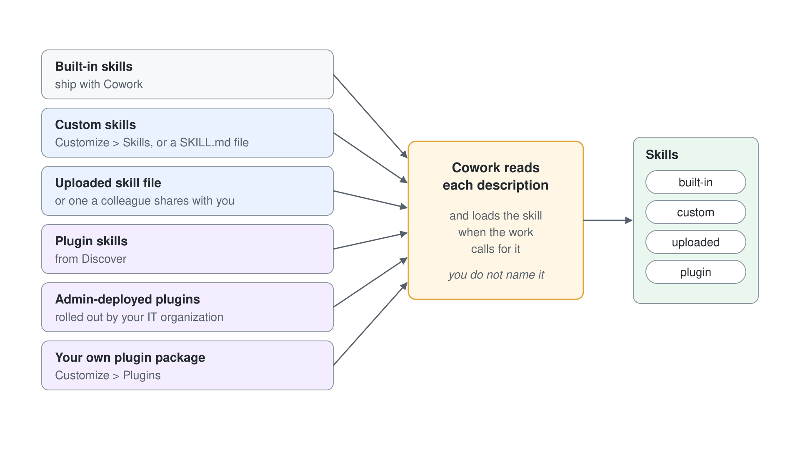

# Understanding Skills: Built-in Skills & the Side Panel

> **Generally available**: part of [Getting Started with Cowork](../01-intro/readme.md). Last checked against Microsoft Learn on 2026-10-17.

Skills are Cowork's specialized capabilities. As Cowork works on your task, it automatically loads the right skills and shows them in the **side panel**. Cowork still picks the skills itself from the task you describe, and you can narrow the set for a conversation with the **Sources** picker.

---

## Built-in Skills

These ship with Cowork and cover the most common office tasks.

| Skill | What it does |
|---|---|
| **Word** | Create and edit Word documents |
| **Excel** | Create and edit Excel spreadsheets |
| **PowerPoint** | Create and edit PowerPoint presentations |
| **PDF** | Work with PDF documents |
| **Email** | Compose, reply, forward, and send emails. Save drafts and manage attachments. |
| **Scheduling** | Schedule meetings |
| **Calendar Management** | Create events using natural language, add Teams meeting links, and manage your calendar. |
| **Meetings** | Prepare meeting intelligence. |
| **Daily Briefing** | Prepare your daily briefing. |
| **Enterprise Search** | Search across your organization. |
| **Deep Research** | Conducts in-depth research across multiple sources to compile comprehensive answers and analysis on complex topics. |
| **Communications** | Draft stakeholder communications |
| **Adaptive Cards** | Generates interactive card-based responses with structured layouts, buttons, and data displays in the conversation. |
| **App (Frontier)** | Build lightweight interactive apps from a description, then refine, open, publish, and share them. No code required. |

Cowork's built-in image-generation skill uses ChatGPT Images 2.0. When your prompt is missing detail, Cowork asks clarifying questions about orientation, style, and where you will use the image. It saves the finished image to your session and to your OneDrive output folder, and you can ask for refinements afterward.

Cowork applies your organization's brand template (fonts, colors, logos, and layouts) to every PowerPoint deck it creates.

---

## The Side Panel

While Cowork runs, the **side panel** shows where the task stands and which files and skills are involved. Open or close it with the side panel toggle in the session view.

| Section | What you see |
|---|---|
| **Progress** | A progress bar showing the percentage of tasks complete, plus a step-by-step log of what Cowork is doing. |
| **Input folder** | Files you provided as context for the session. |
| **Output folder** | Files Cowork created, each with **Download** and **Preview**. |
| **Skills** | Skills Cowork loaded during the session, shown as chips. |
| **Schedule** | Scheduled prompts, with options to edit, pause, resume, or delete them. |
| **Permissions** | Actions you approved with **don't ask again**, so you can review or revoke them. |

The **Skills** chips show how Cowork decomposes a request: each skill that lights up is one step in its plan. Watching the chips is the fastest way to see that, for example, the **Excel** skill builds a spreadsheet before the **Email** skill sends it. When a step stalls or produces the wrong output, the chips tell you which skill to steer.

---

## Where Skills Come From

Built-in skills are only the starting point. You can also:

- **Create custom skills** in **Customize** > **Skills**, or as a `SKILL.md` file in OneDrive (see [Creating Custom Skills](../03-custom-skills/readme.md))
- **Upload a skill file**, or use a skill a colleague shares with you
- **Add plugin skills** from **Discover** (see [Extending Cowork with Plugins](../05-plugins/readme.md))
- **Use admin-deployed plugins** rolled out by your IT organization
- **Upload a plugin package** of your own from **Customize** > **Plugins**

Custom skills, uploaded skills, and plugin skills all appear as chips in the same **Skills** section and activate the same way. Cowork reads each description and loads the skill when the work calls for it, so you do not invoke a skill by name.

You can narrow the set per conversation: the conversation **Sources** picker opens the **Sources & Skills** panel, where you turn plugins on or off. In **Customize** > **Skills**, **Your skills** and **Built-in** list the skills available to you.

---

## Hands-On Demo

- [Produce a Competitive Market Brief](./demo-01-research-brief.md): use Deep Research and Enterprise Search together to survey the market, compare it against Aurora's own positioning, and ship a decision-ready brief.

---

## Where to Go Next

- **[Creating Custom Skills](../03-custom-skills/readme.md)**: teach Cowork your own recurring workflows with a `SKILL.md` file
- **[Scheduled Prompts & Event-Driven Tasks](../04-automation/readme.md)**: put a skill on a recurring schedule
- **[Human-in-the-Loop](../06-staying-in-control/readme.md)**: approve, pause, and govern what your skills do

---

## Links & Resources

- [Use Cowork: Skills & Custom Skills](https://learn.microsoft.com/en-us/microsoft-365/copilot/cowork/use-cowork)
- [Cowork Overview](https://learn.microsoft.com/en-us/microsoft-365/copilot/cowork/)
- [Cowork FAQ](https://learn.microsoft.com/en-us/microsoft-365/copilot/cowork/cowork-faq)
- [Customize Cowork](https://learn.microsoft.com/en-us/microsoft-365/copilot/cowork/cowork-customize)
- [Generate Images](https://learn.microsoft.com/en-us/microsoft-365/copilot/cowork/use-cowork#generate-images)
- [Use Brand Templates with Cowork](https://learn.microsoft.com/en-us/microsoft-365/copilot/cowork/cowork-brand-templates)
