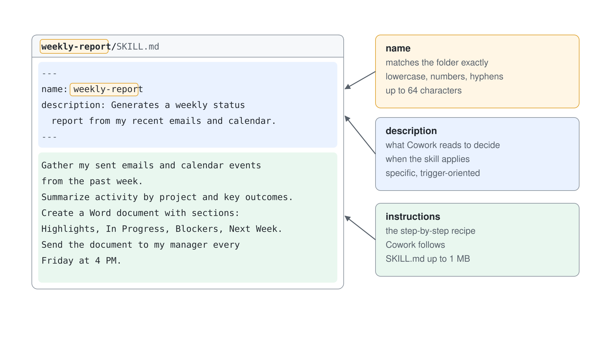
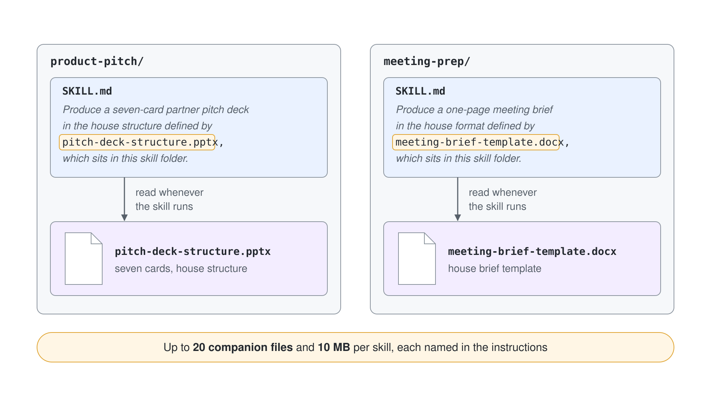
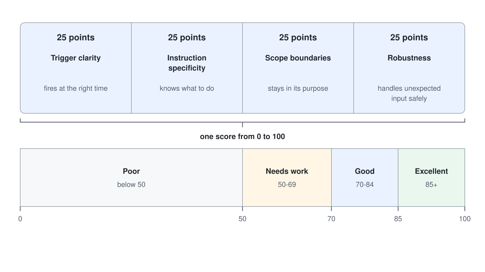
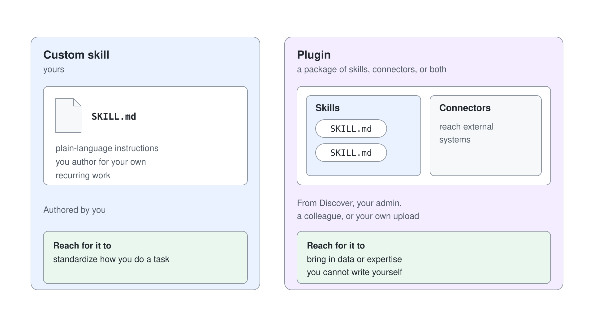

# Creating Custom Skills with SKILL.md

> **Generally available**: part of [Getting Started with Cowork](../01-intro/readme.md). Last checked against Microsoft Learn on 2026-10-17.

[Built-in skills](../02-built-in-skills/readme.md) cover the common office tasks. Custom skills teach Cowork how to handle *your* specific recurring work. You write the instructions in plain language and Cowork saves them to OneDrive; no coding required. Cowork discovers them automatically and reuses them by name, so you never re-explain the same format twice.

---

## Three Ways to Create Custom Skills

Pick the path that fits your work. Each one ends as a `SKILL.md` in its own folder under `Documents/Cowork/Skills/`.

| Path | How it works |
| --- | --- |
| Guided flow | Select **Customize** > **Add** > **Create skill with Cowork**. Cowork starts a guided conversation and saves the result. |
| Ask in chat | Describe the task you repeat and ask Cowork to build a skill for it. |
| Write it yourself | Place a `SKILL.md` file inside a subfolder of your OneDrive, as shown below. |

For the hand-written path, the folder looks like this:

```text
OneDrive/
  Documents/
    Cowork/
      Skills/
        weekly-report/
          SKILL.md
        meeting-prep/
          SKILL.md
```

Cowork **automatically discovers** your custom skills at the start of each conversation. You can create up to **50 custom skills**. Because discovery happens per conversation, a skill you just added shows up in the next new task, while a task you already have open keeps the skill list it started with. A skill written straight into OneDrive can take several minutes to sync: reload **Customize** until it appears under **Added**, or type `/` in a new task and look under **Custom skills** on the **Skills** tab.



---

## Uploading and Sharing Skills

To add a skill someone else wrote, select **Customize** > **Add** > **Upload**. The **Upload a skill or plugin** dialog closes as soon as you pick the file, the skill appears under **Added**, and Cowork stores it in OneDrive under `Documents/Cowork/Skills/<name>/` with its companion files beside `SKILL.md`. Cowork accepts these formats:

| Format | Limit |
| --- | --- |
| `.md` (one `SKILL.md` file) | Up to 1 MB |
| `.zip` or `.skill` archive with `SKILL.md` at its root | Up to 10 MB compressed, 50 MB uncompressed, 100 files |

Each uploaded file needs `name` and `description` frontmatter. If a skill with the same name already exists, Cowork keeps both and numbers the new one. Only upload skills from sources you trust.

To share a skill, open its detail page, select **Share**, and choose **Only you** or **Specific users in your organization**, then select **Apply**. After you edit a shared skill, select **Re-share** to send the latest version. Custom skills are not available in Cowork on mobile.

Because a skill is a Markdown file in OneDrive, you can review it there with colleagues before you share it. OneDrive and SharePoint open Markdown files natively, custom skill files included, with rich-text editing on top of the `.md` file, anchored comments, live presence, and real-time coauthoring.

Cowork is also no longer the only Copilot that keeps skills as Markdown. Copilot in OneDrive saves a process you repeat as a personal skill in a Markdown file (announced in October 2026), and Copilot in SharePoint adds site skills: `SKILL.md` files in the site's **Agent Assets** library that members with **Edit** permission create and members with **View** permission run. Learn does not say that Cowork loads these skills, so treat each product's skills as its own set that shares the Markdown approach.

---

## Anatomy of a SKILL.md

A skill file has two parts: a YAML header (name and description) and plain-language instructions.

```yaml
---
name: weekly-report
description: Generates a weekly status report from my recent emails and calendar.
---

Gather my sent emails and calendar events from the past week.
Summarize activity by project and key outcomes.
Create a Word document with sections: Highlights, In Progress, Blockers, Next Week.
Send the document to my manager every Friday at 4 PM.
```

The **name** is the skill's identity: lowercase letters, numbers, and hyphens only, up to 64 characters, and it must match its folder name exactly. A mismatch between the folder and the `name` is the most common reason a skill silently fails to load, so `weekly-report/` must carry `name: weekly-report`.

The **description** is what Cowork reads to decide when a skill applies, so make it specific and trigger-oriented. A vague description ("helps with reports") rarely matches; a concrete one ("writes my weekly Northern Europe status report from my emails and figures") loads at the right moment. The body is the step-by-step recipe Cowork follows, and a `SKILL.md` can be up to 1 MB.



---

## Companion Files

Each skill folder can hold supporting material next to the `SKILL.md`: reference documents, templates, or scripts. The limits are **20 companion files** and **10 MB per skill**. A proposal-writing skill, for example, can carry your standard template so every output matches house style. Point the skill at the companion file by name in its instructions, and Cowork reads it whenever the skill runs.



---

## Reading the Skill Report

Cowork scores every skill you create or update automatically, and the **Skill Report** it returns gives the verdict first. When Cowork edits a skill for you in a task, the score arrives in the chat, for example 66 out of 100 against a pass mark of 70 for sharing, with the weakest area named. The score runs from 0 to 100 across four 25-point dimensions: **Trigger clarity** (fires at the right time), **Instruction specificity** (knows what to do), **Scope boundaries** (stays in its purpose), and **Robustness** (handles unexpected input safely). The score falls into one of four bands: **Excellent** (85+), **Good** (70-84), **Needs work** (50-69), or **Poor** (below 50).



| Issue | What happens |
| --- | --- |
| The description is over the character limit | The skill never loads. |
| No trigger phrases | The skill never fires. |
| The skill is too broad | It fires when it should not. |
| Two skills compete for the same requests | Both fire; add an explicit handoff between them. |

A low **Trigger clarity** score usually means the description needs the trigger phrases you would actually type, so tune the description first. Then start a new task and check that the skill fires without being named: the step log reads **Reviewed custom skill** with its name.

To change a skill, ask Cowork in a task to apply your fixes, or select **Edit instructions** on the skill's **Customize** page, which opens a task for the edit. Before it overwrites `SKILL.md`, Cowork shows an **Edit file?** or **Copy file** card at **Medium risk** with the proposed changes.



---

## Custom Instructions vs. Skills

Custom instructions live on **Customize** > **Preferences**. They carry how you always work, such as tone, formatting, or scheduling rules, and Cowork applies them to every task. You can write up to 20 KB (about 3,000 English words), and type `/` to reference a skill, file, person, or meeting.

A skill carries one recurring task: the sources, format, and steps for a job you repeat. Put an instruction in **Preferences** when it applies to everything you ask, and write a skill when it describes one job.

---

## Ideas for Custom Skills

**For individual contributors**
- *Weekly Status Report*: summarize sent emails and calendar events into a report
- *Meeting Prep*: pull the agenda, attendee bios, and relevant files before a meeting
- *Inbox Triage*: sort and flag emails by priority, project, or sender
- *Daily Briefing*: custom morning summary with your top priorities

**For team leads and managers**
- *Team Update Digest*: aggregate updates from a Teams channel into a weekly summary
- *New Hire Onboarding Pack*: create a welcome doc, schedule intro meetings, share key links
- *Project Kickoff Package*: create a brief, draft a kickoff email, set up a recurring meeting
- *Stakeholder Announcement*: generate a formatted communication from bullet points

**For power users**
- *Competitive Research Brief*: deep research on a topic and output a formatted report
- *Proposal Template Filler*: populate a standard template from a description you provide
- *Expense Folder Organizer*: move and rename receipts in OneDrive by month or category

---

## Custom Skills vs. Plugins

Both add new capabilities, but they come from different places and solve different problems. A custom skill is *yours*: plain-language instructions you author for your own recurring work. A [plugin](../05-plugins/readme.md) is a package of skills, connectors, or both, from **Discover**, your admin, a colleague, or your own upload. Reach for a custom skill to standardize how *you* do a task; reach for a plugin to bring in data or expertise you cannot write yourself.



---

## Hands-On Demo

- [Turn a Market Brief into a Repeatable Product Pitch](./demo-01-product-pitch-skill.md): author a `SKILL.md` with a companion PowerPoint structure, run it against a research brief, and tune it until every pitch card cites its evidence.
- [Build a Reusable Meeting-Prep Skill](./demo-02-meeting-prep-skill.md): author a `SKILL.md` with a companion brief template, tune its description so Cowork discovers it, then run and refine it until every meeting brief comes out in house format.

---

## Where to Go Next

- **[Scheduled Prompts & Event-Driven Tasks](../04-automation/readme.md)**: put the skill you authored on a recurring schedule
- **[Extending Cowork with Plugins](../05-plugins/readme.md)**: add capabilities you cannot write yourself
- **[Human-in-the-Loop](../06-staying-in-control/readme.md)**: approve, pause, and govern what your skills do

---

## Links & Resources

- [Use Cowork: Skills & Custom Skills](https://learn.microsoft.com/en-us/microsoft-365/copilot/cowork/use-cowork)
- [Customize Cowork](https://learn.microsoft.com/en-us/microsoft-365/copilot/cowork/cowork-customize)
- [How Cowork Evaluates Skills](https://learn.microsoft.com/en-us/microsoft-365/copilot/cowork/use-cowork#how-cowork-evaluates-skills)
- [Extend Copilot in SharePoint with Skills](https://learn.microsoft.com/en-us/sharepoint/copilot-in-sharepoint-skills)
- [OneDrive: New Copilot Capabilities, Simpler Sharing, and Smarter Photos](https://techcommunity.microsoft.com/blog/onedriveblog/onedrive-just-got-a-major-upgrade-new-copilot-capabilities-simpler-sharing-and-s/4565995)
- [Cowork Overview](https://learn.microsoft.com/en-us/microsoft-365/copilot/cowork/)
- [Cowork FAQ](https://learn.microsoft.com/en-us/microsoft-365/copilot/cowork/cowork-faq)
