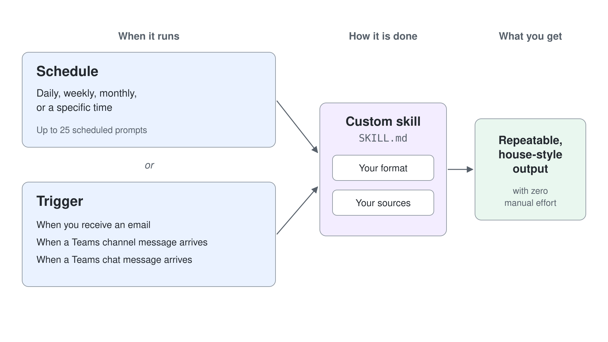

# Scheduled Prompts & Event-Driven Tasks

> **Generally available**: part of [Getting Started with Cowork](../01-intro/readme.md). Last checked against Microsoft Learn on 2026-10-17.

The earlier topics covered what Cowork does and the skills behind it. This topic makes that work repeatable: a prompt you can run once can repeat on a schedule or start when something happens, and Cowork delivers the result without you.

---

## How Scheduling Works

Instead of asking for the same report every week, you hand Cowork the recipe once and it runs on its own.

1. **Write the prompt** as you normally would, describing the full outcome.
2. **Set a recurrence** (daily, weekly, monthly, or a specific time).
3. **Cowork runs it automatically** at each interval and delivers the result.
4. **Manage schedules** on the **Automations** page (left navigation). **Runs** shows each past or upcoming run. **Manage schedules** lets you edit, pause, resume, or delete a schedule. **Create** defines a schedule directly, and the side panel **Schedule** section works during a session.

When you activate a draft schedule, choose **Activate and run now** to run it immediately and watch its approvals, or **Activate** so the first run waits for the next scheduled time. You can have up to 25 scheduled prompts.

---

## Good Candidates for a Schedule

| Schedule | Prompt |
|---|---|
| **Every weekday, 8 AM** | *"Give me a Daily Briefing: today's meetings, unread priority emails, and any documents shared with me since yesterday."* |
| **Every Friday, 4 PM** | *"Summarize my sent emails and calendar for the week into a Word status report and send it to my manager."* |
| **First of the month** | *"Compile last month's project updates from the Marketing Teams channel into a one-page digest."* |

---

## Event-Driven Tasks

Event-driven tasks start when something happens, such as an email arriving, instead of at a set time. Describe the trigger and the job in chat, and Cowork proposes a **Set up trigger?** card. Select **Set up** on the card to arm the task.

The **When** field offers **When you receive an email**, **When a Teams channel message arrives**, and **When a Teams chat message arrives**. Teams triggers can be limited to messages that mention you. The card also shows **Run in** (a new conversation for each run, or the current one), **What it does**, and the permissions the task needs.

On the **Automations** page, each event-driven task shows **Active**, **Draft**, or **Paused**, along with when it last fired. These tasks appear alongside your scheduled prompts.

| Trigger | Prompt |
|---|---|
| **When you receive an email** | *"Whenever my manager emails me about supplier delays, summarize it and draft a reply for my review."* |
| **When a Teams channel message arrives** | *"When I'm @mentioned in the Aurora Outdoor Operations channel, email me a one-line summary."* |

---

## Scheduled Prompts vs. Custom Skills

They pair well but solve different problems. A [custom skill](../03-custom-skills/readme.md) defines *how* a recurring task is done; a schedule defines *when* it runs. Point a schedule at a custom skill to get a repeatable, house-style output with zero manual effort. The skill carries your format and sources; the schedule, or a trigger, carries the cadence.

---

## Automation Still Stops for Approval

By default, scheduled and event-driven tasks prepare any send, post, or change to a shared system and hold it for your approval (draft-and-approve). You can pre-authorize actions when you create a task, which trades control for speed. Scheduling the run alone does not approve the send.

Tasks run with your permissions and see only what you can see. They are rate-limited and guarded against triggering themselves in a loop. Results go only to you unless you approve otherwise.

Automation removes the repetitive work, and by default it keeps your control over what leaves your workspace. The full approval model is covered in [Human-in-the-Loop](../06-staying-in-control/readme.md).

---

## Hands-On Demo

- [Automate a Weekly Status Report](./demo-01-automation.md): author a custom skill from a house template, run it once to check the output, then put it on a Friday schedule that still pauses the send for approval.

---

## Where to Go Next

- **[Creating Custom Skills](../03-custom-skills/readme.md)**: build the custom skills you schedule here
- **[Extending Cowork with Plugins](../05-plugins/readme.md)**: add new skills and connect external services
- **[Human-in-the-Loop](../06-staying-in-control/readme.md)**: approvals and governance for automated actions

---

## Links & Resources

- [Schedule Prompts](https://learn.microsoft.com/en-us/microsoft-365/copilot/cowork/use-cowork#schedule-prompts)
- [Set Up Event-Driven Tasks](https://learn.microsoft.com/en-us/microsoft-365/copilot/cowork/use-cowork#set-up-event-driven-tasks)
- [Cowork Overview](https://learn.microsoft.com/en-us/microsoft-365/copilot/cowork/)
- [Cowork FAQ](https://learn.microsoft.com/en-us/microsoft-365/copilot/cowork/cowork-faq)
