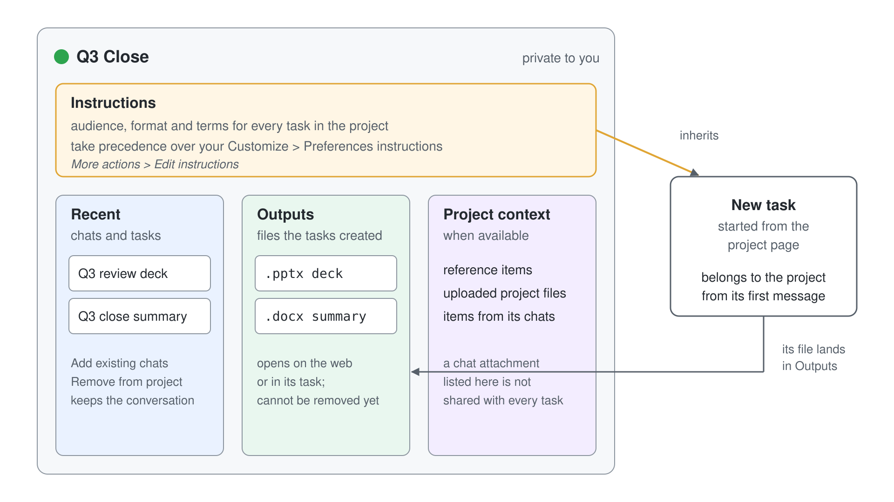

# Organizing Work with Projects

> **Generally available**: part of [Getting Started with Cowork](../01-intro/readme.md). Last checked against Microsoft Learn on 2026-11-05.

The earlier topics covered what Cowork does in one task and the skills it brings to that task. Real work rarely fits in one task: a quarter close, a product launch or a recurring report runs over many conversations that share the same audience, the same terms and the same source files. A project keeps those tasks, their instructions, their context and the files they produce together, so every new task starts where the last one left off.

## What a Project Holds

A project is a named workspace inside Cowork that groups related tasks. You start tasks from it, return to its earlier chats and review the files those tasks produced. Projects are private to the person who creates them: a colleague never sees your project, its instructions or its outputs.

The project page organizes the work in three tabs:

| Tab | What you find there |
| --- | --- |
| **Recent** | The chats and tasks that belong to the project. Select one to return to its conversation. |
| **Outputs** | The files the project's tasks created. Select a file to open it on the web or in the task that made it. |
| **Project context** | Reference items, files uploaded to the project, and items from the project's chats, when available. |

To work with projects, set the **Chat / Cowork** toggle in Microsoft 365 Copilot to **Cowork**. In the left navigation, expand **Projects** and select a project's name to see its tasks. **Back to Projects** (or **View all projects**, where your layout shows it) opens the projects page, where **Search projects** finds a project by name and the **Active** and **Archived** tabs split current work from finished work. Frontier users may see a different set of tabs at the top of the navigation.

---

## Create a Project and Start Its First Task

Create a project for a piece of work that will take more than one task, such as preparing a launch or writing a recurring status report. Hover the **Projects** heading in the left navigation, select the **+** that appears, enter a **Project name** in the **New project** dialog, choose a color and select **Create**. Cowork opens the new project, ready for its instructions and its first task. When you have no projects yet, the same dialog opens from **Add project here**.

Start every task of the project from the project page, so it belongs to the project from its first message. Type the request into the project's chat input and send it: Cowork starts the task with the project's instructions and the context available to it. To start the next task, return to the project page and enter a new request.

Two shortcuts create a project from work already under way. Inside a project, the **...** menu offers **New**. On a task, the **...** menu offers **Move to project** > **New project...**, which creates the project and moves the task into it in one step.

---

## Project Instructions Take Precedence

Project instructions tell Cowork how to work on this one project: the audience of its reports, the format to use, the terms to keep consistent. Open the project's **More actions** menu, select **Edit instructions**, enter the text and select **Save**. If the editor reports that the instructions exceed the limit, shorten them before you save.

The instructions apply to every later interaction inside the project, and they take precedence over your global Cowork or chat instructions. Your personal instructions on the **Preferences** tab of the **Customize** page still describe how you like to work in general; the project's instructions win wherever the two disagree. That gives three layers that each answer a different question:

| Layer | Where you set it | Scope |
| --- | --- | --- |
| Personal instructions | **Customize** > **Preferences** | Every Cowork task you run |
| Project instructions | Project **More actions** > **Edit instructions** | Every task inside that project, ahead of personal instructions |
| Skill | A `SKILL.md` in OneDrive or a plugin | Any task whose request matches the skill's description |

A skill carries a repeatable procedure across all your work, while project instructions carry the facts of one piece of work. A weekly-report skill knows the house format; the Q3 Close project knows that this quarter's reports go to the Nordic leadership team and call the region "Northern Europe".

---

## Bring Existing Chats into a Project

Work often starts before anyone creates a project for it. Open an active project and select the **+** beside the search icon on the **Recent** tab (tooltip **Add existing chats**); an empty project shows the link **add from existing** instead. Pick the chats to add, using **Search chats and tasks** or **Load older chats** to find older ones, and select **Add**. The chats appear in the project's task list.

A chat belongs to one project at a time: a chat that is already in another project is not selectable in the picker. Drag a chat from one project to another to move it, or select **...** on a task and **Move to projects**. To take a task out again, open its **...** menu on the **Recent** tab and select **Remove from project**, which applies at once. Removing a task does not delete its conversation, and you can still open it from **Recent**.

---

## Project Context Is Not a Chat Attachment

**Outputs** lists the files the project's tasks created, so the deck from the first task and the brief from the third sit side by side. Files can't currently be removed from **Outputs**, so name the files your tasks create with care.

**Project context**, where available, lists the project's reference items, the files uploaded to the project, and items from its chats. Adding context to a project is different from attaching a file to one chat: an attachment belongs to the chat it was sent in. A file listed in **Project context** because one chat attached it is not automatically available to every other task in the project, so attach or reference it again where a new task needs it.

---

## Keep Projects Tidy

To change how a project appears, open **More actions** > **Edit project**, change the name or the color and select **Save**. This changes nothing about how Cowork works on the project; use **Edit instructions** for that.

When a piece of work is done, open **More actions** > **Archive** and confirm with **Archive**. The project moves to the **Archived** tab of the projects page and disappears from the navigation, with its tasks and outputs intact. To bring it back, open it from **Archived**, open **More actions** and select **Restore**: the project returns to **Active**.

---

## Hands-On Demo

- [Run the Q3 Close as a Project](./demo-01-q3-close-project.md): create a Q3 Close project with instructions for the Nordic leadership audience, move the Q3 review deck chat into it, start a new task from the project page and find its file under **Outputs**.

## Where to Go Next

- [Scheduled Prompts & Event-Driven Tasks](../05-automation/readme.md): run a prompt or skill on a schedule or when a message arrives.
- [Creating Custom Skills with SKILL.md](../03-custom-skills/readme.md): turn the procedure a project repeats into a skill that works across all your projects.

## Links & Resources

- [Use projects in Copilot Cowork](https://learn.microsoft.com/en-us/copilot/cowork/cowork-projects)
- [Custom instructions in Cowork](https://learn.microsoft.com/en-us/copilot/cowork/cowork-customize#custom-instructions-in-cowork)
- [Use Cowork](https://learn.microsoft.com/en-us/copilot/cowork/use-cowork)
- [Cowork common questions](https://learn.microsoft.com/en-us/copilot/cowork/cowork-faq)
