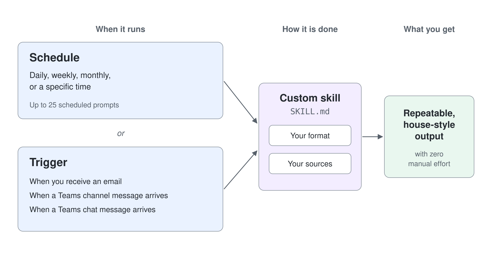

# Scheduled Prompts & Event-Driven Tasks

> **Generally available**: part of [Getting Started with Cowork](../01-intro/readme.md). Last checked against Microsoft Learn on 2026-11-05.

The earlier topics covered what Cowork does and the skills behind it. This topic makes that work repeatable: a prompt you can run once can repeat on a schedule or start when something happens, and Cowork delivers the result without you.

---

## Two Kinds of Triggers

Every automation starts from a trigger, and Cowork offers two kinds. A **schedule** starts the task at a time: on a recurrence such as every morning, every Friday or the first of the month, or at a set time. An **event** starts the task when something happens in your Microsoft 365 work: an email arrives, a Teams channel message arrives, or a Teams chat message arrives. After the trigger fires, both kinds run the same way and appear side by side on the **Automations** page.

| Trigger | Starts the task when | Cowork proposes | What you set on the card |
| --- | --- | --- | --- |
| **Schedule** | The recurrence or the set time comes round (daily, weekly, monthly, or a specific time) | **Create recurring task?** | The recurrence and time, **Run in** (a new conversation for each run), the description every run receives, **Run once now** |
| **When you receive an email** | An email that matches what you described, such as a sender and a subject, arrives | **Set up trigger?** | **Run in** (a new conversation or the current one), **What it does**, the permissions the task needs |
| **When a Teams channel message arrives** | A message is posted in the channel you named | **Set up trigger?** | The same fields, plus an option to react only to messages that mention you |
| **When a Teams chat message arrives** | A message arrives in a 1:1 or group chat | **Set up trigger?** | The same fields, plus an option to react only to messages that mention you |

Pick the trigger by who sets the timing. A schedule fits work whose timing you know, such as the Friday status report or a morning briefing. An event fits work whose timing someone else sets, such as a supplier delay email or an @mention in an operations channel. You can have up to 25 scheduled prompts, and Cowork applies rate limits so an event-driven task cannot fire too often.

---

## How Scheduling Works

You hand Cowork the recipe for a recurring report once, and it runs on its own every week.

1. **Write the prompt** as you normally would, describing the full outcome.
2. **Set a recurrence** (daily, weekly, monthly, or a specific time).
3. **Cowork runs it automatically** at each interval and delivers the result.
4. **Manage automations** on the **Automations** page (left navigation). **Add** creates one directly, suggested templates such as **Daily briefing** and **Weekly wrap** start from a ready-made prompt, and the filters **All**, **Scheduled**, **Triggers**, and **Paused** sort the list. Each automation shows its recurrence and next run, an **Enable** switch, and a **...** menu with **Edit**, **Run now**, **Pause** or **Resume**, and **Delete**.

When you ask for a schedule in chat, Cowork proposes a **Create recurring task?** card with the name, the recurrence (for example **Weekly**, **Friday**, **3:00 PM**), **Run in** (a new conversation for each run), and a description of the job. Its **Run once now** checkbox is ticked by default: leave it ticked to watch a first run and its approvals straight away, or clear it so the first run waits for the schedule, then select **Schedule**. Pausing an automation turns its **Enable** switch off and moves it under **Paused**, where it keeps its settings and does not run until you resume it. You can have up to 25 scheduled prompts.

---

## Good Candidates for a Schedule

| Schedule | Prompt |
|---|---|
| **Every weekday, 8 AM** | *"Give me a Daily Briefing: today's meetings, unread priority emails, and any documents shared with me since yesterday."* |
| **Every Friday, 4 PM** | *"Summarize my sent emails and calendar for the week into a Word status report and send it to my manager."* |
| **First of the month** | *"Compile last month's project updates from the Marketing Teams channel into a one-page digest."* |

---

## Event-Driven Tasks

Event-driven tasks start when something happens, such as an email arriving. Describe the trigger and the job in chat, and Cowork proposes a **Set up trigger?** card. Select **Set up** on the card to arm the task.

The **When** field offers **When you receive an email**, **When a Teams channel message arrives**, and **When a Teams chat message arrives**. Teams triggers can be limited to messages that mention you. The card also shows **Run in** (a new conversation for each run, or the current one), **What it does**, and the permissions the task needs.

On the **Automations** page, each event-driven task shows **Active**, **Draft**, or **Paused**, along with when it last fired. These tasks appear alongside your scheduled prompts.

| Trigger | Prompt |
|---|---|
| **When you receive an email** | *"Whenever my manager emails me about supplier delays, summarize it and draft a reply for my review."* |
| **When a Teams channel message arrives** | *"When I'm @mentioned in the Aurora Outdoor Operations channel, email me a one-line summary."* |

---

## Scheduled Prompts vs. Custom Skills

They pair well but solve different problems. A [custom skill](../03-custom-skills/readme.md) defines *how* a recurring task is done; a schedule defines *when* it runs. Point a schedule at a custom skill to get a repeatable, house-style output with zero manual effort. The skill carries your format and sources; the schedule, or a trigger, carries the cadence.

---

## Automation Still Stops for Approval

By default, scheduled and event-driven tasks prepare any send, post, or change to a shared system and hold it for your approval (draft-and-approve). A weekly status report, for example, lands as a Word document in the task's **Output** and as an email in your Outlook Drafts folder, and nothing is sent until you tell Cowork to send it. You can pre-authorize actions when you create a task, which trades control for speed. Scheduling the run alone does not approve the send.

Tasks run with your permissions and see only what you can see. They are rate-limited and guarded against triggering themselves in a loop. Results go only to you unless you approve otherwise.

### What Pauses and What Runs Through

A run pauses before an action that leaves your workspace or changes something other people share: sending an email, posting in a Teams channel or chat, scheduling a meeting, or changing a shared system. Gathering information and writing new files into the run's **Output** do not pause. In this topic's demo, the Word report and the email saved to your Drafts folder needed no approval; only the send would have.

### The Approval Card

The card shows what Cowork is about to do before it happens. A draft email, a Teams message or a meeting appear as a rich preview, other actions as a summary, and an Outlook mail rule as a detailed card of what the rule will do. Medium and high risk actions carry a risk level indicator, and **Show parameters** reveals the technical details of the action. The button is named after the action itself:

| Choice | What it does |
| --- | --- |
| The action button (**Send**, **Post**, **Create**) | Lets Cowork take the action this one time |
| **More options** (the dropdown next to the action button) | Approves the action and skips the prompt for similar actions for the rest of the conversation: for email and Teams messages **Only to** one recipient, **Only to** one domain, or **Always allow**; for other actions **Approve & don't ask again** |
| **Approve All** | Appears when several approvals are pending and lets all of them proceed, for example **Approve All (3)** |
| **Cancel** | Skips the action; Cowork moves on with the rest of the task |

### Where a Waiting Run Waits

A scheduled run starts a new conversation for each run, so its approval card appears in that run's own conversation, separate from the chat where you created the schedule. Open the automation on the **Automations** page to see its run history and jump into the run that waits. Until you answer, the action does not happen, while everything the run could do without you, such as the report under **Output** and the saved draft, is already there.

### Always Allow Lasts One Conversation

**Always allow** and the other "don't ask again" choices apply only to the current conversation, and the **Permissions** section of the side panel lists them so you can revoke one. Because every scheduled run starts a new conversation, an **Always allow** given in one run does not carry into the next, and next Friday's run asks again. To let a task act without asking at all, pre-authorize the action when you create the task, which trades control for speed; without that, the default stays draft-and-approve.

Automation removes the repetitive work, and by default it keeps your control over what leaves your workspace. The full approval model is covered in [Human-in-the-Loop](../07-staying-in-control/readme.md).

---

## Hands-On Demo

- [Automate a Weekly Status Report](./demo-01-automation.md): author a custom skill from a house template, run it once to check the output, then put it on a Friday schedule that still pauses the send for approval.

---

## Where to Go Next

- **[Creating Custom Skills](../03-custom-skills/readme.md)**: build the custom skills you schedule here
- **[Extending Cowork with Plugins](../06-plugins/readme.md)**: add new skills and connect external services
- **[Human-in-the-Loop](../07-staying-in-control/readme.md)**: approvals and governance for automated actions

---

## Links & Resources

- [Schedule Prompts](https://learn.microsoft.com/en-us/microsoft-365/copilot/cowork/use-cowork#schedule-prompts)
- [Set Up Event-Driven Tasks](https://learn.microsoft.com/en-us/microsoft-365/copilot/cowork/use-cowork#set-up-event-driven-tasks)
- [Approve Actions](https://learn.microsoft.com/en-us/copilot/cowork/use-cowork#approve-actions)
- [Automated Tasks in Cowork Governance](https://learn.microsoft.com/en-us/copilot/cowork/cowork-admin-governance#automated-tasks)
- [Cowork Overview](https://learn.microsoft.com/en-us/microsoft-365/copilot/cowork/)
- [Cowork FAQ](https://learn.microsoft.com/en-us/microsoft-365/copilot/cowork/cowork-faq)
