# Extending Cowork with Plugins

> **Generally available**: part of [Getting Started with Cowork](../01-intro/readme.md). Last checked against Microsoft Learn on 2026-10-21.

Built-in skills handle common office tasks and [custom skills](../03-custom-skills/readme.md) capture your own recipes, but both live inside Microsoft 365. Copilot plugins reach *beyond* it. Plugins come from **Discover** on the **Customize** page (the Microsoft 365 plugin marketplace), from your admin, from a colleague, or from a package you upload. A plugin carries skills, connectors or both, and once installed, its skills appear alongside built-in skills and activate automatically based on context, exactly like the ones you already use.

---

## What Plugins Add

- **Specialized expertise**: skills for financial analysis, legal research, clinical or HR domain knowledge
- **External data connectors**: MCP servers that reach CRM data, ticketing systems and third-party APIs; each user completes a one-time **Connect** sign-in
- **Interactive widgets**: MCP apps return a UI that renders in the conversation
- **Microsoft and role-based plugins**: Dynamics 365 Customer Service, Sales and ERP, Fabric IQ and Business Applications in Work IQ, plus role-based plugins for Legal, Sales, Service and Education
- **Admin deployment**: IT admins can roll out plugins organization-wide; they appear with **Managed by your organization**



---

## Where Plugins Fit

Cowork draws skills from five sources, and every one of them surfaces in the same side panel and activates the same way: automatically, based on the task.



Built-in skills handle the common office tasks. Custom skills handle *your* recurring workflows. Plugins reach into the systems and expertise your work depends on, and admin-deployed plugins let IT standardize that reach across the whole organization. Skills and plugins that colleagues share with you, or that you upload yourself, join the same panel.

---

## One Plugin, Every Copilot Surface

This topic covers Copilot plugins, which you use in Cowork today. Microsoft's plugin registry lets developers publish a plugin once for admin review, so one package serves each Copilot experience. The registry is the shared place to discover, publish, manage and govern plugins across the surfaces below.

A plugin bundles skills (reusable instructions for specialized work), connectors (approved access to services and data) and agents (customizations of Copilot for specific uses). It can also carry the metadata and configuration that connect it to MCP servers. The package does not contain those services: an MCP server runs separately, and the plugin holds only its connection information.

| Surface | Registry status |
| --- | --- |
| Home (Chat and Cowork), Code, Autopilot, Word, Excel, PowerPoint, SharePoint | Covered |
| Copilot Studio, GitHub Copilot, Microsoft Foundry | Announced for later |

The Plugins page replaces and expands the Agents page. Message center item MC1484008 (2026-09-30) replaces the **Agents**, **Agents & Skills** and **Customize** buttons with one **Plugins** button as the rollout reaches your tenant. The registry rolls out from late September to late October 2026, and its UI changes follow from late October to late November 2026. Until the change arrives in your tenant, Cowork still shows **Customize**, and the Customize steps in this topic match your screen.

Admins govern plugins from **Agents** in the Microsoft 365 admin center. **Agents** > **Settings** > **Agent and plugin access** selects the publisher categories users can install from: Microsoft, your organization and certified external publishers. Users select **Request access** on a plugin, and admins approve or reject the request under **Agents** > **Tools** > **Requests (preview)**.

Anthropic's Claude plugins follow the same idea, and the table compares the two.

| | Anthropic | Microsoft |
| --- | --- | --- |
| What gets installed | Plugin: skills, agents, commands, hooks, MCP servers | Plugin: skills, declarative agents, connectors, MCP servers |
| Where it is listed | Marketplaces (public or org-private) | Plugin registry (Microsoft, partner, tenant) |
| Who controls it | Org admin settings | Agent 365: publisher filters, user scopes, access requests, tool toggles |
| Format | Claude plugin, `SKILL.md` | M365 app package, the same `SKILL.md`, imports and exports the Claude format |

Cowork converts a Claude plugin package when you upload it, and `wiqd` imports and exports that format, as the [plugin round-trip exercise](../../../labs/02-cowork/lab-03-cowork-plugins.md#exercise-7-write-once-run-in-claude-and-copilot) shows.

---

## Installing a Plugin

1. Select **+** > **Customize** > **Plugins**.
2. Select a card in **Discover** and review the publisher, skills and connectors on its detail page.
3. Select **Add**.
4. Turn the plugin on or off per conversation in the **Sources & Skills** panel.

On mobile, select **+** > **Skills** instead.

A plugin is packaged as a Microsoft 365 app: a `manifest.json`, `color.png`, `outline.png` and a `skills/` folder of `SKILL.md` folders, the same Microsoft 365 app format as Teams apps. Each skill uses the open `SKILL.md` format you author for [custom skills](../03-custom-skills/readme.md), which is why a plugin's skills behave identically to the ones you write yourself, once installed.

---

## Building and Sharing Your Own Plugin

Select **Upload plugin** under **Customize** > **Plugins** and pick a `.zip` package. A Claude or other compatible plugin package is converted automatically, including its bundled skills and connectors.

The **Share** dialog then offers **Only you** or **Specific users in your organization**. Sharing with specific people needs no admin, while publishing to the whole organization waits for admin approval.


For code-first authoring, the `wiqd` command-line tool (preview) scaffolds, validates, packages and shares plugins:

```powershell
wiqd plugin create --name <name>
wiqd plugin add skill --name "<name>"
wiqd plugin validate
wiqd plugin package
wiqd plugin share --scope users --email <address>
```

Public store listings are submitted through Partner Center.

---

## Community Plugins

Beyond the official Microsoft 365 plugins, the community publishes ready-to-install Cowork plugins. The [awesome-copilot-cowork-plugins](https://github.com/alexclowe/awesome-copilot-cowork-plugins) repository collects packaged plugins you can upload through **Customize** > **Plugins** > **Upload plugin**, each a manifest plus its agent skills. The hands-on demo uses the `dietitian` plugin from that repository to show how an external, domain-specific plugin drops into Cowork and starts producing expert output.

---

## Hands-On Demo

- [Extend Cowork with a Community Plugin](./demo-01-plugins.md): install the `dietitian` plugin from the awesome-copilot-cowork-plugins repository, confirm its two skills appear in the side panel, and produce a client nutrition assessment and education handout that mix the plugin's expertise with Cowork's built-in Word skill.

---

## Where to Go Next

- **[Creating Custom Skills](../03-custom-skills/readme.md)**: author the in-house equivalent of a plugin skill
- **[Scheduled Prompts & Event-Driven Tasks](../04-automation/readme.md)**: run plugin-driven work on a schedule
- **[Human-in-the-Loop](../06-staying-in-control/readme.md)**: approvals and governance for plugin-driven actions

---

## Links & Resources

- [Cowork Plugins](https://learn.microsoft.com/en-us/microsoft-365/copilot/cowork/cowork-plugins)
- [awesome-copilot-cowork-plugins (community)](https://github.com/alexclowe/awesome-copilot-cowork-plugins)
- [Use Cowork](https://learn.microsoft.com/en-us/microsoft-365/copilot/cowork/use-cowork)
- [Cowork Overview](https://learn.microsoft.com/en-us/microsoft-365/copilot/cowork/)
- [Customize Cowork](https://learn.microsoft.com/en-us/microsoft-365/copilot/cowork/cowork-customize)
- [Build Plugins for Cowork](https://learn.microsoft.com/en-us/microsoft-365/copilot/cowork/cowork-plugin-development)
- [Manage Plugins for Cowork](https://learn.microsoft.com/en-us/microsoft-365/copilot/cowork/cowork-manage-plugins)
- [Available Plugins](https://learn.microsoft.com/en-us/microsoft-365/copilot/cowork/cowork-available-plugins)
- [Introducing the plugin registry (Tech Community, 2026-09-30)](https://techcommunity.microsoft.com/blog/microsoft-copilot-blog/introducing-the-plugin-registry---one-place-to-discover-and-govern-plugins-for-m/4559682)
- [The new Microsoft Copilot: Home, Code and Autopilot (Microsoft Blog, 2026-09-25)](https://blogs.microsoft.com/blog/2026/09/25/introducing-the-new-copilot-with-home-code-and-autopilot/)
- [What is a Microsoft 365 Copilot plugin?](https://learn.microsoft.com/microsoft-365/copilot/extensibility/plugins-overview)
- [Manage plugins, skills and MCP servers](https://learn.microsoft.com/microsoft-365/admin/manage/manage-plugins-skills-mcp-servers)
- [Govern plugins](https://learn.microsoft.com/microsoft-365/copilot/extensibility/govern-plugins)
- [Quickstart: build a plugin](https://learn.microsoft.com/microsoft-365/copilot/extensibility/quickstart-plugin)
- [WIQD: build a plugin](https://microsoft.github.io/wiqd/getting-started/build-a-plugin/)
- [WIQD: installation](https://microsoft.github.io/wiqd/getting-started/installation/)
