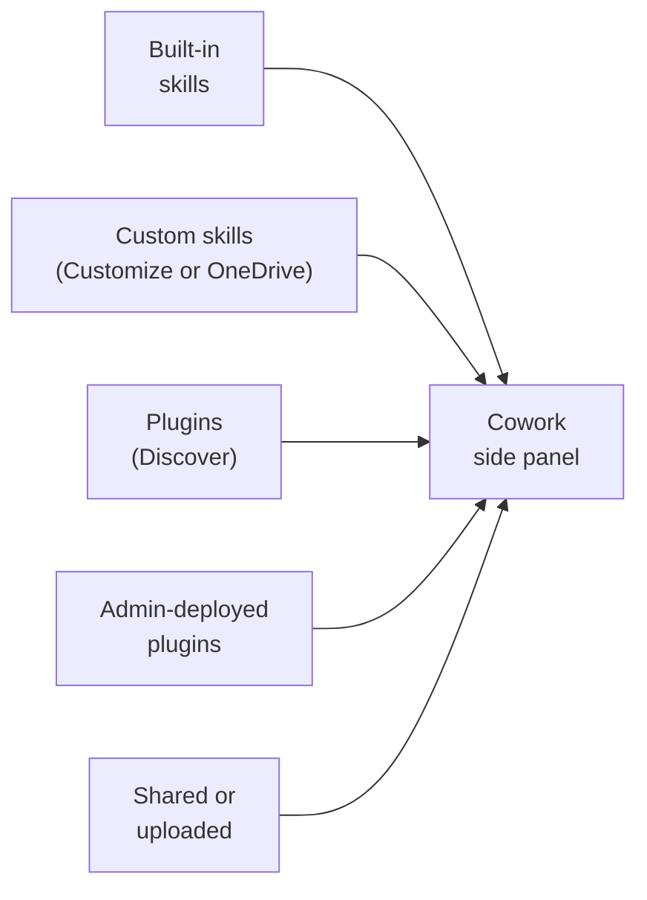

# Extending Cowork with Plugins

> **Generally available**: part of [Getting Started with Cowork](../01-intro/readme.md). Last checked against Microsoft Learn on 2026-10-17.

Built-in skills handle common office tasks and [custom skills](../03-custom-skills/readme.md) capture your own recipes, but both live inside Microsoft 365. Plugins reach *beyond* it. Plugins come from **Discover** on the **Customize** page (the Microsoft 365 plugin marketplace), from your admin, from a colleague, or from a package you upload. A plugin carries skills, connectors or both, and once installed, its skills appear alongside built-in skills and activate automatically based on context, exactly like the ones you already use.

---

## What Plugins Add

- **Specialized expertise**: skills for financial analysis, legal research, clinical or HR domain knowledge
- **External data connectors**: MCP servers that reach CRM data, ticketing systems and third-party APIs; each user completes a one-time **Connect** sign-in
- **Interactive widgets**: MCP apps return a UI that renders in the conversation
- **Microsoft and role-based plugins**: Dynamics 365 Customer Service, Sales and ERP, Fabric IQ and Business Applications in Work IQ, plus role-based plugins for Legal, Sales, Service and Education
- **Admin deployment**: IT admins can roll out plugins organization-wide; they appear with **Managed by your organization**

---

## Where Plugins Fit

Cowork draws skills from five sources, and every one of them surfaces in the same side panel and activates the same way: automatically, based on the task.



Built-in skills handle the common office tasks. Custom skills handle *your* recurring workflows. Plugins reach into the systems and expertise your work depends on, and admin-deployed plugins let IT standardize that reach across the whole organization. Skills and plugins that colleagues share with you, or that you upload yourself, join the same panel.

---

## Installing a Plugin

1. Select **+** > **Customize** > **Plugins**.
2. Select a card in **Discover** and review the publisher, skills and connectors on its detail page.
3. Select **Add**.
4. Turn the plugin on or off per conversation in the **Sources & Skills** panel.

On mobile, select **+** > **Skills** instead.

A plugin is packaged as a Microsoft 365 app: a `manifest.json`, `color.png`, `outline.png` and a `skills/` folder of `SKILL.md` folders, the same Microsoft 365 app format as Teams apps. Each skill uses the open `SKILL.md` format you author for [custom skills](../03-custom-skills/readme.md), which is why a plugin's skills behave identically to the ones you write yourself, once installed.

---

## Building and Sharing Your Own Plugin

Select **Upload plugin** under **Customize** > **Plugins** and pick a `.zip` package. A Claude or other compatible plugin package is converted automatically, including its bundled skills and connectors.

The **Share** dialog then offers **Only you** or **Specific users in your organization**. Sharing with specific people needs no admin, while publishing to the whole organization waits for admin approval.

For code-first authoring, the `wiqd` command-line tool (preview) scaffolds, validates, packages and shares plugins:

```bash
wiqd plugin create --name <name>
wiqd plugin add skill
wiqd plugin validate
wiqd plugin package
wiqd plugin share --scope users
```

Public store listings are submitted through Partner Center.

---

## Community Plugins

Beyond the official Microsoft 365 plugins, the community publishes ready-to-install Cowork plugins. The [awesome-copilot-cowork-plugins](https://github.com/alexclowe/awesome-copilot-cowork-plugins) repository collects packaged plugins you can upload through **Customize** > **Plugins** > **Upload plugin**, each a manifest plus its agent skills. The hands-on demo uses the `dietitian` plugin from that repository to show how an external, domain-specific plugin drops into Cowork and starts producing expert output.

---

## Hands-On Demo

- [Extend Cowork with a Community Plugin](./demo-01-plugins.md): install the `dietitian` plugin from the awesome-copilot-cowork-plugins repository, confirm its two skills appear in the side panel, and produce a client nutrition assessment and education handout that mix the plugin's expertise with Cowork's built-in Word skill.

---

## Where to Go Next

- **[Creating Custom Skills](../03-custom-skills/readme.md)**: author the in-house equivalent of a plugin skill
- **[Scheduled Prompts & Event-Driven Tasks](../04-automation/readme.md)**: run plugin-driven work on a schedule
- **[Human-in-the-Loop](../06-staying-in-control/readme.md)**: approvals and governance for plugin-driven actions

---

## Links & Resources

- [Cowork Plugins](https://learn.microsoft.com/en-us/microsoft-365/copilot/cowork/cowork-plugins)
- [awesome-copilot-cowork-plugins (community)](https://github.com/alexclowe/awesome-copilot-cowork-plugins)
- [Use Cowork](https://learn.microsoft.com/en-us/microsoft-365/copilot/cowork/use-cowork)
- [Cowork Overview](https://learn.microsoft.com/en-us/microsoft-365/copilot/cowork/)
- [Customize Cowork](https://learn.microsoft.com/en-us/microsoft-365/copilot/cowork/cowork-customize)
- [Build Plugins for Cowork](https://learn.microsoft.com/en-us/microsoft-365/copilot/cowork/cowork-plugin-development)
- [Manage Plugins for Cowork](https://learn.microsoft.com/en-us/microsoft-365/copilot/cowork/cowork-manage-plugins)
- [Available Plugins](https://learn.microsoft.com/en-us/microsoft-365/copilot/cowork/cowork-available-plugins)
