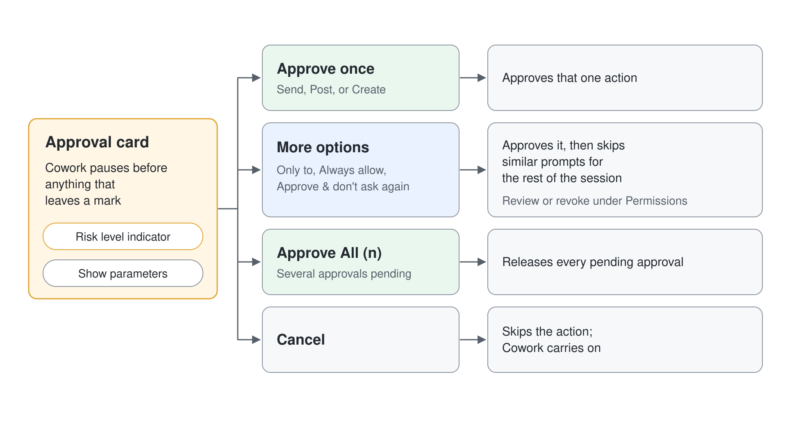

# Turn a Partner Meeting into a Follow-Up Package

Give Cowork your raw meeting notes and a half-finished proposal, and let it reconcile the two, close every open term, draft the follow-up email, and book the next call.

> **Reasoning effort:** Use **Medium** for Steps 1 and 2, where Cowork reconciles the notes against the draft and closes the open terms. Use **Light** for the email in Step 3 and the booking in Step 4. Set it in the **Auto Medium** picker beside the send arrow: Medium is the default, and Light is the leftmost stop on the **Faster** to **Smarter** slider. High or Max is not needed for this package.

## Run Cost

| Token type | Tokens | Opus 5.5 (run) | Sonnet 5.5 (estimate) | Haiku 5.5 (estimate) |
| --- | --- | --- | --- | --- |
| Input | 258 | €0.00 | €0.00 | €0.00 |
| Cache write | 337K | €1.50 | €0.75 | €0.13 |
| Cache read | 25.3M | €4.49 | €4.49 | €1.08 |
| Output | 77K | €1.38 | €0.69 | €0.16 |
| **Total** | **25.7M** | **€7.37** | **€5.93** | **€1.38** |

## Related Topics

This demo shows the [Getting Started with Cowork](../01-intro/readme.md) promise of end-to-end work: one request that spans reading, editing, emailing, and scheduling. The document and calendar work draws on built-in [Skills](../02-built-in-skills/readme.md), and the Outlook and calendar actions stop at the approval cards from [Human-in-the-Loop](./readme.md).

---

Each step follows the same pattern:

- Overview: what this step achieves
- Research / Planning / Discussion: an open prompt to reason through the problem before acting
- Finding: what to read and evaluate in the response before moving on
- Recipe: a complete implementation prompt you can use as-is or adapt from your own findings
- Expected Outcome: observable artefacts that confirm success

You have just come off a discovery call with Fjallbryggan Retail, a Nordic chain that wants to stock Aurora Outdoor for the AW26 season. You promised a revised proposal within a week and a follow-up call.


---

## Demo Files

Point Cowork at the `demo-01-follow-up` folder.

| File | What it represents |
|------|--------------------|
| `partner-meeting-notes.docx` | Notes from the discovery call: what the buyer asked for, the open questions, and the action items |
| `partnership-proposal-draft.docx` | The pre-call draft proposal, with several commercial terms still marked `[OPEN]` |

## Load the demo files

In Microsoft Copilot (copilot.cloud.microsoft), with **Cowork** selected in the top toggle, select **New task**, then **Add attachments** (**+**) > **Upload images and files**, and add both files from the `demo-01-follow-up` folder. They show as Word document chips above the composer and stay listed under **References** in the **Workspace** panel for every step.

---

## Step 1: Reconcile the notes against the draft

**Overview:** The draft proposal was written before the call and is full of open placeholders. The meeting answered most of them. First, have Cowork line the two documents up and tell you exactly what changed.

**Research / Planning / Discussion:**

With both files attached, send this prompt:

```
Read partner-meeting-notes.docx and partnership-proposal-draft.docx. The draft was written before the call. For every item marked [OPEN] in the draft, tell me whether the meeting resolved it and what the agreed position is. Then list anything the buyer raised that the draft does not cover at all.
```

**Finding:** Check that Cowork maps each `[OPEN]` to what the call settled: Accessories included as an impulse add-on at till points, and no category exclusivity required. Margin, opening order and fixtures come back as one proposed package (45 percent at a 180k opening order in exchange for in-store fixtures) that the notes leave for you to approve, and the fleece quality note still waits on your corrected-fit confirmation. It should also list what the buyer raised that the draft never mentions, such as the 41-store footprint across Sweden and Norway, the store-tier list Markus will share, and your promise of a revised proposal within one week. If it leaves any placeholder unmapped, ask it which meeting note covers that term.

**Expected Outcome:** A point-by-point reconciliation showing each open term, what the call decided or proposed, and at least one buyer point the draft never addressed, such as the 41-store footprint.

---

## Step 2: Close every open term in the proposal

**Overview:** With the mapping agreed, turn the draft into a sendable document. Cowork builds v1.0 from the existing file rather than starting from scratch, so the structure your partner expects stays intact.

**Recipe:**

In the same task, send:

```
Update partnership-proposal-draft.docx into a finished v1.0. Replace every [OPEN] placeholder with the position agreed on the call: 45 percent wholesale margin at a 180,000 euro opening order, conditional on an in-store brand-fixtures commitment; Accessories included as a till-point range; no category exclusivity required. Add a short quality note that the AW26 mid-layer fleece has a corrected fit. Set the heads-of-terms deadline to align with the buyer's range review four weeks out. Change the document title from DRAFT to v1.0 and remove any leftover bracketed text. Save it as a new file so the draft is preserved.
```

**Finding:** Open `partnership-proposal-v1.0.docx` from **Output** in the **Workspace** panel and search for the word "OPEN" and any square brackets; there should be none left. Confirm the three commercial terms read back exactly as agreed and that the fleece note is present. Cowork also lists points to **Check before sending**, such as the fact that the meeting notes never confirm the corrected fleece fit, so settle those before the email goes out. If a placeholder survived, tell Cowork which section still has one.

**Expected Outcome:** A new `partnership-proposal-v1.0.docx` under **Output** with no remaining placeholders, the three commercial terms filled in, a fit-quality note added, and the draft file left untouched.

> The recipe above reflects the typical outcome of the reconciliation in Step 1. If your call notes led to different terms, use those.

---

## Step 3: Draft the follow-up email

**Overview:** The partner is waiting on the revised proposal. Cowork writes the cover email, attaches the finished document and saves it to your Outlook Drafts folder, so nothing leaves your mailbox until you send it.

**Recipe:**

In the same task, send:

```
Draft an email to Markus Lind at Fjallbryggan with the finished proposal attached. Keep it to three short paragraphs: thank him for the call, summarise the three headline terms we agreed so he can see them without opening the attachment, and propose we walk through it on a follow-up call next week. Warm and concise. Do not send it; show me the draft.
```

**Finding:** Cowork runs **Save draft** and **Add attachments** in Outlook and hands back a **Saved to drafts** card; because you said not to send, no Send approval appears. Read the summary paragraph and make sure the three terms match the proposal exactly, since a mismatch between the email and the attachment is the classic follow-up mistake. Confirm the attachment is v1.0 and not the old draft: when Cowork finds a stale copy on the draft it asks to remove it with a **Delete this attachment?** card at **Medium risk**. Markus Lind has no address in your directory, so the To line stays empty and Cowork reminds you to add him before you send.

**Expected Outcome:** A three-paragraph email with the finished proposal attached, saved in your Outlook Drafts folder and not sent, plus a short list of what to fix before sending.



---

## Step 4: Book the follow-up call

**Overview:** You promised a call next week. Rather than switch to your calendar, describe the meeting and let Cowork schedule it; creating the event is a medium-risk action that waits for your approval.

**Recipe:**

In the same task, send:

```
Set up a 30-minute follow-up call titled "Aurora x Fjallbryggan - proposal review" with Markus Lind for next week. Aim for a mid-morning slot, and in the invite body note that the agenda is to walk through the v1.0 proposal. Show me the invite before you send it.
```

Cowork runs **View calendar**, picks a free mid-morning slot, and shows the invite as text with the time, a Teams meeting and the agenda body. Markus Lind has no address in your directory, so it asks for one before it sends anything. Book the call on your own calendar instead:

```text
Markus is not in my directory yet, so book the slot you proposed on my own calendar instead: same title, same time and the same invite body, with me as the only attendee. I will forward it to Markus once I have his address.
```

**Finding:** The booking stops at a **Create calendar event?** card marked **Medium risk**, showing the proposed time, a **Pick custom time** option, the title, an empty **Attendees** line and the invite body. Check the proposed time does not collide with anything Cowork can see and that the body names the v1.0 proposal, then select **Save**. Cowork confirms with **Approved 1 action** and **Created event**, and explains that forwarding the event from Outlook sends Markus the invite with the Teams link.

**Expected Outcome:** A 30-minute mid-morning Teams meeting titled "Aurora x Fjallbryggan - proposal review" on your calendar next week, created only after you approved the medium-risk card, with the v1.0 agenda in the body and ready to forward to Markus.

> How risk levels decide which actions stop for your approval is explained in [Human-in-the-Loop](./readme.md#risk-levels).
