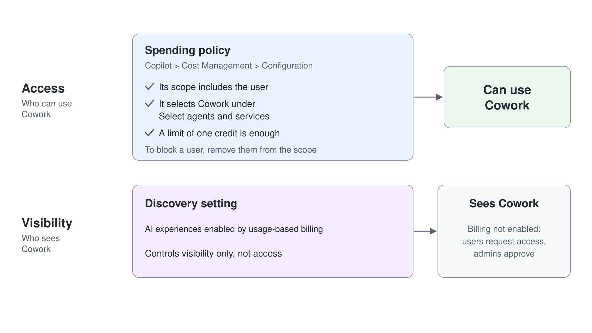

# Human-in-the-Loop: Approving Actions & Staying in Control

> **Generally available**: part of [Getting Started with Cowork](../01-intro/readme.md). Last checked against Microsoft Learn on 2026-10-17.

Cowork acts on your behalf, but never behind your back. It asks for approval before sensitive actions, shows what it is about to do, and lets you stop at any point. This topic covers the human-in-the-loop model for end users and the governance controls for admins.

---

## The Approval Model

Before Cowork does anything that leaves your workspace or changes what you already have (sending an email, posting in Teams, booking or changing a meeting, editing an existing file), it pauses and asks. New files in the task's **Output** and an email saved to your Drafts folder need no approval, so a prompt that ends with "do not send" stops at a draft. The card names the action as a question, such as **Send draft?**, **Create calendar event?**, **Update event?**, or **Edit file?**, and shows what it will write: the recipients, subject, and body of a mail, or the title, time, attendees, and body of an event.

- **Approve once**: The action button (for example **Send**, **Save**, **Update**, or **Schedule**) approves that one action, and the task then shows **Approved 1 action**.
- **More options**: The arrow next to the action button approves and skips similar prompts for the rest of the session, for example **Always allow Create event**. For email and Teams, choose **Only to** a specific recipient, **Only to** a specific domain's recipients, or **Always allow**. For other actions, choose **Approve & don't ask again**.
- **Approve All (n)**: When several approvals are pending, releases every one of them.
- **Cancel**: Skips the action, and Cowork carries on with the rest.
- **Show parameters**: Reveals the technical details of the action.
- **Permissions**: "Don't ask again" choices apply to the current session. Review or revoke them in the side panel **Permissions** section.
- **Office file edits**: Cowork asks **Approve once** or **Always allow** before it changes an existing Word, Excel, or PowerPoint file.
- **Browser actions**: A sensitive submission shows an approval card with **Approve** or **Reject**.
- **Risk indicators**: Approvals for medium- and high-risk actions show a risk level indicator.

### Risk Levels

| Risk | Examples | What it means |
|---|---|---|
| **Medium** | Editing or overwriting a file, deleting an attachment, creating or updating a calendar event, sending mail to yourself | Changes your content or your calendar |
| **High** | Sending email to other people, posting in Teams, external communication | Leaves your workspace and reaches other people |

The examples show the typical split; the risk indicator on the approval card is the authority. The recipient moves the level: sending the review deck to your own address showed **Medium risk** on its **Send draft?** card. Some cards carry no indicator at all, such as **Create recurring task?** when you schedule a prompt.

---

## Steering an Active Task

You are never locked out while Cowork works.

- **Pause (soft)**: Finishes the current step, then pauses.
- **Pause (hard)**: Stops immediately, mid-step.
- **Resume**: Continues the paused task.
- **Cancel**: Clears the current task.
- **Queued messages**: Messages you send while Cowork works are queued and can redirect it.

---

## Feedback

Every response can be rated and corrected.

- Rate responses with thumbs up or thumbs down.
- Rate previewed documents with thumbs up or thumbs down.
- Leave inline comments directly on a message to explain what should change.
- Send general feedback from the header menu.

---

## Governance for Admins

Control does not stop at the individual. Admins decide whether Cowork is available at all, and to whom.

- **Access**: A spending policy under **Copilot** > **Cost Management** > **Configuration** grants access when its scope includes the user and it selects **Cowork** under **Select agents and services**; a limit of one credit is enough. To block a user, remove them from the policy scope.
- **Discovery**: The discovery setting **AI experiences enabled by usage-based billing** controls visibility only, not access. If Cowork is visible but billing is not enabled, users can request access and admins approve.
- **Deprecated control**: The **Agents** > **All agents** control from the Frontier and preview versions is deprecated and has no effect on who can use Cowork.
- **Anthropic models**: Cowork can optionally use Anthropic models as a subprocessor. They default to **No users** in EU/EFTA and the UK, and turning the Anthropic family off never blocks access because **Auto** keeps choosing from the remaining models.
- **Model profiles**: Under **Copilot** > **Cost management** > **Configuration** > **Model profiles**, build a Cowork-only profile with at least two models, then assign it to spending policies.
- **Browser use**: The tenant setting **Cowork Browsing** is off by default. Turn on **Allow browser access** under **Copilot** > **Settings** > **View All** > **Cowork settings**, limit it to security groups, and review the audit log, which records each browser task.
- **Plugins**: Deploy plugins to everyone or to groups, and allow or block them in **Agents** > **Tools**. Org-wide sharing needs admin approval, and there is no single setting that turns off sharing with specific people.
- **Spending limits**: Usage-based billing is governed by spending policies with limits and alerts, so a single user cannot drain the tenant's Copilot Credits. See [Module 1: Spending Limits](../../01-intro/04-where-to-build/readme.md#spending-limits).

  

- **Reporting**: The Cowork usage report in the Microsoft 365 admin center shows active users, total tasks, scheduled versus user-initiated tasks, per-user details, and CSV export; its **Value** tab requires Frontier enrollment. The report refreshes once a day, so today's tasks show up tomorrow. **Copilot** > **Cost management** > **Consumption** splits Copilot Credits by policy, user, and service, never by task, and recent Cowork usage can take hours to be booked there. Copilot Analytics in Viva Insights adds Cowork adoption and impact dashboards.
- **Microsoft Purview**: Purview supports Cowork for DSPM, auditing, sensitivity labels, DLP, Insider Risk Management, Communication Compliance, eDiscovery, and Data Lifecycle Management. Data classification and Compliance Manager are not supported.

---

## Hands-On Demo

- [Turn a Partner Meeting into a Follow-Up Package](./demo-01-follow-up.md): watch the approval gate and risk levels in action as Cowork builds a v1.0 proposal, saves the partner email as a draft, and books the follow-up call through a medium-risk approval.

---

## Where to Go Next

- **[Getting Started with Cowork](../01-intro/readme.md)**: revisit the interaction model this control layer sits on
- **[Scheduled Prompts & Event-Driven Tasks](../04-automation/readme.md)**: the same approval model applies to scheduled actions
- **[Extending Cowork with Plugins](../05-plugins/readme.md)**: approvals apply to plugin-driven actions too

---

## Links & Resources

- [Use Cowork](https://learn.microsoft.com/en-us/microsoft-365/copilot/cowork/use-cowork)
- [Cowork Overview](https://learn.microsoft.com/en-us/microsoft-365/copilot/cowork/)
- [Cowork FAQ](https://learn.microsoft.com/en-us/microsoft-365/copilot/cowork/cowork-faq)
- [How Access to Cowork Is Determined](https://learn.microsoft.com/en-us/microsoft-365/copilot/cowork/cowork-access)
- [Manage Cowork for Your Organization](https://learn.microsoft.com/en-us/microsoft-365/copilot/cowork/cowork-admin-governance)
- [Cowork Usage Report](https://learn.microsoft.com/en-us/microsoft-365/admin/activity-reports/cowork-usage-report)
- [Microsoft Purview and Cowork](https://learn.microsoft.com/en-us/purview/ai-copilot-cowork)
