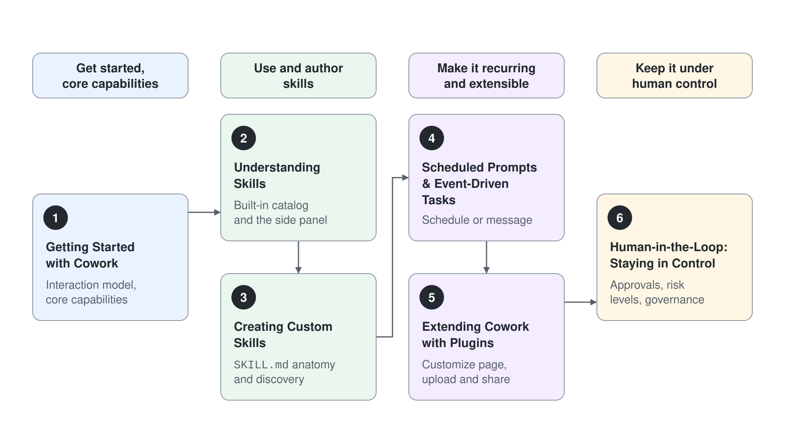
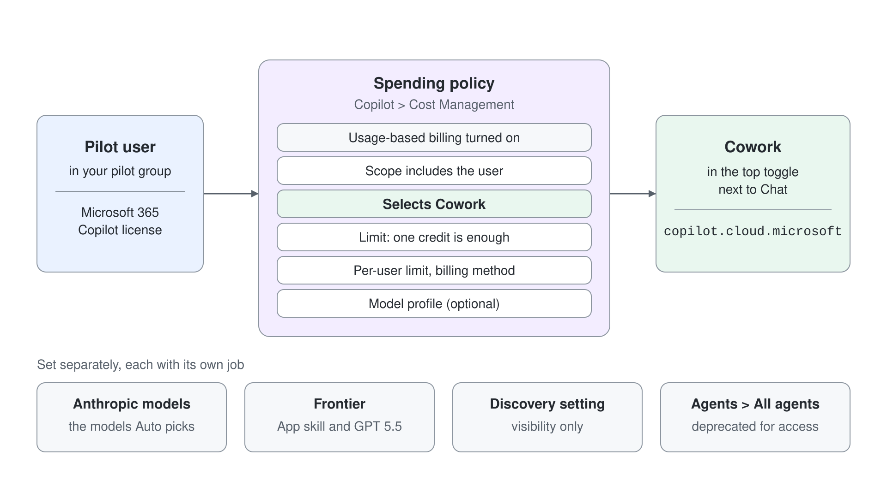

# Module 2: Microsoft 365 Copilot Cowork

> **Generally available**: Cowork has been generally available since June 2026. Access comes from a Copilot Credits spending policy, not from Frontier enrollment. This module was last checked against Microsoft Learn on 2026-10-17.

Cowork is Microsoft 365's agentic AI that does work on your behalf. You describe an outcome in plain language, Cowork plans and executes the steps across your apps, and you approve before anything is sent or saved. This module is split into six focused topics: start with getting started and its core capabilities, learn to use and author skills, make that work recurring and extensible, then keep it all under human control.

## Topics

| # | Topic | What you learn |
|---|-------|----------------|
| 1 | [Getting Started with Cowork](./01-intro/readme.md) | What Cowork is, how it differs from Copilot Chat, where to access it, the interaction model, what it remembers, choosing a model and reasoning effort, and its core capabilities across communication, documents, calendar, research, and automation |
| 2 | [Understanding Skills: Built-in Skills & the Side Panel](./02-built-in-skills/readme.md) | The built-in skill catalog, how the side panel shows Cowork's live work, and where additional skills come from |
| 3 | [Creating Custom Skills with SKILL.md](./03-custom-skills/readme.md) | Authoring your own skills in plain language: the `SKILL.md` anatomy, discovery, description tuning, and companion files |
| 4 | [Scheduled Prompts & Event-Driven Tasks](./04-automation/readme.md) | Running a prompt or custom skill on a schedule or when an email or Teams message arrives, while high-risk actions still pause for approval |
| 5 | [Extending Cowork with Plugins](./05-plugins/readme.md) | Adding plugins from the Customize page, uploading and sharing your own, and community repositories to add external data and expertise |
| 6 | [Human-in-the-Loop: Approving Actions & Staying in Control](./06-staying-in-control/readme.md) | The approval model, risk levels, pause and resume, feedback, and how admins govern Cowork |

## Licensing at a Glance

Cowork is metered by usage-based billing in Copilot Credits, not a per-user seat. A user can open Cowork once a spending policy that selects Cowork covers them, even with a one-credit limit. Anthropic models are optional, and Frontier is needed only for the App skill and GPT 5.5. Setup and pay-as-you-go configuration are covered in [Module 1: What It Costs](../01-intro/03-where-to-build/readme.md#what-it-costs-copilot-credits), and the tenant steps are in [Setting Up Cowork in Your Tenant](./01-intro/readme.md#setting-up-cowork-in-your-tenant).

## Hands-On Demos

Guided, copy-paste demos that put each topic to work. Most run on one shared scenario: you are the Regional Manager for Northern Europe at Aurora Outdoor, a Nordic outdoor-gear retailer, closing out Q3. The plugins demo steps into its plugin's own domain, since a plugin brings outside expertise. Each demo runs about 15 minutes, leaves you holding a real artifact, and lives inside the topic it practises.

| Topic | Demo |
|-------|------|
| [Getting Started with Cowork](./01-intro/readme.md) | [Compile a Q3 Business Review Deck](./01-intro/demo-01-quarterly-review.md) |
| [Getting Started with Cowork](./01-intro/readme.md) | [Schedule a Meeting Where Your Week Has Room](./01-intro/demo-02-workiq-scheduling.md) |
| [Understanding Skills](./02-built-in-skills/readme.md) | [Produce a Competitive Market Brief](./02-built-in-skills/demo-01-research-brief.md) |
| [Creating Custom Skills](./03-custom-skills/readme.md) | [Turn a Market Brief into a Repeatable Product Pitch](./03-custom-skills/demo-01-product-pitch-skill.md) |
| [Creating Custom Skills](./03-custom-skills/readme.md) | [Build a Reusable Meeting-Prep Skill](./03-custom-skills/demo-02-meeting-prep-skill.md) |
| [Scheduled Prompts & Event-Driven Tasks](./04-automation/readme.md) | [Automate a Weekly Status Report](./04-automation/demo-01-automation.md) |
| [Extending Cowork with Plugins](./05-plugins/readme.md) | [Extend Cowork with a Community Plugin](./05-plugins/demo-01-plugins.md) |
| [Human-in-the-Loop: Staying in Control](./06-staying-in-control/readme.md) | [Turn a Partner Meeting into a Follow-Up Package](./06-staying-in-control/demo-01-follow-up.md) |

## Hands-On Learning

Cowork is best understood by delegating real work and watching it plan, act, and pause for approval. These guided paths take you from your first request through authoring and packaging your own skills.

| Path | What you do |
|---|---|
| [Lab 1: Get more done with Copilot Cowork](https://learn.microsoft.com/en-us/training/modules/delegate-work-copilot-cowork/) | A ten-unit Microsoft Learn module: choose the right AI tool, write effective requests, and watch Cowork run multi-step work end to end while you stay in control |
| [Lab 2: Copilot Cowork on Copilot Developer Camp](https://microsoft.github.io/copilot-camp/pages/copilot-cowork/01-cowork-skills/) | Build your first custom Agent Skill for Cowork, then package skills and connectors into a Cowork plugin you can deploy |

## Links & Resources

- [Cowork Overview](https://learn.microsoft.com/en-us/microsoft-365/copilot/cowork/)
- [Get Started with Cowork](https://learn.microsoft.com/en-us/microsoft-365/copilot/cowork/get-started)
- [Cowork FAQ](https://learn.microsoft.com/en-us/microsoft-365/copilot/cowork/cowork-faq)
- [Copilot Developer Camp](https://microsoft.github.io/copilot-camp/)
- [Microsoft 365 Copilot: Developer Camp (show series)](https://learn.microsoft.com/en-us/shows/microsoft-365-copilot-developer-camp/)
- [What's New in Cowork](https://learn.microsoft.com/en-us/microsoft-365/copilot/cowork/whats-new)
