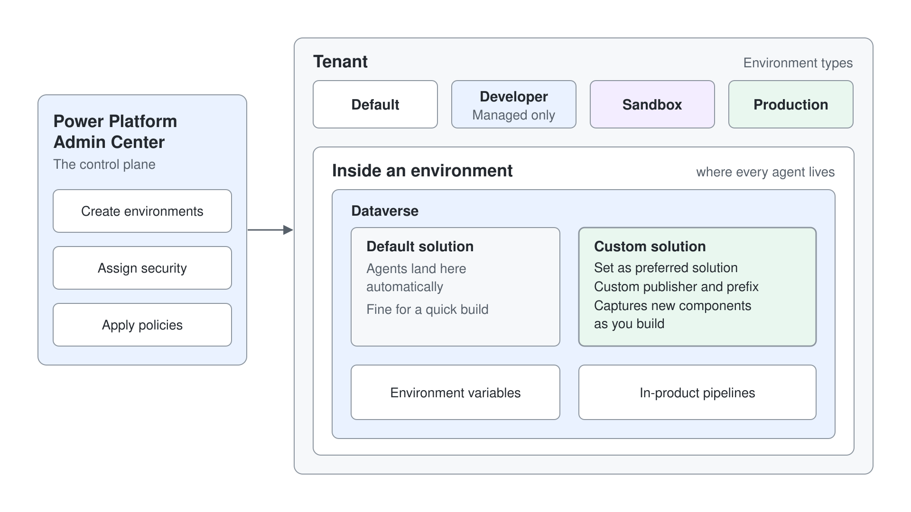

# Standard Agents: Create & Configure

Copilot Studio now builds agents on more than one runtime, and the one most customer projects still run on is the Standard agent (Learn: standard harness). A Standard agent follows the topics, rules, and paths you define, so its behavior stays predictable for well-understood requests such as an internal help desk. Every production agent that already exists in a tenant, and most of the ALM pipelines that move them, live on this surface.

This topic covers where a Standard agent comes from and what you set before you add any knowledge or tools. You create a Standard agent in an environment, give it an identity and instructions, pick its model, and decide how it orchestrates its answers. Everything later in this module builds on these settings.

## Three harnesses, one Copilot Studio

A harness is the runtime between your agent's configuration and the model. It decides when to call the model, what to send it, how to read the reply, and which tool to call next. Learn names three harnesses, and the one you pick when you create an agent fixes its features, its billing, and the authoring screens you see.

| Harness | Learn describes it as | Typical fit |
|---------|-----------------------|-------------|
| Standard harness (Standard agents) | Rule-based agents and structured, repeatable conversations that follow the topics and paths you define | A help desk that answers common questions and routes simple requests through a workflow |
| GitHub Copilot harness (GitHub Copilot agents) | Reasoning-heavy agents that break a goal into steps, recover from failed steps, and create Word, Excel, PowerPoint, and PDF files | A multistep business process such as matching invoices to purchase orders |
| Copilot chat harness | Agents that extend Microsoft Copilot Chat with enterprise knowledge | An onboarding agent that answers from SharePoint inside Copilot Chat |

An agent never moves between harnesses: you choose once, at creation. Learn states that standard harness agents remain fully supported alongside GitHub Copilot agents, which is why this module teaches Standard agents first. GitHub Copilot agents are covered in [GitHub Copilot Agents in Copilot Studio](../../06-cs-gh-copilot/readme.md).

## Creating and opening a Standard agent

The Copilot Studio home page creates both kinds of agent from one **New agent** button, so a maker needs to know which choice leads to a Standard agent. Its dropdown lists **Agent** with the **GitHub Copilot** badge under "Optimize your business processes", and **Agent** with the **Standard** badge ("Create an agent with predefined rules and flows.") under **Other ways to build**. Existing agents open from the **Agents** list, where a column shows **Standard** for standard agents.

| You want to | Do this |
|-------------|---------|
| Create a new Standard agent | On the home page, open the **New agent** dropdown and select **Agent** with the **Standard** badge under **Other ways to build** |
| Open an existing Standard agent | Go to **Agents**, then open the agent from the list |
| Work in the authoring screens of standard agents and agent flows | On the home page, select the three dots (**…**) at the bottom of the side bar, then **Open classic experience** |

## Where a Standard agent lives

Every agent belongs to a Power Platform environment, and the environment holds its Dataverse database, its solutions, and its connections. The environment you select in Copilot Studio before you create the agent is the one it stays in, so pick a dedicated development environment for anything you plan to move to production later. How environments, solutions, and the admin center work is the subject of [Environments, Solutions & the Admin Center](../../07-cs-maintaining/01-environments-solutions/readme.md).

One environment fact changes how a class or a pilot is set up. Learn states that new unmanaged developer environments can't be created from November 15, 2026, and that the Developer Plan sign-up no longer creates one from that date. Use a trial or sandbox environment for a new class tenant.

## Creating an agent

Learn offers two ways to start a Standard agent. You can describe what the agent should do in your own words (up to 1,024 characters), and Copilot Studio generates the name, description, and instructions and suggests triggers, channels, knowledge sources, and tools. You can also select **Create blank agent** on the **Agents** page, enter only a name, and write everything yourself.

A third start is an agent template. The **Agents** page offers templates such as IT Helpdesk, Safe Travels, Weather, and Website Q&A, each a configured custom agent you then tailor. A template decides more than its content: if you create an agent from a prebuilt agent, its configuration also decides which orchestration method the agent uses.

| Start | What Copilot Studio fills in | Use it when |
|-------|------------------------------|-------------|
| Describe the agent | Name, description, instructions, plus suggested knowledge, tools, triggers, and channels | You want a fast first draft to refine |
| **Create blank agent** | Only the name you enter | You already know the instructions and sources |
| Agent template | A complete, working agent for one scenario | Your scenario matches a template closely |

## The Overview page

After provisioning, the agent opens on its **Overview** page, the hub for its identity. The **Details** section holds the name, icon, and description, and the **Instructions** section holds the natural-language guidance for its behavior. Further down you find the **Model** choice, the suggested prompts, and the agent's knowledge.

### Instructions

Instructions tell the agent what its job is, what tone to use, and where its boundaries are. In the instructions editor you can type a slash (`/`) to insert a reference to a tool, a topic, another agent, a variable, or a Power Fx expression, so the instruction names the exact component it means. Write instructions that state scope and refusals explicitly, because a Standard agent with generative orchestration uses them to decide which component answers.

### Model

The **Model** section is a dropdown that sets the primary model for the agent's orchestration. Learn's availability table lists GPT Chat Latest as the default model, alongside general models such as GPT-4.1 and GPT-5 Chat. Preview and experimental models appear only after an administrator allows them, and external models such as Anthropic's need two separate administrator actions before a maker can select them.

## The orchestration setting

Orchestration decides how the agent picks what answers a message. A Standard agent can run either mode, and new agents start with generative orchestration. You switch it on the **Settings** page, in the **Generative AI** section, under **Orchestration**, with the question **Use generative AI orchestration for your agent's responses?**

| Behavior | Generative orchestration | Classic orchestration |
|----------|--------------------------|-----------------------|
| Topics | Selected by the description of their purpose | Selected by matching the user's message to trigger phrases |
| Tools | Called when their name and description fit the request | Called only from inside a topic |
| Knowledge | Searched proactively to answer a question | Used as a fallback when no topic matches, or called from a topic |
| Several components per message | Combines topics, tools, and knowledge in one plan | Tries to select a single topic |
| Missing information | Generates questions to fill inputs automatically | Needs a **Question** node you author |
| The reply | Generated from everything the plan used | Written by you in **Message** nodes |

Several features in later topics only work with generative orchestration, including event triggers, MCP servers, computer use, and child or connected agents. An administrator can also turn generative orchestration off for an environment, and then every agent created there uses classic orchestration. Choose classic orchestration when every path must be scripted and reviewable, and generative when users phrase requests in ways you can't predict.

## Testing while you build

The **Test your agent** panel lets you chat with the draft before anyone else sees it. For an agent with generative orchestration, the activity map shows the orchestrator's plan in real time: which topic, tool, or knowledge source it selected and what it passed in. Close the activity map and turn on tracking between topics when you want to follow a classic conversation node by node.

Two habits save time from the first day. Test after every change, because the test panel always runs the latest draft while channels run the last published version. When an answer surprises you, read the activity map before you edit instructions, because the map tells you whether the wrong component was chosen or the right one returned the wrong content.

## Hands-On Demo

- [Create a Standard IT Help Desk Agent](./demo-create-a-standard-agent.md): the presenter creates a Standard agent from a description, tightens its instructions, checks the model, and runs the same question under generative and classic orchestration to show the difference in the test panel.

## Hands-On Lab

- [Create Your First Copilot Studio Agent](../../../labs/03-cs-basics/01-standard-agents/lab-01-create-your-first-agent.md): learners set up a Power Platform environment, activate Copilot Studio, and create and test the HR agent the rest of the labs extend.

## Key Topics covered in this module

[Harnesses in Copilot Studio](https://learn.microsoft.com/microsoft-copilot-studio/harnesses-overview)

[Access standard harness agents and agent flows](https://learn.microsoft.com/microsoft-copilot-studio/agents-experience/switch-experiences)

[Create and delete agents](https://learn.microsoft.com/microsoft-copilot-studio/authoring-first-bot)

[Create a custom agent from an agent template](https://learn.microsoft.com/microsoft-copilot-studio/template-fundamentals)

[Write agent instructions](https://learn.microsoft.com/microsoft-copilot-studio/authoring-instructions)

[Select a primary AI model for your agent](https://learn.microsoft.com/microsoft-copilot-studio/authoring-select-agent-model)

[Orchestrate agent behavior with generative AI](https://learn.microsoft.com/microsoft-copilot-studio/advanced-generative-actions)

[Test your agent](https://learn.microsoft.com/microsoft-copilot-studio/authoring-test-bot)

[Review agent activity](https://learn.microsoft.com/microsoft-copilot-studio/authoring-review-activity)

[Power Platform environments overview](https://learn.microsoft.com/power-platform/admin/environments-overview)
