# Ground the Help Desk Agent in Public Content



The help desk agent from the previous topic answers from the model's general knowledge, so its VPN advice is plausible and cites nothing anyone can check. Employees and the service desk need answers they can trace to a real support page. In this demo you add public knowledge sources with descriptions that steer the agent, prove the grounding with citations and the activity map, and decide what happens when no source knows the answer.

What you practice here: adding knowledge sources whose names and descriptions steer the orchestrator, then controlling grounded and ungrounded answers.

Duration: about 40 minutes.

## What you'll build

- Two public website sources on the help desk agent, one for Windows and one for Office, each with a description the orchestrator can tell apart.
- Test answers with citations, checked against the source chosen in the activity map.
- A grounded-only configuration that blocks answers without a source.
- Web search turned on for questions beyond your sources, and five suggested prompts for Teams and Copilot Chat.

## Prerequisites

- A Standard agent with generative orchestration turned on. If you skipped the previous demo, create an agent named Grey Logistics IT Help Desk from **New agent**, **Agent** with the **Standard** badge, with the description "An IT help desk agent that answers Windows and Microsoft 365 questions for employees."
- **Allow ungrounded responses** turned on in **Settings**, **Generative AI**, **Knowledge**, so you can see the difference when you turn it off.

## Exercise 1: Add two public websites with distinct descriptions

The orchestrator chooses a knowledge source mainly by its name and description, the same way it chooses topics and tools. Two sources with vague, overlapping descriptions make that choice a coin toss, while two precise descriptions make it predictable.

1. On the **Overview** page, in the **Knowledge** section, select **Add knowledge**, then **Public websites**.
2. Enter the first URL, then set the name and description shown below and add it to the agent.

```text
https://support.microsoft.com/en-us/windows
```

```text
Name: Windows support
Description: Microsoft's official Windows support articles. Use for sign-in problems, Windows Hello, Wi-Fi and VPN connections, Windows Update, drivers, printers, and device settings on Windows 11.
```

3. Add a second public website the same way.

```text
https://support.microsoft.com/en-us/office
```

```text
Name: Microsoft 365 apps support
Description: Microsoft's official support articles for Outlook, Teams, Word, Excel, PowerPoint, and OneDrive. Use for mailbox, calendar, meeting, file sync, and sharing questions.
```

Expected: the **Knowledge** section lists Windows support and Microsoft 365 apps support, each with its description. A status indicator shows when a source is ready.

## Exercise 2: Ask questions and read the citations and the activity map

A grounded answer is only as convincing as the evidence behind it. The citations show the user where the answer came from, and the activity map shows you which source the orchestrator decided to search.

1. In the **Test your agent** panel, start a new conversation and open the activity map.
2. Send the first prompt.

```text
Windows Hello face sign-in stopped working after an update. How do I set it up again?
```

3. Send the second prompt.

```text
OneDrive shows a red X on some files in File Explorer. What does it mean and how do I fix it?
```

Expected: both answers carry numbered citations that link to support.microsoft.com pages. The activity map shows the Windows support source for the first question and the Microsoft 365 apps support source for the second.

> **Tip:** When the map shows the wrong source, fix the description before you touch the instructions. The description is what the orchestrator reads to choose.

## Exercise 3: Block answers that have no source

Some teams prefer no answer over an answer nobody can verify. Turning off **Allow ungrounded responses** makes the agent block any reply produced in a turn where it used no knowledge source or tool, and the **Fallback** topic answers that turn.

1. Ask a question that neither support site covers, with **Allow ungrounded responses** still on.

```text
How many vacation days does a new Grey Logistics employee get?
```

2. Go to **Settings**, **Generative AI**, **Knowledge**, turn off **Allow ungrounded responses**, and select **Save**.
3. Start a new conversation in the test panel and send the same question.

Expected: with the setting on, the agent replies from general knowledge without citations, or declines because the question isn't workplace IT. With the setting off, a reply that used no source is blocked and the **Fallback** topic asks you to rephrase.

## Exercise 4: Turn on web search for questions beyond your sources

Your two sources cover Microsoft products, but employees also ask about third-party hardware. Web search lets the agent search all public sites Bing indexes, in parallel with your website sources, while still citing each page it used.

1. On the **Overview** page, in the **Knowledge** section, turn on **Web Search**.
2. Start a new conversation and send the prompt.

```text
How do I pair a Logitech MX Master 3S mouse with a Windows 11 laptop over Bluetooth?
```

Expected: the answer cites at least one page from a site outside support.microsoft.com, for example the manufacturer's support site. The activity map shows the web search alongside your website sources.

> **Note:** Web search sends a short keyword query to Bing, outside the enterprise boundary and under Bing's own terms. Mention this when a customer asks why an administrator can turn Bing search off.

## Exercise 5: Add suggested prompts for Teams and Copilot Chat

Suggested prompts teach users what the agent is for before they type anything. They appear only on the welcome page in Teams and Microsoft Copilot Chat, so you set them now and see them after publishing in the publishing topic.

1. On the **Overview** page, select the edit icon at the top of the **Suggested prompts** section.
2. Replace any generated prompts with the following five, entering each title and prompt pair, then select **Save**.

```text
Title: Fix Windows Hello
Prompt: Windows Hello face sign-in stopped working. How do I set it up again?

Title: OneDrive sync errors
Prompt: OneDrive shows a red X on some files. What does it mean and how do I fix it?

Title: Outlook keeps asking for my password
Prompt: Outlook keeps asking for my password. What should I check first?

Title: Teams camera not working
Prompt: Teams can't find my camera in meetings. How do I fix it?

Title: Pair a Bluetooth mouse
Prompt: How do I pair a Bluetooth mouse with my Windows 11 laptop?
```

Expected: the **Suggested prompts** section lists the five titles. The test panel shows no change, which is the expected behavior for this setting.

## Troubleshooting

| Symptom | Likely cause | Fix |
|---------|--------------|-----|
| The website source is rejected | The URL is more than two levels deep | Shorten it to at most two path levels, such as `/en-us/windows` |
| Both questions use the same source | The descriptions overlap | Make each description name the products and problem types it covers |
| Answers disappear at random with ungrounded responses off | The model returned an answer without an in-text citation | Add "Always cite the source page for every statement" to the instructions |
| The **Web Search** toggle is missing or has no effect | Generative orchestration is off, or an administrator turned off Bing search | Turn on generative orchestration, or ask the administrator |

## Summary

You grounded the help desk agent in two public sources and controlled what happens when they don't know the answer. You can now:

- add knowledge sources with names and descriptions that steer the orchestrator
- verify grounding through citations and the activity map
- block ungrounded answers and recognize the Fallback behavior that follows
- extend coverage with web search and prepare suggested prompts for Teams and Copilot Chat

Next, [Topics, Entities & Variables](../03-topics/readme.md) adds scripted conversations for the requests that must follow a fixed path.
