# Knowledge Sources & Suggested Prompts

An agent with good instructions but no knowledge answers from the model's general training, which sounds fluent and cites nothing your company wrote. Knowledge sources change that: the agent searches content you point it at when a question arrives and grounds its reply in what it found, with citations a user can open. Choosing which sources to add, and describing each one well, decides most of an agent's answer quality.

This topic explains how a Standard agent answers from knowledge, which source types exist and who can see what through them, and how the orchestration mode changes the search. It closes with the settings that control ungrounded answers and web search, and with suggested prompts, the starters users see before they type anything.

## How a Standard agent answers from knowledge

Knowledge works at two levels. Agent-level knowledge, added on the **Overview** or **Knowledge** page, is available to the whole agent. Topic-level knowledge lives in a generative answers node inside a topic, so a search runs for one specific intent with its own sources.

Every new agent gets a system topic called **Conversational boosting** that contains a generative answers node. Each source you add at agent level is added to that node, which is why an agent answers from new knowledge without any topic work. When neither a topic nor generative answers can respond, the **Fallback** system topic takes over.

## The knowledge source types

When you select **Add knowledge**, the dialog offers the following source types. After adding one, you give it a unique name and a description. Learn asks for a description that is as detailed as possible, because generative orchestration uses it to decide which source to search.

| Source | What the agent searches | Who can see the content |
|--------|-------------------------|-------------------------|
| Public website | Pages under the URL you enter, through Grounding with Bing Search | Anyone; no sign-in needed |
| Upload file | Documents you upload, stored in Dataverse | Everyone who can chat with the agent |
| SharePoint | A SharePoint URL, searched through Microsoft Graph | Only content the signed-in user can already open |
| Dataverse | Up to 15 tables per source, with synonyms and a glossary | The signed-in user's Dataverse permissions |
| Azure AI Search | An existing search index | Depends on the connection you configure |
| Real-time connectors | Live systems such as Dynamics 365, Salesforce, ServiceNow, and Azure SQL | Depends on the connection you configure |
| Unstructured data | Individual SharePoint or OneDrive files and folders, and connector content | The signed-in user's permissions |

The permission column is the one makers underestimate. SharePoint, Dataverse, and Copilot connector sources use the agent user's Microsoft Entra ID authentication, so two people asking the same question can get different answers. An uploaded file has no such filter: once it is in the agent, every user of the agent can be answered from it.

## Knowledge in classic and generative orchestration

The orchestration mode you set in the previous topic changes how knowledge is searched. Generative orchestration searches proactively and can combine several sources in one answer. Classic orchestration searches knowledge as a fallback when no topic's trigger phrases match, inside the **Conversational boosting** topic.

| Area | Generative orchestration | Classic orchestration |
|------|--------------------------|-----------------------|
| When knowledge is searched | Whenever the plan decides a source can help | When no topic matches, or when a topic calls a generative answers node |
| How many sources | Filters with an internal model when there are more than 25 sources; uploaded files don't count | Fixed limits per type: 4 website URLs, 4 SharePoint URLs, 2 Dataverse sources, 2 Bing Custom Search configuration IDs, unlimited uploaded files |
| Custom data and Bing Custom Search | Only inside a generative answers node in a topic | Supported as sources |
| Customizing the search topic | Edits to **Conversational boosting** aren't used | Edits to **Conversational boosting** shape the search |

## Public websites, web search, and Bing Custom Search

A public website source searches Bing, restricted to the URL you add. The URL can be at most two levels deep, and the query sent to Bing can't exceed 2,048 characters, so very long questions or long conversations can skip the search. Learn also asks you to confirm which websites your organization owns, because those are the ones Bing searches on the agent's behalf.

The **Web Search** setting goes further. It appears in the **Knowledge** section of the **Overview** page and as **Use information from the web** on the **Generative AI** settings page, needs generative orchestration, and searches all public websites Bing indexes. Its results are interleaved with your public website sources. Bing queries leave your enterprise boundary under Bing's own terms, and administrators can turn Bing search off in the Power Platform admin center.

Bing Custom Search is the tailored option. You build a search instance at the Bing Custom Search portal that includes or excludes specific sites and pins answers for frequent queries, then add its **Configuration ID** under **Add knowledge**, **Advanced**, **Bing Custom Search**. Turning it on overrides and turns off your public website sources. With generative orchestration it works only inside a generative answers node in a topic, through the node's **Classic data** options.

## Settings that shape grounded answers

Four settings on the **Generative AI** settings page change what the agent may say. They matter as much as the sources, because they decide what happens when a source finds nothing.

| Setting | What it does | Note |
|---------|--------------|------|
| **Allow ungrounded responses** | Lets the agent answer from the model's general knowledge when no source or tool was used | When off, a turn that used no source or tool is blocked and the Fallback topic runs |
| Content moderation | Sets the filter from **Lowest** to **Highest**; Learn names **High** as the default, but a new agent starts at **Low** | A moderation level set on a generative answers node takes precedence |
| **Tenant graph grounding with semantic search** | Uses the Microsoft 365 semantic index for better SharePoint retrieval | Needs **Authenticate with Microsoft** and a Microsoft 365 Copilot license in the tenant; extra cost |
| Official source | Marks a highly trusted source so the agent uses it without verification | Not compatible with generative orchestration |

With **Allow ungrounded responses** off, an answer counts as grounded only when it carries an in-text citation. Instructions that tell the model to omit sources, or force a rigid output format such as JSON, can suppress those citations and make answers disappear intermittently. An instruction that asks the agent to always cite its sources keeps citations consistent.

## Suggested prompts

Suggested prompts are the starters a user sees on the agent's welcome page in Microsoft Teams or Microsoft Copilot Chat before the first message. You can configure up to 10 in the **Suggested prompts** section of the **Overview** page, each with a title and a prompt, and Copilot Studio may generate some from the agent's description and instructions. They don't appear in the test panel, so you only see them after publishing.

Two channel details decide whether users see them at all. In Teams, the **Conversation Start** system topic opens the chat with the agent's introductory message and skips the welcome page, so turn it off for an agent published only to Teams; users can still open the Prompt Gallery. In Microsoft Copilot, chats always start from the welcome page, and updates can take time to appear because of caching.

## What the Live Build Taught

**A new agent can answer without any source until you switch off ungrounded responses.** **Allow ungrounded responses** starts On, so an answer can sound just as right as a grounded one. Open the citation before you trust it, because the cited file is what proves grounding.

**Keep knowledge file names short.** Each file name becomes part of its component's schema name in the agent YAML. A long name failed to sync with `PropertyLengthTooLong`, because the agent's schema prefix pushed it past the limit.

## Hands-On Demo

- [Ground the Help Desk Agent in Public Content](./demo-ground-with-knowledge.md): the presenter adds two public website sources with distinct descriptions, shows citations and the activity map, compares grounded and ungrounded behavior, turns on web search, and adds suggested prompts.

## Hands-On Lab

- [Ground the HR Agent with SharePoint Knowledge](../../../labs/03-cs-basics/02-knowledge/lab-01-ground-with-sharepoint.md): learners add SharePoint documents as knowledge to the HR agent and test answers grounded in them.

## Key Topics covered in this module

[Knowledge sources summary](https://learn.microsoft.com/microsoft-copilot-studio/knowledge-copilot-studio)

[Add knowledge to an agent](https://learn.microsoft.com/microsoft-copilot-studio/knowledge-add-existing-copilot)

[Add a public website as a knowledge source](https://learn.microsoft.com/microsoft-copilot-studio/knowledge-add-public-website)

[Add SharePoint as a knowledge source](https://learn.microsoft.com/microsoft-copilot-studio/knowledge-add-sharepoint)

[Add Bing Custom Search as a knowledge source](https://learn.microsoft.com/microsoft-copilot-studio/knowledge-bing-custom-search)

[Search public data or use a Bing Custom Search for generative answers nodes](https://learn.microsoft.com/microsoft-copilot-studio/nlu-generative-answers-bing)

[Use generative answers in a topic](https://learn.microsoft.com/microsoft-copilot-studio/nlu-boost-node)

[Data, privacy, and security for web search](https://learn.microsoft.com/microsoft-copilot-studio/data-privacy-security-web-search)

[Configure suggested prompts for Teams and Microsoft 365](https://learn.microsoft.com/microsoft-copilot-studio/configure-starter-prompts)
