# Build a Device Issue Topic with Custom Entities



When an employee reports a broken device, the service desk needs three facts every time: which device, its asset tag, and a contact address. Free text gives you "my notebook", "the dock", and "ct-104233" in every possible spelling, and a ticket built from that needs a person to clean it up. In this demo you build a classic topic that turns those messages into clean values, skips questions the user already answered, and decides what happens when an answer never becomes valid.

What you practice here: collecting structured values in a topic with prebuilt and custom entities, proactive slot filling, and deliberate reprompt behavior.

Duration: about 40 minutes.

## What you'll build

- A closed list entity, Device type, with synonyms and smart matching.
- A regular expression entity, Asset tag, that accepts `CT-` plus six digits in any letter case.
- A topic, Report a device issue, that collects the device, the asset tag, and an email address and recaps them.
- A test run where one message fills two questions at once, and a test run where an invalid asset tag falls back to a default value.

## Prerequisites

- A Standard agent, such as Grey Logistics IT Help Desk from the earlier demos, switched to classic orchestration: **Settings**, **Generative AI**, **Orchestration**, set **Use generative AI orchestration for your agent's responses?** to **No**, then **Save**. Classic orchestration triggers the topic from its phrases, which is what this demo shows.

## Exercise 1: Create the Device type closed list entity

A closed list teaches the agent a small, known vocabulary and the words people use for it. Synonyms map "notebook" to laptop and "dock" to docking station, and smart matching catches misspellings, so the variable always holds one of five clean values.

1. Select **Settings** on the top menu bar, then **Entities**.
2. Select **Add an entity**, **New entity**, then **Closed list**.
3. Name the entity `Device type` and add this description.

```text
The type of workplace device an employee reports as broken.
```

4. Under **List items**, add each value below and its synonyms with **Synonyms**.

```text
laptop: notebook, computer, pc
monitor: screen, display
docking station: dock, docking
keyboard: keys
mouse: trackpad, touchpad
```

5. Turn on **Smart matching**, then select **Save**.

Expected: the **Entities** list shows Device type with five values. Opening it shows each value with its synonyms and **Smart matching** turned on.

## Exercise 2: Create the Asset tag regular expression entity

Asset tags always follow one format, so a pattern is more reliable than a list. Learn notes that regex entities use .NET syntax and are case sensitive by default, and the `(?i)` option at the start makes "ct-104233" valid too.

1. On the **Entities** page, select **Add an entity**, **New entity**, then **Regular expression (regex)**.
2. Name the entity `Asset tag`, enter the pattern below, and select **Save**.

```text
(?i)CT-\d{6}
```

Expected: the **Entities** list shows Asset tag next to Device type.

## Exercise 3: Build the Report a device issue topic

The topic asks three questions, each bound to an entity, and recaps the answers. Under classic orchestration it starts when the user's message is close to one of its trigger phrases, so the phrases describe the request in the words employees use.

1. Go to **Topics**, select **Add a topic**, then **From blank**.
2. On the **Trigger** node, select the three dots (**…**), **Properties**, then the **Phrases** area, and paste these phrases, one per line.

```text
report a broken device
my laptop is broken
my monitor stopped working
hardware problem
the docking station doesn't work
my screen is cracked
device issue
```

3. Select **Details** and name the topic `Report a device issue`.
4. Add a **Question** node with the text below. Under **Identify**, select **Device type**, and rename the variable to `deviceType`.

```text
Which device has the problem?
```

5. Add a second **Question** node with the text below. Under **Identify**, select **Asset tag**, and rename the variable to `assetTag`.

```text
What is the asset tag on the device sticker? It starts with CT- followed by six digits.
```

6. Add a third **Question** node with the text below. Under **Identify**, select **Email**, and rename the variable to `contactEmail`.

```text
Which email address should the service desk use to contact you?
```

7. Add a **Message** node. Type the text below and insert each variable with the **{x}** icon where the placeholder names it.

```text
Thanks. I logged a {deviceType} issue for asset {assetTag}. The service desk will contact you at {contactEmail}.
```

8. Select **Save**.

Expected: the canvas shows the **Trigger** node, three **Question** nodes with the entity names Device type, Asset tag, and Email under **Identify**, and the **Message** node with three inserted variables.

## Exercise 4: Watch proactive slot filling fill two answers at once

Users rarely answer one question at a time. Proactive slot filling reads every entity in a message, including the one that triggered the topic, and skips each question whose variable already has a value.

1. Open **Variables** on the topic's menu bar and switch to its **Test** tab.
2. In the **Test your agent** panel, start a new conversation, turn on tracking between topics, and send the message.

```text
My notebook CT-104233 has a cracked screen
```

3. Answer the email question with a test address such as `alex@greylogistics.com`.

Expected: the topic starts, the tracking view jumps straight to the email question, and the **Test** tab shows `deviceType` set to laptop (from the synonym "notebook") and `assetTag` set to CT-104233 before you answered anything. The recap message names all three values.

> **Tip:** To force a question even when its value is already filled, open its properties and set **Skip behavior** to **Ask every time**.

## Exercise 5: Decide what happens after invalid answers

By default a question repeats up to two times and then escalates, which hands a simple typo to a person. For an asset tag, the better design is one clear retry and then a default value the service desk can follow up on.

1. On the asset tag **Question** node, select the three dots (**…**), then **Properties**.
2. Under **Question behavior**, set **How many reprompts** to **Repeat once**. Under **Retry prompt**, select **Customize** and enter the text below.

```text
That doesn't look like an asset tag. Please enter CT- followed by six digits, for example CT-104233.
```

3. Under **Entity recognition**, in **No valid entity found**, set **Action if no entity found** to **Set variable to value** and enter `unknown` as the **Default entity value**.
4. Save the topic, start a new conversation, and send the message, then answer the asset tag question twice with the reply below.

```text
My monitor stopped working
```

```text
I can't find a sticker
```

Expected: after the first invalid answer the agent sends your custom retry prompt. After the second, it moves on to the email question, and the recap names asset unknown.

## Troubleshooting

| Symptom | Likely cause | Fix |
|---------|--------------|-----|
| The message goes to Conversational boosting or Fallback | Generative orchestration is still on, or the phrases are too far from the message | Confirm classic orchestration in **Settings**, then add phrases closer to what users type |
| "notebook" isn't recognized as laptop | The synonym is missing or the wrong entity is selected under **Identify** | Check the Device type values and the question's **Identify** setting |
| A lowercase asset tag is rejected | The pattern lacks the `(?i)` option | Edit the Asset tag entity and add `(?i)` at the start |
| An answer to a question starts a different topic | **Allow switching to another topic** treats the answer as a new request | Turn it off in the question's **Interruptions** properties |

## Summary

You built a topic that turns free-text device reports into three clean values. You can now:

- create closed list entities with synonyms and smart matching, and regular expression entities
- bind questions to prebuilt and custom entities and name their variables
- prove proactive slot filling in the **Test** tab of the **Variables** panel
- replace the default escalation with a retry prompt and a default value

Next, [Power Fx: Formulas in Topics](../04-power-fx/readme.md) calculates and transforms the values a topic collects.
