# Identify an Employee Once and Reuse It Across HR Topics



An HR self-service agent that asks for a name, a department and a cost center in every conversation wears people out, and one that never asks can't tell who wants a reward. HR Buddy solves this with two topics: one collects the employee's data and remembers that the employee is known, the other checks that memory and sends unknown employees through the first topic before it hands out a reward. In this demo you rebuild both topics in a fresh agent, CS-HR Buddy, and watch the second topic skip its detour once the employee is identified.

What you practice here: collecting values with prebuilt entities and multiple choice options, sharing state between topics with a global variable, and redirecting to another topic on a Power Fx condition.

Duration: about 40 minutes.

## What you'll build

- A Standard agent, CS-HR Buddy, with HR Buddy's description, instruction and HR Documents SharePoint knowledge.
- A topic, Collect Employee Data, that asks for last name, first name, department and cost center, confirms the paid leave and sets the global variable `EmployeeIdentified`.
- A topic, Collect Employee rewards, that redirects to Collect Employee Data when `EmployeeIdentified` isn't true, then offers a free dinner or a theatre visit.
- A test run where the first reward request detours through the employee questions and the second goes straight to the reward.

## Prerequisites

- A Copilot Studio license or trial and the maker role in a Power Platform environment, opened in the classic experience: on the **Home** page select the three dots (**...**) at the bottom of the side bar, then **Open classic experience**.
- Read access to the SharePoint site that holds your HR documents, written below as `<your HR Documents site URL>`.
- The definition of the original agent: [src/cs-schema/agents/HR Buddy](../../../src/cs-schema/agents/HR%20Buddy/). Every value you paste comes from its `agent.mcs.yml`, its `knowledge/` file and its topics `CollectEmployeeData.mcs.yml` and `CollectEmployeerewards.mcs.yml`.

## Exercise 1: Create CS-HR Buddy with its HR knowledge

HR Buddy is deliberately thin at the agent level: a one-line description, a one-line instruction and one SharePoint site, with the behavior in its topics. Recreating it with the same text keeps the demo honest about where the logic lives, and the CS- prefix marks it as part of the class environment.

1. Go to the **Agents** page, select **Create blank agent**, enter the name `CS-HR Buddy`, and select **Create**.
2. On the **Overview** page, in the **Details** section, select **Edit**, enter the description below, and select **Save**.

```text
An HR Self service agent
```

3. In the **Instructions** section, select **Edit**, paste the instruction below, and select **Save**.

```text
Answer HR related topics
```

4. In the **Knowledge** section, select **Add knowledge**, then **SharePoint**. Enter `<your HR Documents site URL>`, use the name and description below, and select **Add to agent**.

```text
HR Documents
```

```text
Human Resources related info
```

5. Select **Settings**, and in the **Generative AI** section confirm that **Use generative AI orchestration for your agent's responses?** is set to **Yes**, as it is in HR Buddy.

Expected: the **Overview** page shows CS-HR Buddy with the description, the one-line instruction and HR Documents under **Knowledge**, and the orchestration setting reads **Yes**.

## Exercise 2: Build the Collect Employee Data questions

With generative orchestration, the agent picks a topic by its name and the description on the **Trigger** node, so the description lists the requests the topic handles. HR Buddy's file still carries nine trigger phrases from classic orchestration; under generative orchestration only the description counts. The four questions each bind to the entity that keeps the answer clean: a person name for both names, a fixed list for the department, and a number for the cost center.

1. Go to **Topics**, select **Add a topic**, then **From blank**, and name the topic `Collect Employee Data`.
2. On the **Trigger** node (**The agent chooses**), paste the description below.

```text
This tool can handle queries like these: add employee information, collect employee data, query for paid leave available
```

3. Add a **Question** node with the text below. Under **Identify**, select **Person name**, and rename the variable to `LastName`.

```text
What is your last name?
```

4. Add a second **Question** node with the text below, **Identify** set to **Person name**, and the variable renamed to `FirstName`.

```text
What is your first name?
```

5. Add a third **Question** node with the text below. Keep **Identify** on **Multiple choice options**, add the three values under **Options for user**, and rename the variable to `Department`.

```text
What is your Department?
```

```text
Marketing
Software Engineering
Accounting
```

6. Add a fourth **Question** node with the text below, **Identify** set to **Number**, and the variable renamed to `CostCenter`. In its **Variable properties** panel, select **Return values to original topics**, which makes the cost center an output of the topic, as `outputType` is in HR Buddy's file.

```text
What is your cost center?
```

7. Select **Save**.

Expected: the canvas shows the **Trigger** node with the description and four **Question** nodes identifying Person name, Person name, the three department options, and Number. The department question shows a branch per option, which you leave empty.

> **Tip:** The rebuild fixes three defects of the clone: the variable `Global.EmplyeeIdentified` becomes `Global.EmployeeIdentified`, "What is yourcost center" becomes "What is your cost center?", and "The tickets will be send to you per post mail." becomes "The tickets will be sent to you by post." Everything else is pasted as HR Buddy has it.

## Exercise 3: Confirm the leave and mark the employee as identified

A topic variable lives only while its topic runs. To let a second topic know that this employee already answered, the topic sets a global variable, which keeps its value for the whole session.

1. Below the questions, where the department branches join, add a **Message** node. Type the text below and insert each variable with the **{x}** icon where the placeholder names it.

```text
Hi {Topic.FirstName} {Topic.LastName}. You have 25 days of paid leave left
```

2. Add a **Set a variable value** node from **Variable management**. Under **Set variable**, select **Create a new variable**, select its name, rename it to `EmployeeIdentified`, and select **Global (any topic can access)**.
3. Under **To value**, enter `true`.
4. Select **Save**, then test in the **Test your agent** panel with the message below and answer the four questions, for example `Kurz`, `Johanna`, `Marketing` and `4711`.

```text
add employee information
```

Expected: the agent asks the four questions in order, shows the department options as buttons, and answers "Hi Johanna Kurz. You have 25 days of paid leave left". In the **Variables** panel, the variable appears as `Global.EmployeeIdentified`.

## Exercise 4: Redirect unknown employees from the rewards topic

The rewards topic needs an identified employee but doesn't ask the questions itself. A condition checks the global variable, and a **Redirect** node runs Collect Employee Data as a subtopic, then returns to the reward question.

1. Go to **Topics**, select **Add a topic**, then **From blank**, and name the topic `Collect Employee rewards`.
2. On the **Trigger** node, paste the description below. HR Buddy's topic has trigger phrases but no description, so this description lists four of its phrases in the style of Collect Employee Data.

```text
This tool can handle queries like these: collect employee rewards, claim my employee reward, redeem employee points, employee perks redemption
```

3. Select the **Add node** icon under the **Trigger** node, then **Add a condition**. Select the three dots (**…**) of the **Condition** node, then **Change to formula**, select the **>** arrow, open the **Formula** tab, enter the formula below, and select **Insert**.

```text
Not(Global.EmployeeIdentified)
```

4. Under the **Condition** branch, select the **Add node** icon, point to **Topic management**, select **Go to another topic**, and choose **Collect Employee Data**.
5. Below the condition, where the branches join, add a **Question** node with the text below. Keep **Identify** on **Multiple choice options**, add the two options, and rename the variable to `RewardChoice`.

```text
Please choose your reward:
```

```text
A free dinner
A visit to theatre
```

6. Under the **A free dinner** branch, add a **Message** node with the first text. Under the other branch, add a **Message** node with the second text.

```text
The dinner voucher will be forwarded to you.
```

```text
The tickets will be sent to you by post.
```

7. Select **Save**.

Expected: the canvas shows the condition with `Not(Global.EmployeeIdentified)`, a **Redirect** node to Collect Employee Data under it, the reward question below both branches, and one message under each reward option.

## Exercise 5: Watch the detour run once

The global variable is empty at the start of a session, so `Not()` returns true and the first reward request detours. After Collect Employee Data sets the variable, the same request in the same session goes straight to the reward.

1. In the **Test your agent** panel, start a new conversation and send the message below.

```text
claim my employee reward
```

2. Answer the four employee questions, then select **A free dinner**.
3. In the same conversation, send the message below and select **A visit to theatre**.

```text
redeem employee points
```

Expected: the first request runs the four employee questions and the paid leave message, then returns to "Please choose your reward:" and confirms the dinner voucher. The second request asks only the reward question and confirms the tickets, because `Global.EmployeeIdentified` is already true. In the live run, the agent asked "Please choose your reward:" once more right after the first confirmation; that extra question comes from the orchestrator, not from the topic, and the next request still skipped the employee questions.

> **Note:** Type `start over` to reset the session. Redirecting to the **Start Over** system topic also resets global variables, so the next reward request detours again.

## Troubleshooting

| Symptom | Likely cause | Fix |
|---------|--------------|-----|
| The reward request is answered from the HR Documents site instead of the topic | The topic description doesn't match the request, or generative orchestration is off | Check the description on the **Trigger** node and the orchestration setting in **Settings**, **Generative AI** |
| The condition never sends the user to the employee questions | The formula names a different variable than the one the first topic sets | Compare the spelling of `Global.EmployeeIdentified` in both topics |
| The second reward request still asks the employee questions | The variable is a topic variable, so it vanished when Collect Employee Data ended | Open the variable in **Variable properties** and select **Global (any topic can access)** |
| The reward question never appears after the employee questions | The question sits inside the condition branch instead of below the joined branches | Move it below the condition so both paths reach it |
| "Please choose your reward:" appears a second time after the first reward is confirmed | Generative orchestration planned Collect Employee Data and Collect Employee rewards for the same request and runs the rewards topic again after the redirect returns | Pick a reward or send the next message; the employee questions stay skipped because the global variable is set |

## Summary

You rebuilt HR Buddy's employee identification in CS-HR Buddy. You can now:

- describe a topic so generative orchestration selects it
- bind questions to the Person name and Number entities and to multiple choice options
- share a value between topics with a global variable and set it with **Set a variable value**
- send a conversation through another topic with a Power Fx condition and a **Redirect** node

Next, [Publish CS-HR Buddy to Teams and Microsoft Copilot](../06-publishing/demo-publish-hr-buddy.md) takes this agent to the people who use it.
