# Topics, Entities & Variables

Knowledge answers open questions, but some requests must follow a fixed path every time: report a broken device, book a room, register a candidate. A topic is how a Standard agent runs that path. It asks the questions you wrote, in the order you wrote them, checks each answer, and responds with exactly the message you designed, which is what makes a Standard agent predictable enough for a help desk or a regulated process.

This topic covers how a topic gets triggered under each orchestration mode, the nodes you build with, how entities turn free text into clean values, and how variables carry those values through a conversation. It ends with conversation design: what the agent does when an answer is invalid, when it understands nothing, and when a human has to take over.

## What a topic is

A topic is one portion of a conversation, drawn on an authoring canvas as a chain of nodes. It starts with a **Trigger** node and then sends messages, asks questions, branches, calls tools, and ends or hands over. Every agent starts with two kinds of topics.

| Kind | Examples | What you can do with it |
|------|----------|-------------------------|
| System topics | Conversation Start, Conversational boosting, Fallback, Escalate, On Error, Multiple Topics Matched, End of Conversation, Reset Conversation, Sign in | Edit and turn off, never delete or create |
| Custom topics | The predefined Greeting, Goodbye, Start Over, Thank you topics, and every topic you add | Create, edit, and delete freely |

You can also open any topic in the code editor, which shows it as YAML. That view is useful for copying a topic between agents, but Learn notes that designing a complex topic entirely in the code editor isn't fully supported. When you write topic YAML outside the portal, check each token with the language server of the Copilot Studio extension for VS Code: Learn rarely documents the literal tokens, and look-alikes such as `DatePrebuiltEntity` and `DateTimePrebuiltEntity` both exist with different meanings.

## How a topic gets triggered

The orchestration mode decides what a topic needs before it can run. Under classic orchestration the topic needs trigger phrases, the short sentences and keywords users are likely to type, and Learn recommends 5 to 10 per topic. The language model matches meaning, so "see store opening hours" still triggers a topic whose phrase is "check store hours".

Under generative orchestration the **Trigger** node switches from **User says a phrase** to **The agent chooses**, and the topic needs a description of its purpose. The orchestrator compares that description with the request, alongside every tool, knowledge source, and other agent. When you switch an existing agent from classic to generative orchestration, Copilot Studio generates a description from each topic's trigger phrases as a starting point.

| Element | Classic orchestration | Generative orchestration |
|---------|-----------------------|--------------------------|
| What the topic needs | 5 to 10 trigger phrases | A clear description of its purpose |
| How it is chosen | Natural language matching against the phrases | The plan selects it by description, possibly with other components |
| Topic inputs | Filled by **Question** nodes you author | Filled from the conversation, or by questions the agent generates |
| Topic outputs | Shown to the user in **Message** nodes | Can return output variables that the agent uses in its reply |

## The nodes you build with

Each node performs one action, and the **Add node** menu groups them. Rename nodes as you build, because a canvas of nodes all called "Question" is unreadable a week later.

| Node | What it does |
|------|--------------|
| **Message** | Sends text, variables, images, or an Adaptive Card to the user |
| **Question** | Asks a question and saves the answer, recognized as an entity, in a variable |
| **Adaptive Card** | Shows an interactive card with input fields and submit buttons |
| **Condition** | Branches the conversation on a variable or a Power Fx formula |
| Variable management | Sets, parses, or clears variables, including the conversation history used by the agent |
| Topic management | Redirects to another topic, transfers to a person, or ends the topic or conversation |
| Tool | Calls a flow, a connector, or another tool |
| Advanced | Generative answers, HTTP requests, events, and more |

## Entities and slot filling

An entity is a type of information the agent recognizes in what a user types. Copilot Studio ships prebuilt entities such as Email, Date and time, Person name, Phone number, City, Number, and Money, and each one copes with the many ways people write the same value. "$100", "a hundred dollars", and "100 dollars" all become the money value 100.

When the built-in types don't fit, you create a custom entity on the **Settings** page under **Entities**. A closed list holds a fixed set of values, each with synonyms, and **Smart matching** adds fuzzy matching for misspellings. A regular expression entity matches a pattern such as a ticket number like INC000001, uses .NET regular expression syntax, and becomes case insensitive with the `(?i)` option.

| Entity type | Use it for | Example |
|-------------|------------|---------|
| Prebuilt | Common values with many spellings | Email, Date and time, Money |
| Closed list | A small, known set of values with synonyms | Device type: laptop (notebook), monitor (screen), docking station (dock) |
| Regular expression | Values that always follow one format | Asset tag `CT-` plus six digits |

Slot filling is the act of placing a recognized entity value into the variable of a **Question** node. Proactive slot filling goes one step further: when a user says "my laptop CT-104233 has a cracked screen" in the first message, the agent fills both the device and the asset tag and skips those questions. The **Skip behavior** property of each question controls this, with **Allow question to be skipped** as the setting that permits it and **Ask every time** as the setting that always asks.

One limitation decides where custom entities go. With generative orchestration, tools and topics don't yet accept closed list or regex entities as input parameters, so you collect such values with a **Question** node inside the topic.

## Variables and their scopes

Every node that returns a value, such as a **Question** node, creates a variable automatically, and you rename it to something meaningful in the **Variable properties** panel. Learn defines four scopes, and the prefix you see in formulas tells you which one a variable belongs to.

| Scope | Prefix | Lives for | Typical use |
|-------|--------|-----------|-------------|
| Topic | `Topic.` | The topic that created it (the default) | A value one topic collects and uses |
| Global | `Global.` | The whole user session, in every topic | The user's location, asked once and reused |
| System | `System.` | Created by Copilot Studio for every conversation | `System.User.DisplayName`, `System.Activity.Text` |
| Environment | `Environment.` | Read-only values from Power Platform | An endpoint or setting that differs between dev and production |

Topic variables travel between topics when one topic redirects to another. Mark a variable **Receive values from other topics** and the destination topic skips the question when the value arrives with the redirect; mark it **Return values to original topics** and the value comes back. A global variable needs a name that is unique across all topics, resets when the **Reset Conversation** topic runs, and can be filled from outside through **External sources can set values**.

The **Parse value** node turns raw JSON, for example an API result returned as a string, into a typed record whose fields you can use in later nodes. Learn's note on secrets is worth repeating in class: an environment variable can reference an Azure Key Vault secret, and anyone who can edit the agent could display its value in a **Message** node.

## Conversation design

A scripted conversation is judged by how it fails. Four mechanisms decide what users experience when something goes wrong, and the best practice is to configure each one on purpose.

| Situation | Mechanism | Default behavior |
|-----------|-----------|------------------|
| The answer to a question isn't valid | **Reprompt** in **Question behavior** | **Repeat up to 2 times**, with an optional custom **Retry prompt** |
| The user never gives a valid answer | **No valid entity found** in **Entity recognition** | **Escalate**; alternatives are set a default value, set the variable to empty, or redirect to a topic |
| The answer to a question looks like a new request | **Interruptions**, **Allow switching to another topic** | On; turn it off when answers keep triggering other topics |
| Nothing matches the message | **Fallback** system topic | Asks the user to rephrase at most twice, then redirects to **Escalate** |

**Additional entity validation** adds a Power Fx condition on top of the entity check, for example `Topic.Quantity < 10`, with its own **Condition not met prompt**. With classic orchestration, **Conversational boosting** runs before **Fallback**, so knowledge gets a chance first. With generative orchestration, the agent doesn't call **Multiple Topics Matched**, so overlapping topic descriptions lead to unpredictable choices: write descriptions that say what each topic does and doesn't do.

Close every resolved path deliberately. Redirecting to **End of Conversation** offers a satisfaction survey, while **Escalate** hands over to a person through a configured engagement hub, or tells the user how to reach one when no hub exists. Under generative orchestration, a topic can return its result as an output variable so the agent writes a reply that fits the conversation, and an answered-state output stops the orchestrator from answering the same request twice.

Once a topic ends, the orchestrator decides what comes next. A **No** to a topic's last question can route to the **Escalate** system topic, which answers "Escalating to a representative is not currently configured" when no hub exists, so give a topic that ends on a question a node after it whenever the answer should lead somewhere. Ending the last message with the next thing the user can ask for, as CS-HR Buddy does with "Ask me to collect your employee reward next.", turns a finished topic into a request the orchestrator can route.

## Hands-On Demos

- [Identify an Employee Once and Reuse It Across HR Topics](./demo-hr-buddy-employee-topics.md): the presenter rebuilds HR Buddy's two topics in CS-HR Buddy, collects the employee's data with prebuilt entities and choices, sets a global variable, and shows the rewards topic detour through the employee questions only until the employee is known.
- [Build a Device Issue Topic with Custom Entities](./demo-build-a-slot-filling-topic.md) (optional): the presenter creates a closed list and a regex entity, builds a topic that collects a device, an asset tag, and an email address, shows proactive slot filling in the variables panel, and configures what happens after invalid answers.

## Hands-On Lab

- [Define Topics, Entities, and Variables](../../../labs/03-cs-basics/03-topics/lab-01-build-topics.md): learners turn on generative orchestration for the HR agent and build a single-turn and a multi-turn topic that collect and recap candidate data.

## Key Topics covered in this module

[Create and edit topics](https://learn.microsoft.com/microsoft-copilot-studio/authoring-create-edit-topics)

[Trigger phrase best practices](https://learn.microsoft.com/microsoft-copilot-studio/guidance/trigger-phrases-best-practices)

[Ask a question](https://learn.microsoft.com/microsoft-copilot-studio/authoring-ask-a-question)

[Use entities and slot filling in agents](https://learn.microsoft.com/microsoft-copilot-studio/advanced-entities-slot-filling)

[Implement slot-filling best practices](https://learn.microsoft.com/microsoft-copilot-studio/guidance/slot-filling-best-practices)

[Variables overview](https://learn.microsoft.com/microsoft-copilot-studio/authoring-variables-about)

[Work with variables](https://learn.microsoft.com/microsoft-copilot-studio/authoring-variables)

[Work with global variables](https://learn.microsoft.com/microsoft-copilot-studio/authoring-variables-bot)

[Use system topics](https://learn.microsoft.com/microsoft-copilot-studio/authoring-system-topics)

[Configure the system fallback topic](https://learn.microsoft.com/microsoft-copilot-studio/authoring-system-fallback-topic)

[Recommendations for designing conversational experiences](https://learn.microsoft.com/power-platform/well-architected/experience-optimization/conversation-design)
