# Prepare a Travel Expense Claim with Power Fx



An expense claim collected on a card is still raw input: no claim number, and dates in a format a database column won't take as a timestamp. Without formulas, someone fixes each claim by hand before it can be stored. In this demo you rebuild the expense pilot as CS-Travel Expense Refund and let three Power Fx formulas turn the card input into a claim that is ready to save.

What you practice here: deriving new values from collected input with Power Fx in **Set variable value** nodes, and checking every result in the **Test** tab of the **Variables** panel.

Duration: about 40 minutes.

## What you'll build

- A Standard agent, CS-Travel Expense Refund, with its greeting instructions and the WKO business travel page as knowledge.
- A topic, Submit Refund Request, that collects a claim on a six-field Adaptive Card.
- Variables `claimID`, `departureDateIso`, and `returnDateIso`, each set by one formula.
- A recap message that shows the exact values the next demo hands to a flow.

## Prerequisites

- Copilot Studio in an environment where you can create agents. Open the classic experience: on the home page select the three dots (**…**) at the bottom of the side bar, then **Open classic experience**.
- The definition this demo rebuilds, cloned in [src/cs-schema/agents/Travel Expense Refund](../../../src/cs-schema/agents/Travel%20Expense%20Refund/).
- Copilot Studio formulas use US-style numbers: the comma separates arguments, whatever your browser language.

## Exercise 1: Create CS-Travel Expense Refund

The expense pilot is a Standard agent with one job: take a travel claim. Its instructions set the opening line, and the WKO page on business travel lets it answer what counts as a business trip and which costs qualify.

1. Go to **Agents**, select **Create blank agent**, enter the name `CS-Travel Expense Refund`, and select **Create**.
2. On the **Overview** page, edit **Details** and paste this description.

```text
An agent that helps with refunding travel costs by taking the request and storing it in Dataverse
```

3. In the **Instructions** section, select **Edit**, paste the instructions, and save.

```text
Greet the user with: This is the expense pilot. What is your employee number?
```

4. In the **Knowledge** section, check that **Web Search** is enabled, then select **Add knowledge** and **Public websites**.
5. Enter the URL below in **Public website link** and select **Add**.

```text
https://www.wko.at/lohnverrechnung/lohnsteuerliche-behandlung-dienstreisen
```

6. Set the **Name** and **Description** below, then select **Add to agent**.

```text
Lohnsteuerliche Behandlung von Dienstreisen
```

```text
Official resource on what counts as a business trip and which costs can be claimed
```

7. In the **Test your agent** panel, send the question below.

```text
Which costs count as travel expenses on a business trip in Austria?
```

Expected: the **Overview** page shows the new agent with its description and instructions, and the **Knowledge** section lists the WKO source. The test answer summarizes the rules from the WKO page and cites it.

## Exercise 2: Add the claim card topic

Generative orchestration picks a topic by its description, so the topic needs one sentence that names the request. The card itself is pasted as JSON: the **Adaptive Card** node turns each input `id` into an output variable you can use in formulas.

1. Go to **Topics**, select **Add a topic**, then **From blank**, and name the topic `Submit Refund Request`.
2. On the **Trigger** node, which shows **The agent chooses**, enter this description.

```text
The user wants to submit a travel expense claim
```

3. Select the **Add node** icon under the trigger, then **Ask with Adaptive Card**.
4. Open the node's three dots (**…**), select **Properties**, then **Edit adaptive card**, replace the payload in the **Card payload editor** with the JSON below, and select **Save**.

```json
{
  "$schema": "https://adaptivecards.io/schemas/adaptive-card.json",
  "type": "AdaptiveCard",
  "version": "1.5",
  "body": [
    {
      "type": "TextBlock",
      "text": "Expense Claim",
      "weight": "Bolder",
      "size": "Medium"
    },
    {
      "type": "Input.Text",
      "id": "email",
      "label": "Email Address",
      "placeholder": "Your email (auto-filled from system)",
      "isRequired": true,
      "errorMessage": "Please enter your email"
    },
    {
      "type": "Input.Text",
      "id": "destination",
      "label": "Destination",
      "placeholder": "Enter destination",
      "isRequired": true,
      "errorMessage": "Please enter the destination"
    },
    {
      "type": "Input.Date",
      "id": "departureDate",
      "label": "Departure Date",
      "isRequired": true,
      "errorMessage": "Please enter the departure date"
    },
    {
      "type": "Input.Date",
      "id": "returnDate",
      "label": "Return Date",
      "isRequired": true,
      "errorMessage": "Please enter the return date"
    },
    {
      "type": "Input.Number",
      "id": "amount",
      "label": "Amount",
      "placeholder": "Enter amount",
      "isRequired": true,
      "errorMessage": "Please enter the amount claimed"
    },
    {
      "type": "Input.Text",
      "id": "comment",
      "label": "Comment",
      "placeholder": "Enter any comments",
      "isMultiline": true
    }
  ],
  "actions": [
    {
      "type": "Action.Submit",
      "title": "Submit Claim"
    }
  ]
}
```

5. Rename the node to `Get refund metadata` and select **Save** on the topic.

Expected: the node shows a preview of the Expense Claim card, and the outputs list `actionSubmitId`, `amount`, `comment`, `departureDate`, `destination`, `email`, and `returnDate`. `amount` is a number; the two dates are strings.

## Exercise 3: Give every claim its own ID

A saved claim needs a key that no other claim shares, and the user should never have to invent one. `GUID()` creates a globally unique identifier, and `Text()` turns it into the string a Dataverse text column expects.

1. Under the card node, select the **Add node** icon, then **Variable management** > **Set a variable value**.
2. Under **Set variable**, select **Create new** and name the variable `claimID`.
3. In **To value**, select the **>** arrow, open the **Formula** tab, enter the formula below, and select **Insert**.

```powerfx
Text(GUID())
```

Expected: the node shows `claimID` set to the formula, and the variable type is string.

## Exercise 4: Turn the card dates into timestamps

An `Input.Date` field returns a plain date such as `2026-11-03`. A Dataverse **Date and time** column, which the next demo writes to, takes a full ISO 8601 timestamp, so each date gets a time and a UTC marker appended with the `&` operator.

1. Add a **Set a variable value** node that creates `departureDateIso` with this formula.

```powerfx
Topic.departureDate & "T00:00:00Z"
```

2. Add another node that creates `returnDateIso` with this formula.

```powerfx
Topic.returnDate & "T00:00:00Z"
```

Expected: the canvas shows three **Set variable value** nodes under the card, in the order `claimID`, `departureDateIso`, `returnDateIso`.

> **Tip:** The cloned agent sets the same two ISO variables and then passes the raw `departureDate` and `returnDate` to its flow, so the formulas never reach the database. The rebuild hands the ISO variables on, as the recap below and the next demo show. The rebuild also drops the clone's unused `Topic.expenseClaim` variable and corrects the clone's spelling in the agent description, the knowledge description, the topic description ("The user want") and two card error messages.

## Exercise 5: Recap the claim and watch the formulas run

The recap shows the presenter, and later the user, the exact values a flow will receive. Watching the **Test** tab proves each one came from a formula, not from the card.

1. Add a **Message** node with the text below and insert each variable with the **{x}** icon where its name appears.

```text
Claim {claimID}: {amount} for {destination}, from {departureDateIso} to {returnDateIso}. Contact: {email}. Comment: {comment}
```

2. Select **Save**, open **Variables** on the topic's menu bar, and switch to the **Test** tab.
3. In the **Test your agent** panel, start a new conversation and send the message below.

```text
I want to submit a travel expense claim
```

4. Fill in the card with these values and select **Submit Claim**.

```text
Email Address: alex@greylogistics.com
Destination: Vienna
Departure Date: 2026-11-03
Return Date: 2026-11-05
Amount: 245.80
Comment: Train and two hotel nights
```

Expected: the topic shows the card, and after the submit the **Test** tab shows `claimID` as a 36-character ID, `departureDateIso` as `2026-11-03T00:00:00Z`, and `returnDateIso` as `2026-11-05T00:00:00Z`. The recap names the same values, and a second test run gets a different `claimID`. In the live run the agent then repeated its opening line, "This is the expense pilot. What is your employee number?", because the instructions tell it to greet with that sentence.

These are the values the next demo maps to the flow's inputs:

| Flow input | Value from the topic |
|------------|----------------------|
| ClaimId | `Topic.claimID` |
| EMail | `Topic.email` |
| Destination | `Topic.destination` |
| Comment | `Topic.comment` |
| Amount | `Topic.amount` |
| Departure Date | `Topic.departureDateIso` |
| Return Date | `Topic.returnDateIso` |

## Troubleshooting

| Symptom | Likely cause | Fix |
|---------|--------------|-----|
| The message goes to general knowledge instead of the topic | The trigger description is empty or too vague | Enter the description from Exercise 2 on the **Trigger** node and test in a new conversation |
| The formula editor reports an unknown name | The variable lacks its scope prefix | Write `Topic.departureDate`, never `departureDate` alone |
| A formula with semicolons is rejected | A European list separator was typed | Use commas; Copilot Studio formulas use US-style numbers |
| The card outputs are missing or have the wrong type | The card was saved before the JSON was complete | Reopen **Edit adaptive card**, save again, or correct the types with **Edit Schema** |
| `departureDateIso` is empty | The card was not submitted, or the variable points at the wrong output | Submit the card and check that the formula reads `Topic.departureDate` |
| The greeting "This is the expense pilot. What is your employee number?" follows the recap | The instruction to greet runs again once the topic ends | Ignore it in the demo, or change the instruction to greet only at the start of a conversation |

## Summary

You rebuilt the expense pilot as CS-Travel Expense Refund and turned raw card input into a claim with an ID and two timestamps. You can now:

- create a Standard agent with instructions and a public website as knowledge
- collect several values at once with an **Ask with Adaptive Card** node pasted as JSON
- generate an identifier with `Text(GUID())` and build strings with `&`
- check formula results in the **Test** tab of the **Variables** panel

Next, [Save Expense Claims to Dataverse](../../04-cs-tools/02-dataverse/demo-expense-claims-in-dataverse.md) writes this claim to a Dataverse table through an agent flow.
