# Calculate a Ticket Due Date with Power Fx



Employees ask the help desk when their ticket will be done, and the honest answer depends on the priority and on whether the date lands on a weekend. Without formulas, a topic needs a branch for every priority and another for every weekday, and the canvas turns into a maze. In this demo four short Power Fx formulas replace those branches: one validates the request, one maps the priority to service days, one moves the date off a weekend, and one formats it for the user.

What you practice here: putting calculation and validation logic into Power Fx formulas in **Question**, **Set variable value**, and **Condition** nodes.

Duration: about 40 minutes.

## What you'll build

- A topic, Estimate a ticket due date, that asks for a priority and an issue description.
- A validation rule that rejects descriptions shorter than 20 characters.
- Variables `slaDays`, `dueDate`, and `dueDateText`, each set by one formula.
- A weekend check in a **Condition** node and a reply that names the due date.

## Prerequisites

- A Standard agent, such as Grey Logistics IT Help Desk from the earlier demos, with either orchestration mode.
- Copilot Studio uses US-style numbers in formulas: the comma separates arguments in every formula below, whatever your browser language.

## Exercise 1: Collect the priority and validate the description

A description such as "broken" gives the service desk nothing to act on. **Additional entity validation** runs a Power Fx condition on top of the entity check, so the topic rejects a vague answer and asks again with your own prompt.

1. Go to **Topics**, select **Add a topic**, then **From blank**, and name it `Estimate a ticket due date` in **Details**.
2. Add these trigger phrases and this description to the **Trigger** node.

```text
when will my ticket be done
ticket due date
how long will the service desk take
estimate resolution time
when is my issue fixed
```

```text
Estimates the due date of a service desk ticket from its priority and confirms the issue description.
```

3. Add a **Question** node with the text below. Keep **Identify** on **Multiple choice options**, add the options `High`, `Medium`, and `Low`, and rename the variable to `priority`. If Copilot Studio adds a condition branch for each option, delete those branches: a formula replaces them in the next exercise.

```text
What is the priority of your issue?
```

4. Add a second **Question** node with the text below. Under **Identify**, select **User's entire response**, and rename the variable to `issueDescription`.

```text
Describe the issue in one or two sentences.
```

5. Open the second question's **Properties**, then **Entity recognition**. Under **Additional entity validation**, enter the condition below, select **Customize** under **Condition not met prompt**, and paste the prompt.

```powerfx
Len(Topic.issueDescription) >= 20
```

```text
Please add a little more detail, at least a full sentence, so the service desk can act on it.
```

Expected: the canvas shows two **Question** nodes, and the second node's properties show the `Len` condition and your custom prompt.

## Exercise 2: Map the priority to service days with Switch

`Switch` compares one value against a list of cases and returns the result of the first match, with a default at the end. One formula replaces three condition branches and stays readable when a fourth priority appears.

1. Under the second question, add a **Set variable value** node.
2. Under **Set variable**, select **Create new** and name the variable `slaDays`.
3. Under **To value**, select the **>** arrow, open the **Formula** tab, enter the formula below, and select **Insert**.

```powerfx
Switch(Text(Topic.priority), "High", 1, "Medium", 2, 5)
```

Expected: the node shows `slaDays` set to the formula, and the variable type changes from unknown to number.

> **Tip:** `Text()` around the priority is deliberate. A multiple-choice answer is a choice value, which has no literal form in Power Fx, so convert it before comparing.

## Exercise 3: Calculate the due date and move it off a weekend

`DateAdd` adds days by default, and `Weekday` returns 1 for Sunday and 7 for Saturday. A **Condition** node switched to a formula checks for a weekend, and its true branch pushes the date to Monday.

1. Add a **Set variable value** node that creates `dueDate` with this formula.

```powerfx
DateAdd(Today(), Topic.slaDays)
```

2. Add a **Condition** node. Open its three dots (**…**), select **Change to formula**, select the **>** arrow, and enter this formula.

```powerfx
Weekday(Topic.dueDate) = 1 || Weekday(Topic.dueDate) = 7
```

3. In the **Condition** branch, add a **Set variable value** node that sets the existing `dueDate` variable with this formula.

```powerfx
DateAdd(Topic.dueDate, If(Weekday(Topic.dueDate) = 7, 2, 1))
```

4. Leave the **All Other Conditions** branch empty, so a weekday due date continues unchanged.

Expected: the canvas shows the date calculation, a formula condition, and an adjustment node in the true branch only.

## Exercise 4: Format the date and reply

A raw date value shows up in a format the user didn't choose. `Text` with a format string turns it into a sentence fragment that reads naturally in the reply.

1. Below the condition, add a **Set variable value** node that creates `dueDateText` with this formula.

```powerfx
Text(Topic.dueDate, "dddd, mmmm d")
```

2. Add a **Message** node with the text below, and insert each variable with the **{x}** icon where the placeholder names it.

```text
Thanks. Your {priority} ticket is due by {dueDateText}. The service desk will update you if anything changes.
```

3. Select **Save**.

Expected: the topic saves without errors, and the message shows three inserted variables.

## Exercise 5: Test the formulas and watch the variables

The **Test** tab of the **Variables** panel shows each formula's result as the conversation runs. Watching it proves that the formulas produced the date in the reply.

1. Open **Variables** on the topic's menu bar and switch to the **Test** tab.
2. In the **Test your agent** panel, start a new conversation, send the first message, and choose **Low**.

```text
When will my ticket be done?
```

3. Answer the description question with a short reply, then with a full sentence.

```text
broken
```

```text
My docking station stopped charging the laptop after this morning's update.
```

4. Run the conversation again and choose **High**.

Expected: the short reply brings back your custom prompt. The **Test** tab shows `slaDays` as 5 for Low and 1 for High, `dueDate` never on a Saturday or Sunday, and the reply names the same date as `dueDateText`.

## Troubleshooting

| Symptom | Likely cause | Fix |
|---------|--------------|-----|
| The formula editor reports an unknown name | The variable is missing its scope prefix | Write `Topic.slaDays`, never `slaDays` alone |
| The `Switch` always returns 5 | The priority is compared as a choice, or the option text differs | Keep `Text(Topic.priority)` and match the option text exactly, including capitals |
| A formula with semicolons is rejected | A European list separator was typed | Use commas between arguments; Copilot Studio formulas use US-style numbers |
| The condition shows a type mismatch | A string is compared with another type | Select **Fix type mismatch** to generate the conversion formula |

## Summary

You replaced a maze of branches with four short formulas that validate, calculate, and format. You can now:

- validate an answer with **Additional entity validation** and a custom prompt
- map values with `Switch` and convert choices with `Text`
- calculate dates with `DateAdd` and branch on a formula with `Weekday`
- check every formula's result in the **Test** tab of the **Variables** panel

Next, [Adaptive Cards: Collect Structured Input](../05-adaptive-cards/readme.md) collects several values in one card.
