# Collect a Canteen Order Demand on an Adaptive Card



The canteen manager sends the week's demand as a chat message ("about 40 schnitzel, plenty of curry"), and someone retypes it into the order. A question per dish would take nine turns and still return free text. In this demo you build CS-Food Stock Buddy and give it one card where the manager types a number per dish, and the agent keeps the demand as structured data for the order calculation that follows.

What you practice here: collecting many typed values in one submit with an Adaptive Card node and turning its outputs into a record that other topics can use.

Duration: about 50 minutes.

## What you'll build

- CS-Food Stock Buddy, a Standard agent for canteen food orders.
- A Submit Demand topic with an Adaptive Card that lists nine dishes, each with a number field.
- Nine typed card outputs bound to topic variables.
- A global variable, `Global.orderDemand`, that holds the demand for the next demo, and a confirmation that lists only the dishes ordered.

## Prerequisites

- Copilot Studio with rights to create agents. Open the classic experience: on the **Home** page select the three dots (**…**) at the bottom of the side bar, then **Open classic experience**.
- The original agent's definition, for reference: [src/cs-schema/agents/Food Stock Buddy](../../../src/cs-schema/agents/Food%20Stock%20Buddy/). Every value you paste in this demo comes from it.

## Exercise 1: Create CS-Food Stock Buddy

The agent starts small on purpose: a one-line instruction and generative orchestration. The topic you add next does the real work, and the later demos add a prompt and a live stock connector to the same agent.

1. Go to **Agents**, select **Create blank agent**, enter the name `CS-Food Stock Buddy`, and select **Create**.
2. On the **Overview** page, in the **Details** section, select **Edit** and paste this description, then save.

```text
A helpful agent that assists you with food orders
```

3. In the **Instructions** section, select **Edit**, paste the instruction below, and select **Save**.

```text
You are an agent that assists with food orders
```

4. Open the **Model** dropdown on the **Overview** page and select **GPT Chat Latest**, the model every CS- agent of the class environment runs on. The original agent used GPT-4.1.

Expected: the **Overview** page shows the name CS-Food Stock Buddy, the description, the one-line instruction, and GPT Chat Latest as the model.

## Exercise 2: Create the Submit Demand topic

With generative orchestration, the agent picks a topic from its description; the trigger phrases still help classic matching and testing. Both come verbatim from the original topic.

1. Go to **Topics**, select **Add a topic**, then **From blank**.
2. Select **Details** on the toolbar and name the topic `Submit Demand`.
3. On the **Trigger** node, select the three dots (**…**), **Properties**, then the **Phrases** area, and paste these phrases, one per line.

```text
I want to submit demand
I want to plan an order
I want to buy food
```

4. In **Describe what the topic does** on the **Trigger** node, paste this description, then select **Save**.

```text
Collect demand for food to order. Triggered by phrases like: I want to provide my demand, I want to tell you what food I need
```

Expected: the **Topics** list shows Submit Demand, and its **Trigger** node shows the description and three phrases.

## Exercise 3: Add the nine-dish demand card

The card is one form: a heading, a header row, and nine rows that each pair a dish name with an `Input.Number`. Each input has an `id` such as `qty.WienerSchnitzel`, `min` 0 as the lowest value, and `value` 0 so empty rows submit 0. The schema version is 1.5, the highest that Teams renders.

1. Under the **Trigger** node, select **Add node**, then **Ask with Adaptive Card**.
2. On the new node, select the three dots (**…**), **Properties**, then **Edit adaptive card**.
3. In the **Card payload editor**, replace the default payload with the JSON below, select **Save**, and close the designer.

```json
{
  "$schema": "https://adaptivecards.io/schemas/adaptive-card.json",
  "type": "AdaptiveCard",
  "version": "1.5",
  "body": [
    {
      "type": "TextBlock",
      "text": "Please enter your demand",
      "size": "Large",
      "weight": "Bolder",
      "wrap": true,
      "spacing": "Medium"
    },
    {
      "type": "ColumnSet",
      "spacing": "Medium",
      "columns": [
        {
          "type": "Column",
          "width": "stretch",
          "items": [
            {
              "type": "TextBlock",
              "text": "Enter required quantity",
              "weight": "Bolder",
              "wrap": true
            }
          ]
        },
        {
          "type": "Column",
          "width": "auto",
          "items": [
            {
              "type": "TextBlock",
              "text": "Quantity",
              "weight": "Bolder",
              "wrap": true
            }
          ]
        }
      ]
    },
    {
      "type": "ColumnSet",
      "spacing": "Small",
      "columns": [
        {
          "type": "Column",
          "width": "stretch",
          "items": [
            {
              "type": "TextBlock",
              "text": "Wiener Schnitzel",
              "wrap": true
            }
          ]
        },
        {
          "type": "Column",
          "width": "auto",
          "verticalContentAlignment": "Center",
          "items": [
            {
              "type": "Input.Number",
              "id": "qty.WienerSchnitzel",
              "min": 0,
              "value": 0
            }
          ]
        }
      ]
    },
    {
      "type": "ColumnSet",
      "spacing": "Small",
      "columns": [
        {
          "type": "Column",
          "width": "stretch",
          "items": [
            {
              "type": "TextBlock",
              "text": "Kaiserschmarrn",
              "wrap": true
            }
          ]
        },
        {
          "type": "Column",
          "width": "auto",
          "verticalContentAlignment": "Center",
          "items": [
            {
              "type": "Input.Number",
              "id": "qty.Kaiserschmarrn",
              "min": 0,
              "value": 0
            }
          ]
        }
      ]
    },
    {
      "type": "ColumnSet",
      "spacing": "Small",
      "columns": [
        {
          "type": "Column",
          "width": "stretch",
          "items": [
            {
              "type": "TextBlock",
              "text": "Germknödel",
              "wrap": true
            }
          ]
        },
        {
          "type": "Column",
          "width": "auto",
          "verticalContentAlignment": "Center",
          "items": [
            {
              "type": "Input.Number",
              "id": "qty.Germknoedel",
              "min": 0,
              "value": 0
            }
          ]
        }
      ]
    },
    {
      "type": "ColumnSet",
      "spacing": "Small",
      "columns": [
        {
          "type": "Column",
          "width": "stretch",
          "items": [
            {
              "type": "TextBlock",
              "text": "Weisswurst mit Brezn",
              "wrap": true
            }
          ]
        },
        {
          "type": "Column",
          "width": "auto",
          "verticalContentAlignment": "Center",
          "items": [
            {
              "type": "Input.Number",
              "id": "qty.WeisswurstMitBrezn",
              "min": 0,
              "value": 0
            }
          ]
        }
      ]
    },
    {
      "type": "ColumnSet",
      "spacing": "Small",
      "columns": [
        {
          "type": "Column",
          "width": "stretch",
          "items": [
            {
              "type": "TextBlock",
              "text": "Schweinshaxe mit Kraut",
              "wrap": true
            }
          ]
        },
        {
          "type": "Column",
          "width": "auto",
          "verticalContentAlignment": "Center",
          "items": [
            {
              "type": "Input.Number",
              "id": "qty.SchweinshaxeMitKraut",
              "min": 0,
              "value": 0
            }
          ]
        }
      ]
    },
    {
      "type": "ColumnSet",
      "spacing": "Small",
      "columns": [
        {
          "type": "Column",
          "width": "stretch",
          "items": [
            {
              "type": "TextBlock",
              "text": "Pizza Napoli",
              "wrap": true
            }
          ]
        },
        {
          "type": "Column",
          "width": "auto",
          "verticalContentAlignment": "Center",
          "items": [
            {
              "type": "Input.Number",
              "id": "qty.PizzaNapoli",
              "min": 0,
              "value": 0
            }
          ]
        }
      ]
    },
    {
      "type": "ColumnSet",
      "spacing": "Small",
      "columns": [
        {
          "type": "Column",
          "width": "stretch",
          "items": [
            {
              "type": "TextBlock",
              "text": "Arancini Napoletana",
              "wrap": true
            }
          ]
        },
        {
          "type": "Column",
          "width": "auto",
          "verticalContentAlignment": "Center",
          "items": [
            {
              "type": "Input.Number",
              "id": "qty.AranciniNapoletana",
              "min": 0,
              "value": 0
            }
          ]
        }
      ]
    },
    {
      "type": "ColumnSet",
      "spacing": "Small",
      "columns": [
        {
          "type": "Column",
          "width": "stretch",
          "items": [
            {
              "type": "TextBlock",
              "text": "Pad Ka Prao",
              "wrap": true
            }
          ]
        },
        {
          "type": "Column",
          "width": "auto",
          "verticalContentAlignment": "Center",
          "items": [
            {
              "type": "Input.Number",
              "id": "qty.PadKaPrao",
              "min": 0,
              "value": 0
            }
          ]
        }
      ]
    },
    {
      "type": "ColumnSet",
      "spacing": "Small",
      "columns": [
        {
          "type": "Column",
          "width": "stretch",
          "items": [
            {
              "type": "TextBlock",
              "text": "Green Curry",
              "wrap": true
            }
          ]
        },
        {
          "type": "Column",
          "width": "auto",
          "verticalContentAlignment": "Center",
          "items": [
            {
              "type": "Input.Number",
              "id": "qty.GreenCurry",
              "min": 0,
              "value": 0
            }
          ]
        }
      ]
    }
  ],
  "actions": [
    {
      "type": "Action.Submit",
      "title": "Submit Demand"
    }
  ]
}
```

Expected: the node shows a preview with the heading Please enter your demand, the header row Enter required quantity and Quantity, nine dish rows from Wiener Schnitzel to Green Curry with a number field at 0, and a **Submit Demand** button.

> **Tip:** `min` is a hint, and some clients ignore it. The confirmation in Exercise 5 filters out zero rows anyway, so a skipped dish never reaches the order.

## Exercise 4: Bind the card outputs to typed variables

When the manager selects **Submit Demand**, each input id becomes a node output. Three parts must agree: the input `id` in the card, the variable it is bound to, and the declared type. Numbers have to stay numbers, or the order calculation later works on text.

1. Open the node's **Properties** and select **Edit Schema**. Check that all nine outputs, `qty.WienerSchnitzel` to `qty.GreenCurry`, are typed as numbers.
2. Select **More** in the upper-right corner of the canvas, then **Open code editor**. Find the `AdaptiveCardPrompt` node and make its `output` and `outputType` blocks match the original agent, shown below.

```yaml
      output:
        binding:
          qty.AranciniNapoletana: Topic.qtyAranciniNapoletana
          qty.Germknoedel: Topic.qtyGermknoedel
          qty.GreenCurry: Topic.qtyGreenCurry
          qty.Kaiserschmarrn: Topic.qtyKaiserschmarrn
          qty.PadKaPrao: Topic.qtyPadKaPrao
          qty.PizzaNapoli: Topic.qtyPizzaNapoli
          qty.SchweinshaxeMitKraut: Topic.qtySchweinshaxeMitKraut
          qty.WeisswurstMitBrezn: Topic.qtyWeisswurstMitBrezn
          qty.WienerSchnitzel: Topic.qtyWienerSchnitzel

      outputType:
        properties:
          qty.AranciniNapoletana: Number
          qty.Germknoedel: Number
          qty.GreenCurry: Number
          qty.Kaiserschmarrn: Number
          qty.PadKaPrao: Number
          qty.PizzaNapoli: Number
          qty.SchweinshaxeMitKraut: Number
          qty.WeisswurstMitBrezn: Number
          qty.WienerSchnitzel: Number
```

3. Select **Save**, then **Close code editor**.

Expected: the node lists nine outputs, from `Topic.qtyAranciniNapoletana` to `Topic.qtyWienerSchnitzel`, each with the type Number.

## Exercise 5: Keep the demand for the rest of the agent

The order calculation runs in another topic, so the demand must outlive this one. A global variable holds all nine quantities as one record. A second, topic-level variable turns only the dishes with a quantity above 0 into compact JSON for the confirmation.

1. Under the card node, select **Add node**, **Variable management**, then **Set a variable value**. Under **Set variable**, create a new variable, open it, name it `orderDemand`, and select **Global (any topic can access)** in **Variable properties**.
2. In the value field, switch to the formula editor and enter this formula.

```powerfx
{
  Kaiserschmarrn: Topic.qtyKaiserschmarrn,
  WeisswurstMitBrezn: Topic.qtyWeisswurstMitBrezn,
  WienerSchnitzel: Topic.qtyWienerSchnitzel,
  PizzaNapoli: Topic.qtyPizzaNapoli,
  Germknoedel: Topic.qtyGermknoedel,
  AranciniNapoletana: Topic.qtyAranciniNapoletana,
  SchweinshaxeMitKraut: Topic.qtySchweinshaxeMitKraut,
  PadKaPrao: Topic.qtyPadKaPrao,
  GreenCurry: Topic.qtyGreenCurry
}
```

3. Add a second **Set a variable value** node, create the topic variable `orderDemandClean`, and enter this formula.

```powerfx
JSON(Filter(Table({Name: "Kaiserschmarrn", Quantity: Topic.qtyKaiserschmarrn}, {Name: "WeisswurstMitBrezn", Quantity: Topic.qtyWeisswurstMitBrezn}, {Name: "WienerSchnitzel", Quantity: Topic.qtyWienerSchnitzel}, {Name: "PizzaNapoli", Quantity: Topic.qtyPizzaNapoli}, {Name: "Germknoedel", Quantity: Topic.qtyGermknoedel}, {Name: "AranciniNapoletana", Quantity: Topic.qtyAranciniNapoletana}, {Name: "SchweinshaxeMitKraut", Quantity: Topic.qtySchweinshaxeMitKraut}, {Name: "PadKaPrao", Quantity: Topic.qtyPadKaPrao}, {Name: "GreenCurry", Quantity: Topic.qtyGreenCurry}), Quantity > 0), JSONFormat.Compact)
```

4. Add a **Send a message** node, type the text below, and insert `Topic.orderDemandClean` with the **Insert variable** icon (**{x}**) where the placeholder names it. Select **Save**.

```text
Your demand was successfully noted:{Topic.orderDemandClean}
```

Expected: below the card node the canvas shows the two **Set a variable value** nodes and the message node, and the **Variables** panel lists `Global.orderDemand` as a record with nine number fields.

> **Tip:** The original agent wraps the first formula in `JSON(...)`, so `Global.orderDemand` holds text, and its order topic then calls `JSON()` on that text again, which escapes the demand a second time. Storing the record here means the next demo encodes it once.

## Exercise 6: Submit a demand in the test chat

The test proves the whole chain: the description starts the topic, the card returns numbers, the record lands in the global variable, and the filter drops the zero rows.

1. Select **Test** to open the **Test your agent** panel, select the **Reset** icon, and open **Variables**, then its **Test** tab.
2. Send the message below.

```text
I want to submit demand
```

3. On the card, enter 40 for Wiener Schnitzel, 30 for Pizza Napoli, and 25 for Green Curry, leave the other dishes at 0, and select **Submit Demand**.

Expected: the agent answers Your demand was successfully noted, followed by compact JSON with exactly three entries in the formula's order: `[{"Name":"WienerSchnitzel","Quantity":40},{"Name":"PizzaNapoli","Quantity":30},{"Name":"GreenCurry","Quantity":25}]`. On the **Test** tab, `Global.orderDemand` shows all nine dishes, six of them at 0. In the live run the orchestrator added one more line of its own after the confirmation, such as "Your demand entry form is ready for submission."

## Troubleshooting

| Symptom | Likely cause | Fix |
|---------|--------------|-----|
| The node rejects the card | The payload has no submit action, or the JSON is invalid | Paste the full payload again; it must keep its `Action.Submit` |
| The card shows in the test chat but not in Teams | The card `version` is above 1.5 | Keep `"version": "1.5"` for Teams |
| An output is typed as text | The schema was generated before the inputs changed | Correct the type in **Edit Schema** or in the `outputType` block |
| The confirmation shows `[]` | Every quantity was 0, so the filter removed all rows | Enter at least one quantity above 0 |
| The message starts another topic instead of the card | The description or phrases don't match the request | Use one of the trigger phrases, or add phrases closer to what managers type |
| A second sentence such as "Your demand entry form is ready for submission." follows the confirmation | Generative orchestration writes its own summary after the topic ends | Leave it; the demand is already stored in `Global.orderDemand` |

## Summary

You built CS-Food Stock Buddy and a card that turns a canteen demand into nine typed numbers. You can now:

- paste an Adaptive Card payload into an **Adaptive Card** node and target Teams with schema 1.5
- bind card input ids to typed topic variables through **Edit Schema** and the code editor
- keep collected values in a global record for other topics
- filter and serialize a table with Power Fx for a confirmation message

Next, [Calculate the Canteen Order with a Prompt](../../04-cs-tools/01-prompts/demo-food-order-prompt.md) feeds `Global.orderDemand` to a prompt that works out what to order.
