# Publishing to Teams & Copilot

An agent that only answers in the test panel helps nobody. Publishing makes your latest draft the live version, and channels decide where people meet it: in a Teams chat, in Microsoft 365 Copilot, on a SharePoint site, or on a web page. For most internal agents the first channel is Microsoft 365 and Microsoft Teams, because employees already work there and sign in with their Microsoft accounts.

This topic explains what publishing does, how the authentication setting decides which channels you can use, and how to reach users in Teams, Microsoft Copilot, SharePoint, and on a website. Advanced channels such as WhatsApp, mobile apps and Direct Line belong to [Using Advanced Channels: WhatsApp, Web & Direct Line](../../07-cs-maintaining/04-advanced-channels/readme.md), and moving agents between environments to [Application Lifecycle Management & Source Control](../../07-cs-maintaining/03-alm-source-control/readme.md).

## What publishing does

You edit a draft; users talk to the published version. Selecting **Publish** and confirming copies the current draft to every channel the agent is connected to, which can take a few minutes. Until you publish again, edits stay in the draft and users keep the old behavior.

Running conversations don't switch versions mid-session. The new version arrives when a new session starts, and in most channels a session ends after 30 minutes of inactivity. In Teams, where conversations persist, typing `start over` resets the session at once; otherwise the update can take up to an hour to reach a user. **Force newest version** moves ongoing Teams chats to the new version at once, and because it can interrupt conversations in progress, keep it for fixes users need now.

## Authentication decides your channels

New agents use **Authenticate with Microsoft**, which signs users in with Microsoft Entra ID in Teams, Power Apps, and Microsoft 365 Copilot with no setup. That default is right for internal agents, and it is also what SharePoint, Dataverse, and connector knowledge need to apply each user's permissions. The setting lives under **Settings**, **Security**, **Authentication**.

| Option | Who can chat | What it opens up | What it costs |
|--------|--------------|------------------|---------------|
| **Authenticate with Microsoft** (default) | Signed-in users of your tenant | Teams, Microsoft 365 Copilot, SharePoint, and user-permission knowledge | Only Microsoft channels are available |
| **Authenticate manually** | Users who sign in through the identity provider you configure | Other channels while keeping sign-in, plus the demo website | Setup of the identity provider |
| **No authentication** | Anyone with the link | The demo website and the default web chat embed code | Tools can't use user credentials |

## The Microsoft 365 and Microsoft Teams channel

After the first publish, select **Channels** on the top menu bar and open **Microsoft 365 and Microsoft Teams**. Keep **Make agent available in Microsoft 365 Copilot** selected if the agent should also appear in Copilot Chat, then select **Add channel**. From there you can install the agent for yourself, copy an installation link, and choose who else finds it. A newly added agent can take a while to show in the **@** list of Microsoft 365 Copilot; until then, open it from **Agents** > **More agents**.

| Availability option | Who finds the agent | Approval |
|---------------------|---------------------|----------|
| Share link | Whoever opens the link and has access to the agent | None |
| **Show to my teammates and shared users** | Shared users, in the **Built with Power Platform** section of the Teams app store | None |
| **Show to everyone in my org** | Everyone, in the **Built for your org** section of the Teams app store and the **Built by your org** section of the Microsoft 365 Agent Store | An administrator approves the submission |
| Download as a .zip | Whoever the administrator or you upload the app package for | Follows your tenant's app policies |

A new admin approval is only needed when you change the agent's details, such as its name, icon, or descriptions. Content changes reach approved users every time you publish. Learn's advice for a rollout is to publish for yourself first, test the published version in Teams, share with a small group, and submit to the organization last.

Sharing and listing are separate steps. Sharing the agent with a security group gives its members **End user access**, shown as **Viewer**, and **Show in Built By Your Colleagues** under **Show to my teammates and shared users** is what lists it in Teams. The share is saved as `authorizedSecurityGroupIds` in the agent's `settings.mcs.yml`, so access is reviewable in source control.

Two Teams behaviors surprise makers. The **Conversation Start** topic runs only once per user in Teams, the first time they add the agent, because Teams reuses the same conversation. Teams also renders at most six suggested actions in a question and shows the satisfaction survey as text only.

## SharePoint

The SharePoint channel puts the agent on a SharePoint site you have write access to. In **Channels**, select the **SharePoint** tile, pick the site, select **Deploy**, and confirm; the **Deployment Status** area then links straight to the agent on the site. The agent still consumes Copilot Studio capacity when people use it in SharePoint.

A deployed agent appears for the site's users once it is marked **Approved** in SharePoint, which adds it to the **Approved** section of the agent picker. **Undeploy** in the same panel removes it from the site.

## The demo website and a custom website

Every published agent gets a demo website, a prebuilt page for teammates and stakeholders to try it. Learn is clear that the demo website isn't for production and its URL shouldn't go to customers. The demo website link appears only when the agent uses **No authentication** or **Authenticate manually**, and Learn's setup steps switch it to **No authentication**, so keep it to sandbox agents without internal content.

For a real website, Copilot Studio provides an embed snippet, and Learn's current pattern uses an HTML page with the agent's token endpoint and the Bot Framework Web Chat. Anyone who knows the agent ID can reach the demo and custom website channels until you turn on **Require secured access** under **Settings**, **Security**, **Web channel security**. The change takes up to two hours to apply, and a client running in a browser must exchange the secret for a token in your own service.

## Agents for Microsoft Copilot

Copilot Studio also builds agents that extend Microsoft Copilot Chat directly, on the Copilot chat harness. These agents ground Copilot Chat in your organization's knowledge and are created from the **Configure** tab. Unlike a standalone agent, publishing one doesn't deploy it automatically: you choose the availability options afterward, and an administrator adds it to the organization's catalog.

| Channel | Best for | Sign-in | Who controls the rollout |
|---------|----------|---------|--------------------------|
| Microsoft 365 and Microsoft Teams | Internal agents for employees | Microsoft Entra ID | You, then an administrator for the whole organization |
| SharePoint | An agent for one site's audience | Microsoft Entra ID | The site owner approves it in SharePoint |
| Demo website | Feedback from teammates before release | None | You share the URL |
| Custom website | Customers or partners on your own site | Your choice | Your web team and **Web channel security** |
| Agent for Microsoft Copilot | Grounded answers inside Copilot Chat | Microsoft Entra ID | An administrator adds it to the catalog |

## Hands-On Demos

- [Publish CS-HR Buddy to Teams and Microsoft Copilot](./demo-publish-hr-buddy.md): the presenter turns on Microsoft sign-in and agent connections, publishes CS-HR Buddy to the Microsoft 365 and Microsoft Teams channel, tests it in Teams, shares it with a security group, and rolls out a change with one republish.
- [Publish the Help Desk Agent to Teams and SharePoint](./demo-publish-to-teams-and-copilot.md) (optional): the presenter publishes the agent, installs it in Teams and finds it in Microsoft Copilot, deploys it to a SharePoint site, republishes a change, and shares it with teammates through the availability options.

## Hands-On Lab

- [Publish the HR Agent to Teams and Microsoft 365 Copilot](../../../labs/03-cs-basics/06-publishing/lab-01-publish-to-teams-and-copilot.md): learners publish the HR agent to Teams, then build and publish an agent for Microsoft 365 Copilot Chat with SharePoint knowledge and an Excel tool.

## Key Topics covered in this module

[Key concepts: publish and deploy your agent](https://learn.microsoft.com/microsoft-copilot-studio/publication-fundamentals-publish-channels)

[Connect and configure an agent for Teams and Microsoft 365](https://learn.microsoft.com/microsoft-copilot-studio/publication-add-bot-to-microsoft-teams)

[Publish an agent to SharePoint](https://learn.microsoft.com/microsoft-copilot-studio/publication-add-bot-to-sharepoint)

[Publish an agent to a live or demo website](https://learn.microsoft.com/microsoft-copilot-studio/publication-connect-bot-to-web-channels)

[Configure web and Direct Line channel security](https://learn.microsoft.com/microsoft-copilot-studio/configure-web-security)

[Configure user authentication in Copilot Studio](https://learn.microsoft.com/microsoft-copilot-studio/configuration-end-user-authentication)

[Extend Microsoft Copilot with the Copilot chat harness](https://learn.microsoft.com/microsoft-copilot-studio/microsoft-365-copilot-extend-with-agents)

[Configure suggested prompts for Teams and Microsoft 365](https://learn.microsoft.com/microsoft-copilot-studio/configure-starter-prompts)
