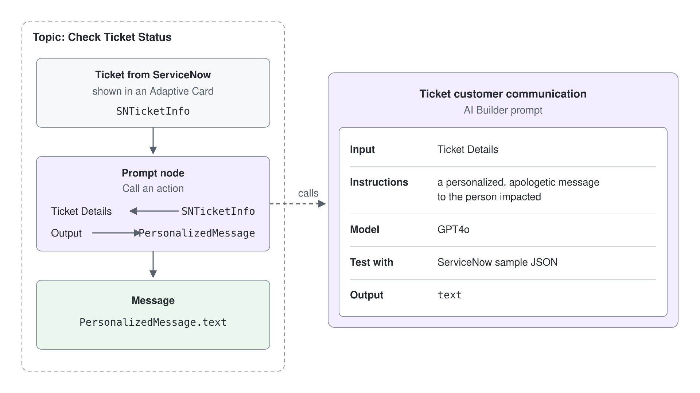

# Prompt Tool & Code Interpreter

An agent's orchestrator is good at choosing what to do next, but it writes every answer in its own way. When a business task needs the same shape of output every time, such as a ticket triaged into a category, a priority, and a one-line summary, you want a fixed instruction, a fixed model, and a fixed output format. That is what a prompt gives you: a reusable, single-turn instruction to a language model that the agent calls like any other tool.

This topic covers prompts in Copilot Studio's Standard agents (Learn: standard harness). You learn where a prompt can run, how prompt builder turns instructions and inputs into a testable tool, how model settings and JSON output make results predictable, and how code interpreter lets a prompt write and run Python for calculations a model should never guess. It closes with the decision every maker meets: when a prompt is the right tool and when the orchestrator alone is enough.

## What a prompt tool is

A prompt is a natural-language instruction that tells a generative AI model to perform one task. Prompt builder is the editor where you write that instruction, add input variables for the values that change at runtime, pick a model, and test the result against sample data before anything reaches a user. A saved prompt is reusable: the same prompt can serve agents, agent flows, and Power Apps.

Inside an agent, a prompt becomes a tool. The orchestrator reads the prompt's name and description, decides when the task fits, fills the inputs from the conversation, and works the prompt's output into its reply. Learn describes a prompt as a single-turn, model-based tool that can reference knowledge you provide and generate code to analyze data.

## Where a prompt runs

You can attach the same kind of prompt in three places, and the place decides who calls it. At agent level, generative orchestration picks the prompt when a user's request matches its description. At topic level, a node calls the prompt at a fixed point in a conversation you designed. In an agent flow, the Run a prompt action calls it as one step of a deterministic automation.

| Where you add it | How you add it | Who decides when it runs |
|------------------|----------------|--------------------------|
| Agent level | Tools page, Add a tool, New tool, Prompt | The orchestrator, from the prompt's name and description |
| Topic level | Add node, Add a tool, New prompt | Your topic, at the node you placed |
| Agent flow | Insert an action, AI capabilities, Run a prompt | The flow, every time it reaches that step |

Prompts you create from the Tools page are saved to the environment, so you can add them to other agents and topics later. The topic-level path suits a step you always want, such as rewriting a ticket update into a customer message. The agent-level path suits a capability users ask for in many different words.

## Building a prompt in prompt builder

Every prompt has three parts you design: the instructions, the inputs, and the output. Instructions say what the model must do and how the answer should look. Inputs are placeholders you insert by typing a forward slash or selecting Add content, and each one is either Text or Image or document. Output is plain text by default, or JSON when another step needs to read individual fields.

You rarely start from an empty page. Prompt assistant (formerly Create a prompt with Copilot) drafts instructions from a short description of your intent, between 4 and 500 characters, and you keep the draft with Keep it before you refine it. The prompt library offers templates for tasks such as document extraction, data transformation, and content generation; it is available in some regions only. Prompt assistant creates new drafts only: it does not improve an existing prompt and does not generate grounded prompts.

A prompt can also read business data. In the Knowledge section of the input menu you select a Dataverse table, and the prompt answers over those rows at runtime. Learn notes that agents configured for anonymous users cannot use Dataverse tables as knowledge in a prompt.

You test while you author. You type a sample value for each input, select Test, and read the response next to your instructions. Only when the test output has the shape you want do you save the prompt and add it to the agent.

## Models and settings

The model dropdown next to the instructions lists the managed models available in your region, and you can connect a model deployed in Microsoft Foundry with the plus sign. The settings panel, opened from the three dots and Settings, holds the rest:

| Setting | What it changes |
|---------|-----------------|
| Temperature | 0 (the default) gives consistent, predictable output; 1 gives more varied output. The slider is disabled for reasoning models such as GPT-5 reasoning |
| Record retrieval | How many records the prompt retrieves from its knowledge sources |
| Include links in the response | Adds citations for the retrieved records |
| Enable code interpreter | Lets the prompt generate and run Python code |
| Content moderation level | A stricter level filters more harmful content and returns fewer answers |

Leave temperature at 0 for extraction, classification, and anything a later step parses. Raise it only for drafting tasks where variety is the goal.

## Structured output with JSON

When the output feeds another tool, a flow, or a condition, switch the output to JSON in the top-right corner of the editor. In Auto detected mode the format follows whatever your latest test returned; once you edit the JSON example, the format becomes Custom and stays fixed. Saving the prompt locks the format, so an agent, flow, or app that calls the prompt always receives the same fields.

Two limits shape the design. You cannot edit the generated JSON schema directly, only the example it is built from. A format without field keys, such as a bare list of strings, is not supported, so wrap values in objects with named fields.

## Code interpreter

Language models are weak at arithmetic and at reading spreadsheets cell by cell. Code interpreter closes that gap: with it turned on, the prompt writes Python, runs it, and answers from the result. Typical uses are counting and averaging rows, processing Excel, Word, PowerPoint, and PDF files, and producing charts or files as output.

Turning it on adds capabilities to the prompt itself: files become a supported output type, and Excel files become a supported input and output type. You enable it per prompt in the settings panel, and it works in prompts you add at agent or topic level.

Plan for its limits before a demo. Code interpreter analyzes one uploaded file per prompt run, returns one file per run, and does not answer follow-up questions about an uploaded file across turns. The agent must use user authentication, so an agent published with No authentication cannot run it. Code generation and execution are billed as premium text and generative AI tools.

## Prompt or orchestrator?

Every Standard agent already uses a model through its orchestrator, so a prompt has to earn its place. Microsoft's guidance draws the line at control: the orchestrator uses a fixed system prompt you cannot edit, while a prompt gives you full control over instructions, model, format, and constraints.

| Situation | Reach for |
|-----------|-----------|
| Extract a single value, such as a name, from the user's message | The orchestrator |
| Extract several related entities from a long document | A prompt |
| Output that another step parses, or that must follow a strict format | A prompt with JSON output |
| Counting, averaging, or reading spreadsheet cells | A prompt with code interpreter |
| A model from Microsoft Foundry for one task | A prompt |
| General reasoning, tool selection, and light formatting | The orchestrator |

## The prompt tool in Standard and GitHub Copilot agents

The prompt tool belongs to Standard agents. In GitHub Copilot agents (Learn: GitHub Copilot harness) the comparison table lists the prompt tool as replaced by skills, which package instructions for an agent in the open `SKILL.md` format. A prompt you build here does not move to a GitHub Copilot agent, because agents never move between harnesses. The GitHub Copilot approach is taught in [Agent Skills in Copilot Studio](../../06-cs-gh-copilot/03-agent-skills/readme.md).

## Hands-On Demo

- [Triage and Analyze Help Desk Tickets with Prompt Tools](./demo-prompt-tool-with-code-interpreter.md): the presenter drafts a triage prompt with Prompt assistant, locks its output to JSON, then builds a second prompt whose code interpreter computes backlog statistics that a model alone would guess.

## Hands-On Lab

- [Invoke Prompts from a Copilot Studio Agent](../../../labs/04-cs-tools/01-prompts/lab-01-build-a-prompt-tool.md): learners add a prompt node to a ticket-status topic, pass the ticket record in as an input, and show the generated customer message.

## Key Topics covered in this module

[Overview of prompts](https://learn.microsoft.com/microsoft-copilot-studio/prompts-overview)

[Use prompts to make your agent perform specific tasks](https://learn.microsoft.com/microsoft-copilot-studio/nlu-prompt-node)

[Create a prompt](https://learn.microsoft.com/microsoft-copilot-studio/create-custom-prompt)

[Prompt assistant](https://learn.microsoft.com/microsoft-copilot-studio/prompt-assistant)

[Get started with prompt library](https://learn.microsoft.com/microsoft-copilot-studio/prompt-library)

[Change the model version and settings](https://learn.microsoft.com/microsoft-copilot-studio/prompt-model-settings)

[Process responses with JSON output](https://learn.microsoft.com/microsoft-copilot-studio/process-responses-json-output)

[Use code interpreter in a prompt](https://learn.microsoft.com/microsoft-copilot-studio/code-interpreter-for-prompts)

[Use agent tools to extend, automate, and enhance your agents](https://learn.microsoft.com/microsoft-copilot-studio/guidance/agent-tools)
