# Answer and Record Supplier Offers from Dataverse



The Grey Logistics IT Help Desk buys docks, monitors, and headsets from several suppliers, and the offers sit in two Dataverse tables. Today a technician opens the tables, filters, and compares prices by hand, then keys in each new offer. In this demo the help desk agent answers comparison questions straight from the tables and records a new offer after the user confirms it.

What you practice here: grounding an agent in Dataverse tables, teaching it the business meaning of columns, and writing a row through a tool that asks first.

Duration: about 30 minutes.

## What you'll build

- A Dataverse knowledge source over the Offer Requests and Offer Request Details tables, with a description the orchestrator can route on.
- Synonyms and a glossary term that map "lead time" and "cheapest offer" to the right columns.
- A Record offer request tool on the Microsoft Dataverse connector that creates a row after the user confirms.

## Prerequisites

- A Power Platform environment with Dataverse, where you have the Environment Maker role and Dataverse search is turned on (ask your administrator if **Dataverse** cannot be added as knowledge).
- A Standard agent named Grey Logistics IT Help Desk in that environment (on the home page, open the **New agent** dropdown and select **Agent** with the **Standard** badge under **Other ways to build**), with generative orchestration on and **Authenticate with Microsoft** under **Settings** > **Security** > **Authentication** (both are defaults).
- The two sample tables and their rows, created before the session in [Power Apps](https://make.powerapps.com) under **Tables** > **New table** > **Set advanced properties**. Use the column list in the [topic readme](./readme.md#the-sample-tables); name the tables Offer Request and Offer Request Detail, and create `offerId` as a **Lookup** column on Offer Request Detail that points to Offer Request.

Rows for Offer Request:

| requestId | supplierId | transportationCost | timestamp |
|-----------|------------|--------------------|-----------|
| OR-1001 | 17 | 120.00 | 2026-10-01 09:00 |
| OR-1002 | 23 | 0.00 | 2026-10-03 14:30 |
| OR-1003 | 31 | 85.50 | 2026-10-07 11:15 |

Rows for Offer Request Detail:

| productName | basePrice | offeredPrice | requestedAmount | offeredAmount | deliveryDurationDays | isAvailable | offerId |
|-------------|-----------|--------------|-----------------|---------------|----------------------|-------------|---------|
| USB-C Dock | 189.00 | 169.00 | 40 | 40 | 5 | Yes | OR-1001 |
| 27-inch Monitor | 249.00 | 229.00 | 25 | 20 | 10 | Yes | OR-1001 |
| USB-C Dock | 189.00 | 175.00 | 40 | 40 | 3 | Yes | OR-1002 |
| Wireless Headset | 99.00 | 89.00 | 60 | 60 | 7 | Yes | OR-1002 |
| 27-inch Monitor | 249.00 | 239.00 | 25 | 25 | 4 | No | OR-1003 |

## Exercise 1: Add the offer tables as knowledge

The agent can only answer from tables it has been given, and the orchestrator only searches them when the description says what is inside. You add both tables as one knowledge source and describe it in the help desk's own words.

1. Open the agent and select **Add knowledge** on the **Overview** page.
2. Select **Dataverse**, search for `Offer Request`, and select both Offer Request and Offer Request Detail.
3. Replace the knowledge description with:

```text
Supplier offers for IT hardware: one Offer Request row per supplier offer with supplier id, transportation cost and date, and Offer Request Detail rows with the products, list and offered prices, requested and offered quantities, delivery days and availability. Use it for questions about supplier offers, prices, quantities and delivery times.
```

4. Select **Add to agent**.

Expected: the **Knowledge** page lists the new Dataverse source with both tables and your description.

## Exercise 2: Ask comparison questions over the rows

Comparisons are where tables beat documents: the answer depends on several rows at once. You ask two questions whose correct answers you can check against the rows in the prerequisites.

1. In the test pane, send:

```text
Which supplier offered the cheapest USB-C dock, and how many days does delivery take?
```

2. Then send:

```text
Did any supplier offer fewer units than we requested?
```

Expected: the first answer names offer OR-1001 from supplier 17 at 169.00 with 5 delivery days, and may add that OR-1002 delivers in 3 days at 175.00; the second answer names the 27-inch Monitor in OR-1001, with 20 of 25 units offered. Both answers cite the Dataverse source.

## Exercise 3: Teach the agent the column vocabulary

Users say "lead time" and "can ship"; the tables say `deliveryDurationDays` and `isAvailable`. Synonyms and a glossary term connect the two, so the same question works however it is phrased.

1. On the **Knowledge** page, open the Dataverse source and select **Edit** next to the synonyms of Offer Request Detail.
2. Add these synonyms and select **Back**:

| Column | Synonyms |
|--------|----------|
| `deliveryDurationDays` | lead time, delivery time, days to deliver |
| `offeredPrice` | offer price, quoted price, unit price |
| `isAvailable` | can ship, in stock, available |

3. Select **Edit** next to the glossary, add this term and description, and select **Back**, then save:

```text
Cheapest offer: the Offer Request Detail row with the lowest offeredPrice for a product. Only rows where isAvailable is Yes can ship.
```

4. Wait a few minutes for the glossary update, then send:

```text
Which offers for the 27-inch monitor can ship, and what is the quoted price and lead time?
```

Expected: the answer lists only OR-1001 at 229.00 with a 10-day lead time and states that OR-1003 cannot ship, because its `isAvailable` value is No.

> **Note:** Glossary updates can take up to 15 minutes to reach the agent. Add the vocabulary before the session if your demo slot is short.

## Exercise 4: Record a new offer with a Dataverse tool

Knowledge reads rows; a tool writes them. You add one action from the Microsoft Dataverse connector, fix the values the user should not choose, and require confirmation before the row is created.

1. Go to **Tools** > **Add a tool** > **Connector**, search for `Microsoft Dataverse`, select **Add a new row**, and select **Add and configure**.
2. Set **Name** to `Record offer request` and the description to:

```text
Creates a new supplier offer in the Offer Request table. Use it when a user asks to record, log or add a supplier offer. Requires the request id, the supplier id and the transportation cost.
```

3. Under **Inputs**, set **Table name** to the custom value **Offer Requests** and select **Save**. The table's columns appear as inputs; set **timestamp** to a custom value with the formula below and leave the other columns on **Dynamically fill with AI**.

```powerfx
Now()
```

4. Under **Additional details**, set **Ask the end user before running** to **Yes** and select **Save**.
5. In the test pane, send:

```text
Record a new offer OR-1004 from supplier 42 with a transportation cost of 60.
```

6. Check the values in the confirmation and confirm.
7. In Power Apps, open the Offer Request table and refresh the data view.

Expected: the agent shows OR-1004, supplier 42, and 60 for confirmation before it runs the tool; after you confirm, the table has a fourth row OR-1004 with today's date and time in `timestamp`.

## Troubleshooting

| Symptom | Likely cause | Fix |
|---------|--------------|-----|
| **Dataverse** is missing or the tables cannot be selected in **Add knowledge** | Dataverse search is off, or you lack permission to the tables | Ask the administrator to turn on Dataverse search and confirm your security role |
| The knowledge source cannot be added at all | The agent uses No authentication or Authenticate manually | Set **Authenticate with Microsoft** and publish |
| "Lead time" questions still answer vaguely | The glossary or synonym update has not arrived yet | Wait up to 15 minutes and test in a new conversation |
| Column inputs do not appear after you set **Table name** | The connector schema refreshes only after required inputs are set | Save the tool, close it, and reopen the configuration page |
| The new row OR-1004 does not appear in knowledge answers right away | The search index updates after the write | Read the row in Power Apps; knowledge answers catch up after indexing |

## Summary

You grounded the Grey Logistics IT Help Desk agent in two related Dataverse tables, taught it the business vocabulary of their columns, and gave it a confirmed write path for new offers. You can now:

- Add Dataverse tables as a knowledge source with a description the orchestrator routes on
- Use synonyms and glossary terms to map user language to columns and rules
- Check answers against known rows to prove the grounding works
- Write a row through a Dataverse connector tool that asks before it runs

The next topic reaches services that have no prebuilt connector, through custom connectors and REST API tools.
