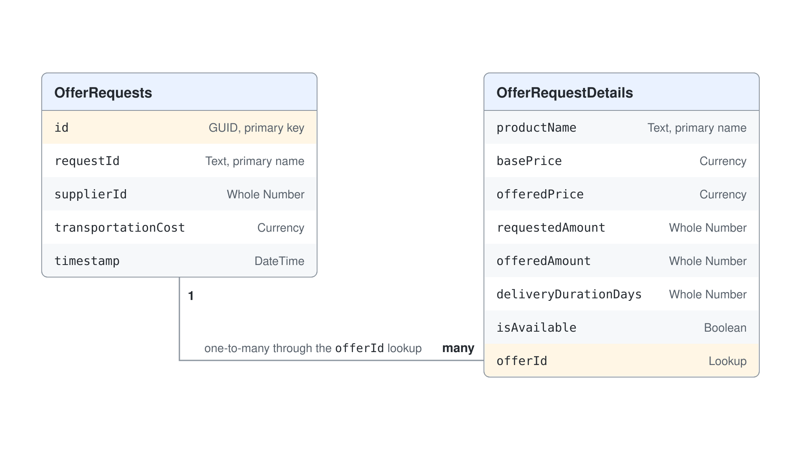

# Dataverse: Knowledge & Business Records

Most business answers live in table rows: which supplier offered the lowest price, how many units are on order, when a delivery is due. Microsoft Dataverse is the data store behind Power Platform, and it is often where those rows already sit. A Copilot Studio agent can use Dataverse in two directions: it reads tables as knowledge to answer questions, and it changes rows through tools when a user asks it to act.

This topic covers both directions in Copilot Studio's Standard agents (Learn: standard harness). You learn what a Dataverse knowledge source needs before it works, how synonyms and glossary terms teach the agent your column names, which tools read and write rows, and how to design tables an agent can understand. The demo uses two small procurement tables, OfferRequests and OfferRequestDetails, which the Contoso IT Help Desk uses to compare hardware offers from suppliers.

## Two ways an agent uses Dataverse

Reading and writing are separate design decisions with separate permissions. Knowledge answers questions over the rows a user is allowed to see. Tools perform operations, such as creating or updating a row, and they run with the credentials the tool is configured for.

| Approach | What the agent does | Status | Fits |
|----------|---------------------|--------|------|
| Dataverse knowledge source | Searches up to 15 tables per source and answers in natural language | Generally available; multiline text and file search is preview | Questions such as "which supplier is fastest" |
| Microsoft Dataverse connector tool | Runs one operation, such as Add a new row, Update a row, or List rows | Generally available | A specific create or update the user requests |
| Prompt with Dataverse knowledge | A prompt tool reads a table and returns a fixed format | Generally available | Summaries or extractions over table data |
| Dataverse MCP Server | Exposes tools such as `read_query`, `search`, `create_record`, and `update_record` | Preview | Open-ended reading and writing under Dataverse role-based access control |

## Dataverse as knowledge

A Dataverse knowledge source grounds the agent in the rows of the tables you select. You add it from **Add knowledge** on the agent's Overview or Knowledge page, pick up to 15 tables, and review the knowledge name and description. The description matters more than it looks: with generative orchestration the agent uses it to decide when to search this source.

Three prerequisites decide whether the option works at all. Dataverse search must be turned on in the environment; when you cannot add a table, ask your administrator to turn it on. The agent's authentication must be **Authenticate with Microsoft**, because No authentication and Authenticate manually are not supported for this source. And the maker needs permission to the underlying data, or the tables do not appear during setup.

Because the agent searches as the signed-in user, two people asking the same question can get different answers. That is the intended behavior: the knowledge source never exposes a row the user could not open in a Dataverse app.

## Teaching the agent your column names

Column names are written for databases. A column called `deliveryDurationDays` holds what users call "lead time", and a column with a generated name such as `cr123_abc` tells the model nothing. Synonyms and glossary terms close that gap; you add them in the knowledge source with **Edit**.

Synonyms attach everyday words to a specific column. Glossary terms define business vocabulary and the rules behind it, such as what counts as "the cheapest offer". Learn calls out numeric columns in particular: when a column holds codes or numbers, give it a description so the model knows how to interpret it. Updated glossary terms can take up to 15 minutes to reach the agent, so test after a short wait.

| Kind | Example for the sample tables | Effect |
|------|-------------------------------|--------|
| Synonym | `deliveryDurationDays`: lead time, delivery time, days to deliver | "Fastest delivery" questions find the right column |
| Synonym | `offeredPrice`: offer price, quoted price, unit price | Price questions use the supplier's offered price |
| Glossary term | Cheapest offer: the row in OfferRequestDetails with the lowest `offeredPrice` for a product | The agent applies one rule for "cheapest" |
| Glossary term | Available: `isAvailable` is Yes | "Which offers can ship" filters correctly |

## Reading and writing rows with tools

Knowledge reads data and tools change it. When a user asks the agent to record something, the agent needs a tool. The Microsoft Dataverse connector offers actions such as Add a new row, Update a row, Get a row, List rows, and Delete a row, and each one you add becomes a tool with its own name, description, and inputs.

Write tools deserve two safeguards. Turn on **Ask the end user before running**, so the user sees the values before a row is created or changed. Keep the default end user credentials, so Dataverse applies the user's own security role to every write.

The Dataverse MCP Server (preview) takes a broader approach: one tool on the agent exposes a set of operations, including `list_tables`, `describe_table`, `read_query`, `search`, `create_record`, and `update_record`. Access follows Dataverse role-based access control, so the agent can act only within the user's permissions. An administrator must allow the Microsoft Copilot Studio MCP client for the environment before the server appears under **Model Context Protocol** in **Add a tool**. Because the server also offers schema operations such as `create_table` and `delete_table`, turn off every tool your scenario does not need.

## The sample tables

The demo uses two related tables. OfferRequests holds one row per supplier offer, and OfferRequestDetails holds the products in each offer. The `offerId` lookup column on OfferRequestDetails points to OfferRequests, which creates the one-to-many relationship: one offer, many product lines.

| Table | Column | Data type in Power Apps |
|-------|--------|-------------------------|
| OfferRequests | `requestId` (primary column) | Single line of text |
| OfferRequests | `supplierId` | Whole number |
| OfferRequests | `transportationCost` | Currency |
| OfferRequests | `timestamp` | Date and time |
| OfferRequestDetails | `productName` (primary column) | Single line of text |
| OfferRequestDetails | `basePrice`, `offeredPrice` | Currency |
| OfferRequestDetails | `requestedAmount`, `offeredAmount`, `deliveryDurationDays` | Whole number |
| OfferRequestDetails | `isAvailable` | Yes/no |
| OfferRequestDetails | `offerId` | Lookup to OfferRequests |

Dataverse adds a unique identifier column to every table automatically, so you never create an `id` column yourself. The primary column is what a lookup displays, which is why `requestId` and `productName` hold human-readable values.

## Designing tables an agent can understand

The same habits that make a table easy for people make it easy for an agent. Give every column a display name and a description in plain language, because the knowledge source reads table metadata as well as your synonyms. Use Yes/no and choice columns for states, so "available" means one thing.

Keep tables focused. A knowledge source takes up to 15 tables, but an agent answers more reliably over a few well-described tables than over a whole data model. When a question needs data from many tables or exact calculations, a prompt with Dataverse knowledge or a flow that queries the rows gives you more control over the result.

## Hands-On Demo

- [Answer and Record Supplier Offers from Dataverse](./demo-dataverse-knowledge-and-records.md): the presenter adds the two offer tables as knowledge, teaches the agent their vocabulary with synonyms and a glossary term, asks comparison questions, and then records a new offer through a Dataverse connector tool that asks for confirmation.

## Key Topics covered in this module

[Add Dataverse tables as a knowledge source](https://learn.microsoft.com/microsoft-copilot-studio/knowledge-add-dataverse)

[Create and edit tables using Power Apps](https://learn.microsoft.com/power-apps/maker/data-platform/create-edit-entities-portal)

[Manage custom columns in a table](https://learn.microsoft.com/power-apps/maker/data-platform/data-platform-manage-fields)

[Use Power Platform connectors as tools](https://learn.microsoft.com/microsoft-copilot-studio/advanced-connectors)

[Microsoft Dataverse connector reference](https://learn.microsoft.com/connectors/commondataserviceforapps/)

[Connect to Dataverse with model context protocol in Microsoft Copilot Studio](https://learn.microsoft.com/power-apps/maker/data-platform/data-platform-mcp-copilot-studio)

[Dataverse MCP Server reference (preview)](https://learn.microsoft.com/microsoft-copilot-studio/mcp-dataverse)

[Configure user authentication in Copilot Studio](https://learn.microsoft.com/microsoft-copilot-studio/configuration-end-user-authentication)
