# Post Trip Summaries to Teams with a Connector Tool



A trip request that stays in the chat helps nobody, because the travel desk works in a Teams channel and never sees it. In this demo you rebuild the Travel Agent as CS-Travel Agent, let it collect a booking, and give it one prebuilt Teams action it can call on its own. You finish with a trip summary in a Teams channel, posted by the agent with values it read from the conversation.

What you practice here: adding one action of a prebuilt connector as a tool, letting generative orchestration fill its inputs from the conversation, and choosing whose credentials it runs with.

Duration: about 40 minutes.

## What you'll build

- CS-Travel Agent, a Standard agent with instructions, web search and the Sightseeing SharePoint site as knowledge. CS-Business Travel Planner connects to it as its booking specialist in module 5.
- A Book Trip topic that collects a place, a date and the number of travelers and recaps them.
- A CS-Post message in a chat or channel tool on the Microsoft Teams connector, with every input filled by the agent and run with the user's own credentials.
- A trip summary posted to a Teams channel from the test chat.

## Prerequisites

- Maker access to a Copilot Studio environment in the classic experience: on the home page select the three dots (**…**) at the bottom of the side bar, then **Open classic experience**.
- A SharePoint site with sightseeing or travel pages you can read, and a Microsoft Teams team with a channel you can post in.
- The original agent definition, for reference: [src/cs-schema/agents/Travel Agent](../../../src/cs-schema/agents/Travel%20Agent/).

## Exercise 1: Create CS-Travel Agent

The agent needs a name the class environment can find and a one-line job. The original uses a short description, one sentence of instructions and web search. New agents use generative orchestration by default, which lets the agent choose between knowledge, topics and tools for every request.

1. Go to **Agents**, select **Create blank agent**, enter the name `CS-Travel Agent`, and select **Create**.
2. On the **Overview** page, in the **Details** section, select **Edit**, paste the description, and select **Save**.

```text
A travel agent
```

3. In the **Instructions** section, select **Edit**, paste the instructions, and select **Save**.

```text
You are a travel agent providing travel info to people
```

4. In the **Knowledge** section, turn on **Web Search** if it is off.
5. Select **Test** and send the message.

```text
What should I pack for three days in Vienna in May?
```

Expected: the **Overview** page shows CS-Travel Agent with the description and the instructions, and **Web Search** is on. The test answer gives packing advice and lists the websites it used as citations.

> **Tip:** The original instructions read "Your are a travel agent". The rebuild fixes the typo; the meaning stays the same.

## Exercise 2: Ground the agent in the Sightseeing site

Web search knows the world, but your travel desk keeps its own recommendations in SharePoint. A SharePoint knowledge source lets the agent search that site and its subpages, and only returns content the person chatting is allowed to read. The name and description tell the orchestrator when the source fits a question.

1. In the **Knowledge** section of the **Overview** page, select **Add knowledge**, then **SharePoint**.
2. Enter your site URL.

```text
https://<your-tenant>.sharepoint.com/sites/<your-site>/Sightseeing
```

3. Enter the name and the description from the original agent, then select **Add to agent**.

```text
Sightseeing
```

```text
Provides Travel Information
```

4. In the **Test your agent** panel, select the **Reset** icon and send a question your Sightseeing pages answer, for example this one.

```text
What should I see on a one-day visit?
```

Expected: the **Knowledge** section lists Sightseeing beside **Web Search**. The answer cites pages from your Sightseeing site; if the site has nothing on the question, the citations point to websites instead.

## Exercise 3: Add the Book Trip topic from its YAML

A booking needs the same three facts every time, so a topic asks for them instead of leaving it to the model. Pasting the original topic into the code editor rebuilds it in one step, and three prebuilt entities turn the answers into a string, a date and a number.

1. Go to **Topics**, select **Add a topic**, then **From blank**.
2. In the upper-right corner of the canvas, select **More**, then **Open code editor**. Delete the contents and paste this YAML.

```yaml
kind: AdaptiveDialog
beginDialog:
  kind: OnRecognizedIntent
  id: main
  intent:
    triggerQueries:
      - book a trip
      - plan my vacation
      - help me book travel
      - I want to book a flight
      - arrange a trip for me
      - reserve travel tickets
      - schedule my next trip
      - organize a holiday for me
      - start booking my journey
      - help me plan a getaway

  actions:
    - kind: Question
      id: Question_be3G1o
      variable: Topic.Sight
      prompt: What is the name of the place you want to visit?
      entity: StringPrebuiltEntity

    - kind: Question
      id: Question_DYfdrA
      variable: Topic.Date
      prompt: What date would you like to book your trip for?
      entity: DatePrebuiltEntity

    - kind: Question
      id: Question_ABBSRr
      variable: Topic.NumberOfPax
      prompt: How many people will be going on this trip?
      entity: NumberPrebuiltEntity

    - kind: SendActivity
      id: SendActivity_1KkSkT
      activity: |-
        Thank you! Here is your trip summary:
        - Sight: {Topic.Sight}
        - Date: {Topic.Date}
        - Number of people: {Topic.NumberOfPax}

        Your booking request has been received. We will contact you soon with more details.

inputType: {}
outputType: {}
```

3. Select **Save**, then **Close code editor**. Select the topic name at the top of the page, type `Book Trip`, press Enter, and save again.
4. Reset the test panel, send the message, and answer the three questions with `Vienna`, `May 12` and `2`. A date without a year makes the agent offer two dates, for example 5/12/2026 and 5/12/2027; select the one that lies ahead.

```text
I want to book a flight
```

Expected: the canvas shows the **Trigger** node, three **Question** nodes and one **Message** node. The test chat asks the three questions in order and ends with the trip summary naming Vienna, the date and 2 people.

## Exercise 4: Add the Teams connector tool

A connector tool is one action of a prebuilt connector that the orchestrator can choose and fill on its own. The original agent uses the Microsoft Teams action Post message in a chat or channel, keeps every input on dynamic filling, and runs it with end user credentials, so a message is posted as the person chatting. The tool's name and description are what the orchestrator reads when it decides whether a request needs this tool.

1. Go to **Tools** and select **Add a tool**. In the **Add tool** dialog select the **Connector** filter, then the **Microsoft Teams** card. In the action search box type `Post message in a chat or channel` and select the action.
2. The dialog shows the action and its **Connection**. If it reads **Not connected**, open it, select **Create new connection** and sign in; an existing Teams connection shows your account with a green dot. Then select **Add and configure**.
3. In the **Details** section, set the name and the description.

```text
CS-Post message in a chat or channel
```

```text
Posts a message to a chat or a channel
```

4. Under **Inputs**, leave **Fill using** on **Dynamically fill with AI** for the three inputs **Post as**, **Post in** and **Post message request**. The agent then fills who posts, whether it goes to a channel or a chat, and the recipient and message text from the conversation, and asks for anything it can't find.
5. Under **Details**, **Additional details**, **Credentials to use**, keep **End user credentials**.
6. Under **Completion**, keep **After running** on **Don't respond (default)** so the agent writes its own confirmation from the tool's outputs, then select **Save**.

Expected: the **Tools** page lists CS-Post message in a chat or channel. Its configuration shows every input on **Dynamically fill with AI**, and the **Completion** section lists the outputs the action returns, including the message link.

> **Note:** The Teams connection dialog has no name field, so the connection can't carry the CS- prefix. When you clean up the old environment, identify it by its connector, Microsoft Teams, and the account that signed in.

7. Tell the agent where the travel desk posts. The connector addresses a channel by two ids, not by names: the team's group id and the channel id. Look both up for your team, for example with the Azure CLI signed in to your tenant.

```bash
az rest --method get --url "https://graph.microsoft.com/v1.0/me/joinedTeams?\$select=id,displayName"
az rest --method get --url "https://graph.microsoft.com/v1.0/teams/<your team id>/channels?\$select=id,displayName"
```

8. On the **Overview** page, in the **Instructions** section, select **Edit**, add the paragraph below after the existing sentence with your own team name and ids, and select **Save**.

```text
The travel desk works in the General channel of the <your-team> team. When you post to Teams with CS-Post message in a chat or channel, post in a channel, and in the recipient set groupId to the team id <your team id> and channelId to <your channel id> for the travel desk or for the General channel of <your-team>. The team field is called groupId, never teamId, and it never takes a team or channel name.
```

Expected: the first command lists your team with its `id`, a GUID; the second lists General with an `id` that starts with `19:` and ends with `@thread.tacv2`. The instructions show both ids.

## Exercise 5: Post the trip summary to a channel

Now the agent combines the topic and the tool in one plan: the topic collects the booking and the tool posts it. The agent writes the message from the trip summary and takes the channel from its instructions.

1. Select the **Reset** icon. Then select the three dots (**…**) at the top of the test panel and turn on **Show activity map when testing**.
2. Book a trip as in Exercise 3, then send the message with your own team name.

```text
Post my trip summary to the General channel in the <your-team> team.
```

3. The first time, the test chat shows a **Connect to continue** card for Microsoft Teams. Select **Allow**; the post runs after the connection is granted.

Expected: the activity map shows CS-Post message in a chat or channel with the inputs it prepared: a `messageBody` with the trip summary and a `recipient` with your `channelId` and `groupId`. The message appears in the channel under your name, and the agent replies that it posted to the General channel of your team.

> **Note:** Without the ids in the instructions, the agent fills the recipient on its own. In the live run one post with team and channel names went through, and the next ones failed with "Group ID does not exist" because the agent passed the team as `teamId` or as a name. With the ids in the instructions, the post went through.

> **Tip:** With **End user credentials**, every user posts under their own name and only where they have access. **Maker-provided credentials** post with your account for everyone, and they need the agent on an authenticated channel first.

## Troubleshooting

| Symptom | Likely cause | Fix |
|---------|--------------|-----|
| The agent answers from knowledge and never calls the tool | The request doesn't ask to post, or generative orchestration is off | Ask to post explicitly. In **Settings**, **Generative AI**, under **Orchestration**, set **Use generative AI orchestration for your agent's responses?** to **Yes** |
| The test panel keeps asking to connect | **End user credentials** need a one-time sign-in per user | Select the connect link in the test chat and sign in once |
| The post fails for a channel | Your account isn't a member of that team or channel | Post to a channel you're a member of, or add yourself to the team |
| The chat shows "The connector 'Microsoft Teams' returned an HTTP error with code 400. Inner Error: Group ID does not exist." | The agent passed a team name, or the team id under `teamId`, where the connector expects `groupId` | Add the ids from Exercise 4, steps 7 and 8, to the instructions; check the prepared inputs in the activity map or on the **Activity** page |
| Answers come from the web instead of Sightseeing | The description Provides Travel Information is too general to win against **Web Search** | Extend the knowledge description with what the site covers, such as city tips and attractions |
| Book Trip doesn't start | The message is far from its trigger phrases | Send one of the phrases, for example `book a trip` |

## Summary

You rebuilt the Travel Agent as CS-Travel Agent and posted a trip summary to Teams through a connector tool. You can now:

- add one action of a prebuilt connector as a tool and name it for the class environment
- let the agent fill tool inputs from the conversation and ask for what is missing
- choose between end user and maker-provided credentials for a tool
- follow a tool call and its inputs in the activity map

Next, [Agent Flows: Deterministic Automation](../04-agent-flows/readme.md) builds CS-Post to teams, the path where you fix the destination and the agent only hands over the text.
