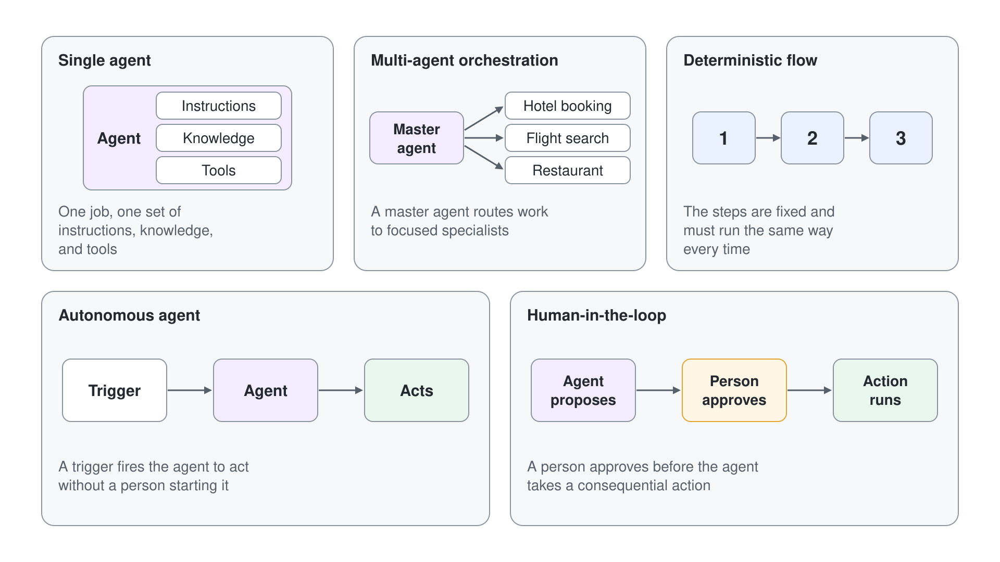

# Agent Flows: Deterministic Automation

Generative orchestration decides at runtime which tool, topic or knowledge source answers a request, and that freedom is exactly what you do not want for some business steps. Logging a ticket, filing an expense or sending a contract for approval has to happen the same way every time, with the same fields and the same rules. Agent flows are the deterministic half of a Standard agent: a trigger, a fixed sequence of actions, and the same output for the same input.

This topic works in Standard agents (Learn: standard harness), where agent flows keep their name and are built on the **Workflows** page. It explains what a flow is made of, how an agent calls one as a tool, where AI fits inside a fixed sequence, how a Power Automate cloud flow becomes an agent flow, and what each run costs.

## What an agent flow is

An agent flow consists of one trigger and at least one action. The trigger is the event that starts the flow: a person running it on demand, a schedule, an event in another system, or an agent calling it. Each action is one task the flow performs, and Learn describes the result as rule-based: the same input always produces the same output.

Actions come in four families, and a single flow usually mixes them.

| Action family | What it does | Example |
| --- | --- | --- |
| AI capabilities | Calls a language model inside the fixed sequence: generate text, process a document, run a prompt, call an agent, or write a natural language reply to the calling agent | **Run a prompt** classifies a ticket's priority |
| Human in the loop | Pauses the flow until a person answers | An approval request, or **Request information** that emails a reviewer a short form |
| Built-in tools | Control structures and data operations | Loops, conditions, date and time functions, child flows |
| Connectors | Reads or writes another service | Office 365 Outlook **Send an email (V2)**, SharePoint, a custom connector |

Agent flows live in solutions, so they get drafts, versioning, export and import like any other Power Platform component. The designer records a version history in Dataverse each time you save, and the **Flow checker** lists every error that blocks publishing. Each agent flow is a row in the Dataverse `workflows` table with `category` 5, so a script that creates flows through the Web API must look each one up by name first, because a rerun after a failure creates duplicates.

## Deterministic versus generative work

The question to ask of every step is whether its order and content are known in advance. When they are, a flow runs them faster, cheaper and identically each time. When the next step depends on what the user meant or what an earlier tool returned, generative orchestration is the better fit.

| The step is | Reach for | Why |
| --- | --- | --- |
| A fixed sequence that must never vary | An agent flow | Rule-based execution; the same input gives the same output |
| Interpreting intent and choosing the next tool | Generative orchestration | The planner reads names and descriptions and builds the plan at runtime |
| One text transformation inside a fixed sequence | A **Run a prompt** step in the flow | A single model call with no tools and no knowledge search |
| A scripted conversation with the user | A topic | Question and message nodes the maker authors node by node |
| A decision that needs a person | A human-in-the-loop action in the flow | The flow pauses until the reviewer responds |

The two halves combine well. The orchestrator works out what the user wants and collects the inputs, then hands those inputs to a flow that executes the business rule exactly once.

## Flows as agent tools

A flow becomes a tool when it starts with the **When an agent calls the flow** trigger and ends with a **Respond to the agent** action. Learn sets four conditions before the flow shows up in the tool picker: both of those cards are present, the **Asynchronous response** toggle under **Networking** in the **Respond to the agent** settings is **Off**, the flow is published, and a typical run answers within the 100-second action limit. Actions placed after **Respond to the agent** keep running after the agent has its answer, up to the 30-day flow run limit.

There are three ways to get there. You can start a new agent flow from the flows page, where the designer opens with the trigger and the response action already in place; you can create the flow as a new tool from the agent, which adds both cards for you; or you can modify an existing flow to use this trigger and response action. Learn's pages label the flows page both **Flows** and **Workflows**, so look for either in the left pane.

### Inputs and outputs

The trigger's input parameters are the contract the agent has to fill, and the output parameters of **Respond to the agent** are what it gets back. Under generative orchestration the agent fills inputs from the conversation and generates a question when a required value is missing, so input names and descriptions matter as much as the tool description. When an input is the same on every call, such as a site address or a list name, set its value yourself in the tool's **Inputs** section and leave only the business values to the agent.

| Contract part | Defined on | What the agent does with it |
| --- | --- | --- |
| Input parameters | The **When an agent calls the flow** trigger | Fills them from context, asks the user for missing ones, or uses a fixed value you set |
| Output parameters | The **Respond to the agent** action | Uses them in its reply or passes them to the next step of the plan |
| Tool name and description | The tool's configuration pane | Decides whether this flow fits the request |
| **Completion** setting | The tool's configuration pane | Decides what the agent does after the tool finishes |

Inside a topic the same contract maps to variables: you assign variables to the flow's inputs on the **Action** node, and the outputs land in variables that later nodes use. When you change a flow's inputs or outputs, refresh the **Action** node or re-add the tool; a schema that no longer matches is a common cause of a failed flow call.

### Agent level or topic level

You attach the flow at one of two levels. At the agent level you open the **Tools** page, select **Add a tool**, select **Flow**, pick the flow and select **Add and configure**; the orchestrator then decides when to call it. At the topic level you add an **Add a tool** node inside a topic, and the flow runs only when the conversation reaches that node.

| Attached at | Who decides when it runs | Works with classic orchestration |
| --- | --- | --- |
| Agent level, from the **Tools** page | The generative orchestrator, from the tool's name and description | No, tools are called only from topics under classic orchestration |
| Topic level, as an **Action** node | The topic author, at a fixed point in the conversation | Yes |

The description deserves the same care as a topic description. A flow named "Flow 1" with the generated description is a tool the orchestrator calls at random; a flow named "Log help desk ticket" whose description names the inputs and states what is out of scope is a tool it calls precisely.

### When a flow tool beats a connector tool

A connector tool ([Connector Tools: Prebuilt Connectors](../03-connectors/readme.md)) is one operation in one service, and the orchestrator decides at runtime when to call it. A flow tool wraps a whole sequence behind one call, so the agent asks for the inputs once and the flow runs every step the same way.

| Need | Connector tool | Flow tool |
| --- | --- | --- |
| One read or write in one service | The natural fit | Extra build effort for no gain |
| Several actions in a fixed order, across services | The orchestrator plans each call, and the order can vary | One deterministic sequence |
| Loops, conditions, or reshaping data such as complex JSON | One operation per call | Built-in control and data actions |
| An approval or a reviewer's input in the middle | Not available | Human-in-the-loop actions |
| Work that continues after the user has the answer | Ends with the call | Actions after **Respond to the agent** run on |
| A connector the agent fails to call reliably | Hard to fix from the agent | Learn suggests wrapping it in a flow |
| Billing | One agent action per call | Flow actions per 100, plus the orchestration step |

Reach for the connector tool first when one operation does the job, and move the work into a flow tool when the job has steps, rules or a person in it.

## AI inside a deterministic flow

A flow can still use a model, as long as the model does one bounded job at a fixed point. The **Run a prompt** action in the **AI capabilities** section adds a prompt node: you write an instruction, insert dynamic content from earlier steps, choose the model, and get back text or structured output for the next action. The prompt node sees only what is in its **Instructions** field, so it never searches SharePoint or reads mail on its own; an earlier step fetches the data and passes it in.

Human review uses the same pattern. A **Request information** action pauses the run and sends the reviewer an Outlook email with the inputs you defined, and every input becomes a parameter that later actions can read. Multistage approvals can combine human stages with AI approval stages that approve or reject against your criteria and record a rationale.

A **Request information** step needs its **Channel**, **Outlook** or **Teams**: without one the flow doesn't turn on and reports `missing required property 'RequestForInformationInput/channel'`. Place the step after **Respond to the agent**, so the chat isn't held while the reviewer answers.

A saved prompt can serve a flow without becoming an agent tool. Build it on the **Tools** page through **Add a tool** > **Add new Prompt**, add one **Text** input per value, select **Save**, then **Cancel** at **Add and configure**. The flow calls it through the `aibuilderpredict_customprompt` operation, passes each input as `item/requestv2/<inputId>`, and reads the answer from `body/responsev2/predictionOutput/text`.

The prompt node belongs to the standard harness. Workflows on the GitHub Copilot harness replace it with an agent node, which the [Tools, MCP, and the New Workflows Designer](../../06-cs-gh-copilot/04-workflows-and-mcp/readme.md) topic covers.

## Building, testing and publishing a flow

You start on the **Workflows** page: open the arrow next to **New workflow** and choose **Agent flows**. The designer opens on an empty canvas with **Add a trigger**, and from there you either drag in actions or select **Copilot** in the toolbar and describe the flow in a sentence such as "When X happens, do Y". The natural language path uses Anthropic models, so an administrator has to turn on external models for the environment before makers can use it.

Publishing and testing are separate steps. **Publish** stays unavailable while the **Flow checker** reports errors, and a published flow can still do the wrong thing, so you run **Test** afterwards, either manually or automatically, and read the output of each action. Test runs from the designer and from the agent's test chat don't consume Copilot Studio capacity.

## Express mode

An agent waits for a flow it called, so slow flows break conversations. Express mode (preview) runs agent-called and app-called flows on a faster path at no added cost; you turn it on with the **Express mode** toggle on the trigger card or in the flow's **Details** panel. It needs the **When an agent calls a flow** or **When an app calls a flow** trigger, a response action, a Copilot Studio plan, and an environment on the new Power Automate infrastructure.

| Use express mode when | Avoid it when |
| --- | --- |
| The flow is logic heavy and returns little connector data | The flow moves large data sets, such as hundreds of rows with many columns |
| An agent waits for the response | The flow is fire and forget, with no response action |
| The flow passes its tests with express mode on | Tests fail on a variable or memory limit |

Express mode brings hard limits: a run must finish within two minutes, stay under roughly 100 actions (each loop iteration counts), keep variables under 1,024 characters and keep each connector response under 64 KB. **Delay** and webhook actions aren't supported, and the toggle doesn't appear until the environment has been upgraded.

## Converting a Power Automate cloud flow

A cloud flow that already does the job doesn't need rebuilding. You open its detail page in Power Automate, make sure it sits in a solution in the environment that should pay for it, select **Edit**, change the plan to **Copilot Studio** and confirm. From then on the flow counts against Copilot Studio capacity, leaves Power Automate licensing behind, and can be managed in Copilot Studio.

The conversion is one way and can't be reversed, because the billing changes with it. It also only produces an agent flow: a cloud flow can't be converted to the new workflow format of the GitHub Copilot harness.

## Billing and capacity

Every action an agent flow executes consumes Copilot Studio capacity, billed as agent flow actions at 13 Copilot Credits per 100 actions. How the flow is started adds one more charge on top.

| The flow runs | Capacity consumed |
| --- | --- |
| From a topic | One classic answer plus the flow's actions |
| Through generative orchestration | One autonomous action (Learn's flows overview wording) plus the flow's actions |
| From the designer test or the agent's test chat | Nothing |
| Through **When an agent calls the flow** for a user licensed for Microsoft 365 Copilot | No charge under the included usage rules |

When the prepaid capacity is used up, new agent flow runs are blocked while runs already in progress finish; the agent itself keeps answering. Power Automate cloud flows stay on Power Automate licensing and aren't affected. Administrators review consumption per flow in the Power Platform admin center under **Licensing** > **Copilot Studio**.

## Hands-On Demos

- [Rebuild the Health Advisor with Two Agent Flows](./demo-health-advisor-flows.md): the presenter rebuilds CS-Health Advisor with one agent flow that classifies symptoms through a prompt, a topic that branches on its outcome, and a second flow that waits for a reviewer before it posts to Teams.
- [Build an Agent Flow and Call It from an Agent](./demo-build-an-agent-flow.md) (optional): the presenter builds a ticket-logging flow with a prompt step and a confirmation email, adds it to the Grey Logistics IT Help Desk agent as a tool, and traces the call in the activity map.

## Key Topics covered in this module

[Agent flows overview](https://learn.microsoft.com/microsoft-copilot-studio/flows-overview)

[Add an agent flow as a tool to an agent](https://learn.microsoft.com/microsoft-copilot-studio/flow-agent)

[Create an agent flow as a tool](https://learn.microsoft.com/microsoft-copilot-studio/advanced-flow-create)

[Call an agent flow from an agent](https://learn.microsoft.com/microsoft-copilot-studio/advanced-use-flow)

[Modify an existing flow to use in an agent](https://learn.microsoft.com/microsoft-copilot-studio/flow-modify-use-with-agent)

[Use Power Platform connectors as tools](https://learn.microsoft.com/microsoft-copilot-studio/advanced-connectors)

[Edit and manage your agent flow in the designer](https://learn.microsoft.com/microsoft-copilot-studio/flow-designer)

[Build an agent flow with natural language](https://learn.microsoft.com/microsoft-copilot-studio/flow-nl)

[Add a prompt node to an agent flow](https://learn.microsoft.com/microsoft-copilot-studio/prompt-node-workflow)

[Request information from human review in agent flows](https://learn.microsoft.com/microsoft-copilot-studio/flows-request-for-information)

[Speed up agent flow execution with express mode (preview)](https://learn.microsoft.com/microsoft-copilot-studio/agent-flow-express-mode)

[Billing rates and management](https://learn.microsoft.com/microsoft-copilot-studio/requirements-messages-management)
