# Give the Canteen Agent Live Stock from a REST API



CS-Food Stock Buddy calculates the canteen's order from a sample stock table that never changes, so every order is wrong as soon as a delivery arrives. The food catalog API already knows the real stock, and its OpenAPI file describes everything it can do. In this demo you turn that file into the CS-Food Catalog custom connector, give the agent three tools from it, and replace the sample stock with the live list.

What you practice here: turning an OpenAPI description into a custom connector, choosing which operations an agent may call, and writing tool descriptions the orchestrator routes on.

Duration: about 40 minutes.

## What you'll build

- The CS-Food Catalog custom connector, created from a shipped OpenAPI 2.0 file with the REST API tool wizard.
- Three tools on CS-Food Stock Buddy: CS-Gets all food, CS-Add food and CS-Update food stock quantity, each with a description the orchestrator routes on.
- The Calculate order quantity topic reading live stock from CS-Gets all food instead of the sample stock.
- Test runs that list the stock, book a delivery, remove spoiled portions and add a dish.

## Prerequisites

- CS-Food Stock Buddy as the [Adaptive Cards demo](../../03-cs-basics/05-adaptive-cards/demo-food-demand-card.md) and the [prompt demo](../01-prompts/demo-food-order-prompt.md) left it: the Submit Demand card topic, and the Calculate order quantity topic whose Set sample stock node fills `Topic.foodStock`. Open it in the classic experience: on the home page select **...** at the bottom of the side bar, then **Open classic experience**, then open the agent from **Agents**.
- The food catalog API reachable over HTTPS. It is the project in [src/food-catalog-mcp](../../../src/food-catalog-mcp/), which [src/deploy-apis.ps1](../../../src/deploy-apis.ps1) deploys as the web app food-catalog-api-dev (REST under `/Food`, MCP under `/api/mcp`) and seeds with the nine dishes of the demand card. Before the session, open `https://<your-food-catalog-host>/Food` in a browser and check that it returns JSON.
- The shipped [cs-food-catalog.json](demo-food-catalog-rest-connector/cs-food-catalog.json): the connector definition of the [Food Inventory REST clone](../../../src/cs-schema/agents/Food%20Inventory%20REST/), with its title set to CS-Food Catalog and a placeholder host. The topic you change comes from the [Food Stock Buddy clone](../../../src/cs-schema/agents/Food%20Stock%20Buddy/).
- A text editor to put your host into the file.

## Exercise 1: Create CS-Food Catalog from the OpenAPI file

The OpenAPI file lists seven operations on `/Food`. The REST API tool wizard turns the file into a custom connector, the environment-level piece that knows the host and every operation, and then lets you choose which operations become tools. The clone's connector carries the title of its specification, so the shipped file sets the title to CS-Food Catalog and the connector arrives with the prefix.

1. Open `demo-food-catalog-rest-connector/cs-food-catalog.json` in a text editor, replace the `host` value with your API's host name (no `https://`, no path), and save. These are the fields at the top of the file:

```json
{
  "swagger": "2.0",
  "host": "your-food-catalog-host.azurewebsites.net",
  "schemes": ["https"],
  "info": {
    "title": "CS-Food Catalog",
    "version": "v1",
    "description": "An Api that allows to manage food stock for a restaurant"
  }
}
```

2. In CS-Food Stock Buddy, go to **Tools** and select **Add a tool**.
3. In the **Add tool** dialog select **See more**, then the **Add new REST API** card. On **Upload REST API specification**, select **Browse API specification**, pick `cs-food-catalog.json`, check that **API specification** shows your host, and select **Next**.
4. On **API plugin details**, the **Tool name** reads CS-Food Catalog from the file's title. Replace the **Description** with the text below, keep **Solution** on the preselected solution (Playground in the class environment), and select **Next**.

```text
The canteen's food catalog. It lists every dish with its price, current stock and minimum stock, adds new dishes, and changes how many portions of a dish are in stock. Use it for questions about food in stock, deliveries, spoiled portions and new dishes.
```

5. On **Authentication**, select **None**, then select **Next**.

Expected: the **Select and configure your tool** page lists the seven operations from the file: Gets all food, Add food, UpdateFood, Search food by name, GetFoodByID, Delete food item and Update food stock quantity.

> **Tip:** The old environment read the stock through one connector in the topic and another one as a tool, and Food Inventory REST used a third with two operations and the bare descriptions "Gets all food" and "Add food". One CS-Food Catalog connector with real descriptions now serves all of it.

## Exercise 2: Turn three operations into CS- tools

Every operation you select becomes a tool the orchestrator can call on its own, so pick only what the canteen needs: read the stock, add a dish, book a delivery. UpdateFood, the two lookups by name and id, and Delete food item stay out, because a canteen agent that rewrites or deletes dishes is a risk nobody asked for. The tool description is what the orchestrator reads when it decides, so each one names the job, the data and when to use it.

1. Select **Gets all food**. On **Configure your tool**, set **Tool name** to `CS-Gets all food` and **Tool description** to the text below, then select **Next**.

```text
Lists every food item in the canteen stock with its id, name, price, current stock (inStock) and minimum stock (minStock). Use it to answer what is in stock, to find the id of a dish before changing its stock, and to read the stock before calculating an order.
```

2. On **Review your tool's parameters**, fill every empty **Output description** with the values below (`minStock` already has one from the file). **Next** stays disabled until every description is filled; select it when it turns on.

```text
id: The numeric id of the food item.
name: The name of the dish.
price: The price of one portion in euro.
inStock: How many portions are in stock.
pictureUrl: A link to a picture of the dish.
description: A short description of the dish.
```

3. Select **Add food**, set **Tool name** to `CS-Add food` and **Tool description** to the text below. Add food has the seven fields as inputs and as outputs, so fill both lists with the values from step 2, then select **Next**.

```text
Adds a new dish to the food catalog with its name, price, description, current stock and minimum stock. Use it only when the user asks to add a dish that is not in the list yet; the catalog assigns the id.
```

4. Select **Update food stock quantity**, set **Tool name** to `CS-Update food stock quantity` and **Tool description** to the text below.

```text
Changes the stock of one food item by an amount: a positive amount adds delivered portions, a negative amount removes used or spoiled portions. It needs the item's id, so look the dish up with CS-Gets all food first.
```

5. On **Review your tool's parameters**, describe the input `id` as below (`amount` already carries "Amount to add or subtract from stock" from the file), fill the outputs with the values from step 2, then select **Next**.

```text
The numeric id of the food item whose stock changes, taken from CS-Gets all food.
```

6. With the three tools under **Selected tools**, select **Next**, check the **Review your tool** page, select **Next** again, and wait until publishing finishes.

Expected: **Review your tool** shows CS-Food Catalog with three tools: CS-Gets all food, CS-Add food and CS-Update food stock quantity. Publishing takes about 20 seconds, then the wizard says "Your tool is now published" and offers **Create connection**.

## Exercise 3: Connect the tools and read the live stock

Publishing created the connector; a connection is what the agent uses to call it at runtime. The API needs no authentication, so one connection serves all three tools.

1. Select **Create connection**. The **Add tool** dialog opens on the **REST API** filter and shows one CS-Food Catalog card per tool; select the card whose description starts with "Lists every food item".
2. **Connection** reads **Not connected**. Open it, select **Create new connection**, enter `CS-Food Catalog` as **Display name (optional)**, and select **Create**. When the connection shows a green dot, select **Add and configure**.
3. The tool's settings page opens with the operation name **Gets all food** as **Name**, because the wizard's tool name doesn't carry over. Replace it with `CS-Gets all food` and select **Save**.
4. Repeat steps 1 to 3 from **Tools** > **Add a tool** > **REST API** for the cards that start with "Adds a new dish" (rename to `CS-Add food`) and "Changes the stock" (rename to `CS-Update food stock quantity`). The CS-Food Catalog connection is preselected now.
5. Open the **Tools** tab and check that the three tools are listed, then send this message in the test panel:

```text
What do we have in stock, and how far is each dish above its minimum stock?
```

Expected: the activity map shows one call to CS-Gets all food and no question back to you, and the reply lists nine dishes. On the seeded database from src/food-catalog-mcp the list includes Wiener Schnitzel at 30 portions against a minimum of 6 and Schweinshaxe mit Kraut at 12 against 3.

> **Note:** The connection carries the display name CS-Food Catalog you entered, so you find it by name when you clean up the old environment. The **REST API** list also shows the old environment's connectors, such as Copilot-Food, Food Inventory v5 and Food-Catalog-Api; only the CS- one belongs to this demo.

## Exercise 4: Feed the order calculation with live stock

The Calculate order quantity topic still hands the prompt a sample stock that never changes. You replace the Set sample stock node with a call to CS-Gets all food and keep the variable name, so the prompt node from the prompt demo stays untouched: it still sends `JSON(Topic.foodStock)`.

1. Go to **Topics** and open Calculate order quantity.
2. On the Set sample stock node, select the three dots (**…**), then **Delete**.
3. Under the trigger, select **Add node** (**+**), then **Add a tool**, open the **Tool** tab and select CS-Gets all food.
4. On the new node, save the tool's output to the existing topic variable `foodStock`, then select **Save**.
5. Select **More** > **Open code editor** and compare the first action with the clone's (your node id differs):

```yaml
    - kind: InvokeConnectorAction
      output:
        kind: SingleVariableOutputBinding
        variable: Topic.foodStock

      connectionReference: <your CS-Food Catalog connection reference>
      connectionProperties:
        mode: Invoker

      operationId: GetFood
```

6. Select **Close code editor**. Submit a demand on the card from the Adaptive Cards demo, then send:

```text
Calculate quantity to order
```

Expected: the activity map shows CS-Gets all food running inside the topic before the Calculate food to order prompt, and the reply starts with "Based on our current stock we have to order:". The quantities now come from the API's stock, so they change as soon as that stock changes, which Exercise 5 proves. On the seeded stock the live run returned 16 for Wiener Schnitzel, 8 for Pizza Napoli and 12 for Green Curry, followed by a current stock list the orchestrator added on its own.

## Exercise 5: Book a delivery and add a dish

With add and update in its tool set, the agent keeps the stock true without any topic: it finds the dish, then changes it. Watch the activity map: two tool calls for one sentence is the orchestrator chaining CS-Gets all food and CS-Update food stock quantity on its own.

1. Send:

```text
We just received 12 portions of Schweinshaxe mit Kraut. Add them to the stock.
```

Expected: the activity map shows CS-Gets all food, then CS-Update food stock quantity with the id of Schweinshaxe mit Kraut and an amount of 12. Asking "How many portions of Schweinshaxe mit Kraut are in stock now?" returns 24 on the seeded database.

2. Send:

```text
Two portions of Pad Ka Prao spoiled. Take them off the stock.
```

Expected: CS-Update food stock quantity runs with an amount of -2, and Pad Ka Prao drops from 18 to 16 portions.

3. Send:

```text
Add a new dish: Apfelstrudel, 6.90 euro, Viennese apple strudel with vanilla sauce, 15 portions in stock, minimum 4.
```

Expected: CS-Add food runs once, and the next stock list shows ten dishes with Apfelstrudel at 15 portions.

4. Submit a demand on the card again and send `Calculate quantity to order`.

Expected: the order works from 24 portions of Schweinshaxe mit Kraut and 16 of Pad Ka Prao, the stock you just booked.

## Troubleshooting

| Symptom | Likely cause | Fix |
|---------|--------------|-----|
| The wizard rejects the file or lists no operations | The file is no longer valid JSON after the edit | Change only the text between the quotes of `host` and keep the quotes |
| A tool call fails with a connection or timeout error | The host in the file is wrong, or the free-tier web app is still starting | Open `https://<your-food-catalog-host>/Food` in a browser and retry; if the host is wrong, fix the file and run the wizard again |
| The agent answers stock questions without calling a tool | Generative orchestration is off, or the tool descriptions are too vague | Turn generative orchestration on in the agent's settings and keep the descriptions from Exercise 2 |
| CS-Update food stock quantity returns Not Found | The agent guessed an id | Name the dish again; the description tells the agent to look the id up with CS-Gets all food first |
| The node refuses to save its output to `foodStock` | The sample stock from the prompt demo has a different shape than the API's list | Let the node create a new variable, delete the old `foodStock` in the **Variables** panel, and rename the new one to `foodStock` |
| The new dish shows a minimum stock of 0 | The API's insert endpoint (`InsertFood` in src/food-catalog-mcp) copies every field except `minStock` | Accept it for the demo, or add UpdateFood as a fourth tool to set it afterwards |

## Summary

You turned the food catalog's OpenAPI file into the CS-Food Catalog connector and gave CS-Food Stock Buddy live stock. You can now:

- create a custom connector from an OpenAPI 2.0 file with the REST API tool wizard
- choose which operations become tools and write descriptions the orchestrator routes on
- connect REST tools and call one from a topic in place of a fixed value
- let the orchestrator chain a lookup and an update for one request

Next, [MCP Servers as Agent Tools](../06-mcp/readme.md) gives an agent tools from an MCP server; the same food API also serves one under `/api/mcp`.
