# Call a Public API from a Topic and as a REST API Tool



The Grey Logistics IT Help Desk schedules laptop rollouts across countries and keeps landing them on public holidays, because the agent has no calendar data. A free public holiday API exists, but no prebuilt connector wraps it. In this demo you call the API twice: first from a topic with an HTTP request node, then as a REST API tool built from an OpenAPI description, and you compare what each path can and cannot do.

What you practice here: calling a REST API without a connector, and choosing between a topic-level HTTP call and an orchestrator-level REST API tool.

Duration: about 40 minutes.

## What you'll build

- A Public holidays topic that asks for a country and calls the API with an HTTP request node built from a Power Fx formula.
- A `public-holidays.json` OpenAPI 2.0 file that describes one operation of the API.
- A Get public holidays REST API tool (preview) that the orchestrator calls with the year and country taken from the user's question.

## Prerequisites

- A Standard agent named Grey Logistics IT Help Desk (on the home page, open the **New agent** dropdown and select **Agent** with the **Standard** badge under **Other ways to build**) with generative orchestration on (the default for new agents).
- Network access to the Nager.Date public holiday API, which needs no key. Before the session, open `https://date.nager.at/api/v3/PublicHolidays/2026/AT` in a browser and check that it returns JSON.
- A text editor to save one JSON file.

## Exercise 1: Call the API from a topic

An HTTP request node runs at a fixed point in a conversation you designed. You build a topic that asks for a country, builds the URL with Power Fx, and turns the JSON response into a typed variable.

1. Go to **Topics**, select **Add a topic** > **From blank**, and name it `Public holidays`. On the trigger, set the description to:

```text
Lists the public holidays of a country for the current year. Use it when a user asks which public holidays are coming up.
```

2. Add a **Question** node with the text below, set **Identify** to **User's entire response**, and save the answer as `CountryCode`:

```text
Which country? Enter the two-letter code, for example AT or DE.
```

3. Select **Add node** > **Advanced** > **Send HTTP request**, set **Method** to **GET**, switch **URL** to a formula, and enter:

```powerfx
"https://date.nager.at/api/v3/PublicHolidays/" & Text(Year(Today())) & "/" & Upper(Topic.CountryCode)
```

4. Set **Response data type** to **From sample data**, select **Get schema from sample JSON**, paste the sample below, and select **Confirm**. Save the response as a new variable named `Holidays`.

```json
[
  {
    "date": "2026-01-01",
    "localName": "Neujahr",
    "name": "New Year's Day",
    "countryCode": "AT",
    "global": true,
    "types": ["Public"]
  },
  {
    "date": "2026-01-06",
    "localName": "Heilige Drei Könige",
    "name": "Epiphany",
    "countryCode": "AT",
    "global": true,
    "types": ["Public"]
  }
]
```

5. Add a **Message** node, insert a formula, and enter:

```powerfx
CountRows(Topic.Holidays) & " holidays this year: " & Concat(Topic.Holidays, date & " " & name, "; ")
```

6. Select **Save**, then in the test pane send `Which public holidays do we have this year?` and answer `AT`.

Expected: the topic runs, asks for the country, and replies with a count and a list that starts with the New Year's Day entry and ends with St. Stephen's Day; for 2026 and Austria the count is 20, because the API also returns school holidays such as Saint Leopold's Day.

## Exercise 2: Describe the endpoint in OpenAPI

The topic works, but only for the current year and only after a question. To let the orchestrator call the API with any year and country it finds in the conversation, the API needs a description with typed parameters. You write that description once as an OpenAPI 2.0 file.

1. Save this text as `public-holidays.json` in a local folder:

```json
{
  "swagger": "2.0",
  "info": {
    "title": "Public Holidays",
    "description": "Returns the public and school holidays of a country for one year.",
    "version": "1.0"
  },
  "host": "date.nager.at",
  "basePath": "/api/v3",
  "schemes": ["https"],
  "produces": ["application/json"],
  "paths": {
    "/PublicHolidays/{year}/{countryCode}": {
      "get": {
        "operationId": "GetPublicHolidays",
        "summary": "Get public holidays",
        "description": "Lists the holidays of one country for one year.",
        "parameters": [
          {
            "name": "year",
            "in": "path",
            "required": true,
            "type": "integer",
            "description": "Four-digit year, for example 2026"
          },
          {
            "name": "countryCode",
            "in": "path",
            "required": true,
            "type": "string",
            "description": "Two-letter ISO 3166-1 country code, for example AT"
          }
        ],
        "responses": {
          "200": {
            "description": "The holidays of the requested year",
            "schema": {
              "type": "array",
              "items": {
                "type": "object",
                "properties": {
                  "date": { "type": "string", "description": "Date of the holiday, yyyy-MM-dd" },
                  "localName": { "type": "string", "description": "Name in the local language" },
                  "name": { "type": "string", "description": "English name" },
                  "global": { "type": "boolean", "description": "True when the holiday applies to the whole country" }
                }
              }
            }
          }
        }
      }
    }
  }
}
```

Expected: a file of about 60 lines that a JSON validator accepts; the operation `GetPublicHolidays` has two required path parameters with descriptions.

## Exercise 3: Add the REST API tool

The REST API wizard turns each selected operation into a tool with typed inputs. The descriptions you give here are what the orchestrator reads, so you replace the short ones from the file with the words users actually type.

1. Go to **Tools**, select **Add a tool** > **New tool** > **REST API**, and upload `public-holidays.json`. Select **Next**.
2. Replace the API description with the text below, leave **Solution** empty so Copilot Studio creates one, and select **Next**:

```text
Public holiday calendar for countries worldwide. Use it to find, list or check public holidays, bank holidays and school holidays for a country and year, for example before scheduling a rollout or a delivery date.
```

3. Set authentication to **None** and select **Next**.
4. Select the **GetPublicHolidays** operation, set **Tool name** to `Get public holidays`, keep the description, and select **Next** twice until the review page.
5. Select **Next** to publish, then **Create connection**. On the **Add tool** screen select **REST API**, select the Get public holidays tool, create a new connection, and select **Add and configure**.

Expected: the agent's **Tools** page lists Get public holidays with the inputs `year` and `countryCode`, both set to **Dynamically fill with AI**.

## Exercise 4: Let the orchestrator call the tool

A tool can serve questions the topic never planned for, because the orchestrator fills its inputs from the user's own words. To see the tool alone, you turn off the topic first.

1. On the **Topics** page, turn off the Public holidays topic.
2. Start a new test conversation and send:

```text
Is 8 December 2026 a public holiday in Austria?
```

3. Then send:

```text
Which public holidays does Austria have in December 2026?
```

Expected: the activity map shows Get public holidays with `year` 2026 and `countryCode` AT, and no question to the user; the first reply confirms Immaculate Conception (Mariä Empfängnis), the second lists 8, 25, and 26 December.

## Exercise 5: Ask for what only the tool can answer

The two paths differ in where their logic lives. The topic hard-codes the current year in its URL formula; the tool takes the year as an input the orchestrator fills from the conversation.

1. Turn the Public holidays topic back on.
2. Send:

```text
List the public holidays in Austria for 2027.
```

Expected: the activity map shows the orchestrator chose Get public holidays with `year` 2027, because the topic's description and URL only cover the current year; the reply lists the 2027 holidays.

> **Tip:** When a topic and a tool can both answer, sharpen their descriptions so each one owns a distinct kind of question.

## Troubleshooting

| Symptom | Likely cause | Fix |
|---------|--------------|-----|
| The HTTP request node fails with a 404 | The country code is not a two-letter ISO code, or it contains spaces | Answer with a code such as `AT`; the formula already applies `Upper` |
| The Message node shows an error about `Topic.Holidays` | The response was not parsed into a table | Set **Response data type** to **From sample data** and regenerate the schema |
| The wizard rejects the file | The JSON is invalid or is not OpenAPI v2 | Validate the JSON and keep `"swagger": "2.0"` at the top |
| The wizard will not continue on the parameter page | An input or output has no description | Paste the parameter name as its description, or a better one |
| The orchestrator still runs the topic in Exercise 4 | The topic is turned on and its description matches | Turn the topic off, or narrow its description to the current year only |

## Summary

You reached an API that has no connector in two ways: an HTTP request node inside a designed topic, and a REST API tool the orchestrator calls with inputs from the conversation. You can now:

- Build an HTTP request URL with Power Fx and parse the response from sample JSON
- Describe an API operation in OpenAPI 2.0 with typed, described parameters
- Turn an OpenAPI file into agent tools with the REST API wizard
- Decide between a topic-level call and an orchestrator-level tool

The lab takes the next step: a custom connector with Microsoft Entra ID sign-in for an API that must know who the user is.
