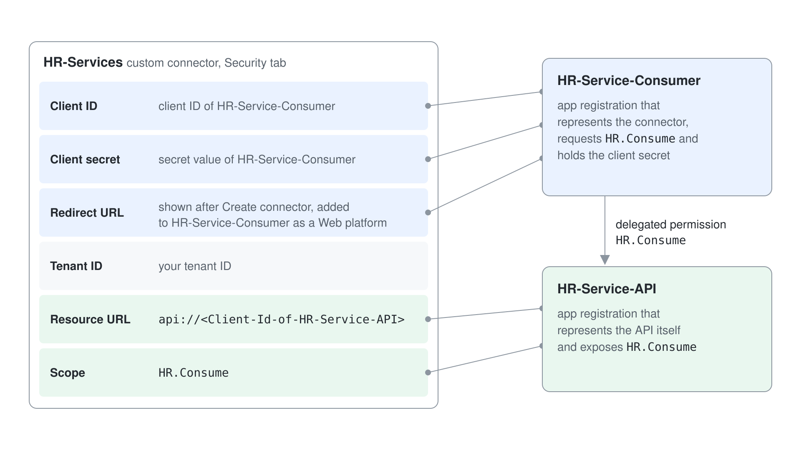

# Custom Connectors & REST APIs

Thousands of prebuilt connectors still leave gaps: the in-house asset database, the facilities booking API, a partner's order service. When no connector exists, a Standard agent in Copilot Studio (Learn: standard harness) has three ways to reach a REST API directly. A custom connector wraps the API once for the whole Power Platform, a REST API tool turns an API description into agent tools in one wizard, and an HTTP request node calls an endpoint from inside a topic.

This topic teaches all three and when each one fits. You learn what an OpenAPI description gives each path, how a custom connector carries Microsoft Entra ID sign-in so every call runs as the real user, how the REST API tool wizard turns operations into tools the orchestrator can choose, and what the HTTP request node is for. Model Context Protocol, the fourth way to reach a service, has its own topic in [MCP Servers as Agent Tools](../06-mcp/readme.md).

## Three ways to call an API

All three paths end in an HTTP call; they differ in who configures the call, who decides when it runs, and how sign-in works.

| | Custom connector | REST API tool (preview) | HTTP request node |
|---|---|---|---|
| Built from | An OpenAPI 2.0 file, imported in Power Apps or Power Automate | An OpenAPI v2 JSON file uploaded in Copilot Studio (a v3 file is translated to v2) | A URL, a method, headers, and a body you type into the node |
| Lives in | The environment, usable by agents, flows, and apps | The agent's tools, stored in a solution | One topic |
| Who decides when it runs | The orchestrator from the tool description, or a topic | The orchestrator from the tool description, or a topic | The topic, when the conversation reaches the node |
| Sign-in | None, API key, OAuth 2.0 including Microsoft Entra ID | None, API key, or OAuth 2.0 | Whatever headers you send |
| Status | Generally available | Preview | Generally available |

An OpenAPI description is a JSON or YAML file that lists an API's operations, their parameters, and their responses. The two connector-based paths read it to build tools with typed inputs and outputs, and the descriptions inside it become the first draft of what the orchestrator reads. Good descriptions in the file save editing later.

## Custom connectors

A custom connector is a Power Platform connector you define for your own API. You start it from the agent with **Add a tool** > **New tool** > **Custom connector**, which opens Power Apps, then select **New custom connector** and **Import an OpenAPI file**. The wizard walks through General (host and base URL), Security (authentication), Definition (operations, parameters, responses), and Test.

Because the connector lives in the environment, the same definition serves a Copilot Studio agent, a Power Automate flow, and a Power Apps canvas app. Each operation you add to an agent becomes one tool with its own name, description, and inputs, exactly like a prebuilt connector action. For the agent to use it, the connector needs view and share permissions for the organization.

An operation's description can also carry call order. The food connector's update operation tells the agent to look the id up with the list operation first, and without that line the agent guessed an id and got `Not Found`. One connector whose operations have real descriptions beats three connectors whose operations carry bare ones such as "Gets all food".

The import path is strict about the format. Custom connectors import OpenAPI 2.0 (formerly Swagger) definitions, and Learn states that OpenAPI 3.0 definitions are not supported by this import. When the API only publishes 3.0, convert it first or use the REST API tool, which translates v3 for you.

## Securing a custom connector with Microsoft Entra ID

Most internal APIs should know which user is calling. A custom connector can hold a full OAuth 2.0 configuration with Microsoft Entra ID as the identity provider, so the agent never stores a shared key and every call carries the signed-in user's token.

The pattern uses two app registrations. One represents the API and exposes a delegated permission (a scope). The other represents the connector: it holds the client secret, requests that scope, and lists the connector's redirect URL as a web redirect URI. On the connector's Security tab you enter the connector registration's client ID and secret, the API's resource URL, and the scope; the redirect URL appears after you create the connector.

At runtime the user signs in once to the connector, Entra ID issues a token for the API's scope, and the API validates the audience before it answers. Learn notes that for automatic connection creation with Entra ID, you set **Enable on-behalf-of login** to true on the connector's Security section.

## The REST API tool

The REST API tool (preview) collapses the custom connector steps into one Copilot Studio wizard. You select **Add a tool** > **New tool** > **REST API**, upload an OpenAPI v2 JSON file, and Copilot Studio builds the tools for you. The wizard has five stages: upload the specification, describe the API and pick a solution, set authentication, select and describe the operations you want, then review and publish.

Two steps decide whether the orchestrator uses the tools well. The API description is prefilled from the file and is usually too short; Learn recommends a detailed description with synonyms: its example replaces "A simple service to manage tickets" with "A system used to get, retrieve, find, and display existing tickets". On the parameter review page every input and output needs a description before you can continue.

You only expose the operations you select. An API that can create, update, and delete does not have to give the agent delete; you add the read operation and leave the rest out. After publishing, you create a connection per tool on the **Add tool** screen and select **Add and configure**.

| Authentication | What you provide | At runtime |
|----------------|------------------|------------|
| None | Nothing | Calls go out without credentials |
| API key | Parameter label, parameter name, and Header or Query location | The user provides the key when the agent first uses the tool |
| OAuth 2.0 | Client ID, client secret, authorization URL, token URL, refresh URL, optional scope | The user signs in through a consent card in the chat |

## The HTTP request node

The HTTP request node calls an endpoint at a fixed point in a topic. You add it with **Add node** > **Advanced** > **Send HTTP request**, enter the URL, and choose GET, POST, PATCH, PUT, or DELETE. The URL can be a Power Fx formula, so a topic can build it from variables the user supplied.

The node does not know the response format until you tell it. Set **Response data type** to **From sample data**, select **Get schema from sample JSON**, and paste an example response; the node then saves the response as a typed variable that later nodes read with Power Fx. Headers and a JSON or raw body are set in **Headers and body** > **Edit**, where you can also pass an `Authorization` header.

The node suits quick, deterministic calls inside a designed conversation, such as looking up a public holiday calendar before promising a delivery date. It is not chosen by the orchestrator, and token handling is up to you. For an API that needs per-user sign-in or that several agents share, a custom connector or REST API tool is the better home.

## Choosing a path

| Situation | Reach for |
|-----------|-----------|
| An internal API that must know who the user is | A custom connector with Microsoft Entra ID OAuth 2.0 |
| The same API in agents, flows, and apps | A custom connector |
| A quick start from an existing OpenAPI file, for one agent | A REST API tool |
| One call at a fixed step of a topic, response shaped by Power Fx | An HTTP request node |
| A service that publishes an MCP server | An MCP tool, see [MCP Servers as Agent Tools](../06-mcp/readme.md) |

Two habits keep the first real call clean. When a connector call replaces a stub, such as the sample-stock node that fills `Topic.foodStock` in the prompt demo, give the stub the API's shape from the start, because the node refuses to save the API's list into a variable of a different shape; otherwise let the node create a new variable and rename it. An API on a free-tier web app starts cold, so its first tool call can time out while the app starts: open the API once before you demo it.

## Hands-On Demos

- [Give the Canteen Agent Live Stock from a REST API](./demo-food-catalog-rest-connector.md): the presenter turns the food catalog's OpenAPI file into the CS-Food Catalog custom connector, gives CS-Food Stock Buddy three tools from it, and replaces the sample stock with the live list.
- [Call a Public API from a Topic and as a REST API Tool](./demo-rest-api-tool.md) (optional): the presenter calls a public holiday API with an HTTP request node in a topic, then describes the same endpoint in OpenAPI and adds it as a REST API tool the orchestrator chooses on its own.

## Hands-On Lab

- [Call a Secured REST API from an Agent](../../../labs/04-cs-tools/05-rest-api/lab-01-call-a-secured-rest-api.md): learners run an HR API locally, secure it with two Entra ID app registrations, publish it through a dev tunnel, wrap it in a custom connector with OAuth 2.0, and call it from an agent as the signed-in user.

## Key Topics covered in this module

[Extend your agent with tools from a REST API (preview)](https://learn.microsoft.com/microsoft-copilot-studio/agent-extend-action-rest-api)

[Use Power Platform connectors as tools](https://learn.microsoft.com/microsoft-copilot-studio/advanced-connectors)

[Create a custom connector from an OpenAPI definition](https://learn.microsoft.com/connectors/custom-connectors/define-openapi-definition)

[Authenticate your API and connector with Microsoft Entra ID](https://learn.microsoft.com/connectors/custom-connectors/azure-active-directory-authentication)

[Make HTTP requests](https://learn.microsoft.com/microsoft-copilot-studio/authoring-http-node)

[Add tools to custom agents](https://learn.microsoft.com/microsoft-copilot-studio/add-tools-custom-agent)
