# Connect the Help Desk Agent to the Microsoft Learn MCP Server



Half the questions the Grey Logistics IT Help Desk receives are "how do I" questions about Microsoft products, and the answers change every month. Copying Microsoft's documentation into knowledge files would be stale the week after. In this demo the agent connects to the Microsoft Learn MCP Server, a public server that searches and fetches the current documentation, and you control which of its tools the agent may call.

What you practice here: adding an MCP server as a tool, routing questions to it, and restricting the tools it exposes.

Duration: about 30 minutes.

## What you'll build

- The Microsoft Learn Docs MCP Server from the catalog, connected to the Grey Logistics IT Help Desk agent.
- An instruction that routes Microsoft product questions to the server.
- A tool selection with **Allow all** off, so the agent can search and read documentation but not request code samples.
- A second connection to the same server through the MCP onboarding wizard, built from the URL alone.

## Prerequisites

- A Standard agent named Grey Logistics IT Help Desk (on the home page, open the **New agent** dropdown and select **Agent** with the **Standard** badge under **Other ways to build**) with generative orchestration on, which MCP requires (it is the default for new agents).
- Network access to `https://learn.microsoft.com/api/mcp`. The server needs no sign-in and has no charge; opening the URL in a browser returns an error by design, because it only answers MCP clients.

## Exercise 1: Add the server from the catalog

Microsoft publishes the Learn server as a certified MCP connector, so you add it without typing a URL. The settings page then shows what the server offers, discovered from the server itself.

1. Open the agent, go to **Tools**, and select **Add a tool**.
2. Search for `Microsoft Learn Docs MCP`, select the Microsoft Learn Docs MCP Server, create the connection if prompted, and select **Add and configure**.
3. On the tool's settings page, scroll to the **Tools** section.

Expected: the **Tools** section lists the server's tools, including `microsoft_docs_search`, `microsoft_docs_fetch`, and `microsoft_code_sample_search`, each with a description written by the server.

## Exercise 2: Route Microsoft questions to the server

The orchestrator decides from descriptions whether to call a server, and the agent's instructions can make the business rule explicit. You add one routing line, then check both a question that should use the server and one that should not.

1. Go to **Overview**, select **Edit** on **Instructions**, add this line, and save:

```text
When the question is about Microsoft products and services, use the Microsoft Learn MCP Server to search for answers and cite the Learn article.
```

2. In the test pane, send:

```text
How do I set up a passkey in Microsoft Authenticator?
```

3. If the agent shows **Open connection manager**, open it, select **Connect** and **Submit**, close the tab, and select **Retry**.
4. Send a question that is not about a Microsoft product:

```text
What should I bring to my first day at the help desk?
```

Expected: for the passkey question, the activity map shows a call to `microsoft_docs_search` and the reply cites at least one `learn.microsoft.com` link; for the second question, the activity map shows no call to the MCP server.

## Exercise 3: Restrict the tools the agent may call

A server's tool list can grow, and every new tool widens what the agent can do. A help desk agent needs to search and read articles; code samples are out of scope, so you turn that tool off and freeze the list.

1. Open the Microsoft Learn Docs MCP Server tool from the **Tools** page.
2. Turn off **Allow all**, turn off `microsoft_code_sample_search`, and select **Save**.
3. In a new test conversation, send:

```text
Show me a C# code sample that reads a user's calendar with Microsoft Graph.
```

Expected: the activity map shows no call to `microsoft_code_sample_search`; the agent answers from `microsoft_docs_search` or `microsoft_docs_fetch`, or says it cannot provide a code sample.

> **Note:** With **Allow all** off, any tool the server adds later also stays off until you turn it on.

## Exercise 4: Connect the same server with the onboarding wizard

Most servers you meet are not in the catalog, so you need the wizard: a name, a description, a URL, and an authentication type. Connecting the Learn server a second time shows that the wizard needs no tool list, because the agent discovers the tools from the server.

1. On the catalog tool's settings page, turn off **Enabled** and select **Save**, so only one copy is active.
2. Select **Add a tool** > **New tool** > **Model Context Protocol** and fill in the wizard:

| Field | Value |
|-------|-------|
| Server name | `Microsoft Learn (wizard)` |
| Server description | `Searches and reads current Microsoft Learn documentation. Use it for how-to questions about Microsoft products and services.` |
| Server URL | `https://learn.microsoft.com/api/mcp` |
| Authentication | None |

3. Select **Create**, select **Create a new connection** on **Add tool**, then **Add to agent**.
4. Repeat the passkey question from Exercise 2 in a new test conversation.

Expected: the wizard tool's settings page lists the same tools you saw in Exercise 1 without you entering any of them, and the passkey question again runs `microsoft_docs_search`, now through Microsoft Learn (wizard).

## Troubleshooting

| Symptom | Likely cause | Fix |
|---------|--------------|-----|
| **Model Context Protocol** is missing or disabled under **Add a tool** | A data policy blocks the MCP connector, or generative orchestration is off | Select the information icon next to the tool, ask the administrator about the policy, and confirm generative orchestration is on |
| The agent answers from general knowledge and never calls the server | The question did not match the server description or the instructions | Add the routing line from Exercise 2 and start a new test conversation |
| "Open connection manager" appears on every test | The connection was created but not submitted | In the connection manager select **Connect**, then **Submit**, then **Retry** in the test pane |
| The wizard connection fails for another server | The server only supports the SSE transport | Use a server that supports Streamable HTTP; Copilot Studio no longer supports SSE |

## Summary

You connected the Grey Logistics IT Help Desk agent to a live documentation source over MCP, routed the right questions to it, and limited the tools it may call. You can now:

- Add an MCP server from the catalog and read the tools it publishes
- Route questions to a server with instructions and verify the routing in the activity map
- Restrict a server's tools with **Allow all** so later additions stay off
- Connect any Streamable HTTP server with the onboarding wizard

The lab connects an MCP server that writes data: the repository's HR MCP server.
