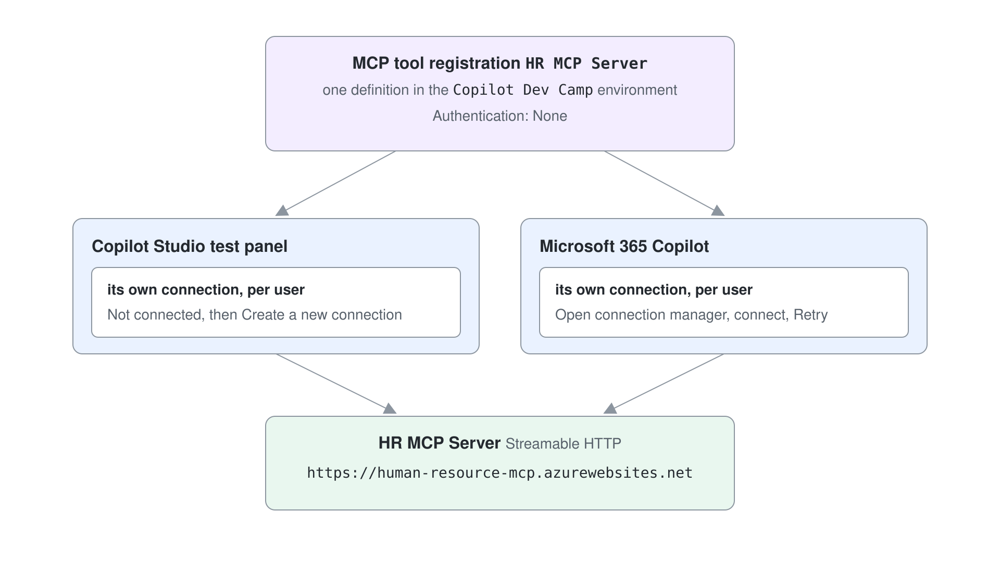

# MCP Servers as Agent Tools

Every connector and REST API tool you add is described by hand, per agent, and stays frozen until someone edits it. The Model Context Protocol (MCP) moves that description to the service: an MCP server publishes its own tools, with names, descriptions, inputs, and outputs, and every agent that connects discovers them when it runs. Change a tool on the server and every connected agent sees the change without being republished.

This topic teaches MCP in Copilot Studio's Standard agents (Learn: standard harness). You learn what a server can expose, how runtime discovery differs from a connector's design-time contract, the three ways to connect a server, which transport and authentication options Copilot Studio supports, how to limit what an agent may call, and how the repository's own HR MCP server builds its tools from code. The GitHub Copilot agent counterpart is part of [Tools, MCP, and the New Workflows Designer](../../06-cs-gh-copilot/04-workflows-and-mcp/readme.md).

## What an MCP server gives an agent

MCP is an open protocol for connecting language model applications to tools and data. A server can offer three kinds of capability, and Copilot Studio uses two of them.

| Capability | What it is | Used by Copilot Studio |
|------------|------------|------------------------|
| Tools | Functions the model can call to perform an action, such as `add_employee` | Yes |
| Resources | File-like data the agent reads for context, such as an API response or file contents | Yes, when the server returns the resource as the output of one of its tools |
| Prompts | Predefined prompt templates for specific tasks | No |

On the agent, the whole server appears as one tool on the **Tools** page. Its settings page lists the server's tools and a sample of its resources with their names and descriptions, so a maker can see what the agent can reach without opening the server's code.

## Design-time contract versus runtime discovery

A custom connector is a design-time contract: you import an OpenAPI file, map each operation to a tool, and the tool list stays fixed until you import the file again. An MCP server is a runtime contract: the agent asks the server which tools exist, and Copilot Studio reflects added, changed, and removed tools automatically.



That shift has a cost as well as a benefit. The server owns the tool descriptions, so a maker cannot enrich them in Copilot Studio with extra context about when to call a tool; a vague description has to be fixed on the server. Topics cannot call an MCP server directly, and MCP needs generative orchestration, because only the orchestrator decides when to call one of the server's tools.

| | Connector or REST API tool | MCP server |
|---|---|---|
| Where tool descriptions live | In Copilot Studio, per agent | On the server, shared by every client |
| A new operation appears | After you re-import and re-add it | At runtime, without changing the agent |
| Called from a topic | Yes | No |
| Works with classic orchestration | From topics only | No |
| Best fit | One agent, a stable API, or a quick prototype | Many agents sharing a toolset, or an API that changes often |

Microsoft's guidance follows that table: use MCP when several agents need the same managed toolset or when upstream APIs change often, and call the API directly when no MCP server exists or you are prototyping quickly.

## Three ways to connect a server

Copilot Studio offers a catalog, a wizard, and a manual path. The catalog under **Add a tool** > **Model Context Protocol** lists prebuilt Microsoft and partner MCP connectors, such as the Microsoft Learn Docs MCP Server and the Dataverse MCP Server; you select one, authorize the connection, and select **Add and configure**. For any other server, the MCP onboarding wizard under **Add a tool** > **New tool** > **Model Context Protocol** asks for a server name, a server description, the server URL, and the authentication type.

The server description in the wizard does the same job as a tool description: the orchestrator reads it to decide whether to call the server at all. The third path, a custom connector created in Power Apps from an OpenAPI schema that describes the MCP endpoint, exists for teams that manage connectors centrally. Organizations can also register their own servers through Agent 365 so administrators approve them before makers see them.

| Path | You provide | Fits |
|------|-------------|------|
| Catalog | A connection | Microsoft and partner servers, such as Microsoft Learn Docs or Dataverse |
| MCP onboarding wizard | Name, description, URL, authentication | Your own or a third-party server, recommended by Learn |
| Custom connector | An OpenAPI schema file for the server | Connectors managed and certified centrally |

## Transport and authentication

Copilot Studio supports the Streamable HTTP transport only. Servers that offer only the older Server-Sent Events (SSE) transport no longer work: Learn states that Copilot Studio stopped supporting SSE for MCP after August 2025. A server that runs only over standard input and output on a developer's machine has to be hosted behind an HTTPS URL before an agent can use it.

The wizard offers three authentication types. None suits public, read-only servers. API key sends a key in a header or a query parameter, and the user of the agent provides the key.

OAuth 2.0 lets each user sign in and grant consent; it comes in three variants: dynamic discovery (dynamic client registration with a discovery endpoint, the simplest), dynamic (registration without discovery, endpoints entered manually), and manual. For dynamic and manual OAuth, Copilot Studio shows a callback URL that you add to the app registration at your identity provider.

## Controlling what the agent may call

All tools on a server are on by default, with the **Allow all** toggle on. Turn it off to switch individual tools on and off, so an agent that only reads can never call a server's delete tool. With **Allow all** off, tools the server adds later stay off until you turn them on, which keeps runtime discovery from widening the agent's reach silently. With it on, a redeploy widens the agent at once: the HR agent offered `assign_shift` as soon as the server added it, so turn **Allow all** off and disable tools the agent has no reason to call, such as `remove_employee` for a scheduling agent.

Governance comes from the connector layer. Copilot Studio reaches MCP servers through Power Platform connectors, so a data policy that blocks a connector also blocks the server and its tools. Each user also needs a connection the first time the agent calls a server that requires sign-in, in the test pane and in every channel. A tool that asks the user for confirmation needs a **Message to display**; without one the call fails with `This tool requires user confirmation, but no confirmation message has been set.`



## Building your own server

Learn points to the official MCP SDKs for building a server in a supported language. The repository's HR MCP server in `src/hr-mcp-server` is a .NET 10 web app built on the MCP C# SDK, and it shows how little code a tool needs: a method marked `[McpServerTool]`, with `[Description]` attributes that become the descriptions the orchestrator reads.

```csharp
[McpServerToolType]
internal class HRTools(IEmployeeService employeeService)
{
    [McpServerTool]
    [Description("Provides the whole list of employees")]
    public async Task<EmployeeCollection> ListEmployees()
    {
        var employees = await employeeService.GetAllEmployeesAsync();
        return new EmployeeCollection
        {
            Employees = employees
        };
    }
}
```

`Program.cs` registers the server with the HTTP transport and maps the MCP endpoint, which is what makes it reachable from Copilot Studio:

```csharp
builder.Services.AddMcpServer()
    .WithHttpTransport(options => options.Stateless = true)
    .WithToolsFromAssembly();
```

Adding a capability means adding a method and restarting the server. Connected agents discover the new tool the next time they list the server's tools, which is the runtime contract from the table above in practice.

Check that an answer really came from the server. When a reply names people missing from the server's data, the orchestrator answered without calling it, and the activity map shows no tool call. The server's search semantics bind the agent too: while the deployed `search_employees` matched only single names, a full-name request returned an empty list and the agent refused to book.

## Hands-On Demos

- [Schedule Restaurant Staff Through an HR MCP Server](./demo-restaurant-hr-mcp.md): the presenter rebuilds CS-Restaurant HR Manager, connects the repository's HR MCP server through the onboarding wizard, finds staff by role and language, books two shifts after a confirmation, and mails the schedule with an Outlook tool.
- [Connect the Help Desk Agent to the Microsoft Learn MCP Server](./demo-connect-an-mcp-server.md) (optional): the presenter adds the Microsoft Learn Docs MCP Server from the catalog, inspects its tools, restricts them with **Allow all**, routes Microsoft how-to questions to it in the instructions, and connects the same server a second time through the onboarding wizard.

## Hands-On Lab

- [Give an Agent MCP Tools](../../../labs/04-cs-tools/06-mcp/lab-01-give-an-agent-mcp-tools.md): learners inspect the HR MCP server with MCP Inspector, register it as a tool, connect per user, test its six tools, and publish the agent to Microsoft 365 Copilot.

## Key Topics covered in this module

[Extend your agent with Model Context Protocol](https://learn.microsoft.com/microsoft-copilot-studio/agent-extend-action-mcp)

[Connect your agent to an existing MCP server](https://learn.microsoft.com/microsoft-copilot-studio/mcp-add-existing-server-to-agent)

[Add tools and resources from an MCP server to your agent](https://learn.microsoft.com/microsoft-copilot-studio/mcp-add-components-to-agent)

[Create a new MCP server](https://learn.microsoft.com/microsoft-copilot-studio/mcp-create-new-server)

[Use agent tools to extend, automate, and enhance your agents](https://learn.microsoft.com/microsoft-copilot-studio/guidance/agent-tools)

[Get started with Microsoft Learn MCP Server in Microsoft Copilot Studio](https://learn.microsoft.com/training/support/mcp-get-started-copilot-studio)

[Connect to Dataverse with model context protocol in Microsoft Copilot Studio](https://learn.microsoft.com/power-apps/maker/data-platform/data-platform-mcp-copilot-studio)
