# Proactive Teammates: Triggers, Email & Teams Mentions

An agent with an account has a name and a mailbox, but instructions alone do not make it act. It moves when something starts its cycle: an incoming email, a schedule, or a colleague who @mentions it. This topic covers the triggers that make a teammate proactive, the ways people hand it work, and the Cadence example that ties them together.

## Triggers Start the Cycle

On October 15, 2026, Microsoft announced triggers for agents on the GitHub Copilot harness. When configured, an external signal (such as an email) or a set cadence starts an agent's cycle, so the agent runs a shared process without anyone opening a chat. The rollout runs through the Frontier program, alongside agent accounts and business process memory.

The Learn example puts the rule plainly: instructions alone don't create a schedule or grant access. Writing "every Monday, prepare the review" in the instructions does nothing until a recurrence trigger exists and the tools can reach the sources. Treat the trigger, the tools, and the instructions as three separate pieces of configuration that must all be present.



| Trigger | Starts the cycle when | Fits |
|---|---|---|
| Recurrence | The schedule you set comes around | Weekly reviews, status packs, reminder chains |
| Email | A message arrives in the agent's mailbox | Intake of requests, proposals, or supplier updates |
| A person | Someone @mentions it or sends it a task | Ad hoc questions, assignments, and updates |

## How People Hand It Work

Colleagues reach an agent with an account through the tools they already use. They invoke it in Teams and Outlook to ask questions, assign work, or contribute updates, and they @mention it in comments in Word, Excel, and PowerPoint to bring it into a document. Team members can also delegate a process task by Teams message or email and keep working.

Replies and comments are how people add judgment to a process the agent runs. The agent prepares, chases, and summarizes; people decide priorities and sign off. Microsoft's own example is a finance lead's budget agent that prepares the weekly review each Tuesday with its own approved credentials, while the finance team contributes updates through the tools they already use.

## The Cadence Pattern

Cadence is the execution-review agent from the Learn documentation, and it is a useful template for any review process. You give it an approved workstream tracker and a small internal reviewer group, then configure supported tools and a recurrence trigger. On each scheduled run it reads the tracker and status evidence, identifies blockers and missing updates, generates a new review document, and sends reviewers the link.


The design works inside the preview limits on purpose. Cadence creates a new document each cycle because co-authoring an existing one is not supported, and it asks reviewers for the specific context or decision it needs. Its instructions tell it to preserve uncertainty (a missing reply does not mean the work is on track) and to stop and explain when a source, connection, or permission is missing.

```text
You are Cadence, our team's execution-review agent.
At each configured review cycle, read the approved workstream tracker and status sources provided by the maker.
Summarize changes, blockers, decisions needed, and open follow-ups. Cite the source for each finding.
Preserve uncertainty: missing replies do not mean work is on track. Do not invent metrics, owners, dates or completion.
Create a new review document in the approved team folder. Verify it exists before sending its link to the configured internal reviewers.
Ask reviewers for the specific context or decision needed. Use supported replies and comments; do not claim you can co-author or make targeted edits to an existing document.
People own prioritization and sign-off. Do not change permissions, expand the audience or act on sensitive findings without the required approval.
If a source, connection, permission or output tool is unavailable, explain what is missing and stop the affected action.
```

## Attribution Is the Point

Because the agent acts with its own credentials, the work is attributed to the agent and process owners keep control over its scope. That attribution is what makes the process observable: an admin can see which actions the agent took, under which identity, and with which permissions. It is also why the human checkpoints in the instructions matter, since nobody approves a scheduled run as it happens.

## Hands-On Demo

Planned: **Wake Cadence on a Schedule**. The instructor adds a recurrence trigger to Cadence, lets one cycle run, and shows the review document, the reviewer email, and a reply flowing back.

## Hands-On Lab

Planned: [Make Cadence Proactive](../../../labs/05-ai-teammates/readme.md). You connect a SharePoint workstream tracker, add a recurrence and an email trigger, run a cycle, and contribute an update as a reviewer by reply and by @mention.

## Key Topics covered in this module

[Delegate shared business processes to agents that are more persistent and proactive](https://www.microsoft.com/en-us/copilot/blog/copilot-studio/delegate-shared-business-processes-to-agents-that-are-more-persistent-and-proactive-with-microsoft-copilot-studio/)

[Give your agent an account (Frontier): Example Cadence](https://learn.microsoft.com/microsoft-copilot-studio/agents-experience/authoring-agent-account#example-cadence-a-team-execution-review-agent)
