# Shared Memory, Licensing & Teammate Governance

A teammate that remembers what the whole team tells it is useful and risky in the same breath. This topic explains how shared memory behaves, what it never keeps, and the licensing and admin steps a tenant needs before anyone can build an agent with an account. Governance of the wider agent estate (the registry, DLP, and Purview) stays in [Governance, Compliance & Preventing Agent Sprawl](../../04-maintaining/04-governance-compliance/readme.md); this topic covers what is specific to teammates.

## Shared Memory: One Memory for the Whole Team

An agent with an account keeps one memory across everyone it works with, so what one person explains benefits the whole team. It holds facts about the work, such as team processes and terminology, and details about individual people, such as how someone prefers to receive updates. It uses this shared memory instead of personal memory, even in one-to-one chats.

Shared memory has no privacy boundary between users. A record about one person can be used in later conversations with other people, and the agent is only guided not to bring up one person's details with someone else. The People card states it directly: anything shared can be summarized and included in the agent's responses to any user, even users without permission to the original file or chat and regardless of sensitivity label.

## What Shared Memory Never Keeps

| Excluded | Examples |
|---|---|
| Personal details | ID numbers, birth dates, account or card numbers, personal phone numbers, home addresses |
| Secrets | Passwords, credentials, and tokens |
| Requests to forget | Anything someone asks it not to remember |
| Judgments | Assessments of anyone's performance or conduct |
| Sensitive categories | Health information and protected characteristics (only the practical effect, such as "attends the offsite remotely") |
| Duplicates and guesses | Content already in instructions or knowledge, inferred conclusions, generalizations from a single remark |

Everyone who interacts with the agent can view or delete its saved shared memories. If no one interacts with it for 28 days, the system deletes them. When a memory conflicts with the instructions, the agent follows the instructions and corrects the memory.

## No Opt-Out in the Preview

End users cannot opt out of shared memory, and by using the agent they consent to it. Admins cannot turn shared memory off on its own either: the only switch is turning agent accounts off altogether. Write the instructions and the team briefing with that in mind, and tell people to share only what they would share with the whole team.

## Licensing: Three Separate Things

| What | Who needs it | Notes |
|---|---|---|
| Maker license | The person who builds the agent | Microsoft 365 E5 with the Agent 365 add-on, or Microsoft 365 E7 (which includes Agent 365) |
| Microsoft 365 Frontier for AI Teammates | Each agent with an account | Assigned per agent at publish; the tenant receives a pool on Frontier enrollment |
| Copilot Credits | The usage | Building, testing, evaluating, and running the agent consume credits on usage-based billing |

Agent 365 itself has been generally available per user since May 1, 2026, and agents are covered under their owner's license rather than needing their own Agent 365 seat. The per-agent Frontier for AI Teammates license is the scarce resource in a class: when the pool is empty, publishing fails, and an admin must remove a license from another agent or acquire more.

## Admin Activation, in Order

1. A global admin enrolls the tenant in Frontier from the Microsoft 365 admin center (**Agents** > **Overview** > **Try now**) and accepts the Agent 365 terms.
2. In the Microsoft 365 admin center, an admin opens **All Agents**, filters by **Agent template: Yes**, selects **Copilot Studio (Frontier)**, selects **Activate**, and picks the users or groups allowed to create agents with accounts.
3. In the Power Platform admin center, an admin opens **Copilot** > **Settings**, selects **Agent accounts** under **Copilot Studio**, and turns it on for the environment.
4. The environment's **Release cycle** is set to **Early**.

Only the users and groups chosen in step 2 can create agents with accounts. In the European Economic Area, Teams is licensed separately: an agent still gets its account, mailbox, and directory entry, but appears in Teams only if the tenant licenses Teams.

## Govern Teammates Like People

Because each agent has its own Entra identity, admins audit and govern it like any other account, and Agent 365 provisions and governs agent accounts with user-grade visibility. Agents with an account cannot read documents labeled **Confidential** or **Internal Only**, so test with approved, non-sensitive samples and never relabel a document to make a test pass. Microsoft has announced further access policies, cost management, and lifecycle controls for these agents over the coming months.

## Hands-On Demo

Planned: **Read the Teammate's Memory**. The instructor shows the People card notice, lists and deletes a saved shared memory, and finds the agent's license and identity in the admin centers.

## Hands-On Lab

Planned: [Teammate Readiness Review](../../../labs/05-ai-teammates/readme.md). You walk the activation checklist for a class tenant, check the license pool, and test which statements Cadence keeps or refuses to remember.

## Key Topics covered in this module

[FAQ for agent accounts (Frontier)](https://learn.microsoft.com/microsoft-copilot-studio/faq-agent-accounts)

[Overview of Microsoft Agent 365](https://learn.microsoft.com/microsoft-agent-365/overview)

[Preview Microsoft Agent 365 features through the Frontier program](https://learn.microsoft.com/microsoft-agent-365/frontier)

[Early release cycle environments](https://learn.microsoft.com/power-platform/admin/early-release)
