# Trigger an Autonomous Agent from a SharePoint List



Requests that people file in a SharePoint list sit untouched until someone on the help desk opens the list, reads each one and sets a priority. The first hour of every outage goes to that triage. In this demo the Grey Logistics IT Help Desk agent reads each new request the moment it is created, sets its priority and writes a triage note back to the list, with nobody in the chat.

What you practice here: turning a chat agent into an autonomous one with an event trigger, a payload instruction and a tool that runs on maker credentials.

Duration: about 30 minutes.

## What you'll build

- A SharePoint list named Help Desk Requests that the agent watches.
- An **Update item** tool, named Update help desk request, that writes the priority and a triage note back to the list with maker-provided credentials.
- An event trigger that sends each new list item to the agent with its own payload instruction.
- A tested and published autonomous run, visible on the agent's **Activity** page.

## Prerequisites

- A SharePoint site where you can create a list. Create a blank list named `Help Desk Requests` with three extra columns: `Description` (Multiple lines of text), `Priority` (Single line of text) and `Triage note` (Multiple lines of text).
- An environment where solution-aware cloud flow sharing is turned on and data policies allow event triggers.
- A Standard agent (Learn: standard harness) named Grey Logistics IT Help Desk, created from the **New agent** dropdown on the home page: under **Other ways to build**, select **Agent** with the **Standard** badge. Keep generative orchestration on (the default for new agents).

## Exercise 1: Set boundaries and a tool that works without a user

An autonomous run has nobody to ask, so the agent's instructions carry the boundaries and its tool must authenticate without a sign-in prompt. The priority rules sit in the instructions because they apply to every run, whatever starts it.

1. On the agent's **Overview** page, replace the instructions with this text:

```text
You are the Grey Logistics IT Help Desk. When you act on a new help desk request, work without waiting for user input, never invent details the request does not contain, and never ask anyone for credentials.
Priorities: P1 when many people cannot work or a security incident is suspected. P2 when one person cannot work at all. P3 when one person can work with a workaround. P4 for questions and requests for equipment or software.
```

2. Go to **Tools**, select **Add a tool**, select **Connector**, search for SharePoint and select **Update item**. Create the connection if asked, then select **Add and configure**.
3. Rename the tool to `Update help desk request` and replace its description:

```text
Writes the priority and a triage note back to one item in the Help Desk Requests SharePoint list. Needs the item ID, the item title, a priority from P1 to P4 and a triage note.
```

4. In the tool's inputs, set **Site Address** to your site and **List Name** to `Help Desk Requests` as fixed values, so the agent only fills the item fields.
5. On the tool's page, under **Details** > **Additional details** > **Credentials to use**, select **Maker-provided credentials** and save.

Expected: the **Tools** page lists Update help desk request, and its details show **Maker-provided credentials**.

> **Warning:** Maker-provided credentials let anyone who reaches the published agent act through your SharePoint permissions. Keep the tool scoped to this one list.

## Exercise 2: Add the event trigger and its payload instruction

The trigger turns a new list item into a message for the agent. The payload instruction tells the agent what to do with this kind of event, which keeps the general instructions short when an agent later has several triggers.

1. On the **Overview** page, go to **Triggers** and select **Add trigger**.
2. Select the SharePoint trigger **When an item is created** and select **Next**.
3. Name the trigger `New help desk request`, confirm the connections for Copilot Studio and SharePoint, and select **Next**.
4. Set **Site Address** to your site and **List Name** to `Help Desk Requests`.
5. In the additional instructions for the agent, paste this payload instruction and select **Create trigger**:

```text
Use content from Body. This is a new item in the Help Desk Requests list. Decide its priority, write a triage note of at most two sentences that names the likely cause and the next step, then call Update help desk request with the item's ID and title, the priority and the triage note.
```

Expected: after a short wait, a confirmation dialog invites you to test the trigger, and **New help desk request** appears in the **Triggers** section of the **Overview** page.

## Exercise 3: Replay a real event and read the plan

Until you publish, the trigger doesn't fire on its own. You create one real event, replay it into the test pane, and check in the activity map that the agent read the payload and called the right tool with the right values.

1. In SharePoint, add this item to Help Desk Requests:

```text
Title: VPN down for the whole Graz office
Description: Since 8:30 nobody in the Graz office can connect to the VPN. About 40 people are affected and cannot reach the finance system.
```

2. Back on the agent's **Overview** page, select the test trigger icon next to New help desk request.
3. Wait until the new item appears as an instance, select it and select **Start testing**.
4. In the test pane, select the map icon to open the activity map.

Expected: the activity map shows the trigger payload, then a call to Update help desk request with the item's ID, `P1` and a two-sentence triage note. The SharePoint item now shows P1 in **Priority** and the note in **Triage note**.

> **Tip:** It can take up to a minute before a new item shows up as a test instance. If no instance appears, refresh the list of instances before you create a second item.

## Exercise 4: Look behind the trigger and publish it

Every event trigger is a small Power Automate flow, and publishing is the moment the agent starts reacting on its own with your credentials. Both deserve one look before the agent goes live.

1. Next to New help desk request, select the three dots and **Edit in Power Automate**.
2. Look at the two cards of the flow, then close Power Automate without changes.
3. Back in Copilot Studio, select **Publish** and read both warnings before you confirm.
4. Add a second item to Help Desk Requests:

```text
Title: Request for a second monitor
Description: I would like a second monitor for my desk in Vienna, room 4.12.
```

5. Open the agent's **Activity** page.

Expected: the flow shows the SharePoint trigger followed by **Sends a prompt to the specified copilot for processing**. The publish dialog warns that the agent includes triggers that use the author's credentials and that editors get access to embedded connections. Within a few minutes the **Activity** page lists an automated session for the second item, and the item shows P4 with a triage note.

## Troubleshooting

| Symptom | Likely cause | Fix |
| --- | --- | --- |
| **Add trigger** is missing or blocked | Generative orchestration is off, data policies block triggers, or solution-aware cloud flow sharing is off | Check **Settings** > **Generative AI**, then ask the environment admin about data policies and flow sharing |
| The test run stops and asks someone to sign in | The tool still uses **End user credentials** | Switch **Credentials to use** to **Maker-provided credentials** and test again |
| The agent sets a priority but never updates the item | The payload instruction doesn't name the tool, or the item ID isn't passed | Name Update help desk request in the payload instruction and check the tool's inputs in the activity map |
| Nothing happens after a new item is created | The agent isn't published yet, so the trigger doesn't fire on its own | Publish the agent; until then, use the test trigger icon |

## Summary

You turned the Grey Logistics IT Help Desk agent into an autonomous agent that triages every new SharePoint request with nobody in the chat. You can now:

- Separate general boundaries in the agent instructions from per-trigger payload instructions
- Configure a connector tool with maker-provided credentials for unattended runs
- Replay a recorded event with the test trigger icon and read the plan in the activity map
- Find the Power Automate flow behind a trigger and recognize the publish warnings about author credentials

The next topic gives one step of a plan a slower, more careful model: [Deep Reasoning Models](../02-deep-reasoning/readme.md).
