# Autonomous Agents & Event Triggers

Every agent so far waited for someone to type a message. Much of the work a help desk or an operations team does starts somewhere else: a new item lands in a SharePoint list, an email arrives, a planner task is completed, or the clock reaches eight in the morning. An autonomous agent reacts to those events on its own, with no person in the chat.

This topic explains how an event trigger hands work to a Standard agent (Learn: standard harness), how to write instructions for a run nobody watches, how to test a trigger before it goes live, and why autonomy changes the security and billing picture. Event triggers need generative orchestration, so everything here assumes it is turned on.

## From a chat message to an event

Learn describes a trigger as one part of a three-part workflow. An event trigger registers that something happened, it sends the agent a payload with information about the event and instructions, and the agent's instructions decide which tools, topics or other agents to call in response. The agent never invents a new action on the spot: it can only choose among the tools and topics the maker gave it.

Event triggers differ from topic triggers. A topic trigger such as **The agent chooses** fires on something the user typed; an event trigger fires on something that happened in another system and needs no user input at all. Copilot Studio offers a library of event triggers across Microsoft and partner services, and an administrator's data policies decide which of them a maker can use.

| Example event | Typical trigger |
| --- | --- |
| A row changes in a Dataverse table | **When a row is added, modified or deleted** |
| An item is created in a SharePoint list | A SharePoint item-created trigger |
| A file lands in OneDrive | A OneDrive file-created trigger |
| A Planner task is completed | A Planner task trigger |
| A fixed amount of time passes | **Recurrence** |

## The trigger payload

The payload is a JSON or plain text message that carries the event's data to the agent. Each trigger ships a default payload: for a Dataverse row trigger it is "Use content from `Body`", which hands the agent the row and tells it to use it. You can add your own instructions to the payload when you create the trigger, and later change its variables and wording in Power Automate.

Payload instructions and agent instructions do different jobs. The agent's instructions describe its general behavior and boundaries; the payload says how to react to this one kind of event. An agent with several triggers stays readable when each payload carries its own short instruction, as long as the two never contradict each other.

| Put it in | When |
| --- | --- |
| Agent instructions | It applies to every run: tone, boundaries, which data never to invent, how to report a failure |
| Payload instructions | It applies to one trigger: what to look for in this event and which tool to call for it |
| A tool or topic description | It helps the orchestrator pick that tool or fill its inputs correctly |

## Instructions for a run nobody watches

An unattended run has nobody to answer a clarifying question, so the instructions have to make every decision explicit. Name the tool to call, say which payload field fills which input, and state what to do when data is missing. Learn's guidance adds that fewer than 15 tools or topics in one consecutive sequence run more reliably, and that a stubborn tool call can move into an agent flow that the agent calls instead.

Authentication is part of the same problem. If a tool asks the user to sign in, an autonomous run stops, because nobody is there to sign in. Every action in an autonomous path has to use working maker authentication, and the instructions can tell the agent never to request credentials.

On a connector tool, that setting lives on the tool's page under **Details** > **Additional details** > **Credentials to use**, where you switch from the default **End user credentials** to **Maker-provided credentials**. Administrators can switch maker-provided credentials off for an environment; from then on every tool call needs a live user sign-in, and autonomous runs in that environment fail.

## Testing a trigger before it goes live

Before you publish, a trigger still records each event, but its flow run fails at the agent call, so nothing gets answered; that gives you a safe test loop. You cause the event once, select the test trigger icon next to the trigger on the **Overview** page, pick the recorded instance and select **Start testing**. The test pane then runs the agent on that payload, and the activity map shows which tools it chose and whether an input was missing.

After you publish, the agent reacts to every event, and each run appears on the **Activity** page as an automated session. Events that arrive close together can share one run: in the lab, several files uploaded at once start one flow run and one agent session that processes them one after another.

## A Power Automate flow behind every trigger

Behind each event trigger sits a small Power Automate flow: the event as its trigger, then an action that sends the prompt to the agent. You reach it with the three dots next to the trigger and **Edit in Power Automate**, where you can narrow the event's parameters or rewrite the payload. Because the mechanism is an ordinary flow, almost any event Power Automate can listen to can start an autonomous agent.

Makers can only add triggers in environments where solution-aware cloud flow sharing is turned on. When the **Add trigger** option seems blocked even though data policies allow triggers, that environment setting is the usual cause.

## Credentials, guardrails and oversight

Event triggers can only use the agent author's credentials. Before you publish, Copilot Studio warns that the agent includes triggers that use the author's credentials, and that editors get access to the connections embedded in its flows and triggers. Anyone who can reach the published agent might use it to see data through those credentials, so the trigger's scope and the agent's tools deserve a review before every publish.

| Guardrail | What it means in practice |
| --- | --- |
| Least privilege | Give the agent only the tools and permissions this job needs; read-only where reading is enough |
| Narrow trigger parameters | Filter the event, such as one list or one folder, so unrelated events never start a run |
| Validate the input | Check that the event is authentic and expected before the agent acts on it |
| Human approval for high-stakes actions | Route sensitive steps through an approval in an agent flow |
| Audit | Review the **Activity** page and keep logs of what each run did |

Administrators can block event triggers for an environment through data policies, and they can watch resource use in the Power Platform admin center.

## Billing and quotas

Every trigger payload counts as a message to the agent, whether or not a person is involved. A **Recurrence** trigger set to every ten minutes therefore sends 144 messages a day before the agent has done anything useful. The steps the agent then takes are billed as agent actions, which the billing table rates at 5 Copilot Credits each.

Frequent triggers also count against service quotas, and an agent that exceeds them can be throttled. Keep recurrence intervals as long as the business allows, and track how many triggers are active in an environment.

## What the Live Build Taught

**A trigger payload carries no intent, so the instructions must supply it.** Without the sentence "Send that email to the customer with CS-Work IQ Mail.", the triggered run wrote its reply only into the chat. Name the tool and the action in every agent instruction a trigger runs.

**A trigger never backfills, so mail that arrived earlier is never answered.** A new shared mailbox needed about 15 minutes before its trigger could read the Inbox, so create it well before the session.

**Unattended runs leave an audit trail on the Activity page.** The **Last step** column names the tool each run used, such as `SendEmailWithAttachments`, so check it to confirm the expected tool ran.

## Hands-On Demo

- [Trigger an Autonomous Agent from a SharePoint List](./demo-trigger-an-autonomous-agent.md): the presenter adds a SharePoint item-created trigger to the Contoso IT Help Desk agent, tests it with a recorded event, reads the payload and the plan in the activity map, and opens the flow behind the trigger.

## Hands-On Lab

- [Create an Autonomous Agent](../../../labs/05-cs-advanced/01-autonomous-agents/lab-01-create-an-autonomous-agent.md): learners build an agent that reacts to resume PDFs uploaded to SharePoint, extracts the candidate data and creates employee records through the HR MCP server.

## Key Topics covered in this module

[Event trigger overview](https://learn.microsoft.com/microsoft-copilot-studio/authoring-triggers-about)

[Add an event trigger](https://learn.microsoft.com/microsoft-copilot-studio/authoring-trigger-event)

[Design autonomous agent capabilities](https://learn.microsoft.com/microsoft-copilot-studio/guidance/autonomous-agents)

[Orchestrate agent behavior with generative AI](https://learn.microsoft.com/microsoft-copilot-studio/advanced-generative-actions)

[Billing rates and management](https://learn.microsoft.com/microsoft-copilot-studio/requirements-messages-management)

[Configure data policies for agents](https://learn.microsoft.com/microsoft-copilot-studio/admin-data-loss-prevention)

[Use connectors with maker-provided credentials](https://learn.microsoft.com/microsoft-copilot-studio/advanced-connectors#use-connectors-with-maker-provided-credentials)

[Control maker-provided credentials for authentication](https://learn.microsoft.com/microsoft-copilot-studio/configure-no-maker-authentication)
