# Deep Reasoning Models

Most of what an agent does is fast and shallow: look something up, call a tool, phrase an answer. Some steps are different: weighing several rules against each other, ranking options under constraints, or working out why a pattern of incidents keeps recurring. A fast model tends to answer those steps with a confident shortcut, and a deep reasoning model works through them step by step, slower and more carefully.

This topic covers deep reasoning in Standard agents (Learn: standard harness): how you turn it on, how the agent decides when to use it, how the `reason` keyword forces it for one step, which models Learn lists for reasoning today, what it costs, and when it is the wrong tool.

## What deep reasoning adds

Learn describes deep reasoning models as advanced models that build a detailed internal chain of thought before they answer. They suit tasks that need logical reasoning, problem solving and step-by-step analysis, and they return more accurate results on those tasks at the price of longer response times. Learn's own examples are recommending among investment options, planning inventory against changing demand, and solving equations with the steps shown.

The feature is in preview. It is available only in the United States and in the EU excluding the United Kingdom, it makes no data residency commitments, and pay-as-you-go processing can happen outside the agent's home region.

## Turning it on and steering it

Deep reasoning sits on top of generative orchestration. You turn on generative orchestration first, then open the agent's **Settings** and turn on **Deep reasoning (preview)**; while orchestration is classic, the deep reasoning switch stays unavailable.

Once it is on, the agent decides by itself which tasks or steps benefit from the reasoning model. You can also force it: write the keyword `reason` into an instruction step, such as "use reason to choose the recommendation", and the agent uses the reasoning model for that step only. Every step that should reason needs its own `reason`, and each one adds waiting time.

The pattern that works is the one in the diagram: retrieval steps on the fast default model, one decision step marked with `reason`, and the presentation step back on the fast model.

## Which model does the reasoning

Learn describes two separate levers, and they're easy to confuse.

| Lever | Where you set it | What Learn says it uses |
| --- | --- | --- |
| **Deep reasoning (preview)** plus the `reason` keyword | The agent's **Settings** | The deep reasoning article states that both supported regions use the Azure OpenAI o3 model for the reasoning steps |
| The agent's primary model | The **Model** section on the **Overview** page | Any model in the list; the ones tagged Deep are GPT-5 Reasoning (preview), Claude Opus 4.6, 4.7 and 4.8 (generally available, cross-geo outside the United States) and Grok 4.2 (experimental, early access environments in the United States) |

The model selection article adds that separate settings exist for changing the model used for deep reasoning, while the deep reasoning article itself still names o3. Check both pages before you promise a specific reasoning model to a customer; the documentation reflects the product at the time you read it.

Learn sorts models into three use categories, and the trade-off is the same one deep reasoning makes per step.

| Tag | Optimized for | Latency | Cost |
| --- | --- | --- | --- |
| Deep | Deliberate multistep reasoning and tool-supported workflows: policy and contract analysis, complex troubleshooting, synthesis of long documents | Highest | Highest |
| Auto | Mixed workloads, routed dynamically per turn | Variable | Variable |
| General | Everyday chat, light grounding, simple actions | Lowest | Lowest |

Preview and experimental models aren't meant for production, can process data outside your region, and need administrator settings in the Power Platform admin center before makers see them.

## Tracing the reasoning

The activity map, in the test pane and on the agent's **Activity** page, shows a deep reasoning node wherever the reasoning model ran. Expanding the node shows the reasoning steps, the data the model used and the result it produced. A plan for a simple lookup should show no reasoning node at all, which is how you confirm that the `reason` keyword sits only where you meant it.

Learn's FAQ recommends comparing outputs with and without the reasoning model during testing. Running the same question before and after you add `reason` shows whether the slower step actually changed the answer.

## What it costs

Deep reasoning consumes billed Copilot Credits. A step that uses a reasoning model is billed twice: the normal rate for the feature that ran (a generative answer, an agent action) plus text and generative AI tools at the premium rate of 10 Copilot Credits per 1,000 tokens for the model's reasoning. The billing table also lists deep reasoning among the agent actions shown on the activity map.

## When not to use it

Deep reasoning helps when a step has to weigh evidence. It doesn't help a step that only retrieves or rephrases, and it makes a chatty agent feel slow.

| Situation | Better choice |
| --- | --- |
| FAQ answers and lookups | The default model with knowledge |
| A fixed rule applied the same way every time | An agent flow or a Power Fx condition |
| High-volume or latency-sensitive conversations, such as a phone line | The default model, with `reason` on no step |
| Vague instructions that produce weak answers | Rewrite the instructions first; reasoning doesn't fix a missing rule |
| Data residency requirements outside the United States and EU regions | Wait for regional availability |

## Hands-On Demo

- [Prioritize a Ticket Backlog with Deep Reasoning](./demo-deep-reasoning.md): the presenter asks the Grey Logistics IT Help Desk to order a ticket backlog against SLA rules, first on the default model, then with `reason` on the ranking step, and compares the plans in the activity map.

## Hands-On Lab

- [Recommend a Supplier with a Deep Reasoning Agent](../../../labs/05-cs-advanced/02-deep-reasoning/lab-01-supplier-recommendation.md): learners screen ten suppliers against a sourcing policy and an incident log, place `reason` on the award step, and trace the deep reasoning node in the activity map.

## Key Topics covered in this module

[Use deep reasoning models for complex tasks (preview)](https://learn.microsoft.com/microsoft-copilot-studio/authoring-reasoning-models)

[FAQ for deep reasoning](https://learn.microsoft.com/microsoft-copilot-studio/faqs-reasoning)

[Select a primary AI model for your agent](https://learn.microsoft.com/microsoft-copilot-studio/authoring-select-agent-model)

[Orchestrate agent behavior with generative AI](https://learn.microsoft.com/microsoft-copilot-studio/advanced-generative-actions)

[Billing rates and management](https://learn.microsoft.com/microsoft-copilot-studio/requirements-messages-management)
