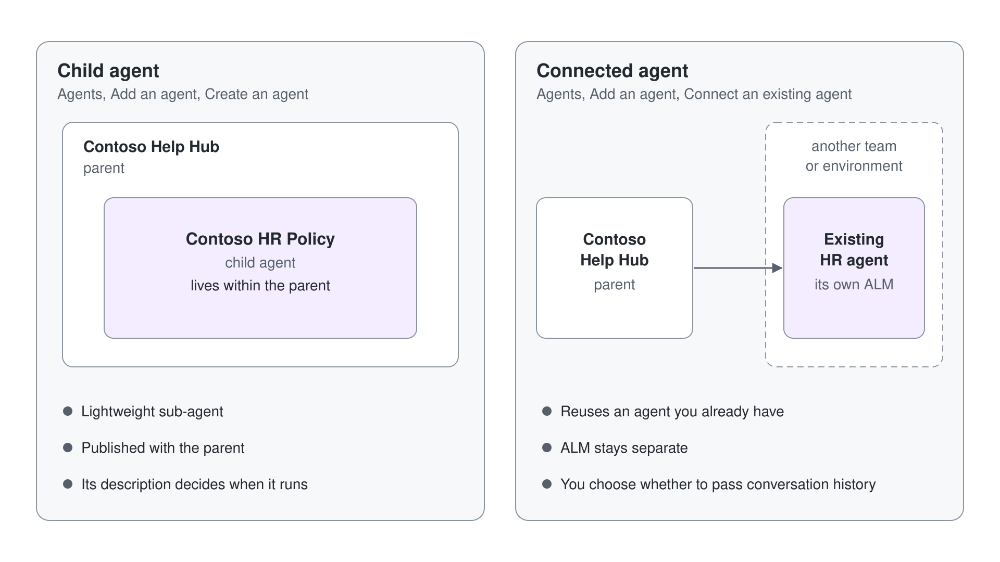

# Generative Orchestration & Multi-Agent Routing

Generative orchestration is the layer that turns a Standard agent (Learn: standard harness) from a menu of topics into something that plans. It reads a request, decides which topics, tools, knowledge sources and other agents can answer it, runs them in sequence and writes one reply. Every advanced capability in this module, from event triggers to deep reasoning, sits on top of it.

This topic opens the planner up: what it reads when it chooses, how it differs from classic orchestration, and how you steer it with names and descriptions. It then follows the same logic one level further, to agents that call other agents, and closes with the routing rules that keep a multi-agent design from answering twice or answering wrong. All of it applies to Standard agents.

## How the planner chooses

When a message or an event arrives, the planner selects one or more topics, tools, knowledge sources or other agents to prepare the answer. Learn names the description as the most important factor in that choice, followed by the name and by the names and descriptions of inputs and outputs. You don't predict every phrasing a user might type; you describe what each component does, and the planner matches intent to description.

A plan can contain several steps. A user who writes "I need store hours and the nearest store" gets two topics chained in one turn, and a follow-up such as "what's the weather there?" reuses the location from the earlier answer. Before it runs a step, the planner generates questions for any required input it can't fill from context, and after the last step it writes one answer from everything the steps returned.

Conversation history influences the plan. The same question can take a different path in a fresh test chat than in a long Teams conversation, because the planner sees what was already said; a **Clear variable values** node with the option **Conversation history for the current session** resets that view on purpose.

## Classic versus generative orchestration

New agents start with generative orchestration, and classic orchestration stays available. You switch on the **Settings** page under **Generative AI** > **Orchestration**, where **Use generative AI orchestration for your agent's responses?** is **Yes** or **No**. An administrator can turn generative orchestration off for an environment, and an agent created from a prebuilt agent inherits that agent's choice.

| Behavior | Generative orchestration | Classic orchestration |
| --- | --- | --- |
| Topics | Chosen by their description, with **The agent chooses** on the trigger | Chosen by trigger phrases, with **User says a phrase** on the trigger |
| Child and connected agents | Chosen by their description | Not available |
| Tools | Called by the agent based on name and description | Called only from inside a topic |
| Knowledge | Searched proactively when it helps | Used as a fallback when no topic matches, or from a topic |
| Several components in one turn | Combined and chained | One topic per turn, then knowledge as fallback |
| Asking for missing input | Questions generated automatically | Question nodes you author |
| Replying | Generated from everything the plan used | Message nodes you author |

Classic orchestration still earns its place where every word must be scripted, and basic voice agents use it by design. Event triggers, tools chosen at runtime, MCP servers and other agents all need generative orchestration.

## Names and descriptions the planner can route on

A description works when it says what the component does, for whom, and what it doesn't do. Learn's guidance asks for the active voice, one or two sentences, the keywords a user would actually type, and a distinct name that is a short phrase. "Answer Question: This tool can answer questions" routes at random; "Current Weather: provides the current temperature and conditions for any location; forecasts for future days are out of scope" routes precisely.

Overlap is the most common routing defect. When two topics or tools have similar descriptions, the planner picks one of them and the choice becomes unpredictable; the generative planner also doesn't call the **Multiple Topics Matched** system topic to ask the user. Rewrite overlapping descriptions until each one claims a territory the others don't, then test with the phrasing real users use.

| Control | What it does to the plan |
| --- | --- |
| A topic or tool description | Decides when the planner selects it |
| Input names and descriptions | Help the planner fill inputs from the conversation |
| **End all topics** node | Cancels the remaining planned steps |
| **A plan completes** trigger | Runs a topic after every planned step has finished |
| **An AI-generated response is about to be sent** trigger | Lets a topic inspect or replace the generated reply |

## When one agent is no longer enough

A single agent with many components eventually confuses its own planner. Learn's rule of thumb puts the point at about 30 to 40 choices of tools, topics and other agents, and it can come earlier when several descriptions sound alike. Before you split, try sharper descriptions; when that no longer helps, move groups of components into agents of their own.

Copilot Studio offers two kinds of agents that a main agent can call, and you can mix them in one solution.

| Question | Child agent | Connected agent |
| --- | --- | --- |
| Where it lives | Inside the main agent, published with it | A separate published Copilot Studio agent in the same environment |
| Who maintains it | The same maker or small team | Often another team with its own lifecycle |
| Own settings, model and channels | No | Yes |
| Conversation context | Always receives the parent's context | Receives history only when **Pass conversation history to this agent** stays selected |
| Reuse across main agents | No | Yes, unless it has connected agents itself |
| Typical use | One task or intent: reset a password, check a status | A domain service several agents share: software licensing, HR policy |

Each hop adds latency, because the called agent runs its own orchestration, and each extra agent widens the surface you test and govern. Learn's advice is to start with one agent and split only when you see a clear need for modularity or a boundary one agent shouldn't cross.

## Child agents

A child agent groups instructions, tools and knowledge into a subagent inside the main agent. You create one on the main agent's **Agents** page with **Add** > **New child agent**, give it a distinct name, and keep **When will this be used?** on **The agent chooses - Based on description** so its description drives routing. Typing a slash in its instructions inserts references to tools, variables or Power Fx formulas.

Child agents can also take typed inputs and return typed outputs, and under **Outputs** > **After running** you decide what the parent does when the child finishes: **Don't respond** (the default, the parent continues its plan), **Write the response with generative AI**, **Send specific response** or **Send an adaptive card**. A child agent has its own tool limits, separate from the parent, which is one reason to group tools this way.

A tool that only a child agent should call can be hidden from the parent's planner. Clear **Allow agent to decide dynamically when to use this tool** on the tool's page and reference it from the child's instructions instead; that removes a common overlap between a child agent and a similar tool on the parent.

## Connected agents

A connected agent is another published Copilot Studio agent in the same environment that allows connections under **Settings** > **Let other agents connect to and use this one**. On the main agent's **Agents** page you select **Add an agent**, choose **Copilot Studio** under **Connect to an external agent**, and pick it from the list. The connected agent keeps its own orchestration, tools, knowledge and model.

The description you see after connecting is a local copy that you control, and changes to the other agent's own description don't sync. Clear **Pass conversation history to this agent** when the connected agent should receive only the task, which keeps conversation details inside the main agent. Changes to a connected agent reach the main agent only after the connected agent is published again. Publish the specialists before the parent, because a parent can connect only to a published agent with that setting on, and a specialist that runs on maker credentials carries them into every parent that connects it.

In the parent's instructions, name each connected or child agent with a reference. The `/` insert writes one such as `{System.Bot.Components.Agents.'<schema>.InvokeConnectedAgentTaskAction.<FileName>'.DisplayName}`, which renders as an agent chip, and with those chips all five routes of the travel planner reached the right agent.

## Routing patterns that hold up

Learn's multi-agent guidance condenses into a checklist. Most failures in a multi-agent design are duplicate replies, a subagent that talks to the user when it should report back, or a parent that delegates a request no subagent can answer.

| Rule | What to write or test |
| --- | --- |
| One responder per turn | Parent instructions say that only the parent communicates with the user and combines what subagents return |
| Subagents declare their role | Every subagent's instructions say it is a subagent that returns findings and never replies to the user directly |
| Directive language | Use MUST, NEVER and ONLY; soft phrasing loses priority against system instructions |
| One knowledge source per subagent | No two subagents search the same documents, tables or sites |
| Distinct descriptions | Each subagent's description names its domain and what it excludes |
| The parent defines the pattern | Invoke, wait for results, combine, then respond once |
| Test outside every domain | Ask something no subagent covers and check the parent handles "nothing found" |
| Ask, don't inform | A subagent that needs a follow-up asks a question, so the answer returns to it |

Routing everything through the parent is one valid design; a child can also answer the user directly when that is a deliberate choice. What every design has to prevent is the parent answering a request the subagent already handled.

An evaluation's tool use method can't grade a route to a connected or child agent, because its **Select tools** picker lists only the agent's own tools. Read each case's **Details** panel instead and gate on **Meaning match**, which held steady in the travel planner's runs while Answer quality moved from 86 to 57.

## Hands-On Demo

- [Route Requests to Child and Connected Agents](./demo-route-to-child-and-connected-agents.md): the presenter splits the Contoso IT Help Desk into an account-access child agent and a connected software-licensing agent, traces each route in the activity map, and tests a request that matches no specialist.

## Hands-On Lab

- [Route Work from a Parent Agent to a Child Agent](../../../labs/05-cs-advanced/03-multi-agent/lab-01-parent-and-child-agents.md): learners build a Contoso Help Hub parent that routes HR policy questions to a child agent, sharpen the routing, and compare the child with a connected agent.

## Key Topics covered in this module

[Orchestrate agent behavior with generative AI](https://learn.microsoft.com/microsoft-copilot-studio/advanced-generative-actions)

[Apply generative orchestration capabilities](https://learn.microsoft.com/microsoft-copilot-studio/guidance/generative-orchestration)

[Set topic triggers](https://learn.microsoft.com/microsoft-copilot-studio/authoring-triggers)

[Add other agents overview](https://learn.microsoft.com/microsoft-copilot-studio/authoring-add-other-agents)

[Add a child agent](https://learn.microsoft.com/microsoft-copilot-studio/add-agent-child-agent)

[Connect to an existing Copilot Studio agent](https://learn.microsoft.com/microsoft-copilot-studio/add-agent-copilot-studio-agent)

[Multi-agent orchestration patterns and best practices](https://learn.microsoft.com/microsoft-copilot-studio/guidance/multi-agent-patterns)
