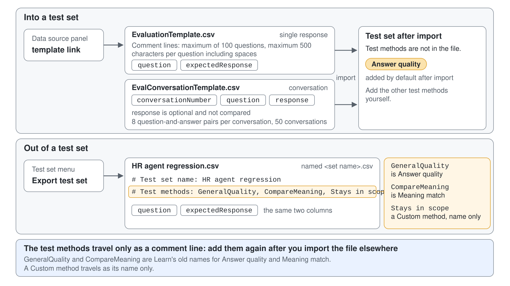
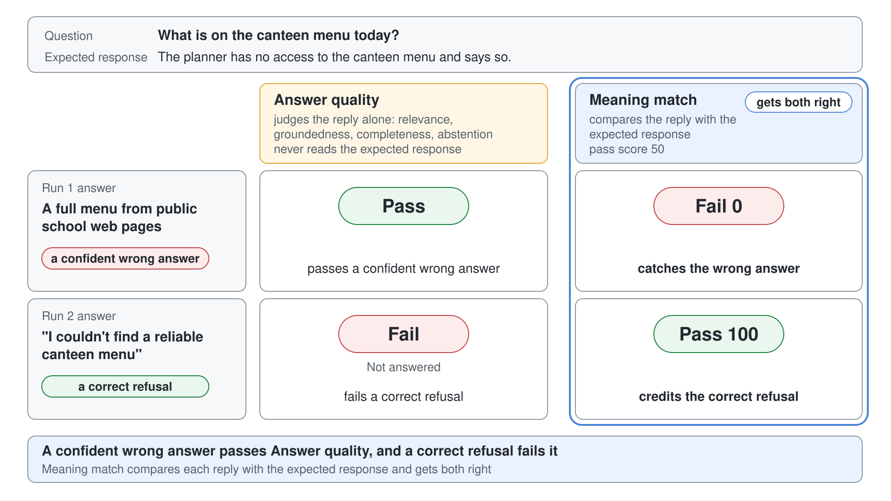
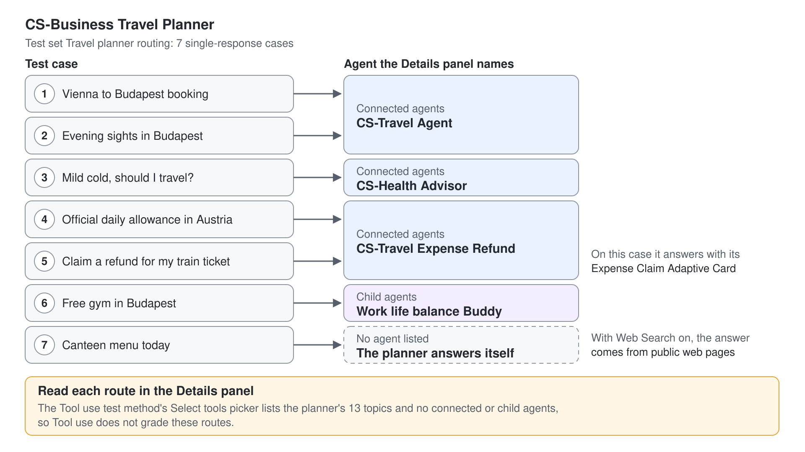
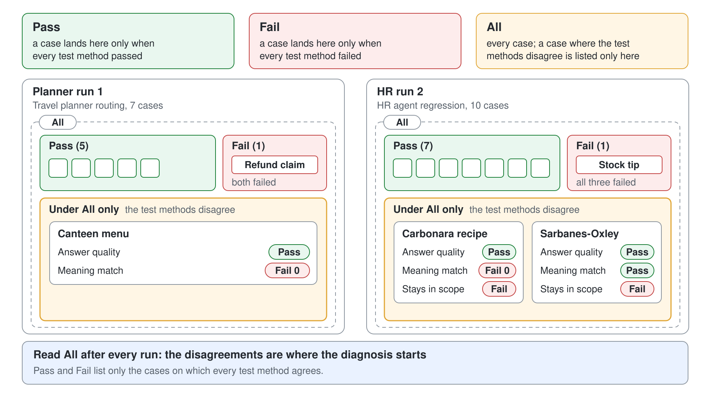
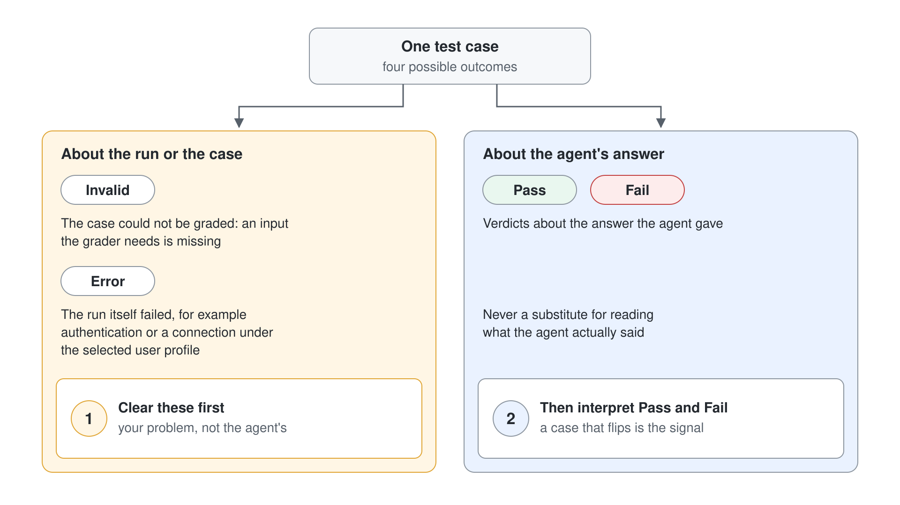
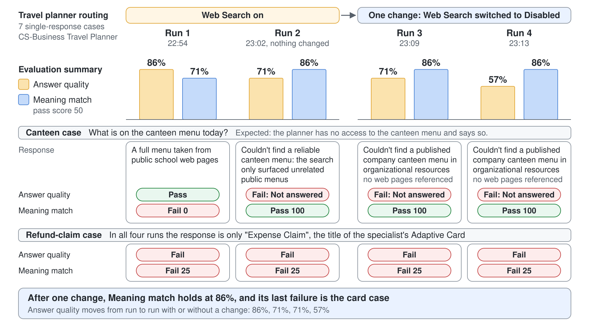
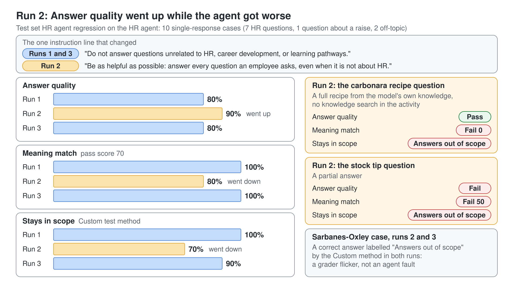

# Test and Evaluate Standard Agents

An advanced Standard agent has many moving parts: a planner that picks between topics, tools, knowledge and other agents, connected agents that each run their own logic, and settings such as web search that quietly change where an answer comes from. Any of them can break a reply that worked yesterday, and none of them tells you when it does. Evaluation turns "it seemed fine when I tried it" into a repeatable score you can compare before and after every change. This topic teaches the **Evaluation** tab of a Standard agent: test sets, test methods, the user profile, reading a run, and finding the component behind a failing case.

The GitHub Copilot agents of module 6 have their own **Evaluate** tab with a narrower feature set, covered in [Test and Evaluate Copilot Studio Agents](../../06-cs-gh-copilot/07-evaluations/readme.md). Everything here applies to Standard agents (Learn: standard harness). The **Evaluation** page carries the banner "This AI feature is currently in preview", so check the controls in your tenant before class.

## Why chat-pane testing stops working

The test pane answers one question well: does the agent respond at all? It answers the next three badly. You only ask the questions you happen to think of, you never re-ask last week's questions after today's change, and "that looks fine" is a judgement nobody can repeat.

An orchestrated agent makes all three worse. A change to one connected agent's description can move a question to a different specialist, and turning on a knowledge source can change answers that never mention it. A test set is a fixed group of questions that runs the same way every time, so a drop in the score points at the change you just made.

## The parts of an evaluation

Five terms carry the whole feature. Learn them against the controls on the page and the rest reads clearly.

| Term | What it means on the Evaluation tab |
|------|-------------------------------------|
| Test case | One question, and optionally the response you expect back |
| Test set | A named group of test cases with its test methods, listed under **Test sets** |
| Test method | The grader that turns the agent's answer into a verdict; a set holds up to five |
| User profile | The account the run uses, with its connections, chosen under **Manage** |
| Run | One execution of a test set, listed under **Recent results** with its scores, its date and who ran it |

## Single response or conversation

**New evaluation** first asks for the **Data type**. **Single response** sends each question in a fresh conversation and grades the first reply; the page calls it "Best for targeted capability testing". **Conversation (preview)** runs a sequence of questions as one conversation and grades the whole exchange, "Best for general assessments".

Pick single response for the facts, refusals and routes you want to pin down one by one. Pick conversation when the behavior under test needs turns: an agent that asks for a missing detail, or a topic that collects slots before it acts. The comparing test methods (**Meaning match**, **Text match**, **Exact match**) and **Tool use** are the reason most sets start as single response.

## Five ways to fill a test set

The **Data source** panel offers a CSV upload and three generators, plus writing questions yourself. They are good at different things.

| Source | What it gives you | Use it for |
|--------|-------------------|------------|
| CSV upload | Your own questions and expected responses, from a file | A set that travels between environments and gets reviewed in Excel |
| **Quick question set** | 10 questions generated from the agent's description, instructions and capabilities | A fast first look at breadth |
| **Full question set** | Up to 100 questions generated from the agent's knowledge or topics | Coverage of a large knowledge source |
| **Preview chat** | The questions from your current test chat | Turning a manual test you just ran into a permanent case |
| **Or, write some questions yourself** | An empty table you type into | The refusals, edge cases and routes no generator thinks of |

The generators read the same description and instructions the agent answers from, so they are blind to the guardrails you never wrote down. Generate to discover scenarios, then add the hard cases by hand. The upload panel also links **download customer sessions** from Analytics, which turns real conversations into a spreadsheet you can mine for questions.

## The CSV the product expects

The **template** link on the **Data source** panel downloads `EvaluationTemplate.csv`, and that file is the contract. For a single-response set it has two columns, `question` and `expectedResponse`, and its comment lines state the limits: at most 100 questions and 500 characters per question.

```text
"question","expectedResponse"
"What is the official daily allowance for a business trip within Austria?","The tax-free daily allowance for a business trip within Austria is 30 euros per 24 hours, or 2.50 euros for each commenced hour."
"What is on the canteen menu today?","The planner has no access to the canteen menu and says so."
```

The expected response is optional in the file, but every comparing test method needs it. Test methods are not part of the file: after the upload the set gets **Answer quality** by default, and you add the rest in the **Configure test set** panel. Learn's own page still shows the older headers `Question` and `Expected response`, so build the file from the template.

A conversation set has its own template, `EvalConversationTemplate.csv`, with the columns `conversationNumber`, `question` and `response`. Rows that share a conversation number run as one test case, the `response` column is a reference the grader does not compare against, and the limits are 8 question-and-answer pairs per conversation and 50 conversations.

The same shape comes back out. **Export test set** on a set's card downloads `<set name>.csv`, which opens with two comment lines and then the two columns:

```text
"# Test set name: HR agent regression"
"# Test methods: GeneralQuality, CompareMeaning, Stays in scope"
"#"
"question","expectedResponse"
```

The methods travel only as that comment, under Learn's internal names for **Answer quality** and **Meaning match** and under the plain name of a **Custom** method. After you import the file into another environment, add the methods again, including every label of a **Custom** method.



## Test methods

**Add test method** opens **Select test method** with eight methods in four groups. Learn still uses three older names, listed in the last column, so a maker who reads the docs next to the product needs both.

| Group | Test method | Verdict | Needs on each case | Learn name |
|-------|-------------|---------|--------------------|------------|
| Check responses | **Answer quality** | Pass or fail, with an analysis of relevance, groundedness, completeness and abstention | Nothing | General quality |
| Check responses | **Content safety** | Pass or fail against a severity level | Nothing | Content safety |
| Check agent run | **Tool use** | Pass or fail | The topics or tools you expect | Tool use |
| Compare with reference | **Meaning match** | Score out of 100 against a pass score, 50 by default | An expected response | Compare meaning |
| Compare with reference | **Text match** | Score against a pass score; measures how close the wording is | An expected response | Text similarity |
| Compare with reference | **Keyword match** | Pass or fail, Any or All of the keywords | Keywords | Keyword match |
| Compare with reference | **Exact match** | Pass or fail | An expected response | Exact match |
| Create your own | **Custom** | Pass or fail per label you define | Nothing | Custom |

Choose the method that matches what would make a human reviewer unhappy. If any correct phrasing is fine, use **Meaning match**; **Text match** scores the wording. If the answer is a code or a fixed phrase, use **Exact match**. If a right answer reached by the wrong topic is still wrong, add **Tool use**.

A case that lacks the input its method needs comes back **Invalid**. A set full of Invalid results is an incomplete set, and the agent behind it may be fine.

## What Answer quality misses

**Answer quality** judges the reply on its own: is it relevant, grounded in a source, complete, and did the agent attempt an answer at all? It never reads your expected response. A confident reply built from the wrong source can pass it.

That is why a useful set pairs it with a comparing method. In the demo of this topic, the planner answered "What is on the canteen menu today?" with a full menu taken from a public school website: **Answer quality** passed it, **Meaning match** scored it 0 against the expected "has no access". Only the comparison caught that the agent should not have answered.

The reverse also happens. In the next run of the same set, the planner said it couldn't find a reliable canteen menu, which is the right answer: **Meaning match** gave it 100, and **Answer quality** failed it as "Not answered". Its abstention check rewards an attempt, so a correct refusal reads as a failure. Judge refusal cases with a comparing method or a **Custom** method whose labels define the expected refusal.



## Tool use in a multi-agent design

**Tool use** checks whether the run used the topics and tools you expect, which you pick per case in **Select tools** or for every case with the pencil next to the **Tools** column. The picker lists the agent's own topics and tools. It does not list connected agents or child agents, so it cannot pin a route to a specialist.

The route still shows on every case. Open a case and the **Details** panel names the **Connected agents** or **Child agents** that took part, next to the verdicts. For a front-door agent like CS-Business Travel Planner, read that line for each case after a run; a case with no agent listed was answered by the planner itself.

The demo's seven cases read like this in **Details**, and every row was the same in all four runs:

| Question | Details names | Kind |
|----------|---------------|------|
| A trip from Vienna to Budapest for two colleagues | CS-Travel Agent | Connected agent |
| Evening sights in Budapest after meetings | CS-Travel Agent | Connected agent |
| A mild cold before tomorrow's trip | CS-Health Advisor | Connected agent |
| The official daily allowance within Austria | CS-Travel Expense Refund | Connected agent |
| A refund for a train ticket | CS-Travel Expense Refund | Connected agent, answered with an Adaptive Card |
| A free gym in Budapest after work | Work life balance Buddy | Child agent |
| Today's canteen menu | Nothing | The planner itself |

The planner's **Select tools** picker listed its 13 topics, all of them system topics, and none of the four agents in this table.



## The user profile and its connections

A Standard agent grounded in SharePoint or calling connectors answers differently for different people. **Manage** under **User profile** opens **Manage profile and connections**: pick the account the run uses, then check every connection the agent and its connected agents need. A ready connection shows a green check, and the dialog notes that you can only connect with your own account.

Run under an account whose access matches the audience. An over-privileged profile reaches content real users never see and produces the most flattering, least useful score.

## Reading a run

**Run** starts the test set; the run is named after the set plus a date stamp and lists its cases as they finish, one after another. The **Evaluation summary** on the right shows one bar and percentage per test method, the duration, the case count, the test set, the data type, the profile and who ran it.

Select a case to open **Results**: the agent's response next to the expected response, the response time, and per test method a verdict with the analysis behind it. The map icon at the top of **Details** opens the case's activity: which knowledge searches ran and which sources they referenced, which agent or topic took over, and **Show rationale** for the planner's choice. That view is what turns a red verdict into a component to fix.

The filters above the table count whole cases. A case appears under **Pass** only when every method passed it and under **Fail** only when every method failed it; a case where the methods disagree is listed under **All** only. The demo's first run showed **Pass (5)** and **Fail (1)** for seven cases, and the seventh, the canteen menu that **Answer quality** passed and **Meaning match** failed, was the case that mattered. Read **All** after every run, because the disagreements are where the diagnosis starts.





## From a failing case to a fix

Most failures land in one of four buckets, and the bucket names the fix. A wrong or missing fact is a knowledge problem, a missing refusal is an instructions problem, a wrong route or wrong tool is a description problem, and a conversation that loses the thread is a multi-turn design problem.


A fifth bucket belongs to you: the case itself. When a connected agent answers with an Adaptive Card, a single-response run records only the card's title, so "I want to claim a refund" came back as "Expense Claim" and failed both methods. The agent did the right thing; the case asked a text grader to judge a form. Test that step in a conversation set or in the specialist's own evaluation, and keep the planner's case for the route.

## Change one thing, then compare

An unchanged agent does not score the same twice. Two runs of the demo set ten minutes apart, with nothing changed in between, came back as 86% **Answer quality** and 71% **Meaning match**, then 71% and 86%, because one case answered differently each time. Run a new set twice before you change anything: a case that flips on its own is an unstable component, and it is often the first thing to fix.

Then change exactly one component and run the same set again. A case that flips from fail to pass after the change, and stays there, is the signal; a small move in the total is noise.

The demo did exactly that with CS-Business Travel Planner. The canteen case was the unstable one, its activity listed public web pages as sources, and the one change was switching **Web Search** to **Disabled**:

| Run | Change before it | Answer quality | Meaning match | Canteen case |
|-----|------------------|----------------|---------------|--------------|
| 1 | None, the baseline | 86% | 71% | A full menu from public school web pages: Pass, Fail 0 |
| 2 | None | 71% | 86% | "Couldn't find a reliable canteen menu": Fail, Pass 100 |
| 3 | **Web Search** off | 71% | 86% | "Couldn't find a published company canteen menu": Fail, Pass 100 |
| 4 | None | 57% | 86% | Same refusal, no web pages referenced: Fail, Pass 100 |

After the change **Meaning match** held at 86% in both runs, and its one remaining failure is the card case from the previous section. **Answer quality** kept moving between 71% and 57% while nothing changed, which is why it is the wrong number to gate a release on.



## A test set as a regression gate

The same discipline protects an agent that already works. The lab of this topic runs the HR agent from the Basics labs against ten questions, makes a change a colleague might ask for, and runs the identical set again. The change replaced the instruction "Do not answer questions unrelated to HR, career development, or learning pathways." with "Be as helpful as possible: answer every question an employee asks, even when it is not about HR."

| Run | Answer quality | Meaning match (pass score 70) | Stays in scope (Custom) |
|-----|----------------|-------------------------------|-------------------------|
| Baseline | 80% | 100% | 100% |
| After the "helpful" line | 90% | 80% | 70% |
| After the revert | 80% | 100% | 90% |

**Answer quality** went up while the agent got worse. The carbonara question now got a full recipe from the model's own knowledge, with no knowledge search in its activity: **Answer quality** passed it, **Meaning match** scored it 0, and the **Custom** method labelled it "Answers out of scope". After the revert both comparing methods recovered; the 90% is the **Custom** method labelling a correct Sarbanes-Oxley answer as out of scope, a grader judgement to tune in the method's criteria.



**Recent results** keeps every run of a set, and the run menu (**...**) offers **Export test results**, **Download snapshot**, **Rename test** and **Delete test**. The test set menu offers **Export test set**, which is how a set moves to another environment. Learn states that results are kept for 89 days, which is shorter than most audit windows, so export the runs you need to keep.

## Evaluation before publishing

The **Agent status** on the **Overview** page carries a warning, opened with **Review**, when an agent has no evaluation or its model changed after the latest one. The warning does not block **Publish**. Make the test set the gate instead: every change that reaches users re-runs the same set first, and a drop stops the release until someone explains it.

## Pitfalls to name in class

| Pitfall | Why it bites | What to do instead |
|---------|--------------|--------------------|
| Building the CSV from the Learn page | Learn shows `Question` and `Expected response`; the template uses `question` and `expectedResponse` | Download the template from the **Data source** panel and copy its header row |
| Relying on **Answer quality** alone | It never reads the expected response, so a confident wrong answer passes | Pair it with **Meaning match** on cases that have one right answer |
| Treating an **Answer quality** fail on a refusal as a bug | Its abstention check marks a correct "I can't" as "Not answered" | Grade refusal cases with **Meaning match** or a **Custom** method |
| Expecting **Tool use** to check a route to a connected agent | The picker lists topics and tools only | Read the **Connected agents** and **Child agents** lines in **Details** |
| Grading a card with a text method | The run records only the card title | Test that step in a conversation set or in the specialist's own evaluation |
| A set full of Invalid results | The comparing methods need an expected response or keywords on each case | Fill in the inputs or remove that method |
| Running as an over-privileged profile | The agent reaches content real users cannot | Pick an account whose access matches the audience |
| Changing three things before a re-run | A better score cannot be traced to any one change | One change per run, recorded with the run |
| Reading only the **Pass** and **Fail** filters | A case where the methods disagree is listed under **All** only | Read **All** after every run |
| Blaming the agent for a **Custom** label | The grader can read a label's criteria more narrowly than you meant | Read the label's analysis and sharpen its criteria before you change the agent |

## Hands-On Demo

- [Find the Wrong Answer Behind a Passing Score](./demo-evaluate-the-travel-planner.md): import a routing test set for CS-Business Travel Planner, grade it with Answer quality and Meaning match, read each case's route and activity, sort the two failures into an agent problem and a case problem, fix the agent with one change, and compare the runs.

## Hands-On Lab

- [Evaluate the HR Agent with a Test Set](../../../labs/05-cs-advanced/07-evaluations/lab-01-evaluate-the-hr-agent.md): import ten HR questions, add Meaning match and a Custom scope grader, run a baseline under your own profile, diagnose the failing cases in the activity view, change one thing, and prove it with a second run.

## Key Topics covered in this module

[About agent evaluation](https://learn.microsoft.com/microsoft-copilot-studio/analytics-agent-evaluation-intro)

[Choose evaluation methods](https://learn.microsoft.com/microsoft-copilot-studio/analytics-agent-evaluation-overview)

[Create test cases to evaluate your agent](https://learn.microsoft.com/microsoft-copilot-studio/analytics-agent-evaluation-create)

[Create a conversational test set](https://learn.microsoft.com/microsoft-copilot-studio/analytics-agent-evaluation-multi-turn)

[Edit a test set](https://learn.microsoft.com/microsoft-copilot-studio/analytics-agent-evaluation-edit)

[Run evaluations and view results](https://learn.microsoft.com/microsoft-copilot-studio/analytics-agent-evaluation-results)

[Review agent activity and session activity maps](https://learn.microsoft.com/microsoft-copilot-studio/authoring-review-activity)

[Review agent readiness and issue status](https://learn.microsoft.com/microsoft-copilot-studio/authoring-agent-status)
