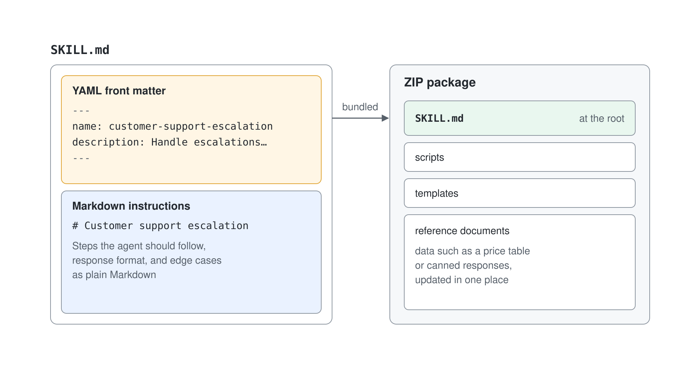
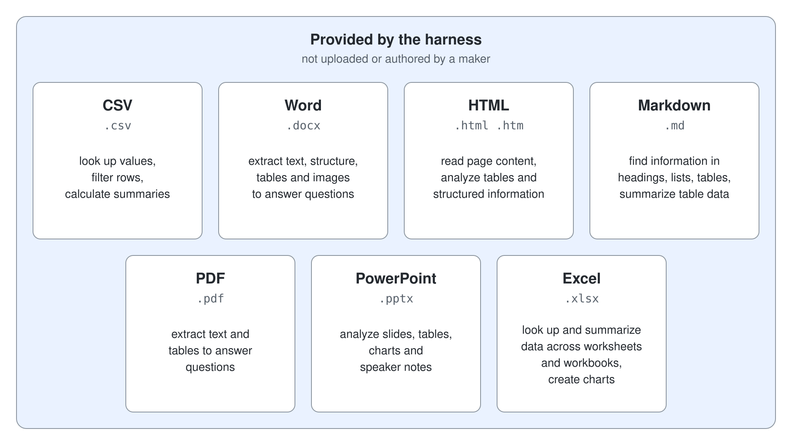

# Agent Skills in Copilot Studio

Skills are the standout addition of Microsoft Copilot harness agents and the strongest tie to the rest of this course. A skill is a reusable capability defined by a name, a description, and Markdown instructions, stored as a `SKILL.md` file. Because it uses the same Agent Skills open format as Claude Code and GitHub Copilot, a skill a maker or developer already wrote can be uploaded straight into a Copilot Studio agent.

For makers, the key idea is separation of concerns. Instructions set the agent's general behavior, knowledge grounds it, tools connect it to services, and skills package focused task recipes the agent activates only when a request matches. This keeps a complex agent modular: each part has one job.

## What a skill actually is

A skill is a focused task recipe the agent activates only when a request calls for it. It carries three things: a name, a description, and Markdown instructions that spell out how to handle one specific task or scenario. Think of it as the difference between a general job description (your agent's instructions) and a step-by-step playbook for one recurring situation.

The instructions can be as simple as a numbered method and a response format, or as rich as a full playbook with edge cases. The agent reads them the way a new team member would read a one-page how-to before answering that particular kind of question.

## The SKILL.md file format

A skill lives in a single `SKILL.md` file. The top of the file is YAML front matter (the `name` and `description`) fenced between two `---` lines; everything below is plain Markdown that describes the behaviour. When a task needs supporting material, you bundle the `SKILL.md` together with scripts, templates, or reference documents into a ZIP, with `SKILL.md` at the root.



Keeping the data (a price table, a set of canned responses) in a reference file means you update it in one place without rewriting the recipe. The instructions stay short and readable; the details stay maintainable.

## Loaded on demand, driven by the description

Only the name and description of each skill sit in the agent's context by default. The full instructions load just-in-time, when the orchestration runtime matches an incoming request to the skill. That on-demand loading is what lets an agent carry many skills without bloating every single turn with instructions it rarely needs.


Because the runtime decides activation from the description alone, the description is your activation dial. Pack it with the exact words a real request would contain (the caller's vocabulary) and say both what the skill does and when to use it. If a skill fails to fire, widen or narrow the description before you touch the instructions.

## Where skills come from and where they are saved

On the Build tab of a Microsoft Copilot harness agent, **Skills** > **Add skill** offers three ways in. **Generate with AI** takes a description of the skill you want, asks follow-up questions, and hands you the result to view, download or **Add to agent**. **Create from blank** asks for a name (lowercase letters, numbers and hyphens), a description and Markdown instructions. **Upload a skill** takes a `SKILL.md`, or a ZIP with `SKILL.md` at its root plus scripts, templates and reference documents.

Portability is the payoff of the shared open format. A skill a maker or developer already wrote for Claude Code or GitHub Copilot can be uploaded straight into a Copilot Studio agent, and **Download** gives back the Markdown file named after the skill, so a skill authored here can travel the other way. To change an uploaded skill, edit the file in your own editor and bring it back with **Replace**.

A skill is saved inside its agent, each skill in its own folder, so two skills in one agent can't share a name, and it moves with its agent through solutions and ALM. The skills marketplace (preview) is where one skill reaches several agents: **+** next to **Skills** > **Browse skills (preview)** lists the skills that admins or skill owners in your organization shared, and **Add** gives the agent a snapshot that keeps a reference to the original. Copilot Cowork keeps its custom skills somewhere else: in your OneDrive at `Documents/Cowork/skills/<name>/SKILL.md`, where Cowork finds them at the start of each session.

Plugin registry support for Copilot Studio is announced for a later release.


## Built-in skills

Not every skill is one you add. The GitHub Copilot harness brings built-in skills for analyzing document and data files: CSV, Word, HTML, Markdown, PDF, PowerPoint and Excel. Each contains task-specific instructions and supporting resources, and the agent picks the relevant guidance as it works on a request, so a question about an uploaded workbook or slide deck needs no skill of your own.



Your own skills add task guidance or domain expertise on top of the built-in ones. Skills provide instructions; packages provide the code libraries the agent uses for file and data operations.

## When a skill doesn't load

Copilot Studio checks every skill when it loads the agent, and a skill that fails a check is skipped while the rest of the agent still loads. The usual causes are invalid YAML front matter (quote a value that contains a colon), a missing `name` or `description`, a description too long for the catalog the model reads, two skills with the same name, and a `SKILL.md` that isn't saved as UTF-8 without a byte-order mark. If the agent behaves as though a skill isn't installed, check the Skills panel first, fix the file, then upload it again.

## Skills versus tools

Skills and tools solve different problems and work best together. A tool connects the agent to an external service or data source; a skill is self-contained instructions with no live connection of its own. A skill can, however, direct the agent to use a specific tool in a particular way, which makes the two complementary.


## Skill file shape

```markdown
---
name: customer-support-escalation
description: Handle escalations when a customer reports a blocked or urgent issue. Collect the case details and route to the right queue.
---

# Customer support escalation

Steps the agent should follow, response format, and edge cases go here as plain Markdown.
```

## Hands-On Demo

- [Add and Tune an Agent Skill](./demo-03-add-a-reusable-skill.md): the maker uploads a `SKILL.md`, tests activation in Preview, and refines the description until the skill fires only on the right requests.

## Hands-On Lab

- [Package Team Knowledge into a Portable Skill](../../../labs/06-cs-copilot-harness/03-agent-skills/lab-01-portable-skill.md): capture repeatable objection-handling guidance as a ZIP-packaged skill, then prove it is portable by reusing it on a second agent.

## Key Topics covered in this module

[Skills overview for agents](https://learn.microsoft.com/microsoft-copilot-studio/agents-experience/skills-overview)

[Create a skill for an agent](https://learn.microsoft.com/microsoft-copilot-studio/agents-experience/skills-create)

[Add an existing skill to an agent](https://learn.microsoft.com/microsoft-copilot-studio/agents-experience/skills-add-existing)

[Manage and delete skills in an agent](https://learn.microsoft.com/microsoft-copilot-studio/agents-experience/skills-manage)

[Introducing the plugin registry](https://techcommunity.microsoft.com/blog/microsoft-copilot-blog/introducing-the-plugin-registry---one-place-to-discover-and-govern-plugins-for-m/4559682)
