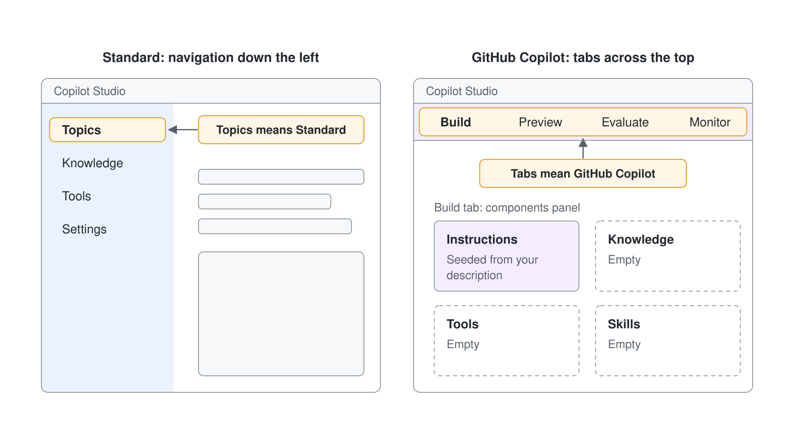

# Standard vs. GitHub Copilot Agents

In June 2026 Microsoft shipped a rebuilt Copilot Studio as a production-ready preview and rolled it out worldwide. It runs beside the established authoring model, so one tenant now holds two kinds of agent: Standard agents (Learn: standard harness) and GitHub Copilot agents (Learn: GitHub Copilot harness). This topic gives makers a clear mental model of what differs and, above all, how to tell which kind of agent they are working on before they change anything.

The teaching goal is transfer. Students learn Standard agents first, the kind most production agents and ALM pipelines use today (Topics, Knowledge, Tools, Settings), then meet GitHub Copilot agents beside them so every concept carries over. In this course, Standard agents are the primary track and GitHub Copilot agents run as guided demos and labs.

### What launched

GitHub Copilot agents bring three changes a maker notices at once. An enhanced orchestration runtime reasons and plans across steps on every turn. Authoring is natural-language-first: you describe the agent's job and connect what it needs. One **Build** tab gathers instructions, knowledge, tools, skills, model, connected agents and memory, while Standard agents keep working unchanged.

Learn calls the runtime behind each kind a harness. The standard harness follows the topics, rules and paths you define, which suits help desk agents that must answer the same way every time. The GitHub Copilot harness takes a goal, breaks it into steps, calls tools across connectors, knowledge, MCP and connected agents, recovers when a step fails, and creates or edits Word, Excel, PowerPoint and PDF files. A third harness, the Copilot chat harness, extends Microsoft Copilot Chat with your organization's knowledge.

The name points to technology shared with GitHub Copilot. Learn states that the GitHub Copilot harness is a Copilot Studio authoring and orchestration framework and that customer data isn't sent to or processed by the GitHub Copilot service. The usual Copilot Studio privacy, security, compliance and data residency commitments apply.

### Choosing when you create an agent

You pick the kind of agent when you create it, from the **New agent** menu on the **Agents** page. Under **Optimize your business processes**, **Agent** with the **GitHub Copilot** badge creates "an agent to take actions and answer questions". Under **Other ways to build**, **Agent** with the **Standard** badge creates "an agent with predefined rules and flows".

Existing agents open from the **Agents** list, where each Standard agent is marked Standard. You also reach Standard agents and agent flows through **...** at the bottom of the side bar and **Open classic experience**.

> **Note:** Some Learn pages for Standard agents still begin with "Turn off **New experience**". When your tenant shows the **New agent** menu, use it: the result is the same Standard agent.

### Telling the two kinds apart

The fastest tell is the agent's own navigation. A Standard agent opens on an **Overview** page, with pages such as Knowledge, Tools, Topics and Settings. A GitHub Copilot agent opens on the **Build** tab, with **Build**, **Preview**, **Evaluate** and **Monitor** across the top. If you see Topics, you are in a Standard agent.

Confirming which kind you are in before you build is the habit that prevents the most rework. A minute spent reading the navigation saves an hour of building in the wrong place.

### The one-way conversion rule

An agent created as one kind can't be moved to the other: Learn states that agents created with the GitHub Copilot harness can't be transferred to the standard harness, and the reverse holds too. The two run on different architectures. Standard agents use authored topics, triggers and branching; GitHub Copilot agents use instructions plus the reasoning runtime.

The practical consequence is simple: decide the kind before you invest in an agent. Rebuilding a mature Standard agent as a GitHub Copilot agent means authoring it again from scratch, and the same holds in reverse. Read the navigation, confirm the kind, then start building.

### When to choose which

Standard agents lead where you need deterministic control: authored topics and branching, a configurable orchestration mode (classic or generative), and features GitHub Copilot agents don't offer. Those include the prompt tool, custom entities, Azure AI Search knowledge, manual authentication, computer use, and the SharePoint, WhatsApp and Dynamics 365 Contact Center channels. Reach for a Standard agent when the conversation must follow an exact, auditable path.

Choose a GitHub Copilot agent for a greenfield agent that reasons over Microsoft 365 data, for longer multi-step work across several tools and files, and when you want Skills, memory and the enhanced orchestrator. Topics have a counterpart there: hooks run workflows at set points, such as when a session starts or before a tool runs. In this module, Standard agents stay the primary production track and GitHub Copilot agents run as guided demos and labs.

## Standard to GitHub Copilot at a glance

| Concept | Standard agent | GitHub Copilot agent |
|---------|----------------|----------------------|
| Create it | **New agent** menu, **Other ways to build**, **Agent** with the **Standard** badge | **New agent** menu, **Agent** with the **GitHub Copilot** badge |
| Navigation | Overview, Knowledge, Tools, Topics and Settings pages | Build, Preview, Evaluate and Monitor tabs |
| Authoring model | Topics, triggers, branching nodes | Natural-language instructions plus reasoning |
| Orchestration | Configurable (classic or generative) | Enhanced runtime, used for all agents |
| Reusable behavior | Topics, prompt tool | Skills, hooks |
| Convert to the other kind | Not possible | Not possible |
| Billing | Copilot Studio licensing for the standard harness | Usage-based Copilot Credits |
| Status | Generally available | Production-ready preview |

## Hands-On Demo

- [Build and Ground Your First GitHub Copilot Agent](./demo-01-build-and-ground-an-agent.md): the maker creates a Northwind Sales Assistant from the **New agent** menu, scopes it with Instructions, grounds it on a product document, and verifies a cited answer in Preview.
- [Tenant setup: Copilot Credits for GitHub Copilot agents and Work IQ](../../../setup/tenant-credit-setup.md): the one-time admin steps that give the environment and Work IQ the Copilot Credits every demo in this module consumes.

## Hands-On Lab

- [Compare Standard and GitHub Copilot Agents Side by Side](../../../labs/06-cs-gh-copilot/01-standard-vs-github-copilot/lab-01-compare-standard-and-github-copilot.md): the maker stands up a minimal Northwind assistant as a GitHub Copilot agent, contrasts it with a Standard agent, and records a per-agent decision that reinforces the **New agent** menu, coexistence, and the one-way conversion rule.

## Key Topics covered in this module

[Harnesses in Copilot Studio](https://learn.microsoft.com/microsoft-copilot-studio/harnesses-overview)

[Agents powered by the GitHub Copilot harness overview](https://learn.microsoft.com/microsoft-copilot-studio/agents-experience/overview)

[Access standard harness agents and agent flows](https://learn.microsoft.com/microsoft-copilot-studio/agents-experience/switch-experiences)

[Create a new agent (GitHub Copilot)](https://learn.microsoft.com/microsoft-copilot-studio/agents-experience/build-new-agent)

[What's new in Copilot Studio](https://learn.microsoft.com/microsoft-copilot-studio/whats-new)

[Meet the new Copilot Studio (announcement)](https://techcommunity.microsoft.com/blog/copilot-studio-blog/meet-the-new-copilot-studio-rebuilt-for-more-complex-multi-step-work/4526488)
