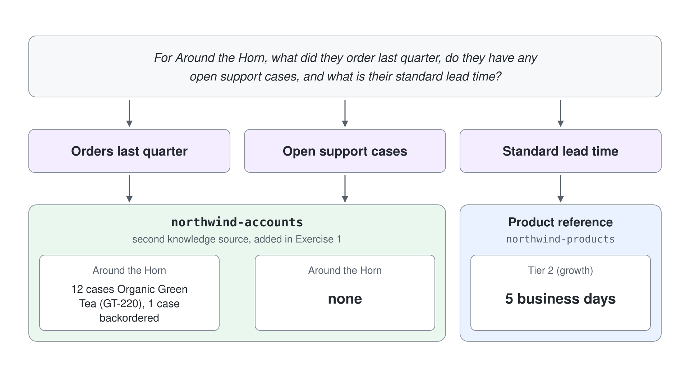

# Trace the Agentic Reasoning Loop

When a Northwind Traders seller asks one question that needs several facts at once (what an account ordered, whether they have an open case, and what their lead time is), the assistant should plan the work and pull from every relevant source in a single turn instead of answering half the question. In this demo you give the Northwind Sales Assistant a second knowledge source, ask a genuinely multi-source question, and then open the orchestrator's plan so you can see, trust, and debug how it reached the answer. You leave with an agent that reasons across sources and the skill to inspect that reasoning whenever an answer looks wrong.

## What you'll build

- A second knowledge source (account, order, and support-case data) added to the existing Northwind Sales Assistant, so the orchestrator has more than one place to look.
- A tested baseline that contrasts a single-source question with a multi-source one in the Preview tab.
- An inspected reasoning plan, read in the step list above the answer, that names each planned step and which source it searched.
- A post-hoc run review in **Preview** > **History** that confirms the chained actions and citations for one turn, with **Monitor** as the aggregate view.
- A reasoning instruction that forces deliberate, step-by-step planning, verified by re-asking and re-inspecting.

## Related Topics

This demo puts [The Unified Build Surface and the New Orchestrator](readme.md) into practice by exercising the single enhanced runtime that plans and reasons across multiple steps, then exposing that plan through the step list in **Preview** and the session transcripts in **History**. It builds on [Standard vs. GitHub Copilot Agents](../01-standard-vs-github-copilot/readme.md), because only GitHub Copilot agents run this one non-configurable orchestration runtime; a Standard agent would answer single-pass with one tool per turn and would not expose a chained plan.

## Prerequisites

- A Copilot Studio environment where you can create agents (a Power Platform environment with the maker role).
- GitHub Copilot agents available in your environment: on [copilotstudio.microsoft.com](https://copilotstudio.microsoft.com), the **New agent** menu on the **Agents** page offers **Agent** with the **GitHub Copilot** badge.
- The Northwind Sales Assistant you built in [Build and Ground Your First GitHub Copilot Agent](../01-standard-vs-github-copilot/demo-01-build-and-ground-an-agent.md), grounded on the product and account reference document, open on the **Build** tab. This demo continues that same agent; do not start a new one.
- The ability to upload a second file as knowledge (the exact content is provided in Exercise 1).

## Exercise 1: Add a second source so there is something to chain

The new orchestrator can only plan a multi-step answer when the agent has more than one source or tool to choose between. With a single knowledge document there is nothing to route across, so every answer is a one-hop lookup and the reasoning loop never has to plan. To see planning at all, you first have to create the conditions for it: a second, distinct source that holds facts the first document does not.

In this exercise you add account, order, and support-case data as a separate knowledge source. It deliberately overlaps on account names with the product reference from demo-01 but carries different facts, so a question about one account can only be answered fully by consulting both documents.

1. Create a file named `northwind-accounts.md` (or a Word document) with exactly this content:

```text
# Northwind Traders - Account and Order Reference

## Accounts
- Alfreds Futterkiste (Tier 1): region North, owner J. Berg.
- Around the Horn (Tier 2): region North, owner M. Diaz.
- Blauer See Delikatessen (Tier 3): region South, owner P. Novak.

## Recent orders (last quarter)
- Alfreds Futterkiste: 40 cases Cold Brew Concentrate (CB-100), delivered on time.
- Around the Horn: 12 cases Organic Green Tea (GT-220), 1 case backordered.
- Blauer See Delikatessen: 8 bags Dark Roast Beans (DR-330), delivered late.

## Open support cases
- Alfreds Futterkiste: case 4821, damaged shipment, open.
- Around the Horn: none.
```

2. On the **Build** tab, select **+** next to **Knowledge** in the right panel.
3. Drop your `northwind-accounts` document on **Drag and drop or click to upload**, then select **Add to agent** in the **Upload files** dialog.
4. After a minute or two, reload the page and select the new entry under **Knowledge**; the **Edit knowledge source** panel shows its **Status**.

Expected: **Knowledge** now lists the original product reference and the new `northwind-accounts` source, both with the status **Ready**, beside the default **Search all websites**. The agent now has two distinct places to look, which is the precondition for planning.

> **Note:** Keep the two documents separate rather than merging them into one file. The point of this demo is to watch the orchestrator route across sources, and it can only do that when the facts actually live in different places.

## Exercise 2: Establish a single-source versus multi-source baseline

Before you inspect any reasoning, you need two reference answers to compare: one question that a single document can answer, and one that no single document can. The contrast is what makes the plan visible and meaningful. A single-source question produces a short, one-hop answer; a multi-source question forces the orchestrator to gather facts from more than one place and stitch them together in one turn.

You will ask both in the Preview tab, which is where the agent behaves before anyone else sees it. Read the multi-source answer closely: a correct response weaves the order history, the support-case status, and the lead time into one reply, which is only possible if the agent consulted both documents.

1. Open the **Preview** tab, check that **Debug mode** is on, and select **New chat**.
2. Send this single-source question first:

```text
What is a case of Organic Green Tea, and what is the standard lead time for a Tier 2 account?
```

3. Read the answer; both facts come from the product reference alone.
4. Select **New chat** again, so the next answer runs its own searches, and send this multi-source question:

```text
For Around the Horn, what did they order last quarter, do they have any open support cases, and what is their standard lead time?
```

5. Read how the second answer combines facts that live in different documents.

Expected: the first answer is a compact reply drawn entirely from the product reference. The second answer names the Organic Green Tea order with the backordered case (from `northwind-accounts`), states that Around the Horn has no open support cases (from `northwind-accounts`), and gives the Tier 2 lead time (from the product reference), showing that one turn pulled from both sources.

## Exercise 3: Inspect the plan in the step list

An answer that looks right is not the same as an answer you can trust. With **Debug mode** on, every reply in **Preview** carries a step list above it that shows the steps the orchestrator ran and what each one searched for. This is how you move from hoping the agent chained sources correctly to confirming it did, and it is the first place you look when a multi-part answer drops or confuses a fact.

Reading the plan for a question you already understand teaches you what a healthy plan looks like, so that a broken one later is easy to spot. For the Around the Horn question, a healthy plan breaks the request into its parts (orders, support cases, lead time) and attributes each to the document that holds it.



1. In the **Preview** tab, find the multi-source answer from Exercise 2.
2. Above that answer, expand the step list, which opens with "Thought for N seconds" or "Reasoned through your request".
3. Expand each **Used tool: Searched knowledge** step. It shows the tool description, the sources it could search, an **Input** with the query it ran and an **Output** such as "[3 results]".

Expected: the step list shows one or more **Used tool: Searched knowledge** steps whose queries cover the parts of the question (orders, support cases, lead time), followed by **Used skill: analyzing-markdown** or **analyzing-docx**, the built-in skill that reads the found files. You can see the request was decomposed, not answered in a single undifferentiated pass.

> **Tip:** If the multi-source answer lists only **Used skill: analyzing-markdown** and no search, it ran in the same chat as an earlier question whose search had already loaded the files; that happened in the live run. Ask it again after **New chat**. If a search lists only one source, re-check the second source's status on the **Build** tab before assuming the planner failed.

## Exercise 4: Review the run after the fact in History and Monitor

The step list answers "how did this one reply happen" while you are watching. **History** keeps every Preview session, so you can debug routing after the fact instead of only in the moment, and **Monitor** adds the totals across sessions and channels. This matters because the questions that expose a bad plan are often the ones a colleague asked yesterday, not the one in front of you.

In this exercise you open the turn from Exercise 2 in **History** and read its activity, confirming from a second, independent view that the orchestrator really did chain multiple actions for a single question.

1. On the **Preview** tab, select **History**. The list filters by **All**, **In progress**, **Completed**, **Failed**, **Cancelled** and **Auth required**, with columns for **Name**, **Date**, **Channels**, **Status**, **Last step** and **Credits**.
2. Open the session that contains the Around the Horn question.
3. Read the **Activity** panel for that turn and the numbered citations under the answer.
4. Open the **Monitor** tab and read **Overview** and **Sessions**.

Expected: the **Activity** panel for that one turn lists the **Searched knowledge** steps, and the answer cites `northwind-accounts` and the product reference by number. **History** also shows what each session cost in credits. In the live run, **Monitor** counted the credits the Preview chats used under **Total credits used** but listed none of them under **Sessions** ("No sessions to show"), even hours later. Read single Preview runs in **History**, and use **Monitor** for totals and published channels.

## Exercise 5: Shape the plan with a reasoning instruction

Deep reasoning is applied automatically when the orchestrator judges a task complex, and you can force it on a specific behavior with the keyword reason. Adding a "reason step by step" instruction tells the runtime to plan deliberately (identify the account tier, then look up orders and cases, then summarize) rather than gathering facts in whatever order it lands on. Makers use this to make planning predictable for high-stakes flows, and to see how much the instruction changes the shape of the plan.

This is the lever that separates the new orchestrator from generative orchestration in a Standard agent. That orchestration is single-pass and picks one tool per turn, so there is no multi-step plan to shape; here you are directly influencing how deeply the runtime plans before it answers. You will add the instruction, re-ask the multi-source question, and re-open the step list to see the ordered plan the keyword produced.


1. On the **Build** tab, click at the end of the **Instructions** editor.
2. Add the following as a new line, then select the **Save** icon:

```text
When a seller names an account, reason step by step: first identify the account tier, then look up recent orders and open cases, then summarize.
```

3. Return to the **Preview** tab, select **New chat**, and re-send the multi-source question:

```text
For Around the Horn, what did they order last quarter, do they have any open support cases, and what is their standard lead time?
```

4. Expand the step list above the new answer and compare the plan to the one you read in Exercise 3.

Expected: a toast confirms "Your agent has been saved.", and the new step list shows a more deliberate plan: a thought that names the lookups, then **Ran 2 events in parallel** with one **Searched knowledge** query per part of the question. The answer follows your stated sequence (tier first, then orders and cases, then a summary); in the live run, a reply built this way was laid out as numbered sections in exactly the instructed order. Contrast this with generative orchestration in a Standard agent, which would select one tool for the turn and expose no chained, shapeable plan at all.

> **Note:** You do not configure the orchestration runtime itself; every new-type agent runs the same enhanced runtime. What you shape is how it plans, through instructions and the reason keyword, not through a settings switch.

## Troubleshooting

| Symptom | Likely cause | Fix |
|---------|--------------|-----|
| Multi-source answer drops the order history or the case status | The second source is still processing or was not added | On the **Build** tab, reload the page, open `northwind-accounts` under **Knowledge**, confirm its status is **Ready**, then re-ask |
| The step list shows no search for a multi-part question | The question ran in a chat whose earlier search had already loaded the files | Select **New chat** and ask the Exercise 2 multi-source prompt again |
| No step list above the answers | **Debug mode** is off | Turn on **Debug mode** at the top of **Preview** |
| **Monitor** shows "No sessions to show" | Monitor data arrives with a delay | Use **Preview** > **History** for runs you just made, and check **Monitor** later |
| The reason instruction did not change the plan | The line was not saved, or the keyword reason is absent from the text | Confirm the line in the **Instructions** editor contains the word reason, select **Save**, then re-ask in a **New chat** |
| Pages read Topics / Knowledge / Tools / Settings | The agent is a Standard agent | This flow needs a GitHub Copilot agent; return to [Build and Ground Your First GitHub Copilot Agent](../01-standard-vs-github-copilot/demo-01-build-and-ground-an-agent.md) and use that agent |

## Summary

You gave the Northwind Sales Assistant a second knowledge source, asked a question that no single document could answer, and then opened the orchestrator's plan in the step list and in **History** to confirm it chained both sources in one turn. You also shaped how deeply the runtime plans with a reason instruction and watched the plan change. You can now:

- Create the conditions for multi-step reasoning by giving an agent more than one source to route across.
- Contrast single-source and multi-source answers in the **Preview** tab to make a plan worth inspecting.
- Inspect a reply's plan in the step list and read what each search looked for.
- Review a past turn's chained actions and citations in **History** to debug routing after the fact.
- Shape the depth of planning with a reason instruction, and explain how that differs from the single-pass orchestration of a Standard agent.

Next, package a reusable set of instructions and actions the orchestrator can call as one unit in [Add a Reusable Skill to Your Agent](../03-agent-skills/demo-03-add-a-reusable-skill.md).
