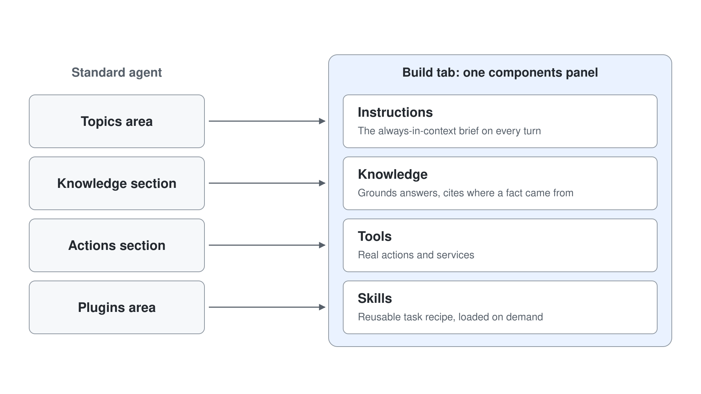

# The Unified Build Surface and the New Orchestrator

A GitHub Copilot agent collapses the scattered configuration of a Standard agent into one Build surface where instructions, knowledge, tools, and skills sit together. Behind it runs an enhanced orchestration runtime that every GitHub Copilot agent uses, with deeper reasoning and better answers over Microsoft 365 data. This topic teaches makers to read the new surface and to understand why the agent behaves differently from a Standard agent.

The pedagogical bridge is the component map. Everything a maker configured across the navigation areas of a Standard agent still exists; it just lives in a single consolidated view now. Show each Standard agent setting and where it moved so the knowledge transfers rather than resets.

### The four tabs

A GitHub Copilot agent is organized into four tabs across the top, and knowing what each one is for keeps a maker oriented. **Build** is where you author the agent: its identity, instructions, knowledge, tools, and skills all sit in one panel. **Preview** is the live test surface where you talk to the agent and watch it apply what you configured. **Evaluate** is where you score the agent against a repeatable test set instead of one-off chats, and **Monitor** is where you review real runs and activity after the fact.

The tabs read left to right in the order you actually work: build it, try it, measure it, watch it. A maker coming from Standard agents can map the familiar pieces here: the old Test pane became **Preview** and the old Analytics became **Monitor**, with **Evaluate** as its own tab for test-set scoring.

### The unified components panel

On the **Build** tab, everything that shapes the agent lives in one components panel instead of scattered navigation areas. Instructions replace the topic logic of a Standard agent and are the always-in-context brief the runtime reasons against on every turn. Knowledge sources ground answers in your own content so the agent can cite where a fact came from. Tools connect the agent to real actions and services, and Skills package a reusable task recipe the agent loads on demand.

Consolidating these four into one view is the heart of a GitHub Copilot agent. A maker no longer hops between a Topics area, a Knowledge section, an Actions section, and a plugins area; they compose the whole agent in a single place and see how the pieces fit together.

### Microsoft IQ and memory

From the same Knowledge component, Microsoft IQ connects the agent to organizational data (email, calendar, files, Teams messages, and people) without building a connector. Memory gives the agent persistent context across interactions, so it recalls a user's preferences and prior details over time. Both are configured in the components panel, and both deepen answers without any code.

### The enhanced orchestration runtime

Behind every GitHub Copilot agent runs a single enhanced orchestration runtime, and it is not a setting you choose. In a Standard agent you pick classic or generative orchestration; here the runtime is always on and plans across multiple steps on its own. That means one question can make the agent consult several knowledge sources and tools, then stitch the result into a single answer, which is why a GitHub Copilot agent behaves so differently from a Standard agent.

### Deep reasoning

The runtime decides on its own when a task is complex enough to reason deeply, spending more planning effort before it answers. You can also force it by adding the keyword reason to an instruction step, which makes the agent plan deliberately for a specific behavior. Deep reasoning is what turns a multi-part question into an ordered plan instead of a single-hop lookup, and it is the lever makers reach for on high-stakes flows.

### Testing with visibility

A GitHub Copilot agent makes its thinking visible so you can trust and debug it, not just read its final reply. In **Preview** you watch the agent apply instructions, call tools, and activate skills in real time, and Get rationale opens the plan behind any single answer. The **Evaluate** tab takes this further by scoring the agent against a fixed test set with graders, and the **Monitor** tab lets you reopen past runs to see exactly what the agent chained. Together these tabs give a maker measured confidence before publishing.

## Standard to GitHub Copilot component map

| Maker task | Standard agent | GitHub Copilot agent |
|------------|------------------|--------------|
| Define behavior | Topics and trigger phrases | Instructions on the Build tab |
| Add grounding | Knowledge section | Knowledge in the components panel |
| Add an action | Actions section | Tools in the components panel |
| Reusable capability | Topics or plugins | Skills in the components panel |
| Choose orchestration | Settings, orchestration options | Not applicable, enhanced runtime is always on |
| Test | Test pane | Preview tab |
| Review activity | Analytics | Monitor tab |

## Hands-On Demo

- [Trace the Agentic Reasoning Loop](./demo-02-trace-agent-reasoning.md): Add a second knowledge source, ask a genuinely multi-source question, then open Get rationale and the Monitor activity tracker to watch the orchestrator plan and chain across sources in a single turn.

## Hands-On Lab

- [Build, Evaluate, and Monitor a Northwind Sales Assistant](../../../labs/06-cs-gh-copilot/02-unified-build-and-orchestrator/lab-01-evaluate-and-monitor-agent.md): Compose an agent across the Build and Preview tabs, then score it with a test set on the Evaluate tab and review its runs on the Monitor tab.

Scoring the agent in depth is its own topic: see [Test and Evaluate Copilot Studio Agents](../07-evaluations/readme.md).

## Key Topics covered in this module

[Agents overview: orchestration and reasoning](https://learn.microsoft.com/microsoft-copilot-studio/agents-experience/overview)

[Harnesses in Copilot Studio](https://learn.microsoft.com/microsoft-copilot-studio/harnesses-overview)

[Use deep reasoning models for complex tasks](https://learn.microsoft.com/microsoft-copilot-studio/authoring-reasoning-models)

[Use Microsoft IQ in the new agent experience](https://learn.microsoft.com/microsoft-copilot-studio/agents-experience/use-microsoft-iq)
